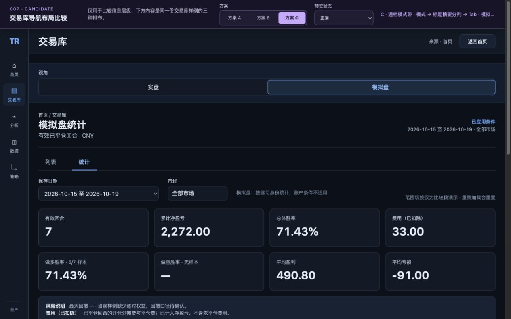
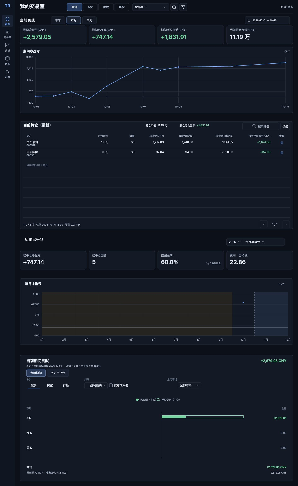

# Revision 10 独立验收

日期：2026-10-24。验收人：`revision10_acceptance`，未参与实现。仅写本报告及独立证据；未修改实现、生产数据或提交代码。

## 结论与边界

**当前候选阶段：Spec、质量、原型功能、交互、已检查视觉均 PASS。** 原型的 12 个模式组合及两个宽度已操作；最终修复按影响范围复验。首页正式 1440 源稿已与正式首页基线直接逐区对照。阅读器受影响评论、链接及首页 1280 嵌入由 root 在真实浏览器补验；本验收直接查看其最终截图与操作记录后确认通过。阅读器表格回归已修复，失败与复验记录保留。

**这不是最终需求全部完成。** C07 最终采用 A/B/C 哪个布局尚待用户选择；C08 最大回撤语义仍待用户决定，且样例缺少逐时权益，当前只能显示 `—` 和原因。不能宣称最大回撤已计算正确，也不能把静态 SVG/演示原型通过等同实际业务应用、写入持久化或回放闭环通过。

## 触发、范围与参考

触发：用户要求 C07–C10 静态设计修复后由独立 Agent 验收直到通过。依 `development-workflow.md`、`frontend-control-audit.md`、`ui-task-templates.md`，阅读本轮 PLAN、REVIEW、DESIGN-COVERAGE、三个实现报告和原始 `TRADING-LIBRARY-V10.json` 评论。

范围为本轮相对 `evidence/revision-10-repair-before/<repo-relative-files>` 的静态设计修改，不把工作树全部 dirty 纳入。包含 C07 候选导航、C08 模拟统计指标、C09 水平分布、C10 首页四张 1440 源稿；排除生产应用、业务数据库、旧阅读器未变化的全量控件和实体触摸。没有写库路径，因此数据库隔离与持久化验收 NOT APPLICABLE；触屏未测试，NOT VERIFIED，不能将鼠标/键盘证据充作触摸证据。

首页参考：`docs/design-system/baselines/2026-10-22-homepage-v2.5/source/images/home-1440.svg`。保留导航、卡片、表格、历史图、贡献区、色彩、密度和页面层级。允许真实 fixture 造成日期、金额、2 个持仓、图线变化。不存在本轮新建的 trading home-1280 源稿；1280 目标是阅读器内嵌同一 1440 SVG 缩放。

预览：[候选导航](http://127.0.0.1:3090/design-system/baselines/2026-10-22-trading-library-v1.0/navigation-options.html) · [设计阅读器](http://127.0.0.1:3090/design-system/baselines/2026-10-22-trading-library-v1.0/visual-spec.html)。验收时 3090 服务运行。

## 最终版本绑定

权威清单：`review-package.json`。本验收独立对其 57 个文件 SHA256 全量比对，零差异，最终见 `independent/final-package-after-table-fix.json`；前一冻结包记录保留于 `independent/final-verification.json`。

| 项目 | SHA256 |
|---|---|
| content fingerprint | `ce8873acaca197ac0cec3eda7f43221ce56c786066e6537fb073508f8e11b35d` |
| source prose | `40d4cfc9cb9d443270f41ff96c5a5b6902276e7f628d8c0c242ccbc6f53dbd63` |
| navigation-options.html | `69edf090a0634b761b1f5daf896a5f062a323bb6e73d012f87c5edafd59c0946` |
| homepage-template.py | `3b9b3bddc1be037e6180adc9535b75cb4f70ff7adfe7ad32554360078bd999cd` |
| generator | `8bf7fbe2e030ebb83f5ad4dc8e7f3543866b48c22b94a5806e9009fc62b36658` |
| fixture | `a4f244af153c8102b6b3b293208798fb99df156f2a5100ca274428febf6723ab` |
| handoff / journeys-home-entry | `a73aad6556698df58f01abc56d539e6eef09d4fefc07abb4012d85f6ef12434d` |
| library-return / journeys-library-return | `29a78527bb80bc28504d098b066210496538c6f6777c3ffc7698fbc3d828fd87` |

早期全组合截图绑定第一冻结包 content `d959551e33d9a455775a98bf4fb515b8ea098a9c2a4392d8f6b56be7fbf7da35`。该包 nav `fb5884de4b8cf853b6286ecaa43c4c199b50a49b54cd8c381e93fc0841cc8219`、home handoff `5d534b6ffa4ab99baa73e54f54c7ec4680c4b8e744d3c5cea45c6f53e71a0df6` 已被修复替代；缺陷截图保留，不将其冒充最终通过。

## 分门验收

| 门槛 | 当前候选结果 | 依据与限制 |
|---|---|---|
| Spec | PASS | C07 可比较三种层级且模式与内容一致；C08 方向分母/费用说明/无样本；C09 水平频数；C10 复用正式首页。布局决策和回撤定义仍 OPEN。 |
| 质量 | PASS | 审读 generator/home renderer/nav；实际 fixture 适配、时间比例、zero、空行、焦点问题均复核；5 个 home + 4 个 metrics 测试独立重跑成功；57 hashes match。测试数量不替代接口/视觉检查。 |
| 功能（原型） | PASS | 模式、Tab、日期条件记忆、分布单位与内容变化、加载/空/错误/正常均真实操作。无服务端持久化承诺。 |
| 交互（鼠标/键盘） | PASS | 各方案可点击；左右方向键切模式、Home/End 切 Tab，焦点保留；最终 C 按钮不再被状态选择器遮盖。 |
| 视觉（本报告已检查范围） | PASS | 原 24 组合；最终 1280 三方案直接浏览器复验，最终 1440 三方案由 root 捕获、本验收直接查看截图；首页 1440 整页直接对比；6 个指标/分布源稿直接查看。 |
| 阅读器受影响项 / 首页 1280 嵌入 | PASS（修复后） | root 真机操作，本验收直接查看最终表格上下截图、1280内嵌/100%原图/返回稿及C07–C10四截图；见补验记录。 |
| 实际业务应用 / 持久化 / 实体触摸 | NOT VERIFIED | 当前工作为设计候选，不能由本轮静态验收推导这些结论。 |

## 控件与状态覆盖

| 元素/旅程 | 场景 | 结果 | 证据 |
|---|---|---|---|
| `c07-scheme-a` + 模式 + Tab | A：实盘列表/统计、模拟盘列表/统计，1440/1280 | PASS | `independent/nav-a-{live,simulation}-{list,stats}-{1440,1280}.jpg` |
| `c07-scheme-b` + 模式 + Tab | B 同上四组合，两宽 | PASS | `independent/nav-b-*.jpg` |
| `c07-scheme-c` + 模式 + Tab | C 同上四组合，两宽 | PASS | `independent/nav-c-*.jpg` |
| 模式联动 | 标题、日期口径、账户条件、列表/统计数据同步；返回保持各模式条件 | PASS | 原24截图、`nav-interactions.json` |
| `c07-date-range` | 实盘 fixture、模拟盘 long 切换回来仍各自保持 | PASS | `nav-date-retention-amount.jpg` |
| `c07-measure-rate/amount` | 真正切换区间与分布计数，模拟金额 `[1,1,0,1,4]` | PASS | 同上 |
| `preview-select` | loading/empty/error/normal；保留模式条件；空样本显示 `—` | PASS | `nav-preview-{loading,empty,error,normal}.jpg`、`nav-interactions.json` |
| 模式/Tab 键盘 | ArrowLeft 回实盘，Home 列表，End 统计；焦点随可见控件 | PASS | `nav-interactions.json`、实际 AX 复验 |
| 顶部候选工具栏 | 最终 1280 A/B/C 模拟统计逐个点击；TR 未遮挡 | PASS | `nav-final-{a,b,c}-simulation-1280.jpg`、`nav-final-regression.json` |
| 最终1440工具栏与布局 | root 真机1440逐个操作，本验收逐张查看三截图 | PASS | `root-final-nav-1440.json`、`root-final-nav-{A,B,C}-1440.png` |
| C08模拟指标 | 7 回合、2272净利、33费用、5/7做多胜率、做空无样本；回撤待口径 | PASS | `02-simulation-normal.jpg` |
| C09分布 | 金额/选中/空/极端/缺口相关源稿 | PASS | `03-distribution-selected.jpg`、`distribution-amount.jpg`、`06-empty.jpg`、`08-extreme.jpg`、`journeys-trend-gap.jpg` |
| C10普通首页 | 与 canonical 1440×2346逐区比较；金额与2持仓区别可解释 | PASS | `canonical-1440.jpg`、`handoff-final-1440.jpg` |
| C10返回焦点 | 首页仍active；交易库入口有独立焦点环 | PASS（视觉） | `home-return-final-1440.jpg`；两返回稿同hash |

以上无前缀的截图/JSON均在 `independent/`，root 文件在本报告同目录。早期 `nav-a-live-list-1440.jpg` 实际1425像素内容宽（1440减滚动条），1280对应1265，原两宽矩阵有效。最终 subagent viewport override 曾返回成功但实际仍1280×800，故 **`nav-final-*-1440.jpg` 不作为1440证据**，改由 root 最终1440证据补足。`handoff-1280.jpg` / `canonical-1280.jpg` 为直接SVG固有1440宽截图，不能当响应式证据；`home-return-focus-1280.jpg` 实际非焦点入口稿，也不作焦点证据。详见 `viewport-limitation.json`。

## 阅读器补验回归与最终复核

R20：root 在阅读器补验发现 BT02 候选链接段落误插尺寸表内，导致后续表格行显示为管道文本，当时判定 FAIL。现链接移至完整表后，`root-reader-table-final.png` 与 `root-reader-table-final-lower.png` 已逐张直接查看，8个数据行全部正常，`root-reader-table-final.json` 记录9行（含表头）、brokenP=0。失败图 `root-reader-table-before.png` 保留。

表修复前包归档为 `review-package-before-table-fix.json`，content `2fa1847445578e46b19888a73b9622530a5061dd790c184eaf13b144a9f3122a`。本验收将最终source中的段落反向移回旧位置，SHA精确复现旧source `542bc1e…`，证明最终source只移动此段落；仅source及5个派生产物hash变化，nav/home/metrics既有证据仍有效。最终57文件再次hash比对零差异。

root 在真实1280×900阅读器逐步切换首页入口和返回稿，嵌入的天然尺寸1440×2346图在450高容器内完整contain；本验收直接查看 `root-reader-home-final-1280.png`、`root-reader-home-return-1280.png`、`root-reader-home-original-1280.png`。缩略图完整且100%原尺寸弹窗可用（按原尺寸需要滚动），不将缩略文字可读性等同100%原图。

`root-reader-comments.json` 及 `root-reader-comment-C07/C08/C09/C10.png` 已读并逐张查看：四评论定位至当前对应图稿，原occurrence与当前occurrence保留，原图href指向 `review-records/2026-10-24-revision-10/originals/`，状态仍待评审。本轮未伪造评论解决状态。root实际点击候选链接到原型并返回；分布三帧实际切换证据为 `root-reader-distribution.json`，末帧下一步禁用符合边界。

阅读器与1280嵌入门槛修复后 PASS。root的操作证据和本验收的截图复核分开标注，不声称本验收亲自执行了root操作。

## 缺陷保留与复验

| 缺陷 | 位置（最终文件） | 修复后复验 |
|---|---|---|
| 候选工具栏高度变化，TR 被盖 | `navigation-options.html:33,46,229` | 固定72px并使用实测高度；1280与1440 PASS。 |
| R19：修TR后的回归，C按钮与preview重叠约50px，点击仍B | `navigation-options.html:38–41,169` | scheme-field独立220px，preview148px，间距18px；真实点C切换成功。保留 `nav-fixed-c-simulation-1280.jpg` 失败证据。 |
| 首页2真实持仓后6空行仍有查看图标 | `source/homepage-template.py:256` | 最终只剩2真实行入口；保留旧 `handoff-1440.jpg` 对比最终整页。 |
| 非连续日期按索引均分，刻度与点错位（root另发现） | `source/homepage-template.py:217–249` | 点/折线/刻度/竖网格同elapsed-day比例；10-07位于6/14范围（x689.71），10-15x1380；直接看最终图通过。 |
| fixture valuation.as_of接口、月份halfstep、zero位置、返回focus | `source/homepage-template.py:96,207,484` 等 | 真实fixture调用与测试、最终图复核通过；未仅依赖早期4tests。 |
| gap方向分母、金额桶、bar可见性/最小宽、mode事件祖先误命中、趋势图窄/点拉伸 | generator/nav相关修复 | source审读 + 原型真实操作 + gap/极端/金额截图复核通过。 |

C09 极端分布中两回合各50%，条形等长；空态频数为0但占比/胜率为 `—`，没有把缺失当0%胜率。gap示例做多5/5正确；收益分布与缺口时序的区分保留。费用已包含在净盈亏中，说明明确范围为已平仓开仓分摊费和平仓费、不含未平仓费用。

协调者补充记录：`ROOT-READER-ACCEPTANCE.md`；最终协调者版本记录：`root-final-version.json`。本独立报告最终结论与上述同一 content fingerprint 绑定。
