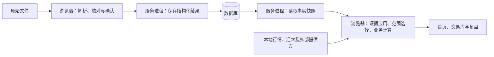

# 后端业务与数据设计：现状说明

**当前成交数据可以被保存和读取，但“事实仍在”“金额可算”和“页面成功展示”尚未形成清楚、稳定的责任链。** 本说明沿一笔交易的处理过程，解释现有系统做了什么、哪些条件影响展示，以及已知问题分别发生在哪一层。非技术审核人员可先读各章正文；函数、类型、协议和证据定位放在可展开的技术细节中。

**本文记录现状，不是目标规范，也不代表验收通过。** 事实边界是 2026-10-25 的工作树快照；本轮没有重跑性能或浏览器实验，涉及运行结果的结论沿用已有证据，并保留其适用范围。[目标设计审查稿](target-design.candidate.md)另行描述建议，不能据此推断现状已经修复。

<details>
<summary>技术细节：版本与证据基线</summary>

快照 HEAD 为 `58bf0d90e68ddc634de180b3f5c3d16a089f0eb3`。工作树含大量未提交与未跟踪开发文件，仅检出该提交不能复现本文状态。关键源文件指纹见[证据清单](../../.scratch/backend-design-wayfinder/evidence/source-snapshot.json)。本文未打开或写入业务库。

</details>

## 阅读前：术语说明 {#AS00}

**本文用“事实—证据—计算—展示”区分四类责任。** 先区分这些概念，才能判断一个检查结果究竟说明了什么；同一个“完整”不能跨层使用。

|术语|在本文中的意思|阅读时要保留的边界|
|---|---|---|
|成交事实|实际发生的买卖，包含账户、证券、时间、数量、价格等|统计和页面结果不能反过来改写它|
|辅助证据|月结单中的库存、费用、公司行动或账户事项等补充材料|可以影响数量或成本，但不一定是一笔成交，也不一定属于某只证券|
|证券身份／交易性质|前者确定是哪只证券；后者区分实盘、模拟或尚不能确认|显示名称不等于身份，性质不明不能自动视为实盘|
|回合|由相关成交形成的一段持仓和交易过程|它是根据事实计算的结果，不替代原始成交|
|持久化／事务|前者是把结果实际写入数据库；后者让关联修改作为一批成功或失败|页面提示成功不能代替实际保存|
|接口约定／协议|模块间交换信息的规则，包括输入、输出及错误含义|传输响应成功不等于业务内容有效|
|事实快照／读取凭据|一次一致读取的内容，以及说明读取范围、数量和内容绑定的记录|只能说明这一次读到了什么，不能证明历史材料全已导入|
|查询范围／选集|用户选择的账户、市场、性质、标的和期间，以及由此选出的记录|当前持仓时点、期间表现范围、历史回合范围各有用途|
|归属／承载成交|前者说明证据属于哪个账户、证券或期间；后者指现行实现把证据附在某笔成交上|没有承载成交，不自然等于证据无效或成交丢失|
|计算资格／覆盖|现有输入是否足以支持某项结论，以及输入覆盖了哪些对象和时间|数量已知、成本已知、价格齐备、历史起点完整是不同条件|
|页面读模型／发布|前者是为页面整理的结果；后者是接受并替换页面当前显示内容|计算完成仍需核对请求和范围；失败不能显示成真实空集合|
|处理对象／数据对象|前者执行一项职责，后者承载职责间传递的信息|是设计上的角色，不要求每个角色对应一个类或文件|

**汇率、行情和可知时间也要分开理解。** 行情是估值所用的市场价格，汇率用于币种转换；系统今天取得一条历史数据，并不能证明它在过去那个时点已经可知。当前市值也不等于购入成本，更不等于含现金的总资产。

<details>
<summary>技术细节：术语与现有代码用语对照</summary>

本文的“接口约定”对应 `Interface`，包括输入、输出、不变量、错误和调用约束；“读取凭据”对应 `receipt`；“全集资格”对应 `universe coverage`；“全历史覆盖”对应 `lifetime coverage`。“保留输入的计算句柄”对应 `prepared handle`，是进程内资源；“初始占位数据”对应 `seed`，不等于成功读取的空集合。

现有状态中的 `unknown` 表示不能确认，`blocked` 表示阻断，`not-wired` 表示尚未接入。它们不应被统一解释成“没有数据”。`FX` 为汇率；`Recall` 为复盘文档及其存储体系。本文所说的对象主要由 TypeScript 类型、函数和闭包实现，只有部分采用 class。

</details>

## 一、系统需要完成的功能 {#AS01}

**系统的核心任务，是把真实交易材料变成可核对、可追踪、可复盘的事实。** 用户确认导入结果后，应能查看交易、持仓和期间表现，进入某个标的的回合与复盘，再返回原来的范围。洞察、导出和策略研究消费这些事实，不改写原始成交。

|功能|用户需要获得的结果|
|---|---|
|导入与核对|按券商和材料格式解释成交，定位来源，识别冲突后确认保存|
|交易事实管理|保存证券、账户、性质、成交、必要的库存／成本证据及修订|
|首页与交易库|按账户、市场、性质查看交易，得到持仓、期间和历史统计，并知道哪些信息未知|
|行情与汇率|优先读取本地数据，必要时补齐外部数据，说明来源和时效|
|复盘与回放|还原已知成交与市场过程，保存复盘草稿和完成版本|
|洞察、导出与策略研究|从事实与复盘得到分析或导出，保持研究结果可追踪|

**当前业务范围以股票和交易型开放式基金成交，以及影响数量、成本的必要辅助证据为中心。** 完整的券商现金对账不是首页工作的前置目标；策略有设计文档，也不代表全部功能已实现。这些边界仍受[月结导入设计](../superpowers/specs/2026-09-07-monthly-statement-import-design.md)和[项目背景中的参考现金约定](../../CONTEXT.md)约束。

**展示规则要求系统如实表达未知和失败。** [首页现行设计](../design-system/baselines/2026-10-22-homepage-v2.5/source/visual-design.candidate.md)要求：未知金额不能写成零；缺行情或汇率时曲线断开；首次读取失败显示不可用；更新失败保留原数据；切换期间不改变当前持仓的最新时点。交易库仍以[现行交易库设计](../design-system/baselines/2026-10-22-trading-library-v1.0/source/visual-design.candidate.md)为参考。

**因此，系统需要分别回答六个问题。** 请求是否成功、成交是否可见、数量是否可信、金额是否可算、全历史是否完整、结果是否可以替换当前页面，不能由一次检查一起证明。当前代码已有部分对应概念，但职责尚未稳定分配。

<details>
<summary>技术细节：各项功能的现有承接位置</summary>

|功能|当前实现区域|
|---|---|
|导入与核对|`app/lib/import`、工作区导入编排、SQLite 写入|
|交易事实管理|`trades`、`storage`、`instruments`|
|首页与交易库|`reviews`、`homepage-v25`、`library`、工作区|
|行情与汇率|`market`、`fx`、存储与 API|
|复盘与回放|`replay`、`recall`、`reviews`|
|洞察、导出与策略研究|`insights`、`recall-export`；策略规格需另查实现状态|

</details>

## 二、领域和运行位置 {#AS02}

**业务处理分布在浏览器、服务进程和数据库中，不能只按服务器目录理解后端。** 当前浏览器解释原始文件，也承担大量持仓与财务计算；服务进程提供存储和外部数据入口；数据库保存成交事实、辅助证据、行情、复盘和设置。本文讨论这些非视觉职责如何协作。



**这张总图表示当前信息流，不表示每次读取都需要访问外网。** 文件目前在浏览器内解析，主要上传已经整理的结构化结果。以下职责表进一步说明每个领域拥有的知识，以及不能跨越的边界。

|领域|拥有的业务知识|向其他领域提供什么|职责边界|
|---|---|---|---|
|导入解释|版式、时间、行来源、成交和辅助项识别|候选成交、证据、排除项和问题|解析成功不等于用户确认或财务完整|
|交易与证券身份|稳定证券身份、交易性质、账户分组和回合|成交事实与交易集合|名称不是身份；现金事件不必属于证券|
|持久化与读取约定|事务、结构、关联、集合枚举和内容绑定|事实快照与写入报告|数据库读全不等于业务全历史完整|
|库存、财务与页面供数|证据应用、数量成本、估值和范围内结果|交易库条目及首页所需结果|事实存在不等于金额已知；未知不等于空集合|
|行情、汇率与资本参数|市场时段、价格覆盖、汇率证据、参考资本和现金基准|带来源和覆盖说明的数据|不拥有原始成交，也不决定页面何时发布|
|复盘与回放|决策、草稿、完成版本和可见信息截止点|复盘文档、摘要和回放状态|复盘输入不是成交修订|
|洞察、导出与策略研究|分析及派生结果|统计、标签建议、导出物和研究输入输出|不能用统计结果反推材料完整或改写事实|

**本轮只深入下一章所列数据链路，其他领域仅清点职责。** 因此，表内列出一个领域，不代表已完成内部实现审计；策略范围仍需对照[策略组合回测设计](../specs/2026-09-29-strategy-portfolio-backtesting.md)。

<details>
<summary>技术细节：运行拓扑与历史架构的适用边界</summary>

当前由浏览器、Node HTTP 和 SQLite 协作，“后端设计”范围大于 `app/api`。读取入口包括 `bootstrap` 与 `homepage-source`。[历史架构决策](../adr/0001-current-architecture.md)可说明演进背景，但其中的 Node 版本、端口与数据库默认值不是当前运行配置。

</details>

## 三、一条记录的完整生命旅程 {#AS03}

**一条记录需要经过解释、确认、保存、读取、证据应用、计算和发布，才成为用户看到的信息。** 每一步解决不同问题；前一步成功，不能直接替后一步作保证。

|阶段|输入 → 输出|这一阶段负责什么|
|---|---|---|
|识别与解析|文件 → 候选成交、辅助项和诊断|解释版式、时间、数量金额与来源，标明排除项|
|预览与确认|候选记录 → 用户确认的写入请求|处理分类、重复、冲突和时间选择；取消不写入|
|持久化|确认请求 → 保存或合并报告|校验证券与成交，在一次事务中合并导入历史和事实|
|一致读取|数据库 → 本次事实快照|在同一次读取中取得计数、集合、复盘摘要及转换缺口|
|传输校验|读取响应 → 已核对的集合|检查结构、关联、计数和内容是否匹配|
|辅助证据应用|成交与导入历史 → 带证据的成交和检查结果|按账户、证券建立关联；新路径另查证据是否有原成交承载|
|交易集合组装|成交、复盘和行情状态 → 交易库条目|形成证券、账户、性质、回合、复盘与派生摘要|
|首页采集与资格判断|集合、行情和汇率 → 可供计算的来源|核对输入绑定、时间、全集资格、筛选及全历史起止条件|
|业务计算与页面发布|已准备来源 → 金额、事实、持仓和页面结果|计算覆盖与金额，再核对请求、范围和超时条件|

**首页与交易库共享已保存事实，但等待的数据不同。** 当前交易库读取可以绕过首页所需的汇率与全证券日线等待；首页在交出一份完整结果前要组装更多依赖。因此，“交易库有历史成交，首页首次没有可用结果”可以同时发生，不能据此认定数据库丢失成交。[新旧依赖对照](../../.scratch/homepage-design-logic-review-2026-10-24/questions/Q02-LEGACY-HOMEPAGE-DIFF.md)记录了相关位置与证据。

<details>
<summary>技术细节：旅程中的函数、类型与入口映射</summary>

|阶段|当前处理对象／函数|数据对象或入口|
|---|---|---|
|解析|`parseBrokerStatement`、具体券商解析器|`StatementDispatchResult`、`StatementParseResult`|
|确认|工作区导入编排、预览、reconciliation|确认写入请求|
|保存|`SqliteStore.mergeTradeData`|`PUT /api/storage/trades`|
|读取|`getBootstrap`、`readHomepageStoredCollection`|`StorageBootstrap`、`HomepageStoredCollection`|
|传输解释|`createSqliteHttpClient.getHomepageSource`、`parseHomepageStoredCollection`|HTTP body、已校验集合|
|证据应用|`applyMonthlyHistoryEvidence`、`projectMonthlyHistoryEvidence`|挂载后的成交、inspection|
|集合组装|`buildTradeLibraryEntries` 等|entries|
|采集与资格|`prepareHomepageFinancialAcquisition`、`ownHomepageFinancialSource`|raw / owned source|
|计算与发布|财务投影、工作区、`useHomepageHost`|view、facts、holdings、页面包|

</details>

## 四、处理对象和数据对象 {#AS04}

**现有实现已覆盖主要处理步骤，问题集中在职责交界处。** 本章先说明每个模块对业务的作用和限制，再在技术细节中列出处理对象、数据对象及源码，供专业审查逐项核对。角色名称不要求对应同名的类。

### 4.1 导入解释模块

**导入模块负责解释材料，不能替用户确认，更不能把辅助材料伪造成交。** 它识别格式与券商，解释证券、时间和行来源，重组记录，并处理冲突与重新导入。

**合法材料不一定每行都有证券，也不一定含成交。** 例如，无成交月份仍可能有持仓快照；账户级事项也可能没有市场或证券代码。模块需要把候选、排除项、阻断原因和待核对问题交给下一步，分别检查原始字段缺失与业务含义缺失。

**来源可追踪仍不能证明历史材料齐全。** 文件指纹、文档标识和来源片段支持重导与核对，但不能据此宣称从历史起点到现在的全部事实已覆盖。

<details>
<summary>技术细节：导入处理对象、数据对象与来源</summary>

处理对象包括[材料分发器](../../app/lib/import/dispatcher.ts)、`BrokerStatementParser` 及各券商解析器、[时间解释](../../app/lib/import/statement-time.ts)、[成交核对](../../app/lib/import/execution-reconciliation.ts)、[月结重导](../../app/lib/import/monthly-reimport.ts)。入口和解析器约定见[导入合同](../../app/lib/import/contracts.ts)。

数据对象包括 `StatementInput`、`StatementParseResult`、`ParsedInstrumentCandidate`、`TradeExecution`、`MonthlyStatement`、诊断及排除项。`StatementPosition` 要求市场／代码；`StatementEvent` 允许缺省市场／代码，因为账户事件可能不属于证券，见[月结实际类型](../../app/lib/import/monthly-statement.ts)。解析可返回 `blocked` 和待确认问题。

</details>

### 4.2 交易事实、身份与修订模块

**本模块维护账户、证券、性质和成交的稳定关联，再从事实生成回合与交易集合。** 身份规范化、性质判断、去重、修订、回合构建和摘要各有作用；显示名称变化不能改变证券身份。

**金额暂缺不表示成交不存在。** 交易库条目的某项金额可以未知，成交集合仍然成立；同样，回合和统计是派生结果，不能替代原始成交。实盘、模拟和性质不明的数据也不能互相替换。

**历史诊断需要随实现变化更新。** 当前已有可信旧来源的性质兼容规则，不能继续把“历史 1,784 笔全部被排除”当作本快照的状态。

<details>
<summary>技术细节：交易身份、回合、修订对象与类型</summary>

处理对象见[性质判断](../../app/lib/trades/nature-resolution.ts)、[回合构建](../../app/lib/trades/episodes.ts)中的 `buildTradeEpisodes`、[交易库条目构建](../../app/lib/trades/library.ts)中的 `buildTradeLibraryEntries`，以及[成交修订](../../app/lib/storage/trade-revisions.ts)。

数据对象包括 `Instrument`、`TradeExecution`、`TradeEpisode`、`TradeLibraryEntry`、修订请求与报告。金额和数量使用 Decimal 字符串；来源保留时区、时间精度、页／行、费用和月结证据等信息，见[交易类型](../../app/lib/trades/types.ts)。交易性质中的 `live`、模拟与 `unknown` 不可偷换。

</details>

### 4.3 持久化与快照协议模块

**本模块保证数据按结构保存，并在声明范围内一致读取；它不能证明用户已经导入全部历史材料。** 当前职责包括配置与迁移、事务写入、数据映射、聚合读取、传输和兼容处理。

**读取凭据只约束本次快照。** 其中的读取标识关联本次操作，快照生成时间说明何时取得这份内容，摘要核对内容是否一致。三者都不等于数据库的持久版本，也不能证明证券历史起点完整，或历史汇率当时已经可知。

**现行配置与兼容路径必须分开使用。** 旧的浏览器本地保存方式已是迁移兼容，不能当作当前主写库方案；调试与写入验收也必须遵循项目配置和数据库隔离约定。本文没有打开或写入业务库。

<details>
<summary>技术细节：存储对象、快照字段、错误与运行配置</summary>

处理对象见[存储仓储](../../app/lib/storage/sqlite-store.ts)中的 `SqliteStore`、[数据库打开入口](../../db/sqlite.ts)中的 `openSqliteDatabase`、[读取快照](../../app/lib/storage/homepage-source-snapshot.ts)、[传输客户端](../../app/lib/storage/sqlite-http-client.ts)及[首页读取入口](../../app/api/storage/homepage-source/route.ts)。`import-transaction.ts` 和 localStorage 的 load/save 已标记为迁移兼容。

数据对象包括 `StoredInstrument`、`StorageBootstrap`、`ImportHistoryEntry`、`ExecutionMergeReport`、`HomepageStoredCollection`，见[存储类型](../../app/lib/storage/sqlite-contracts.ts)。首页响应 envelope 包含 bootstrap、Recall 摘要和 receipt；receipt 含枚举范围、计数、投影缺口、`receiptId`、`knownAt`、`payloadDigest`。前者是读取标识，中者是物化时间，后者绑定内容，均非持久数据库 revision，见[协议定义](../../app/lib/storage/homepage-source-contract.ts)。HTTP 503 目前只返回通用 `unavailable`，无法由响应定位内部异常。

配置权威是[配置说明](../../conf/README.md)、`runtime.json` 与固定原生环境。标准 `make dev` 使用业务库在线备份并固定监听 3333；浏览器写入测试须显式指定隔离数据库，不能新建工作树业务库替代共享业务库。

</details>

### 4.4 证据应用与资格模块

**当前实现把“证据能否附到原成交”与“计算是否可信”紧密相连，影响范围仍不够清楚。** 必要的月结证据被应用到成交后，再交给采集、选集和财务计算；这些职责目前分散在多个区域。

**局部归属问题可能影响整个集合。** 新的证据转换路径会把既未应用、也未停用的条目记为缺口；没有市场、代码的事件会产生未归属原因，其他事项和公司行动也可能保留未解决原因。采集层把这些原因汇总为全集资格未知，筛选后仍保留这份全局资格。

**全历史计算还缺少入口提供的起点证明。** 当前规则要求各组具备完整历史覆盖，生产采集入口却没有提供这些证明。无成交月份和账户事项本来是合法输入，因此还需审查：它们是否必须找到承载成交，以及不足究竟影响哪项指标、哪个范围。[规则与对照证据](../../.scratch/homepage-design-logic-review-2026-10-24/questions/Q02-LEGACY-HOMEPAGE-DIFF.md)保留了具体条件。

<details>
<summary>技术细节：证据转换、资格类型与资源生命周期</summary>

处理对象包括[月结证据转换](../../app/lib/import/statement-evidence.ts)中的 `projectMonthlyHistoryEvidence`、`inspectOriginalCarriers`、[采集句柄](../../app/components/homepage-v25/financial-acquisition.ts)和[首页来源持有器](../../app/components/homepage-v25/financial-source-model.ts)中的 `ownHomepageFinancialSource`。句柄调用 `complete` 或 `dispose` 会释放保留输入，完成后不能重用。

数据对象包括挂载后的 `TradeExecution`、证据 inspection、`StoredRepresentationReceipt`、`HomepageUniverseCoverage`、`LifetimeSourceCoverage`、`HomepageOwnedFinancialSource`。新 projector 中既未 `attached`、也未 `retired` 的条目形成缺口；`other`／公司行动可保留未解决原因。原因聚合为全局 `universe unknown`，全历史 `all` 范围要求每组 `lifetime` 证明；生产采集器目前传入空数组。

</details>

### 4.5 数量、成本、估值与页面投影模块

**本模块根据事实和证据重建数量、成本，再用行情与汇率计算金额和页面所需结果。** 内部包括持仓账本、期间起止点、覆盖判断、费用、筛选和结果整理。

**全集资格未知会限制部分金额与曲线，但这里并不直接删除证券或持仓行。** 因此，不能看到资格缺口就认定持仓对象已丢失，也不能把缺口数量直接解释为耗时原因。

**首页等待还涉及数据读取和计算的先后关系。** 全局采集先等待汇率和全部证券日线，工作区再计算页面视图、事实和持仓，之后才交给发布模块检查超时；需要分别核查等待、计算与最终接受结果的过程。

<details>
<summary>技术细节：账本、估值投影与版本类型</summary>

处理对象见[持仓账本](../../app/lib/replay/position-ledger.ts)中的 `preparePositionLedger`／`replayPreparedPositionBoundaries`、[期间计算](../../app/lib/reviews/homepage-v25-performance.ts)中的 `prepareHomepageV25Source`／`projectHomepageV25Boundaries`、[财务页面投影](../../app/components/homepage-v25/financial-view-model.ts)中的 `projectHomepageFinancialView`，以及[持仓模型](../../app/components/homepage-v25/holdings-model.ts)。

数据对象包括 `PreparedPositionLedger`、`CanonicalFactResult`、`HomepageV25PreparedSource`、`SourceRevisions`、`HomepageV25Metric`、`QuoteCoverage`、`FxCoverage`、`HomepagePeriodView`。Prepared handle、来源内容版本和页面请求 generation 用途不同。工作区计算 `view`／`facts`／`holdings` 后交给 host，host 再判断 deadline；全局 `unknown` 影响期间曲线和部分汇总金额，不在此处直接删除 instrument 或持仓行。

</details>

### 4.6 页面读取与发布编排模块

**本模块应保证页面只接受当前请求、当前范围的结果，并把失败与真实空数据分开。** 它根据网址和筛选发起读取，拒绝过期结果，成功时替换数据，失败时提供恢复状态；期间、历史范围和当前持仓时点不能混用。

**已有诊断发现：首次完整结果失败，可能被页面误呈现为“暂无持仓”或零。** 首次没有旧结果可保留时，初始占位内容仍为空；随后“初始化完成”被当作“数据就绪”。这属于失败与业务空集合混淆，传输成功或结构检查通过都不能排除它。[既有桌面和分段诊断](../../.scratch/homepage-design-logic-review-2026-10-24/REVIEW.md)及[传导机制](../../.scratch/homepage-design-logic-review-2026-10-24/questions/Q02-LEGACY-HOMEPAGE-DIFF.md)记录了证据。

**历史区还存在独立的未接入问题。** 当前首页的历史初始状态和全局结果都标记为尚未接线，重新读取会直接抛出未接线错误。历史区不展示不能全部归因于市场字段、资格或超时。

<details>
<summary>技术细节：页面状态对象、失败传导与历史未接线位置</summary>

处理对象见[工作区](../../app/components/trade-review-workspace.tsx)、[首页状态](../../app/lib/reviews/homepage-v25-state.ts)和[首页发布钩子](../../app/components/homepage-v25/use-homepage-host.ts)。数据对象包括 `HomepageRequest`、`HomepageScope`、`HomepageAttachments`、`HomepageSnapshot`、页面包及加载／错误状态；generation 与完整 scope key 均匹配才可发布。

首次失败时可保留 `source=null / view=null / EMPTY_HOLDINGS`，随后 `initialized` 被当作 `ready`。这是空 seed 与成功空集合的混淆。另见[工作区首页领域位置](../../app/components/trade-review-workspace.tsx:2286)：history seed 与全局结果均为 `not-wired`，`reloadHistory` 直接抛出“历史财务读取尚未接线”。这条实现缺口与首次超时分开记录。

</details>

### 4.7 其余领域的职责概要

**其余领域为主链提供数据或消费结果，本轮没有下探其内部合规性。** 行情失败不表示没有成交；持仓市值不包含全部现金；复盘有独立版本和信息截止点；洞察、导出和研究不能改写事实。

|领域|提供的结果|对主链的约束|
|---|---|---|
|行情与汇率|价格、汇率、覆盖和更新结果|来源、发布时间、系统观测时间与覆盖分别说明；外部失败不能解释成无成交|
|参考资本与现金|参考资本、现金基准及修订|持仓市值不等于含现金总资产|
|复盘与回放|复盘文档、完成版本、摘要和回放位置|保存处理版本冲突；市场与成交截止点约束未来信息|
|洞察与导出|分析事实、建议和导出物|消费资格明确的派生结果，不用统计修正来源|
|策略研究|规格中的研究职责|保留事实输入、模拟隔离和可追踪结果；不声明实现完成|

<details>
<summary>技术细节：其余领域的处理对象、数据对象与源码</summary>

|领域|处理对象与数据对象|来源|
|---|---|---|
|行情与 FX|`refreshMarketData`、provider router、覆盖／任务仓储；`MarketDataRefreshResult`、candle、coverage、FX observation|[行情服务](../../app/lib/market/market-data-service.ts)、[汇率合同](../../app/lib/fx/room-contracts.ts)|
|资本与现金|参考资本模型、现金基准仓储；基准与修订对象|[参考资本](../../app/lib/principal/reference-capital-model.ts)、[现金模型](../../app/lib/cash/cash-model.ts)|
|复盘与回放|Recall repository、回放引擎；`RecallDocument`、完成版本、摘要和游标|[复盘仓储](../../app/lib/recall/server-repository.ts)、[回放引擎](../../app/lib/replay/replay-engine.ts)|
|洞察与导出|insight engine、tag suggestions、export；分析事实、建议和 export manifest|[洞察引擎](../../app/lib/insights/insight-engine.ts)、[导出实现](../../app/lib/recall-export/export.ts)|

</details>

## 五、当前校验是怎样叠加的 {#AS05}

**当前校验共有六层，各层只能证明自己的结论。** 比如，读取内容与数据库一致，并不表示费用、行情和历史起点足以计算金额；计算条件不足，也不自动表示数据库读取有误。

|校验层|合理的问题|现有实现与缺口|
|---|---|---|
|输入解释|这一行是什么，来源与时间能否解释？|已有解析诊断、阻断和用户核对；部分辅助项合法地没有证券|
|持久化结构|对象是否能保存，关联是否合法，是否冲突？|已有结构检查、事务和合并／修订；通过不代表金额可信|
|读取与传输|声明范围内是否读全，内容是否一致？|已有快照、计数、结构和摘要核对；不证明业务历史完整|
|语义与范围|证据影响哪个账户、证券或指标？|承载成交检查与全集资格聚合耦合，影响范围表达不足|
|计算资格|数量、成本、费用、行情、汇率分别是否足够？|已有局部覆盖类型，仍受全集资格未知与缺少全历史输入限制|
|发布资格|是否当前请求，是否超时，能否替换旧结果？|已有请求、范围和截止检查；首次失败与空集合仍混淆|

**审查“严格还是宽松”之前，应先写清证明责任。** 每一层都要说明输入由谁提供、检查证明什么、不足影响哪里、下游如何展示。不能用一个“通过／不通过”概括整条链。

<details>
<summary>技术细节：六层校验的现有机制对照</summary>

输入解释使用解析诊断、`blocked` 和确认步骤；持久化层使用 store 校验、事务与 merge／revision；读取层使用 snapshot、count、shape、digest。语义层现为 carrier inspection 与 universe 聚合；计算层受 `unknown` 与 lifetime 输入约束；发布层核对 generation、scope、deadline。它们不是可互相替代的完整性证明。

</details>

## 六、问题树与证据边界 {#AS06}

**首页未展示至少涉及四条需要分开核查的路径，不能归为单一原因。** 现有同库对照没有发现传输丢成交；证据资格、首次结果发布、历史未接线则各有独立问题。以下问题树保留这些层次。

```text
首页交易／持仓未展示
├─ 一、事实读取是否丢失？
│  └─ 既有结构、计数、摘要及同库成交对照未发现传输丢失
├─ 二、事实存在，但全集资格未知
│  ├─ 合法账户辅助项没有证券，也被要求找到承载成交
│  ├─ 部分无成交证据无承载记录；其他事项／公司行动仍可能未解决
│  ├─ 未归属风险传播至全集，筛选后仍保留
│  └─ 全历史范围需要起点与覆盖证明，采集入口未提供
├─ 三、首次页面结果未发布
│  ├─ 等待汇率、全证券日线与业务计算，可能包含读取、计算或异常等待
│  ├─ 超时后不接受结果，此时尚无旧结果可保留
│  └─ 初始化完成被误作成功，初始空内容呈现为零或无持仓
└─ 四、历史区供数尚未接入
   └─ 历史状态标记为未接线，重新读取直接报未接线错误
```

**资格不足会限制财务结论，超时会阻止首次发布，两者不能直接连成已证明的耗时因果。** 因此，不能把证据缺口数量解释为“导致十五秒”的原因；底层读取一致，也不能证明页面已经接受并展示结果。

**历史对照中的 1,866 和 228 是特定隔离快照的结果，不能当成本轮在线库总数。** 市场身份修复后的那次对照包含 1,866 笔非演示成交；旧挂载、当前挂载和新转换输出的深比较一致，新检查仍报告 228 个“没有原成交承载”的证据缺口。它不是丢失 228 笔成交，也不是本轮重新测得的数据。

**当前设计缺口主要在各层证明责任和影响范围。** 只补某个市场字段，不能解决全部辅助证据承载、全历史输入与首屏发布问题。[目标设计](target-design.candidate.md)据此提出候选划分，业务取舍仍由[决策地图](../../.scratch/backend-design-wayfinder/issues/00-map.md)逐项承接；财务与相关暂停任务的状态不会因本文改写而改变。

<details>
<summary>技术细节：历史实验的数字、限制与诊断来源</summary>

历史隔离快照记录 1,866 笔非 demo 成交，新 inspection 有 228 个 `no-original-carrier` 证据缺口；三条挂载／投影路径输出深比较一致。实验只替换旧挂载实现，其余依赖仍为当时当前版本，不能视为完整旧版环境。实验过程、失败探针修正和结果见[新旧路径对照](../../.scratch/homepage-design-logic-review-2026-10-24/questions/Q02-LEGACY-HOMEPAGE-DIFF.md)。

问题树第二支影响 `universe`／`lifetime` 资格，第三支涉及 IO、CPU、异常和 deadline，第四支为 history `not-wired`。不能把 Q02 缺口直接画成“Q02 → 15 秒”的单一已证因果链。

</details>
