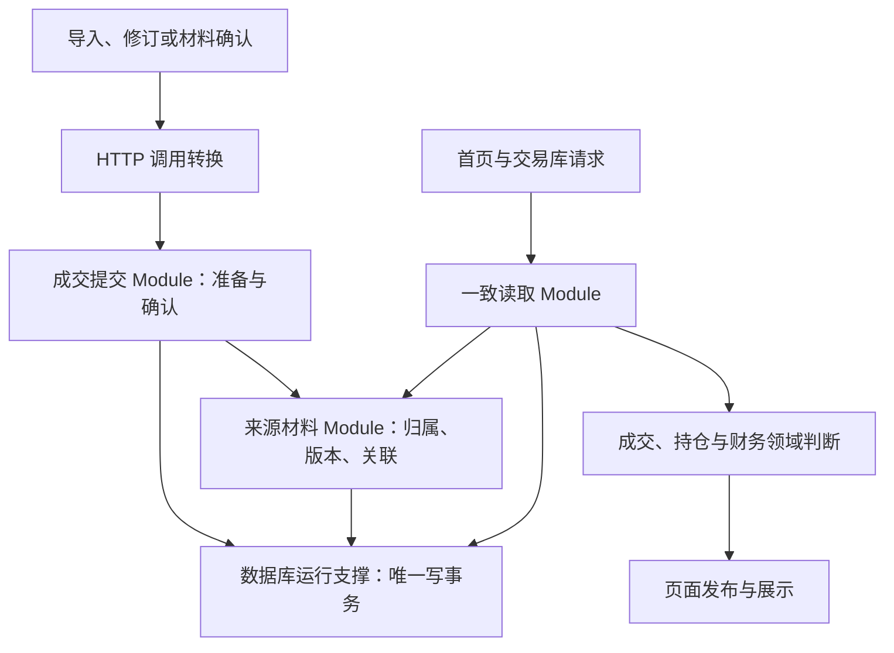

# 数据库模块重设计：按业务职责组织，统一提交成交变更

**建议保留 SQLite，将“如何安全保存成交”“如何解释来源材料”“如何读取一致数据”分别交给明确的模块。** 页面只提交本次变更及用户选择，不再负责合并整个数据库；数据库也不负责决定首页金额能否发布。

状态：**B 方向已由用户选择；本文具体约定为待审设计，尚未批准实施。** 日期：2026-10-26。依据为含既有未提交修改的工作区，HEAD `58bf0d90e68ddc634de180b3f5c3d16a089f0eb3`。本文细化原[后端目标稿](target-design.candidate.md)中事实保存、来源和读取职责，不替换其余领域，也不改动旧交互审查稿或评论版本。

审核人员可以先读第1、3、4、10节；专业人员再展开调用约定、保存结构及验证细节。现状证据见[综合审查 DB01–DB07](database-review/REVIEW.md)，不要把本文的建议误读为已经实现的行为。

## 1. 这次设计要解决什么

**先保证保存的事实可信、读取的内容说得清，再让页面按各自需求使用。** “交易库有记录、首页没有展示”不是单一问题：保存有四项可复现缺陷，展示还有完整性范围、历史提供者及性能缺口。

|目标|完成后的可观察行为|依据|
|---|---|---|
|不同账户的真实成交不误合并|两个账户的相同成交保留两笔；同一账户的真实重复成交也保留重数|DB01 已用合成数据复现|
|旧预览不覆盖新修订|预览后事实改变，确认时明确提示重新审查；重复确认不重复保存|DB02 已复现|
|证券身份不会被普通更新改写|改名称可以；同一身份改市场、代码或币种被明确拒绝|DB03 已复现|
|各正式入口使用同一校验规则|非法时间和数字不落库；仅日期、未知费用等合法表示仍可保存|DB04 已复现|
|材料缺口有归属，读取保证有边界|响应能说明读了什么、哪些材料归属已知、哪些仍未知|DB05 静态确认，跨账户反例待验证|

**本轮只设计模块和对象，不开发产品。** 财务 P1/F07、Bars 继续暂停，历史失败和验收轮数保留。历史汇率、历史覆盖提供者、首页金额计算及完整首屏一秒目标，都不能通过本次设计宣称完成。

## 2. 阅读本文需要的几个概念

**“保存完整”与“足以计算”是两件事。** 一次响应可以完整读出库中所有成交，但库中仍可能缺少开户前持仓、某个月的记录或历史汇率。

|本文用词|含义与例子|
|---|---|
|成交事实|已经确认保存的买卖记录，包含账户、证券、数量、价格、时间、费用等|
|来源材料|导入文件及其解析结果、月结余额等证据；没有成交的月份也可以有材料|
|材料版本|同一材料被重新解析、补充或替代后的独立版本，旧内容仍可追查|
|变更计划|服务器根据当前数据准备的待确认方案；包含影响、冲突和允许的选择，尚未改动正式成交|
|业务版本|成交或来源证据每次正式改变后递增的持久编号；用于识别预览是否过期|
|提交凭据|一次保存的持久结果，用于重复请求、断线重试和追查|
|读取凭据|说明这次响应读了什么及其摘要；不能证明全部历史齐全，也不承诺以后可读取当时版本|
|计算资格|特定业务结论是否有充分依据；例如“有交易列表”不代表“可以计算全历史收益”|

<details>
<summary>专业词汇：本文如何使用 Module、Interface 与 Seam</summary>

**Module 是封装业务复杂度的模块；Interface 是调用者必须了解的全部约定。** Interface 包括输入输出、顺序、不变量、错误和性能，不只是函数签名。Implementation 是内部实现。Depth 表示调用者用较少约定获得较多可靠能力；不是按代码行数衡量。

Seam 指可以替换行为的位置。浏览器 HTTP、实际 SQLite 连接是本项目需要验证的 Seam。Adapter 是在该位置满足 Interface 的具体实现。没有切换第二种数据库的需求，不预先建立通用多数据库框架。Leverage 表示调用者得到的能力，Locality 表示规则修改能集中在一个地方。

</details>

## 3. 已选择的方向与取舍

**用户选择 B：按业务职责拆分，由成交提交模块拥有跨成交和来源变更的唯一写事务。** 这既避免页面了解数据库合并细节，也避免把财务判断塞进存储模块。

|方向|主要好处|主要代价|本轮结论|
|---|---|---|---|
|A：集中成一个成交事实模块|外部入口少，提交和读取容易统一|来源解释、并发和读取规划集中，职责容易继续膨胀|未选|
|B：提交、来源、一致读取分别负责|业务知识有明确归属，能够逐项验证；写入仍保持整体原子性|必须约束内部协作，防止每个模块自行开启事务|**用户已选**|
|C：围绕导入旅程提供专门入口|预览、确认、重试路径容易理解|容易为首页和交易库再复制供数、校验逻辑|借鉴旅程设计，不作为整体组织方式|

**下面的具体方案是协调者提出、供审定的设计。** 第一阶段采用较粗的全局业务版本，宁可让并发预览重新审查，也不冒险漏掉新插入记录；先拒绝证券身份改写，不顺带实现证券身份纠正或账户合并功能。

## 4. 模块怎样分工

**成交提交是唯一正式改动成交及其来源关系的入口；其余模块分别隐藏证据解释和读取复杂度。** 模块是职责划分，不要求每个对象都建一个类，也不要求所有模块公开给浏览器调用。



### 4.1 成交提交：把一次用户意图完整保存

**本模块负责从“本次想改什么”到“安全保存了什么”，调用者不提供整个库的合并结果。** 它拥有成交判等、冲突选择、统一校验、过期判断、审计和重复请求处理；所有事实入口复用这些规则。

- 外部 Interface：准备变更 `prepare`、确认变更 `commit`、查询提交结果 `getCommit`。
- 输入：本次导入候选、明确修订意图，或只有材料而没有成交的提交；既有 TradingView 账户专项迁移与回滚使用专用维护意图。每种意图分别定义对象，不提供任意表名和自由SQL的通用命令。
- 输出：不可变计划，或正式提交凭据；错误必须说明是否已经保存以及用户下一步能做什么。
- 内部 Implementation：输入校验、身份与重数匹配、差异规划、版本检查和事务执行。内部函数不能另开事务。

**规则所有者唯一，不能在页面和 Store 中各保留一份。** 解析器仍负责识别文件格式；提交模块负责对所有解析器、旧浏览器迁移和管理脚本执行相同的正式写入检查。

### 4.2 来源材料：解释记录从哪里来

**本模块负责材料身份、版本、已知归属及成交关联，不负责批准某个财务结论。** 它能表达“账户B、港股、某月的材料存在缺口”，而不是只输出一个全局不完整标记。

- 内部 Interface：生成材料变更 `prepareMaterialChanges`、按读取范围整理证据 `projectEvidence`、解释材料沿革 `explainMaterial`。
- 输入输出：规范化材料、原始定位、版本关系、已知与未知归属、逐条诊断、材料与成交的贡献关系。
- 保存约定：准备函数返回变更描述；只有成交提交模块能把这些变更写入其事务。材料查询使用调用方提供的同一读取上下文。
- 业务限制：不从文件名、币种或第一笔成交推定市场、账户、开户日期或整段历史完整。

**它不是一层简单的增删改查包装。** 材料替代、零成交月份、同一成交的多个来源以及无法归属的证据，都在这里形成一致解释，不由页面分别拼接。

### 4.3 一致读取：交付可说明范围的数据

**本模块把同一时点的事实、来源和诊断一起交付，但不计算首页收益或决定所有内容能否展示。** 调用者说明业务选集及用途，模块负责读取必需数据及其前序依赖。

- 外部 Interface：`read`。首页与交易库使用同一事实和来源约定，可以选择不同的投影。
- 输出：事实集合、来源证据、诊断、实际读取范围、业务版本和读取凭据。
- 期间查询：包含该结论需要的期初前序成交；或者使用已经证明有效的期初基准。没有基准时不能只取期间成交后声称足够计算持仓。
- 一致性：在同一 SQLite 读取事务中复制所有原始输入，再结束事务；复杂计算和摘要编码在复制后进行。不得在持有事务时请求行情或等待网络。

### 4.4 数据库运行支撑：保持现有可用基础

**继续使用实际 SQLite 连接、现有迁移机制和配置，集中管理运行条件。** 工厂在应用组装处取得连接，业务模块接受连接及需要的时钟、标识生成器，不自行定位数据库。

- 遵守 `conf/runtime.json` 的绝对业务库路径及覆盖规则；失败时不创建工作树内业务库、不自动换端口。
- 保留外键、WAL、忙等待及短事务；沿用 Node 26.0.0 / SQLite 3.53.0。
- 只新增迁移，不修改已经执行的迁移内容或校验值。
- Recall 文档普通保存、行情缓存、设置等保留自身职责，不强行纳入成交写事务。既有 TradingView 专项迁移涉及的跨领域原子操作按第8节适配，不能直接嵌套公开事务。普通证券名称更新只能更新展示字段。

## 5. 数据对象：保存什么，谁可以改变它

**事实、材料、计划和凭据需要独立身份；它们不是同一张“大记录”的不同叫法。** 下表约束对象关系，不要求每个对象单独建表。

|对象|必须表达的内容|改变规则|
|---|---|---|
|账户引用 `AccountRef`|现有稳定账户ID、来源账户定位；名称是展示信息|不因为名称相似自动合并账户；首阶段不要求新增账户主表|
|证券身份 `InstrumentIdentity`|规范ID、市场、代码、币种|普通命令不得改写；名称可单独更新；身份纠正另案设计|
|成交事实 `ExecutionFact`|账户、证券、买卖、数量、价格、时间与精度、费用状态、性质及模拟信息|修订须说明理由、旧值和差异；不直接覆盖审计|
|来源观察 `SourceObservation`|某材料版本中的一行或一个来源事件及其原始值|一个事实可有多个观察；原始观察不被归一化结果覆盖|
|材料及版本 `SourceMaterial`|材料ID、版本ID、解析规则版本、原始定位、摘要、替代关系、归属与诊断|旧版本保留；只有新版本确认后才改变当前生效证据|
|变更计划 `ReviewPlan`|基础业务版本、候选摘要、规则版本、影响、允许选择、有效期|服务器持久保存且不可改；修改候选必须重新准备|
|提交凭据 `CommitReceipt`|请求ID、请求摘要、计划ID、提交后业务版本、结果与审计引用|正式提交后不变；重复请求返回原结果|
|读取集合 `StoredSnapshot`|本次复制的事实、材料、诊断、依赖范围和读取凭据|表示本次响应的一致内容，不保证服务器永久保存其副本|

### 5.1 成交判等：先区分账户，再处理来源与重数

**数量和价格相同不等于同一笔成交。** 判等首先隔离账户、证券身份、实盘/模拟性质及模拟运行；未知或矛盾性质不能跨性质合并。订单号也不天然等于一次成交号。

1. 有券商稳定成交号时，在其来源命名空间、账户和性质内识别同一成交；同号但核心值不同进入冲突审查，不能静默覆盖。
2. 同一文件版本的稳定行定位可识别重复导入；文件指纹不是整份文件所有成交共用的判等键。
3. 跨来源匹配保持一对一与成交重数；不得用集合去重压掉两笔真实同秒成交。现有月结替换、仅日期及模拟排序规则作为兼容输入，须加上账户和版本保护后验证。
4. 缺少足够依据时只提出候选关联，要求明确选择；没有选择则保留歧义并阻止本计划确认，不擅自删掉一笔。用户可选择保留独立记录或确认重复。

**性质读取沿用已存在的约定，不重新恢复“见券商名就认定实盘”。** 显式未知或矛盾保持未知；历史兼容只使用当前 `nature-resolution.ts` 的明确格式规则和文件证据。读取时推导的性质不自动改写原始身份；新增写入将规范字段作为正式权威，来源原文另存，不能留下两份可相互覆盖的权威字段。

### 5.2 数值与时间：严格检查有效值，保留合法的不确定性

**非法字符串必须拒绝，证据未知则明确保留未知。** 所有新写事实使用 Decimal 验证，禁止非有限值、非法数字、数量不大于零、价格小于零；本稿建议允许零价格以保留已有可能的零价成交，实际来源限制可以更严格，但不得由存储层自行补价。

- 已知费用采用现有非负费用约定；未知费用有独立状态，不补成零。返佣负数或特殊事件不伪装成普通费用，本轮不新增该业务能力。
- 时间分为合法日期精度与合法带时区时刻；日期不能强制变成某时区零点，非法日期不能绕过检查。模拟排序元数据保留。
- 金额和数量使用精确十进制文本往返，不转 JavaScript 浮点数后再保存；原结算币种和原始金额保留，换算值属于派生结果。
- 历史异常不在本次迁移中静默修复、丢弃或制造新值。读取返回定位诊断；与异常无关的合法新写入可以继续，涉及异常记录的替换须先明确处理该异常。

### 5.3 材料换版：新版本漏掉一笔，不等于那笔成交不存在

**材料替代与成交撤回必须分别决定。** 例如旧版有E1、E2，新版只有E1：可以确认新版为当前材料，但计划必须单列E2的处置，不能因旧材料退出当前版本就自动删除E2。

|E2的情况|计划必须说明什么|允许的明确选择|
|---|---|---|
|仅有旧材料支持|新版未出现，不能判断是纠错还是遗漏|保留成交并标明仅有历史来源；或确认撤回并记录理由|
|另有来源支持|逐项列出其他来源及是否冲突|保留成交；若仍要撤回，须明确确认会否定哪些来源并说明理由|
|已有人工作过修订|展示修订后的当前值、修订理由及旧材料差异|保留已修订事实；或重新审查后显式撤回，不能恢复旧值覆盖|

**这是本稿提出的待审规则：没有完成相关选择，就不能确认整个计划。** 现有月结替换仍可生成“撤回旧记录”的建议，但只能作为可见、可选择的计划动作；另一来源仍有效或已有人工修订时不得自动选择撤回。撤回是有前后记录和理由的事实修订，保留原始观察及历史关联，不物理删除来源证据；读取当前事实时排除已撤回成交，审计仍可查询。

若新版补回或改变E2，则回到普通关联、冲突或修订规则，不另开一条无保护覆盖路径。仅材料沿革改变而没有成交改变，也推进业务版本。历史观察保持原始账户和数值，规范账户可以通过经过审计的映射解释，不改写观察原文。

## 6. 一次记录从准备到读取的旅程

**页面负责呈现和选择，服务器负责决定并保存实际变更。** 成交、来源、审计、业务版本及提交凭据要么一起保存，要么一起不保存。

### 6.1 准备：产生可以确认的不可变计划

**准备阶段允许保存待确认计划，但不把候选混入正式查询。** 服务器先验证本次输入，在短读取事务中取得当前事实、来源和业务版本；结束事务后规划差异，再检查基础版本仍有效后持久保存计划。期间变化则返回过期，或进行有限次重新准备，不能无限重试。

计划记录基础业务版本、规则版本和候选原文摘要；预览列出新增、关联、替换、修订、未解决冲突及允许选项。浏览器只持有计划ID和展示数据，不能提交可任意改写的计划正文或裸删除ID。计划有效期和容量是运行配置，准备响应必须返回到期时间；服务重启后未到期计划仍可使用。

### 6.2 确认：先认重复请求，再检查是否过期

**确认基于服务器保存的计划，并在一次写事务内完成全部前提检查。** 调用顺序固定，避免重试已成功请求时误报“计划已过期”。

1. 开启唯一写事务，先按请求ID查询提交凭据；同ID且请求摘要相同，直接返回原结果；同ID不同内容返回冲突。
2. 检查计划是否已消费；相同计划及相同选择返回原凭据，即使这次请求ID不同，同时持久登记该新请求ID到原凭据的关联；不同选择返回冲突。这个关联也受请求ID唯一约束，之后可以用新ID查询，不能再把它用于另一命令。
3. 检查计划存在、未到期、规则版本适用、选择完整且在白名单内；比较基础业务版本。
4. 校验最终应用结果，依序保存证券及成交、材料版本和关联、修订审计；业务版本递增，计划记为已消费，同时保存提交凭据。
5. 提交事务后返回凭据；任何失败回滚全部正式变更。确认时不重新读取外部文件、不访问网络、不执行财务计算。

**断线不能直接解释为保存失败。** 浏览器使用原请求ID查询结果或原样重试，不生成新ID盲目重做。`getCommit` 查无结果只表示此刻尚无已提交凭据；原请求可能仍在执行，应继续以同ID重试或轮询，而不是宣告未保存。

### 6.3 读取：以服务器结果更新页面

**确认后通过权威读取刷新，不能把旧的浏览器合并数组当成保存结果。** 提交凭据中的版本用于要求读取“至少包含这次提交”；如果已有后续提交，则返回更新版本并明确告知。

第一页携带业务版本；继续分页要求同一版本，发生变化就重新开始，不拼接前后两版。暂不提供任意历史版本读取：要求“恰好版本R”而当前版本已改变，返回版本变化错误，而不是伪造历史结果。

<details>
<summary>技术约定：Interface 草案与版本的含义</summary>

```ts
type ChangeIntent = ImportIntent | RevisionIntent | MaterialIntent
  | TradingViewAccountMigrationIntent | TradingViewAccountRollbackIntent;
type CommitInput = { planId: string; choices: PlanChoices; requestId: string };
type ReadVersion = { exact: BookVersion } | { atLeast: BookVersion };

interface TradeChanges {
  prepare(intent: ChangeIntent): ReviewPlan;
  commit(input: CommitInput): CommitReceipt;
  getCommit(requestId: string): CommitReceipt | PendingOrUnknown;
}
interface StoredReads {
  read(input: { scope: BusinessScope; purpose: ReadPurpose;
                version?: ReadVersion; cursor?: string }): StoredSnapshot;
}
```

这是业务 Interface 草案，不限定同步函数或 HTTP 路由名称。`ImportIntent` 仅含本次候选及来源；`RevisionIntent` 含目标、旧值前提、新值和理由；`MaterialIntent` 可以不含成交。两个 TradingView 专用意图仅承接既有功能，不能调用任意数据库修改。调用者不得传整个当前库或自由删除列表。`PlanChoices` 的每一项绑定服务器计划中的冲突项及允许动作。

`BookVersion` 包括数据库身份、恢复代号和递增序号。同一数据库世代内才可比较序号；备份恢复或克隆为独立测试库时建立新世代，不让旧计划、凭据或浏览器缓存误认另一份库。运行流程必须阻断世代未更新的恢复上线；普通服务重启不更换世代。具体文件格式由实施者决定。

第一阶段的序号覆盖所有正式成交、材料证据、关联及身份映射改变，包括新插入记录，防止只比较旧行而漏掉“新增一笔”的情况。纯展示名称、设置、行情缓存和独立 Recall 文档不改变成交业务版本。读取到这些附属对象时，响应另列其版本或内容摘要，不能假称成交版本覆盖一切。准备计划、登记重试请求别名等管理写入不改变业务版本。

只要成交或来源语义改变，即使成交行数没变，也必须更新业务版本。未来分区版本需先证明所有写入口及跨分区依赖均被覆盖，不在首阶段提前实施。

</details>

## 7. 读取完整性与业务资格怎样分开

**每一层只承诺自己能证明的内容，页面不再把一个全局失败标记扩散到所有信息。** 来源材料负责描述证据，领域模块负责判断结论是否充分；已知无关的缺口不影响当前选集，无法确定归属的缺口仍需保守处理。

|层次|能证明什么|不能据此宣称什么|
|---|---|---|
|存储读取|本次范围的数据在同一版本中已枚举，摘要与内容一致|用户全部历史都已导入|
|材料解释|材料属于哪些已知账户、市场、证券和期间，缺口在哪里|单凭存在月结文件就能算所有指标|
|成交展示|满足列表规则的事实可以展示；未知属性显式说明|所有展示记录都可计入严格实盘统计|
|持仓领域|当前数量或成本所需的前序事实、期初基准和事件是否足够|有成交就必然能重建完整持仓与成本|
|财务领域|指定指标所需历史覆盖、费用、行情、汇率是否足够|一个缺口必须隐藏整个交易列表，或未知可以当零|

**材料范围按每个维度分别保留已知与未知，不用一个总开关替代。** 例如材料已知属于账户B、市场未知，查询账户A时可以证明它无关；查询账户B时仍不能假定它无关。范围相交只说明需要考虑，是否阻断哪项指标由领域规则决定。

零成交月份可以保存独立材料，但只有明确的证据规则才能支持“该月没有成交”；解析出零行不自动等于完整。缺少市场时保留原文和诊断，不仅凭 HKD/USD/CNY 推定市场。来源替代关系保留旧证据，不把互相矛盾的材料简单合成完整。

## 8. 保存结构与现有代码如何衔接

**保留已有事实表和审计基础，为计划、凭据及来源沿革补齐持久身份。** 这是一份逻辑对象与保存要求的设计，不是最终建表语句；索引和列名可由实施者决定，唯一性与原子性要求不能省略。

<details>
<summary>最小持久化方案、兼容与调用迁移</summary>

**新增的保存能力有明确职责，不以另建一套事实库实现。** 首阶段建议增加下列逻辑结构；可以与现有表合并，但实现计划必须给出等价约束及测试。

|保存结构|最少内容与约束|
|---|---|
|业务版本状态|单业务库身份、恢复世代、当前序号；成交提交事务内更新|
|不可变计划|计划ID、意图类型、基础版本、规则版本、候选及差异、允许选择、到期时间、消费结果；未确认内容不进入正式读模型|
|提交凭据|请求ID唯一、规范请求摘要、计划ID、选择摘要、结果、提交后版本；一个计划只生效一次|
|来源材料与版本|稳定材料ID、不可变版本ID、原始定位、已有文件指纹及是否缺失、解析版本、归属、诊断、替代关系；零成交材料合法|
|观察与成交关联|材料版本内稳定观察身份、原始值、贡献到哪个成交、关联理由；保留重数，禁止仅按金额字段合并观察|

`instruments`、`executions` 继续保存当前正式事实；既有修订审计保留。原 `import_batches` 继续表达导入尝试和历史展示，其原始 JSON 保留为证据，新材料模型成为归属和沿革的唯一权威。旧界面需要的导入历史投影由来源模块生成并在同一提交中更新；不能让旧 JSON 与新材料各自接受业务写入。

迁移为每个历史导入批次建立确定性材料版本引用，保留原批次ID、原字段、缺失标记与关联。缺少真实指纹时不伪造指纹；材料关联无法还原的历史成交标记“来源未解析”，不删除、不编造行定位、不补历史覆盖。旧材料是否同一文件的版本若证据不足，先保留独立身份，后续通过审查关联。

计划与凭据有容量及保留策略：未消费计划到期后可清理候选正文；已消费计划至少保留ID、选择摘要、提交引用。正式凭据及请求摘要在本阶段不清理，以维持幂等承诺。审计和已保存的材料内容不因清理预览而删除；没有保留文件原件的历史记录，不能宣称迁移后就拥有原件。不得新增静默级联删除成交的路径。

**切换应在一个明确的兼容窗口完成，不能长期运行两套业务权威。** 新版本激活前，只读盘点全部写入口并验证迁移；激活时暂停旧进程写入、备份、执行新增迁移及校验，再启动新版本。运行版本检查拒绝不兼容旧写进程。回退须停止写入并从备份按恢复流程恢复，不能用旧程序直接写已经改变约定的库。

|现有位置|迁移后的职责|
|---|---|
|`trade-review-workspace.tsx` 的 `confirmImport`|展示服务器计划、提交选择，收到凭据后权威刷新；移除整个库合并及自由替换ID上传|
|`app/api/storage/trades/route.ts` 与 HTTP client|把旧入口过渡到新命令约定；过渡期也只能调用同一提交规则，最终拒绝无版本保护的替换请求|
|`sqlite-store.ts` 的合并、修订、浏览器迁移及相关脚本|逐项登记并委托统一规则；无安全等价的旧命令明确拒绝，不保留旁路|
|`homepage-source-snapshot.ts`|复用一致读取与读取凭据；首页资格、金额与发布仍在现有领域职责中|
|`nature-resolution.ts`、费用与精度规则|保留已批准语义；只保留一个权威规则入口，不在页面复制|
|`tradingview-account-migration-store.ts` 的提交与回滚|保留专用功能，经成交提交协调唯一事务；内部执行函数接受已有事务上下文，保留原专项审计和依赖保护|
|Recall / 行情 / 设置|保留各自职责和版本；不因成交变动自动重写已完成复盘|

历史回合ID可能因普通事实修订改变。本文选择保留旧复盘及原引用，并显式标出关联待检查；不自动绑定到新回合，也不实现新的通用复盘迁移能力。既有 TradingView 专项迁移的明确例外见下节；新增通用关联或证券身份纠正能力仍应另行审定。

</details>

### 8.1 既有 TradingView 账户迁移与回滚保留

**统一提交不能通过取消既有能力来完成。** 当前专项迁移已经处理成交账户、别名、暂定本金及复盘/回合引用；本稿保留其既有作用范围与审查过程，不把它扩展为一般账户合并或普通修订后的自动重绑。

- **准备与确认：** 原迁移/回滚预览映射为专用服务器计划，除业务版本外，保留原计划摘要、受影响行及引用依赖检查。Recall和本金可独立改变，不计入成交版本，因此确认时必须额外核验其旧值、版本与新增依赖，不能只比较成交版本。
- **唯一事务：** 成交提交开启事务，专项 Implementation 在此上下文内应用白名单变更及专项审计；原公开提交/回滚入口改为委托，不能再自行开启第二个事务。Recall普通保存仍使用原文档版本控制，专项迁移不能借此绕过其引用和正式版保护。
- **来源同步：** 同时更新新材料模型的规范账户投影与映射，保留原始观察账户；专项前后记录覆盖这些新关系。普通重导继续保留已有账户纠正证据，不让旧来源账户把已确认账户改回去。
- **回滚语义：** 回滚是一次新的正式提交，业务版本继续递增，不把版本号退回。必须核验当前值仍等于迁移后值，并检查后来新增的来源关联、事实修订、引用及本金变化；有冲突时拒绝，不能用旧快照覆盖新状态。已存在的操作ID、结果、别名和原专项行审计继续可查。
- **历史兼容：** 对新材料模型建立前的专项操作，迁移时补建可证明的关联基线；无法证明回滚不会破坏新增对象时，回滚预览明确报阻塞，不静默遗漏新表。不得对所有旧操作一概停用。所有读写旧入口都保留其能力、结果含义和可追查性。

这项兼容调整不新增本金计算、历史财务供数或Bars开发。实施计划必须独立列出适配和回归成本；普通导入不得触发这条专项路径。

## 9. 失败、性能与测试怎样约定

**错误必须可处理，性能必须可测；HTTP成功和单元测试通过不能代替完整旅程。** 下面是后续实现的验收要求，本轮没有执行这些产品检查。

### 9.1 错误：保留原因，不把异常变成空列表

**同一种错误在 Store、HTTP 和页面上应保持同一含义。** 错误对象包含稳定代码、阶段、关联ID、是否可重试以及字段/记录定位，日志不记录交易原文或完整账户信息。

|错误|保存状态与处理|建议 HTTP 对应|
|---|---|---|
|输入非法、选择非法|未保存；定位到字段或选择项，修改后重做|400 / 422|
|预览过期、业务版本变化、身份冲突、重复ID内容不同|未应用本次新变更；重新准备或审查|409|
|计划不存在或已过期|未应用本次新变更；重新准备；已经提交的重复请求先返回原凭据|404 / 410|
|数据库忙或暂不可用|未提交或状态待确认，带重试信息；用同请求ID核对|503|
|不兼容版本、意外内部异常|记录关联ID，显式失败；不得吞错返回空列表|503 / 500|

HTTP 状态属于 Adapter 的映射；业务逻辑不靠错误消息字符串前缀判断类别。连接、解析、SQL、规则校验和序列化异常分别保留阶段信息。

### 9.2 性能：缩短事务，按依赖读，完整首屏仍须实测

**本设计提供可优化的位置，不预先许诺耗时。** 读取记录 SQL、物化复制、序列化字节、网络、浏览器解析、领域计算和绘制耗时，关联同一请求及业务版本；写入记录准备、等锁、事务和刷新耗时。

缓存必须绑定业务版本、选集、规则版本及实际外部依赖版本；来源改变但成交数量不变时也失效。计划准备不得在写事务里做大规模候选匹配；确认仅应用预先准备并重新核验的有界差异。若差异过大，准备阶段拒绝并解释，不能分批半提交同一计划。

完整首屏 ≤1秒继续采用已确认边界：本地数据齐备，覆盖浏览器冷/热、服务重启首读、导入/修订后首次打开；进程启动和外部补数另计。不能删掉必要历史、只显示局部内容或取消完整性判断来算达标。财务和 Bars 未恢复前保留未验证状态。

### 9.3 验收：用相同 Interface 证明业务约定

**验证从纯规则到真实持久化逐层展开，不通过伪造存储绕过约束。** 实施时以真实 SQLite 和相同迁移测试存储；文件库验证重启、并发与断线恢复，浏览器写入使用隔离库。

|验收组|必须覆盖的反例和行为|证据|
|---|---|---|
|DB01 身份与重数|跨账户同值保留；真实同秒两笔保留；相同文件重导不增；跨来源歧义需选择；模拟运行隔离|纯规则及真实 Store 合同测试|
|DB02 并发与幂等|预览后修订/新增/来源关联改变均冲突；同请求重试、同计划不同请求、不同选择、过期后成功请求重试；重启仍可查凭据|双连接文件 SQLite、故障注入与 HTTP 测试|
|DB03 身份|名称可变；市场/代码/币种普通更新拒绝；已有成交解释不变|实际写入后 JOIN 读取|
|DB04 校验|坏日期、非数字、非有限、负价格、零/负数量、坏费用拒绝且无半写；高精度、零价、日期精度、未知费用和原币往返|所有正式入口共用的合同测试|
|范围与读取|同版枚举；期间依赖闭合；分页跨版拒绝；无关账户缺口可排除，未知归属不能消失；零成交材料可读|读取测试及领域输入合同测试|
|材料换版|新版缺E2时显式处置；仅旧来源、其他来源、人工修订三类均覆盖；撤回有审计，原观察不删；补回不绕过冲突规则|计划、提交与读取的真实 Store 测试|
|迁移与旁路|已有14次迁移升级、原事实及来源保留；旧写入口无旁路；版本拒绝不兼容进程；恢复更换世代|迁移、入口清单和隔离恢复演练|
|TradingView专项兼容|迁移与回滚同事务；金额/数量/费用等原有守恒不变；来源同步；新依赖和Recall/本金并发阻止过期确认；旧操作可查及可解释回滚|原专项测试保留，增加新模型与双连接回归|
|页面旅程|导入预览→确认→权威刷新→返回→重载；修订冲突、忙等待和失败有明确反馈|独立桌面 UI、真实隔离持久化及视觉验收|
|性能|完整首屏边界下的各阶段耗时、字节、SQL数量和版本；不得把未测写成通过|独立端到端性能报告，后续按暂停边界安排|

Decimal、时间和判等规则可在进程内验证；存储测试通过与调用者相同的 Interface。浏览器 HTTP 使用实际路由验证并保留本地测试 Adapter；SQL、迁移、持久化和已证明业务行为的旧测试保留，只有被等价合同覆盖的重复浅层测试才考虑替换。

## 10. 审定时重点看什么

**需要审定的是下面五项具体取舍；模块方向 B 已经选定，产品尚未修复。** 这些选择决定后续实施方案，避免在开发时暗中补业务规则。

1. **写入归一：** 所有成交及来源正式改变经过同一提交规则；页面不合并全库，旧入口没有无保护旁路。
2. **并发优先保守：** 首阶段使用全局业务版本，任何相关改变都让旧预览重新确认，接受多一次审查以换取安全。
3. **证据不冒充结论：** 保存已知/未知归属，读取完整性与列表、持仓、财务资格分开；未知不补零。
4. **扩展能力暂不夹带：** 普通更新拒绝证券身份改写；账户自动合并、身份纠正、旧复盘自动重绑和负费用新类型另案审定。
5. **保留历史再演进：** 保留原事实、来源、审计和精度；新增持久计划/凭据及材料版本，历史缺失明确诊断，不静默补齐。

材料换版后遗漏成交的处置见第5.3节，是待审业务规则；既有 TradingView 专项迁移和回滚按第8.1节保留并适配。普通修订不自动重绑复盘的规则，不取消这项已有、明确预览的专项能力。

具体类名、目录细分、SQL列名、索引、计划容量和有效期配置由实施计划决定，但不能改变以上不变量。零价格允许、费用沿用现有非负约定是协调者在本稿提出的兼容选择，不记为用户已批准。

**后续顺序是：审定本文，再拆实施与验证任务。** 本稿独立检查记录见[设计验收记录](../../.scratch/database-module-redesign-2026-10-26/FINAL-ACCEPTANCE.md)。本文的检查只判断设计能否指导规划；财务和 Bars 恢复、产品修复、桌面交付与性能达标都需要各自授权和证据。

## 11. 规则与现状证据索引

**每项关键规则有一个所有者，并能追到当前问题的证据。** 行号会随开发改变，以下以文件及函数定位；证据代表当前问题和设计依据，不代表本稿已经落地。

|问题或职责|目标规则所有者|当前证据|
|---|---|---|
|DB01 判等、账户与重数|成交提交 Module|[成交匹配实现](../../app/lib/import/execution-reconciliation.ts)；[四项复现源码](../../.scratch/database-model-review-2026-10-26/evidence/store-probes.test.ts)|
|DB02 过期覆盖与审计|成交提交 Module|[现有 Store](../../app/lib/storage/sqlite-store.ts)：`mergeTradeData`、`reviseTrades`、`prepareReplacementEvidence`|
|DB03 身份改写|成交提交 Module；普通名称更新只允许展示字段|同一 Store 的 `putInstrument`、`getExecutions`、`validateInstrument`|
|DB04 数值与时间|成交提交 Module 的统一正式写校验|同一 Store 的 `validateExecution`、`reviseTrades`；[费用规则](../../app/lib/trades/execution-fee.ts)|
|材料沿革与可界定范围|来源材料 Module|[导入历史模型](../../app/lib/storage/import-history.ts)、[材料证据模型](../../app/lib/import/statement-evidence.ts)|
|性质兼容|现有性质规则，由提交和读取共用|[性质解析](../../app/lib/trades/nature-resolution.ts)|
|DB05 领域资格|来源 Module 提供归属；对应领域拥有结论资格|[现有采集](../../app/components/homepage-v25/financial-acquisition.ts)、[财务来源判断](../../app/components/homepage-v25/financial-source-model.ts)|
|一致读取及凭据|一致读取 Module|[当前首页读取事务](../../app/lib/storage/homepage-source-snapshot.ts)、[传输合同](../../app/lib/storage/homepage-source-contract.ts)|
|运行与事务|数据库运行支撑|[SQLite连接与事务](../../db/sqlite.ts)、[迁移定义](../../db/sqlite-schema.ts)|
|TradingView专项迁移/回滚|成交提交协调；专项 Module 保留计划、守恒、审计与依赖规则|[专项存储实现](../../app/lib/storage/tradingview-account-migration-store.ts)：`commit`、`executePlan`、`rollback`|
|DB06 历史供数、DB07 性能|各领域及页面；不属于本轮实施|[综合审查](database-review/REVIEW.md)第4节；原暂停任务记录保持原样|
