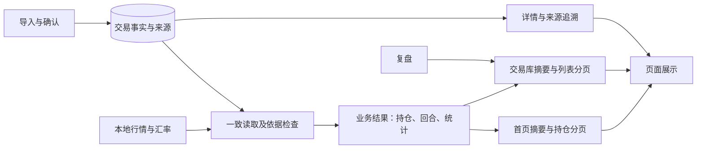

# 首页与交易库后端读取架构与接口设计（审查稿）

**状态：候选方案，供业务审核和技术评估，尚未批准实施。** 本文以目前实际问题为起点，给出后端全局职责和首页、交易库读取链路的建议设计。具体接口命名、对象字段及数据准备方式都只是候选；开放问题由[接口与架构决策地图](../../.scratch/page-reading-architecture-wayfinder/issues/00-map.md)跟踪。本文不替代[现状说明](current-state.md)、[目标设计](target-design.candidate.md)和[数据库模块候选稿](database-module-design.candidate.md)。

## 一、先看结论：系统要提供正确的页面结果，而不只是原始数据

**用户打开首页或交易库时，应在本地数据齐备的条件下，1 秒内看到该页面完整、可操作且符合当前范围的真实信息。** 系统必须同时保证数字有依据、缺失和失败可以识别，并能追溯到交易记录和来源。

目前的主要问题是：首页每次只展示 8 行持仓，却先把所有成交和大量来源材料传给浏览器，再由浏览器校验、计算和分页。隔离副本的一个响应达到约 34.33 MB，交易库也依赖这条大接口。该数据是一次样本，不是正式库统计或所有数据都可直接删除的证据。[实测与源码依据](../../.scratch/home-trades-recovery-diagnosis-2026-10-28/PROTOCOL-REVIEW.md)。

**本稿建议把读取分为三个层次：**

1. **记录层**保存并读取可信的成交和必要辅助材料，保留原始来源和修订轨迹。
2. **业务结果层**依据完整范围和必要前序记录，生成持仓、交易回合、统计及其可计算状态。
3. **页面接口层**按首页、交易库、详情和追溯的实际用途，交付摘要或当前页数据。

各层是职责划分，不预设必须建成三个服务或三个数据库。实际计算发生在请求时还是提前准备，仍需测量并审查。

## 二、阅读前：常用名称

**先区分原始记录、计算结果和页面显示，才能判断数据缺失在哪里。**

|名称|通俗解释|不要混淆|
|---|---|---|
|成交明细|券商记录的一次成交|一条成交不一定是一项持仓或一次交易决策|
|辅助流水|可能影响数量、成本或复盘解释的其他事实，例如期初持仓或配售|不是普通成交，也不要求一定来自月结单|
|来源材料与沿革|记录来自哪里、材料发生过哪些变化|可追溯不等于全部历史已经导入|
|持仓行|按业务规则组合后，当前仍持有的一项展示结果|不是一条原始成交；可能涉及账户和交易回合|
|交易回合|同一账户与证券从建仓到平仓的一段过程|未平仓回合仍存在|
|摘要|对整个选定范围计算得到的数量或指标|不是当前页 8 行的简单合计|
|读取范围|用户选择的市场、账户、交易性质和期间等|持仓的最新时点与期间表现的时间范围可不同|
|数据版本|标识一组数据处于哪个变化状态|成交、行情、汇率及复盘不一定共享一个版本|
|数据足够／未知|结论所需依据足够，或当前无法判断|未知不是零，读取失败也不是空结果|
|接口协议|页面与服务约定怎样提问、返回结果和解释失败|HTTP 成功不等于结果完整或金额可信|
|预先准备的结果|在数据变化时或之后预先整理的业务结果|是否采用、何时可用及如何更新尚待决定|

项目已有业务术语见 [CONTEXT.md](../../CONTEXT.md)。本表是阅读说明，不修改既有领域定义。

## 三、整个后端怎样分工

**各模块围绕同一份事实协作，但各自只对自己的结果负责。** 首页查询不能修改成交，行情模块不能替用户确认导入，复盘内容也不能反向改变事实。

|模块|主要职责|向其他模块提供|本次深入程度|
|---|---|---|---|
|导入与确认|解释文件、核对来源和冲突，用户确认后发起保存|候选记录、诊断、确认结果|概要；不重做已暂停的重复导入任务|
|交易与材料存储|保存成交、证券、账户、辅助流水、来源和修订|一致的事实、来源与版本|深入读取边界；写入遵循既有合同|
|业务结果计算|应用必要前序与辅助依据，形成回合、持仓、统计及可用性|可解释、带范围和依据的结果|明确职责；具体算法和现有财务任务不在本次实施范围|
|页面读取|针对首页、交易库、详情组织返回结果|摘要、分页列表、详情与状态|本稿重点|
|行情与汇率|提供有来源和时间状态的价格与汇率|本地数据及缺失／过期说明|接口边界；Bars 开发继续暂停|
|复盘与回放|保存复盘，按规则回放已发生的事实|复盘摘要、详情及回放状态|概要|
|运行与诊断|记录请求及耗时、错误和版本，支持定位问题|可核对的分段证据|本稿重点|



**图中箭头表示职责与数据流，不等于已完成实现。** 可由现有进程和数据库承载；最终计算位置、缓存和版本发布方式仍待决策。

## 四、一次打开页面的数据旅程

**页面请求应从“用户要看什么”开始，再追到计算它需要的事实。** 不应从“数据库有哪些对象”出发，把整套数据直接交给页面。

1. **确定范围**：记录市场、账户、性质、期间、搜索、排序和页码；明确当前持仓与期间统计分别使用的时点。
2. **取得可信依据**：从一致的数据状态取得所需成交、辅助流水及必要前序记录；若有可验证的期初依据，可评估使用。缺失或损坏要留下明确结果。
3. **形成完整范围的业务结果**：先形成整个范围内的回合、持仓和统计；不能因为只展示第一页，就只计算第一页。
4. **准备页面结果**：首页取范围摘要和当前页持仓；交易库取相应范围摘要和当前页列表。搜索、排序、计数在分页之前作用于完整结果。
5. **绑定范围和版本并交付**：交付结果和其数据状态，页面仅在请求、范围、版本相匹配时应用；超时和错误不冒充空结果。
6. **按需深入**：查看某行时读取该项详情；追查来源时再读取材料及诊断。导出面向完整筛选结果，不限当前页。

**例子：20 条持仓，每页 8 条。** 首页第 1 页只需要传输 8 条展示行，但“共 20 条”和范围摘要必须根据全部 20 条计算；第 3 页有 4 条。如果其中有持仓缺行情或成本，受影响金额按现行规则标注未知，不能擅自按零计算。

## 五、模块与对象设计

**每个处理对象负责一件可说明、可测试的事；数据对象负责清楚表达交换内容。** 名称是设计角色，不要求一一对应为类或新增服务。

|模块|处理对象及职责|主要数据对象|不能越过的边界|
|---|---|---|---|
|范围解释|将用户请求解释为明确的业务范围、排序及分页条件|读取范围、排序要求、分页请求|不能静默改变用户选定的账户、市场或性质|
|事实读取|读取一致版本的成交、辅助流水及所需前序|事实快照、来源引用、读取说明|读取到库内所有记录不代表历史来源齐全|
|业务计算|生成回合、持仓和指标，并判断每项是否有足够依据|业务结果、可用性、原因与依据引用|不能将未知变成零；不能在计算中改写原始事实|
|页面组装|将业务结果整理为摘要和当前页|首页摘要、持仓页、交易库页、详情|不为渲染把完整原始证据塞入每一页|
|结果版本协调|判断不同结果是否可在一次展示中组合，处理变更与失效|范围标识、成交及其他数据版本、读取时间|成交版本不能代表行情、汇率及复盘全部最新|
|追溯|根据引用定位事实、材料、变更和诊断|详情、材料沿革、诊断|传输校验不等于业务计算资格|
|诊断|记录不含敏感内容的处理阶段、耗时及失败位置|请求关联号、耗时、大小、错误分类|日志不能替代业务校验，避免记录原始交易或文件内容|

### 各种“完整”要分别回答

**不能因为接口返回成功，就声称所有业务结论都能计算。**

|问题|系统需要回答什么|可能的结果|
|---|---|---|
|传输是否完整|返回的数据是否符合所约定的范围与格式|通过／协议失败|
|数据库读取是否成功|所需记录能否一致读取|成功／存储失败／数据损坏|
|交易列表是否可展示|记录能否形成合规的交易列表|可展示／部分不可展示并说明原因|
|数量和成本是否可信|前序与辅助事实是否足够|可计算／依据不足|
|金额是否可计算|数量、成本、行情、汇率等是否满足该指标要求|可计算／未知并说明原因|
|全历史是否齐全|是否有依据证明所需历史覆盖|已证明／无法证明|

不能把材料范围的诊断当成“所有成交不能显示”；具体限制需依据各自规则判断。也不能用“部分”掩盖数据损坏或事实丢失。

## 六、页面接口草案

**接口围绕消费者需要的结果设计，并保留明确的范围、状态和版本。** 下表是职责草案，不是已有 URL，也不是已经确定的最终字段合同。

|接口角色|请求包含|响应至少表达|常见后续动作|
|---|---|---|---|
|首页摘要|市场、账户、性质、期间等|范围内总览、每项可用性及原因、数据版本／时点|切换范围；查看某项说明|
|首页持仓列表|当前范围、搜索、排序、页码或游标、每页数量|当前页持仓行、完整筛选总数、翻页信息、范围及版本|翻页、搜索、排序、查看详情、导出|
|交易库摘要与列表|当前范围、列表视图、搜索、排序及分页|范围摘要、当前页标的或回合、总数、版本及复盘状态|展开回合、查看成交、复盘|
|详情|稳定的行／标的／回合身份和所需范围|详情所需事实、可用性及版本|返回原列表与位置|
|来源与诊断|事实或材料引用、查询权限与范围|关联材料、沿革和具体问题；可按需分页|核对来源、解释计算依据|
|完整结果导出|与列表相同的范围、筛选与排序要求|完整筛选结果或受控的导出结果|下载；不能只导出当前页|

**页面之间可以共享同一份业务结果，但不必共享同一个大响应。** 精确拆分、合并请求或并行读取须通过性能与一致性实验决定。首页设计同时包含指标、持仓、曲线和主要控件；只返回摘要与列表并不代表完整首屏已就绪。

<details>
<summary>技术人员：示意响应和字段解释</summary>

下面只是说明结构，不代表可直接调用的 API。实际字段、金额精度、分页方式、错误码和版本约束由决策票确定。

```json
{
  "scope": { "market": "all", "accounts": ["示例账户"], "nature": "live" },
  "snapshot": { "tradeVersion": "示例版本", "valuationVersion": "示例版本", "asOf": "示例时点" },
  "summary": { "holdingCount": 20, "marketValue": { "status": "unknown", "value": null, "reason": "部分行情不足" } },
  "page": { "number": 1, "size": 8, "totalRows": 20, "items": [{ "id": "示例持仓", "name": "示例证券", "quantity": "100" }] }
}
```

这只是一个待设计的组合视图示意，不表示最终一定采用单接口或单一估值版本；成交、行情、汇率和复盘的版本粒度应分别论证。金额以精确表示和明确币种为准；`null` 与 `status` 配合，不可把缺失值隐式转换成 0。样例只列一行以便阅读，不代表真实第一页只有一行。

</details>

## 七、分页、版本与更新

**分页必须在同一个可解释的数据范围下工作。** 如果第一次查询后发生导入或修订，第二页不能悄悄混入另一版数据；应根据选定方案保留可读取的快照，或明确提示数据变化并重新查询。稳定排序必须有唯一的末级排序依据，避免同名结果翻页时重复或遗漏。

**不同数据更新要分别处理。** 一笔新成交、材料修订、行情更新、汇率更新和复盘保存可能影响不同结果；要明确哪些结果失效、如何重新准备、哪些页面可以继续使用。不能假定一个成交版本覆盖行情和复盘，也不能在更新失败时把旧值冒充新值。

**预先准备数据可能改善速度，但会引入更新与恢复责任。** 候选路线包括直接窄查询、每次请求计算、更新时预先计算并保存，或者组合使用。需比较首次读取、导入或修订后的等待、重启恢复、存储空间、正确性和维护成本，实验前不能保证任何路线达到 1 秒。

## 八、故障与诊断：让用户和开发者都知道卡在哪里

**用户需要明确知道“没有数据”“正在处理”“依据不足”和“读取失败”的区别。** 后端应返回足够的状态供页面呈现，不把异常转成空数组或数值零。

|情况|期望结果|诊断需要记录|
|---|---|---|
|范围内确实没有记录|显示真实空状态|范围、结果数及读取成功状态|
|某项金额无法确认|保留可展示的事实，相关金额按规则显示未知及原因|缺失类别、涉及范围与数据时点|
|数据损坏或读取异常|明确失败；更新失败时按现有设计保留并标明旧状态|错误分类、发生阶段、关联号|
|分页期间数据改变|按最终选定策略重新读取或提示刷新|原版本、新版本及冲突阶段|
|请求超时|明确不可用及重试路径，不称为零持仓|分段耗时、超时阶段、响应大小|

诊断漏斗至少区分：请求进入、读取事实、检查与计算、页面结果组装、编码与发送、浏览器解析、页面可交互。记录时间口径、数据版本、各阶段耗时及响应字节，避免日志包含原始文件和敏感交易内容。

## 九、实施前需要决定的事项

**以下选择尚未批准，不能由文档中的示例替用户作决定。** 地图中的问题逐项处理，并与既有[首页与交易库恢复地图](../../.scratch/home-trades-recovery-wayfinder/issues/00-map.md)和[读取架构问题](../../.scratch/home-trades-recovery-wayfinder/issues/04-reading-architecture.md)保持关联。

1. 首页与交易库各自返回哪些结果，哪些字段、详情和追溯数据按需读取？
2. 如何在不下载全部原始材料的情况下，保证可核对、可追溯和缺失状态正确？
3. 在本地真实规模与用户关心的更新场景下，哪种计算与保存方式能够满足 1 秒并保持结果一致？
4. 分页、行情、汇率、复盘和交易变更如何绑定版本、失效及恢复？
5. 新旧接口如何安全切换，如何在隔离副本中核对行为并处理性能未达标？

## 十、验证与验收要求

**功能、数据正确性和速度要分别通过；单个接口成功不能代替桌面整页验收。** 以下是验收设计，不是本次实测结果。

|场景|期望|证据|
|---|---|---|
|本地数据齐备时打开首页与交易库|两页各自完整首屏 1 秒内，范围和设计要求的内容正确、主要控件可用|真实桌面浏览器分段计时、截图和数据核对|
|冷／热访问、服务重启后首次读取|每种情况分别满足目标|独立计时及环境、版本记录|
|导入或修订后首次打开|结果包含最新确认变更并满足目标|隔离库实际写入、返回、重读及计时；写入等待另记录|
|跨页、搜索、排序、导出|全范围总数正确，无遗漏或重复；导出全部筛选结果|小而完整的用例与桌面操作；版本变化反例|
|缺行情、汇率、期初依据或来源|事实可见性与金额可计算性分别判断，未知不写零|预期和实际对照、追溯证据|
|损坏、失败、超时、并发变更|明确失败或刷新，不把错误冒充空数据或最新数据|故障注入与版本证据|
|性能漏斗|确认每阶段耗时与传输量，并与旧方案对比|请求链路测量；不能把单阶段耗时相加冒充整页实测|

统一边界：服务已启动、本地数据齐备时，浏览器冷／热、服务重启首读、导入或修订后首次打开均分别计时；进程启动和外部行情／汇率补齐单独计时。首页完整就绪包括真实指标、持仓、设计要求的曲线和可操作控件，不是骨架或部分结果。

## 十一、本稿适用边界

**本文提供审查与规划，不代表已经完成开发。** 财务 P1/F07 和 Bars 的既有任务继续暂停，历史轮次不重置；重复导入任务的暂停状态也不因本稿改变。尚未批准恢复的任务不能通过更名实施。当前测量来自隔离副本，其中有一条测试成交；未修改正式业务数据库。具体决策完成后，还需要独立实施计划、测试和真实桌面验收。
