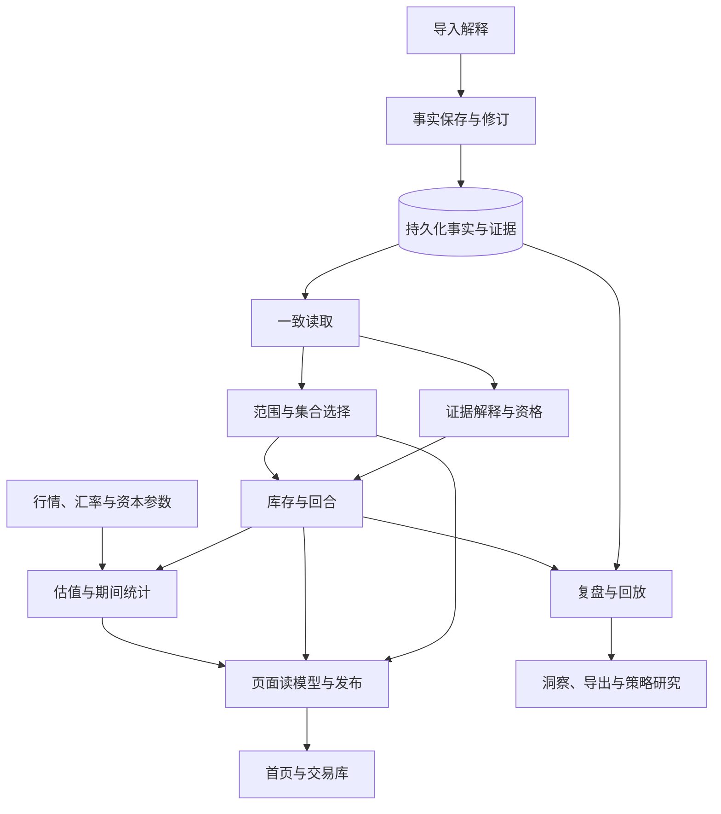

# 后端业务与数据设计：目标设计审查稿

**本稿建议把事实、证据、计算和页面发布分别负责，让一笔交易从导入到展示始终可追踪。** 对用户而言，系统应回答：成交是否还在、当前持有什么、期间盈亏如何、哪些结论不能确定，以及到哪里核对依据。正文先说明业务结论与例子；专业人员可展开技术细节，核查对象、约定和现有实现映射。

**本文是待用户审查的候选设计，尚未冻结，也未授权实现。** 已确认的业务要求继续有效；新增职责划分、对象关系和资格模型仍是建议。[现状说明](current-state.md)单独维护事实与证据，未决问题由[后端设计决策地图](../../.scratch/backend-design-wayfinder/issues/00-map.md)索引。本文不把现有行为自动升格为规范，也不关闭决策票。

## 阅读前：术语说明 {#BD00}

**本稿用少量固定术语区分“发生过什么”“凭什么计算”和“怎样展示”。** 这些区别是后文模块划分的共同基础；其具体字段与实现方式尚待设计接受后确定。

|术语|在本文中的意思|需要避免的误读|
|---|---|---|
|成交事实|真实发生的买卖，包含账户、证券、性质、时间、数量、价格与费用|不能为了报表或复盘结果改写|
|辅助证据|库存、费用、公司行动或账户事项等材料，为数量、成本或覆盖提供依据|可以没有成交，也可以只属于账户|
|证券身份／交易性质|前者确定是哪只证券；后者区分实盘、模拟或不能确认|名称不等于身份；性质不明不能自动变为实盘|
|回合|根据相关成交形成的一段持仓与交易过程|属于派生结果，不替代成交|
|持久化／原子提交|前者是实际保存到数据库；后者要求一批关联写入整体成功或整体失败|页面回调不能证明保存成功|
|事实快照／读取凭据|一次一致读取的内容，以及说明范围、数量、内容绑定的记录|只证明这次读取，不证明所有应有历史都已导入|
|查询范围／选集|用户选择的账户、市场、性质、标的和期间，以及筛出的成员|当前持仓、期间表现与历史回合各有时间范围|
|归属／应用关系|证据属于哪里，以及支持或影响哪项结论|不要求通过虚构成交建立关系；具体独立关系仍待审|
|计算资格／覆盖|输入是否足以支持某项结论，以及覆盖的对象和时间|数量、成本、费用、行情、汇率与历史起点要分开判断|
|页面读模型／发布单元|前者是供页面消费的结果，后者是一次一起接受和替换的内容|一致发布不等于每个金额都已知；分阶段方案仍待决定|
|接口约定|模块对调用方承诺的输入、输出、规则、错误和调用限制|不是仅列函数名或参数|
|处理对象／数据对象|前者执行职责，后者承载交换的信息|逻辑角色不强制对应一个类、文件或新模块|

**“已知时间”和“业务发生时间”也必须分开。** 行情是市场价格，汇率用于换算币种；来源发布时间、系统取得时间和交易发生时间并不相同。今天取得历史汇率，不能证明它在过去那个时点已经可知。

技术细节：术语对照及候选对象的地位

接口约定对应 `Interface`；读取凭据对应 `receipt`；全集覆盖对应 `universe coverage`；全历史覆盖对应 `lifetime coverage`。`prepared handle` 是进程内保留计算输入的资源句柄，不能跨重启引用；`seed` 是初始占位数据，不能据此证明真实空集合。`FX` 为汇率，`Recall` 为复盘文档体系。

`unknown` 代表不能确认，`live` 代表实盘。后文的 M01–M08 是职责编号，F01–F07 是功能编号；均非实施顺序。逻辑对象不要求新建 class，也不要求一对象一文件或增加只转发参数的 wrapper。本文不使用未经定义的人工介入缩写来替代明确的用户确认步骤。

## 一、设计目标与取舍 {#BD01}

**设计首先保证事实可追踪、结果可解释、失败不伪装成空数据。** 正常数据应快速可见；必要输入未知时，系统仍应保留事实和原因，不能制造看似精确的金额。

**已确认的首页规则是本稿的基础。** 首页只提供实盘入口，账户与市场范围明确；当前持仓保持最新时点，期间和历史范围分别承担各自职责。未知金额不等于零，读取失败不等于无交易；首次失败显示不可用，更新失败保留旧结果；请求或范围不一致的结果不能发布。这些要求来自[首页现行正文与附录](../design-system/baselines/2026-10-22-homepage-v2.5/source/visual-design.candidate.md)。

|候选取舍|要解决的问题|代价或限制|
|---|---|---|
|事实、证据、计算和发布分别负责|一次检查不能替代整条链的正确性|需要清楚定义模块间的信息和失效关系|
|按真实影响范围报告缺失|局部问题不应无条件压制无关结果|归属不明仍须保留风险，传播规则待审|
|用清楚、有限的接口约定隐藏复杂规则|页面不重复解释证券、库存或汇率资格|模块内部规则仍需用反例验证|
|来源一致与金额全已知分别表达|同一版本发布不必被误读为所有金额可算|是否分阶段、哪些区块同批替换仍待决定|
|先审模块与对象|先解决职责和约定缺口，减少反复补丁|本稿不定算法、查询语句、表迁移、方法签名或工期|

**现状与目标继续分为两份文档。** 用户已选择这种组织方式，以便分别维护实现事实和候选设计；两份文档互相引用。本稿采用“目标与取舍—功能分区—协作—验证”的总分结构，使用后端自己的章节编号。

**本轮停在职责、对象和协作审查，不进入产品实施。** 全项目功能给出总图；深入导入、事实存储、读取、校验与首页／交易库供数；复盘、策略等只给职责概要。优先考虑现有实现能否承担职责，不预设迁移运行位置。

**既有暂停任务保持原状态。** 不恢复这些任务，不修改校验、不补造数据、不迁移数据库；无法达到的完整首屏目标仍记为未通过，不能靠改口径取消失败。

技术细节：范围与暂停任务标识

本轮不恢复财务 `P1/F07` 与 `Bars`。原任务已经达到的 `3/3` 轮数和失败记录保留；设计得到确认也不会自动恢复实施，仍须用户另行明确授权。模块划分不要求把浏览器计算全部迁入 Node。

## 二、功能拆解与用户路径 {#BD02}

**系统功能可拆为七组，但必须通过完整用户路径把它们连起来。** 每组都要同时回答正常结果和异常含义；页面变化本身不能证明事实已经保存。

|功能|拆解后的责任|成功结果|异常也必须回答|
|---|---|---|---|
|F01 导入并确认|识别材料、解释行、识别时间与身份、预览和冲突处理|确认后的事实与证据可重载|哪些行被排除、待核对或阻断；取消是否未写入|
|F02 保存与修订|身份关联、原子合并、重复提交、修订和追踪|不丢失、不重复、不静默覆盖原成交|为何冲突或失败，是否实际提交|
|F03 一致读取|选择正确数据库、读取同次快照、验证内容|声明范围内的事实可信传输|读取或协议错误与业务缺失分别说明|
|F04 解释与资格|证据分类、归属、数量成本影响和历史覆盖|每项结论有依据和影响范围|不能归属、不能判断和冲突各影响哪里|
|F05 库与首页供数|选择成员、计算库存与回合、估值和期间表现|同一事实可形成不同页面结果，口径可解释|有成交但金额未知时怎样表达|
|F06 发布与恢复|请求与范围、取消、超时、旧结果、返回刷新|当前请求显示一致结果，失败可恢复|首次失败、更新失败和真实空集合分别是什么|
|F07 复盘与研究|回放、决策、摘要、统计、导出和策略隔离|消费可追踪事实，不改写成交|如何处理版本冲突、未来信息及模拟与实盘混淆|

**三条主路径是模块审查的共同检验线。** 它们分别检验保存是否真实发生、读取是否正确解释、跨页面上下文是否连续。

1. **导入 → 确认 → 保存 → 重载。** 同文件重导或修订，需要核对实际保存结果，不能只看页面回调。
2. **打开首页 → 切范围 → 查看持仓／期间 → 进入交易库。** 已存事实与选集可追踪，缺金额时解释原因，不能假空。
3. **交易库 → 复盘 → 返回首页。** 保留已应用范围和来源位置，按最新事实重新读取；返回页面的快照不能替代事实源。

技术细节：功能拆解中的持久化与传输含义

F02 的重复提交要求是幂等：同一确认命令重复执行不能产生重复事实；原子提交意味着一批关联写入整体成功或整体失败。F03 包含结构与绑定验证，HTTP 成功只说明传输层响应，不能代替业务协议验证。F06 要同时核对 request generation、scope 和 source，不接受取消或迟到结果覆盖新请求。

## 三、领域划分与协作总图 {#BD03}

**候选设计按业务知识分工，跨进程协作不改变责任边界。** 例如，解释月结单与判断持仓数量是不同职责，即使它们都在浏览器运行也不应混在一起。运行位置先保持现状，迁移问题留待设计接受后的性能与实施方案讨论。

**图中箭头表示信息依赖，不是已批准的实施顺序或分阶段首屏方案。** 发布单元仍待决定；无论采用哪种方案，都不能混合不同查询范围或不同事实版本。

|领域|拥有的对象与规则|对外提供什么|职责边界|
|---|---|---|---|
|导入解释|原始材料、解释候选、诊断、时间和来源|可确认的事实与证据候选|不决定全局历史资格或页面状态|
|交易事实|证券、账户、性质、成交、修订和关联|事实读取、确认写入、稳定身份解释|不决定页面排序或实时行情|
|库存与表现|辅助证据影响、数量、成本、回合、估值和覆盖|附有资格说明的业务结果|不解释原始文档或管理传输|
|页面供数|查询范围、读模型、请求次序和发布状态|对应页面可使用的事实与结果|不在组件内重新定义财务公式|
|行情、汇率与资本|行情版本、时段与覆盖、汇率可知时间和参考参数|带来源与覆盖的数据|不证明成交集合或库存起点完整|
|复盘与回放|文档、决策、完成版本和可见截止点|摘要、回放及保存读取约定|不改实际成交以满足复盘结果|
|分析与研究|洞察、标签建议、导出和策略结果|可追踪的派生输出|不将模拟结果并入实盘事实|

**持久化、传输、配置和诊断是支撑职责，不能因此吸收所有业务规则。** 共用一个仓储不等于库存、证据或发布规则都应放进仓储；下一章把主链进一步拆成八个模块。

技术细节：支撑职责与运行位置的映射边界

持久化、HTTP Adapter、配置和诊断跨领域服务。现有 `SqliteStore` 的共用只说明实现入口，不构成领域所有权依据。领域与模块均为候选划分，不预设服务拆分，也不要求增加网络跳转。

## 四、模块、处理对象与接口约定 {#BD04}

**八个候选模块分别承担一项可解释的责任，并通过明确输入输出协作。** 每个模块的约定还需包含错误、调用次序、配置及性能限制。正文先说明业务作用与例子，技术细节列出逻辑处理对象、数据对象和现有映射；这些名称不是实现指令。

### M01 导入解释模块

**本模块只解释材料并形成可核对的候选，用户确认后才进入写入。** 它区分成交、证券辅助证据、账户辅助证据、排除项和无法解释项；分类不确定时保留原始描述与来源，不强填市场。

**输入是材料和解析选项，输出是候选、警告及阻断原因。** 例如，无成交月份也可提供真实库存覆盖证据；但结构损坏或关键数值不守恒应阻断，待核对不能伪装通过。取消不持久化，日期精度不能升为秒，来源时区缺失不能猜测。

**辅助证据的分类仍需审定。** 具体范围交给[辅助证据业务范围决策](../../.scratch/backend-design-wayfinder/issues/01-evidence-scope.md)；原件解析耗时另计，不能混入本地数据齐备后的页面读取口径。

技术细节：M01 的处理对象、数据对象与现有映射

处理对象为材料分发器、券商 Adapter、时间解释器、身份解析器、预览／冲突协调器。现有 `dispatcher`、`parsers`、`statement-time`、`reconciliation` 可作为实现起点。

数据对象为导入材料引用、解析候选、成交候选、辅助证据、诊断、排除项与确认命令；所有可追踪条目关联来源。Interface 输入材料与解析选项，输出候选及阻断／警告，不执行隐式业务写入。

### M02 事实保存与修订模块

**本模块保证证券、成交、导入历史和必要证据一起保持真实关联。** 相同来源重导、冲突修订和模拟隔离都要得到明确结果，不能为报表补造价格、费用或成本。

**输入是带关联实体和修订意图的确认命令，输出是可解释的提交报告。** 一次提交整体成功或整体失败，成功后必须能重读确认。例如，重复导入应明确哪些新增、哪些重复、哪些冲突；不能仅凭页面提示判断已经保存。

**结构、关联、性质和存储错误需要分别报告。** 未知证券关联、非法结构、性质冲突与存储不可用不能合并成模糊失败；性质不明也不能自动归为实盘。具体数据结构与迁移不在本稿决定。

技术细节：M02 的处理对象、数据对象与提交结果

处理对象为事实仓储、导入提交协调器、去重／修订处理器、身份与性质解析器。可评估复用 `SqliteStore`、reconciliation、nature-resolution、revisions。

数据对象包括成交事实、证券身份、账户身份、导入批次、来源定位、修订与提交报告。Interface 需原子提交，区分 `inserted`／`duplicate`／`conflict` 等结果，不把 `unknown` 自动转为 `live`。具体 schema 和迁移另行设计。

### M03 一致读取模块

**本模块证明“在声明范围内，这次读到了什么”，不证明全部历史材料都已导入。** 它读取同一个事实快照，向调用方提供可核对的范围、数量、内容绑定和诊断。

**输入是读取范围与版本约定，输出是完成读取后的快照或明确失败。** 结构、关联或枚举错误属于协议失败；已知转换缺口要单独返回，不能静默丢弃，也不能用一个空集合掩盖读取失败。

**版本含义与兼容方式仍待审查。** 当前首页快照可作为映射起点，但不直接成为全站最终协议；各类标识不能互相替代。具体取舍见[读取协议与版本决策](../../.scratch/backend-design-wayfinder/issues/02-read-protocol.md)。

技术细节：M03 的处理对象、数据对象与版本边界

处理对象为快照读取器、持久化 Adapter、响应编码器、响应解码／验证器。数据对象包括查询标识、事实快照、枚举声明、计数、投影缺口、内容版本／绑定摘要及读取诊断；现有映射起点是 `HomepageStoredCollection`。

读事务结束后才出具快照。HTTP 成功不能掩盖无效 envelope；request ID、receipt ID、内容指纹和持久 revision 各有语义。不要为新 Interface 增加仅转发参数的空模块。

### M04 证据解释与资格模块

**本模块说明辅助证据支持或影响什么结论，让“成交存在”与“金额可算”分开。** 候选方案建议独立保留证据，记录归属、应用关系、缺失或冲突；是否采用独立关系模型仍由用户决定。

**输入是事实快照、选定范围和所求结论，输出是业务计算输入与分维度资格。** 例如，账户现金事项、没有证券归属的公司行动、无成交月份，必须分别解释，不能都因没有承载成交而压制全部结果。

**未归属风险要可见，影响范围仍是开放问题。** 风险应影响当前账户、某证券、某期间还是全集，不能由一个全局开关隐含决定。本模块不请求行情、不改原始事实，也不直接控制页面显示；详见[辅助范围](../../.scratch/backend-design-wayfinder/issues/01-evidence-scope.md)和[资格与历史覆盖](../../.scratch/backend-design-wayfinder/issues/03-qualification.md)两项决策。

技术细节：M04 的处理对象、数据对象与职责限制

处理对象为证据分类器、归属解析器、证据应用器与资格评估器。现有 `statement-evidence` 和采集 inspection 需重新审查职责分配。

数据对象包括辅助证据、归属范围、应用关系、资格报告、原因和来源。建议允许证据直接引用账户／证券／期间，而非强制附着某笔成交；这是候选，不是已经接受的 schema。Interface 不执行行情 IO，不修改原始事实，不以单一全局 boolean 隐含决定影响范围。

### M05 查询范围与交易集合模块

**本模块统一解释筛选，保证选出的成员与用户实际选择一致。** 市场、账户、实盘／模拟、标的和附加条件由此解析；期间区间、历史回合区间与当前持仓截止点分别建模。

**输入是事实快照和有效查询，输出是准确成员及排除原因。** 例如，搜索没有匹配只表示局部搜索为空，不能说账户无持仓；非法或不完整范围也不能静默扩大为全部。首页只产生实盘入口，交易库可支持独立、明确的范围。

**筛选之后怎样裁剪证据风险，需要依赖证据模块的范围规则。** 组件不能各自再做一套性质推断；“性质未知而排除”“选集为空”和“读取失败”也必须分别表达。

技术细节：M05 的处理对象、数据对象与现有映射

处理对象为范围解析器、性质／身份分组器、选集处理器与交易库条目投影器。现有 `shared-scope`、`attachment-groups`、`library`、homepage state 可提供映射。

数据对象为查询范围、已应用筛选、稳定组身份、成交集合、回合引用、选集回执和范围错误。Interface 不允许非法范围静默扩大全部；选集后的风险裁剪依赖 M04。

### M06 库存、成本与回合模块

**本模块按指定截止点重建数量、方向、成本与回合，不把库存快照伪造成交。** 它依据成交，以及确实影响证券数量或成本的辅助证据计算；市值不是购入成本。

**输入是选集事实、相关证据和截止点，输出是带来源、精度与资格的状态。** 例如，数量可以已知而成本仍未知；只有日期的记录不能据此编造日内先后，方向无法判断时应待核对。此处不请求行情。

**哪些资格足以展示持仓，仍按用户审定规则执行。** 本稿不改变既有金额约定和具体成本算法，也不恢复暂停实施；证据规则接受前不能把候选方案当作可直接开发的要求。

技术细节：M06 的处理对象、数据对象与算法边界

处理对象为持仓账本、证据顺序解释器、费用分配器和回合构建器。优先评估 `position-ledger`、`episodes`、IPO／bonus 证据函数的复用。

数据对象包括库存身份、持仓状态事实、流入／流出事实、费用事实、回合、数量／成本资格。Interface 返回状态、来源、时间精度及资格，不执行行情读取。本稿不更改 FIFO 等具体算法、金额合同或暂停状态。

### M07 估值与期间统计模块

**本模块用有来源、覆盖和时间含义的行情与汇率计算金额。** 当前市值、期间收益和历史已平仓统计采用各自口径，不能因都属于金额而混用。

**输入是指定版本的事实、所需期间端点或指标，以及外部数据快照；输出是指标及其资格和原因。** 例如，一只证券缺价，只能给出有依据的不可计算结果或曲线缺口，不能以零或插值补足。今天取得的汇率也不能证明历史时点可知。

**全历史起点和覆盖必须有真实提供者。** 不能用空输入得到“完整”结论；具体规则见[资格与覆盖决策](../../.scratch/backend-design-wayfinder/issues/03-qualification.md)。同一来源可复用计算，缓存失效和性能策略仍需另行设计。

技术细节：M07 的处理对象、数据对象与现有映射

处理对象为行情／FX 输入规划器、端点估值器、期间／贡献投影器与覆盖解释器。现有 prepared source、boundary projection、series 和财务 facts 是映射起点。

数据对象为行情与 FX 观测、时段覆盖、端点、指标值、原币／展示币、期间、费用与历史覆盖。Interface 必须绑定事实版本、端点／指标和外部数据快照；空 lifetime 输入不能换取 `complete`，当前 FX `knownAt` 不能证明过去已知。

### M08 页面读模型与发布模块

**本模块把业务结果组合成首页与交易库内容，并负责等待、失败、恢复及旧结果保留。** 页面只消费这些结果，不重新定义库存、费用或计算资格。

**输入是有效查询及对应业务结果，输出是与当前请求、范围、来源一致的页面内容。** 首次读取失败显示不可用；更新失败保留最后成功内容及其范围、时效，并说明失败；取消或迟到结果不能覆盖新范围。

**哪些内容必须一起替换、哪些依赖可以等待，仍待决定。** 一批结果可以包含明确未知的指标，但分阶段发布、区块原子替换、汇率与日线的必要性，要由[发布单元与失败状态决策](../../.scratch/backend-design-wayfinder/issues/04-publication.md)审定。候选方案不能把“完整首屏一秒内”改成只显示骨架或成交列表。

技术细节：M08 的处理对象、数据对象与发布守卫

处理对象为读取协调器、读模型组装器、发布守卫、错误／恢复状态机。浏览器 state／hook 与服务端读取按同一 Interface 分工，不预设运行迁移。

数据对象为读取请求、事实版本、选集身份、页面结果、区块结果、上次已接受版本、诊断与请求时序。只接受 generation、scope 和 source 均匹配的结果；完整首屏仍要求 `≤1 秒`，不得降为骨架或成交列表先出现。

### 其他领域的概要

**其余领域保持明确边界，本轮不下探其内部处理对象，也不宣称审查通过。** 行情与汇率提供本地缓存、外部接入、覆盖和可知时间；资本参数提供参考资本与现金基准；复盘与回放提供版本化文档、摘要及市场／成交截止点；分析与导出消费资格明确的事实；策略研究保持模拟与实盘隔离。

技术细节：其他领域的对外约定概要

行情／FX 由本地缓存、外部 Adapter、coverage 和知识时间构成输入；资本领域输出参考资本／现金基准。Recall／replay 输出版本化文档、摘要和双截止点；insights／export 消费有来源资格的派生事实；策略研究输入输出需保持模拟隔离。本稿不由现有目录或类型推断实现已完成。

## 五、数据对象模型与关系 {#BD05}

**候选对象模型把来源、事实、证据、查询和结果分开，避免一种对象承担所有含义。** 下表说明每类信息保存什么、由什么变化而失效；它是概念关系，不是可直接发布的数据表或兼容协议。

|概念对象|保存的信息与关系|身份及生命周期边界|
|---|---|---|
|来源定位|材料指纹、文档、券商与格式、页／行片段、时间解释|追踪解释依据，不等于成交经济字段的去重依据|
|成交事实|账户、证券、性质、方向、真实精度的时间、数量、价格和费用|身份稳定，修订显式记录，不能被视图改写|
|证券身份|市场或交易所、代码、币种；显示名称独立|不能从币种或现金描述强猜|
|辅助证据|库存、数量、费用、公司行动、账户事项、来源与解释状态|建议有独立身份，可不应用或应用到多项结论；重导可替换，关系待审|
|证据归属与应用关系|所属账户、证券、期间，支持或影响的结论，无法归属原因|不借虚构成交建立关系；原件未变仍可更正解释，独立关系待审|
|事实快照|声明范围的事实和证据、枚举与转换诊断、内容绑定|一次读取一致；内容版本不能替代请求次序，全局通用化待审|
|查询范围|性质、市场、账户、标的、附加条件、期间、历史范围与截止点|已应用范围与编辑草稿分开，非法输入可以修正|
|资格报告|所评估结论、维度、状态、影响范围、原因与证据|从指定事实与规则版本派生，不当作原始事实；统一职责待审|
|库存与回合结果|数量、方向、成本、费用、时间精度、回合及资格|事实或证据变化后重新计算或失效|
|金额与曲线结果|值或缺失、币种、期间端点、覆盖、原因与来源版本|缺失与零分开；当前观测时间不能替代历史可知时间|
|页面读取结果|请求、范围、事实版本、区块内容与状态、最后成功结果和恢复原因|只由当前发布守卫接受；首次无数据不能制造成功空集合，职责整理待审|

**关系的核心建议，是允许证据独立于成交存在。** 一个文档可以有零到多笔成交及辅助证据；一笔成交属于一个账户和证券；证据可以只属于账户，不必附着某笔成交。快照容纳声明范围内的对象，选集和资格共同决定计算输入，计算结果再组成页面内容。尤其是独立证据与归属规则，尚未替代现有模型。

**标识和时间各有用途，也要避免混用。** 稳定业务身份回答“是哪一个对象”；读取标识回答“是哪次读取”；内容版本回答“依据哪份输入”；请求次序判断“结果是否过期”；进程内计算资源只用于本次运行。发生时间、来源发布时间、系统取得时间和请求完成时间，同样不能互相冒充。

技术细节：概念对象的现有映射

|概念对象|现有映射／状态|
|---|---|
|来源定位|`Execution.source`、`ImportHistoryEntry`；现有|
|成交事实|`TradeExecution`；现有|
|证券身份|`Instrument`、canonical identity；现有|
|辅助证据|`MonthlyStatement` positions/events；分类及关系为候选|
|证据归属与应用关系|`evidenceScope`、挂载字段；独立关系模型待审|
|事实快照|`HomepageStoredCollection`；全站通用化待审|
|查询范围|`HomepageScope`／`Snapshot`、library query、`asOf`；现有|
|资格报告|现有多个 coverage／receipt；统一职责为候选|
|库存／回合结果|ledger、`TradeEpisode`；现有|
|金额／曲线结果|`HomepageV25Metric`、`BoundaryPoint`；现有|
|页面读取结果|现有 host／bundle 分散承载；候选整理|

技术细节：五类标识、四类时间与协议边界

|信息|用途|不能冒充什么|
|---|---|---|
|稳定业务 ID|标识证券、成交、文档或证据|某次请求或最新版本|
|读取 receipt ID|关联本次读取与诊断|持久数据库 revision|
|内容指纹／版本向量|绑定输入，跟踪事实／行情／FX 变更|证明历史从起点完整|
|请求 generation＋scope key|判断迟到或串范围结果|业务事实 ID|
|prepared handle|保留进程内计算输入并管理资源生命周期|跨重启的持久引用|
|发生时间／业务日|成交、事件所属时间，保留精度和时区|本次读取完成时间|
|提供方发布时间|来源何时发布|客户端真正已知时间|
|观测时间／knownAt|系统何时取得特定证据|更早历史上已经可知|
|请求／完成时间|诊断本次读取与截止点|证券历史覆盖起点|

具体序列化字段、版本迁移和时钟策略，在模块设计接受后确定；不能把概念表直接当兼容 schema 发布。

## 六、校验、缺失与错误的设计 {#BD06}

**候选设计保留六层校验，每层只证明自己的结论，并明确不足影响哪里。** 读取正确不等于金额可算；金额条件不足也不能反向否定事实已经读到。所有“完整性”都要说明层次、范围和所求结论。

|校验层|责任模块|能证明什么|失败或不足如何表达|
|---|---|---|---|
|第一层：输入解释|M01|候选行含义、来源、时间和身份解释|阻断或待确认对应候选，不伪造值|
|第二层：保存合法性|M02|结构、关联、冲突及原子提交|拒绝命令或报告冲突，不能假成功|
|第三层：读取完整性|M03|声明范围内枚举与内容绑定正确|协议失败或明确转换缺口，不返回伪空集合|
|第四层：语义归属|M04、M05|证据归属范围及选集成员|输出影响范围与不确定性，不静默吞掉|
|第五层：计算资格|M06、M07|所求数量、成本或指标有足够依据|对应结论未知或冲突，保留原因|
|第六层：发布一致性|M08|当前请求与来源、范围匹配|拒绝过期结果；首次失败或保留旧结果|

**计算资格建议按维度表达，具体统一方式仍待决定。** 至少区分成交可读、数量与方向、成本、费用、行情、汇率、选集覆盖、历史起点与期间覆盖；每个维度附原因、受影响对象及时间范围、证据引用和规则版本。可以评估沿用现有对象或形成统一报告，但不能为了统一名称抹去差别。

**缺失原因必须保留，不能一律归成“不确定”。** 未导入、不可归属、冲突、外部暂缺和协议错误各有恢复方式；同时，也不能反过来把全部未知改为通过。没有依据的数量与金额结论仍应保持未知。

**集合状态与字段状态要分开。** 下表表达现行视觉规范的业务含义；它不授权直接修改产品中的状态定义。

|情形|应表达的语义|审查反例|
|---|---|---|
|范围成功读取且无记录|真实空集合，允许计数为零|不能由初始化完成或初始占位数据推断|
|首次读取失败|不可用，保留查询与恢复入口|不能显示“暂无交易／持仓”|
|有成交但缺价格或成本|事实可追踪，对应字段或结论未知|不能全部变为零或删除事实|
|更新失败且有旧结果|保留旧结果及原范围、时效，说明失败|不能给旧金额配上新筛选标签|
|搜索无匹配|局部搜索为空|不能宣称账户无持仓|
|期间无已平仓回合|回合数为零，胜率无值|不能生成虚拟收益曲线|

**具体状态组合仍交由发布决策审查。** [发布单元与失败状态](../../.scratch/backend-design-wayfinder/issues/04-publication.md)接受后，才能确定哪些状态可合法组合；本稿不把示意表直接写入产品。

技术细节：校验编号与现有术语映射

六层分别为 `L1` 输入解释、`L2` 保存合法性、`L3` 读取完整性、`L4` 语义归属、`L5` 计算资格、`L6` 发布一致性。`L3 PASS` 不升级为 `L5 PASS`，`L5` 不足不自动否定 `L3`。coverage／receipt 是否统一仍待决策；各类原因不能压缩成一个 `unknown` 后丢失。`initialized` 或空 `seed` 不能证明真实空集合。

## 七、性能、诊断和数据安全 {#BD07}

**已确认的性能目标仍是：本地数据齐备时，完整首屏在一秒内就绪。** 它覆盖浏览器冷／热读取、服务重启后首读、导入或修订后首次打开。进程启动与外部行情、汇率补齐单独计时；必要的本地计算不能移出预算。现行设计中的十五秒是失败后转手动恢复的上限，不是性能验收门槛。[已有优化地图](../../.scratch/homepage-one-second-wayfinder/issues/00-map.md)保留相关任务。

**诊断应能沿同一次操作定位等待发生在哪里。** 需要区分浏览器触发、传输、服务内读取与转换、客户端校验、证据与选集、行情汇率、数量估值、发布和真实渲染。各段可能并行，不能直接相加；本稿也不在没有测量时分配毫秒预算。

**首次可见与完整就绪必须分别记录。** 先出现标题不能算完整首屏达标；同时应记录输入规模、缓存情况、事实版本、取消、错误和未结束阶段。内部错误与客户端恢复信息需要可关联，但日志默认只含聚合数量、阶段、原因和脱敏标识，不输出账户、文件全文或成交明细。

**数据安全与运行配置继续遵循项目约定。** 并行工作树使用明确的共享业务库路径；写入验收使用一致性备份与显式隔离路径，不能误建工作树业务库。重构与迁移需要另外的方案、兼容证据和批准，当前实现位置继续保持可追踪。

技术细节：计时边界、诊断字段与配置入口

性能门槛为完整首屏 `≤1 秒`。建议诊断 Interface 以同次操作关联标识记录：浏览器触发；HTTP 等待／传输；Node 排队、SQL、映射、编码；客户端解码／绑定检查；证据与选集；行情／FX 本地及外部读；数量与估值；发布与渲染。并发阶段不可简单求和，所需本地投影构建仍在预算内。

记录 input size、cache hit、source version、cancel／error 和未结束阶段；trace ID 关联内部异常与客户端恢复，不能用通用 HTTP 503 隐藏全部原因。运行权威仍是[配置说明](../../conf/README.md)；写入验收须显式 DB override，并使用隔离备份。本文不进行产品或数据库修改。

## 八、模块级审查与后续验证 {#BD08}

**本轮接受的是职责与约定是否可解释、对象关系是否承接场景、未决问题是否明确。** 这不等于产品验收，也不表示所有模块已可直接开发。决策仍开放时，不生成实施顺序，不恢复暂停任务。

|审查场景|设计应能明确回答什么|主要模块与待决策|
|---|---|---|
|正常股票成交保存重载|谁保证关联、原子写入及同次读取？|M01–M03|
|同文档重导或修订|怎样保留来源、替换证据、失效派生结果？|M01–M04；读取协议与版本|
|账户现金事项没有市场|它是否需要证券身份，影响什么结论？|M04；辅助范围|
|无成交月份有持仓快照|怎样独立表示，不伪造成交或误判丢成交？|M01、M04、M06；资格|
|公司行动无法归属|怎样保护可能受影响的数量成本，同时不污染无关范围？|M04–M07；辅助范围与资格|
|期初为零／期初非零|各需什么覆盖，全历史起点证明由谁提供？|M04、M06、M07；资格与历史覆盖|
|某证券缺价／某币种缺汇率|哪些字段未知，哪些事实仍可追踪？|M07、M08；发布单元|
|首次超时、更新失败、结果迟到|怎样分开不可用、旧数据和新请求？|M08；发布单元|
|切市场或账户后进入交易库再返回|成员、资格、范围与来源上下文是否一致？|M05、M08；模块所有权|
|重启或修订后首次读取|需要哪些本地计算与失效条件，怎样测完整一秒？|M02–M08；验证与迭代边界|

**六项决策继续开放，顺序只表示审查依赖。** 先判断辅助证据业务范围，再讨论其资格和页面影响；读取协议可独立审查，最后归拢模块所有权，并确定设计接受后的验证边界。

|决策|需要用户判断什么|依赖与地位|
|---|---|---|
|[一、辅助证据的业务范围](../../.scratch/backend-design-wayfinder/issues/01-evidence-scope.md)|哪些辅助材料属于本系统，账户与证券证据怎样区分？|后续资格讨论的基础；开放|
|[二、读取协议与版本](../../.scratch/backend-design-wayfinder/issues/02-read-protocol.md)|读取范围、内容绑定与版本兼容怎样定义？|可独立审查；开放|
|[三、资格与历史覆盖](../../.scratch/backend-design-wayfinder/issues/03-qualification.md)|不足影响哪些结论与范围，历史起点由谁证明？|依赖辅助范围；开放|
|[四、发布单元与失败状态](../../.scratch/backend-design-wayfinder/issues/04-publication.md)|哪些结果一起替换，依赖如何等待，失败如何恢复？|结合资格审查；开放|
|[五、模块所有权](../../.scratch/backend-design-wayfinder/issues/05-module-ownership.md)|规则由哪个模块拥有，调用方依赖什么约定？|归拢前述职责；开放|
|[六、验证与迭代边界](../../.scratch/backend-design-wayfinder/issues/06-verification.md)|设计接受后，还需哪些独立证据与停止条件？|明确后续验证；开放|

**这些决策票不是开发任务，确认设计也不自动恢复已暂停实施。** 后续仍须用户明确授权恢复，并遵守逐项独立验收、每任务最多三轮、超限暂停并记录的要求；本轮没有改变原失败记录或轮数。

技术细节：审查状态与既有迭代限制

决策票沿用原本地 tracker，不因文字重排而关闭。达到 `3/3` 的财务 `P1/F07`、Bars 等原任务保持暂停，原失败记录不覆盖；设计确认不构成恢复指令。后续实施仍要求独立验收，每任务最多 3 轮，超限暂停并留存记录。

