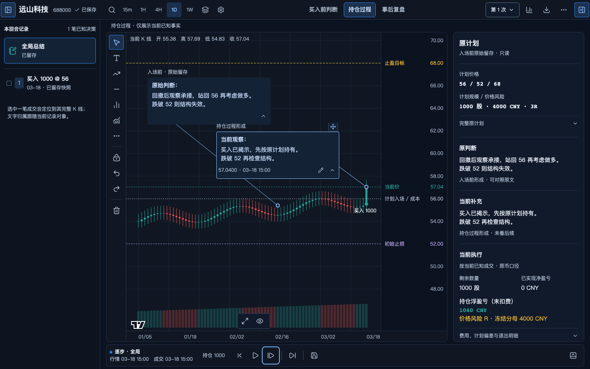

# 复盘工作区：纯净视觉基线与实现定义

版本：2026-10-11 / r1。状态：规范与实现定义已形成；真实页面验收入口和严格视觉对照方式已获用户确认，尚待未来实施时校准精确空间预算。本次只修订文档及设计图，没有修改产品代码、数据或运行样板。r1按用户决定更新计划图外标签、完成绘制自动选择，并补齐正式入口与主页兼容；具体色值/轴区宽度仍为候选。

**先看：[图文视觉规范](illustrated-guide.md) · [可浏览图册与选中动效](visual-spec.html)。** 图册按“图片 → 作用说明 → 参数与验收规则”组织13个专题、15张设计图，覆盖CB01–28。

上图是1440×900的待确认设计图；使用虚构标的与固定交易样本，不是实际运行金图。精确空间预算仍是待校准候选；已确认规则与新图的状态区别在图册中说明。

这套文档定义“根据视觉样例开发”：先提取产品应该呈现的内容与规则，再把规则接到现有组件和真实状态链，最后分别核对功能、数据与视觉。样板截图不是实现规格的全部，样板测试通过也不是正式页面通过。

| 文档 | 用途 |
| --- | --- |
| [图文视觉规范](illustrated-guide.md) | 15张待确认设计图（6张修订、3张新增，6张沿用）、操作步骤、具体参数及CB规则映射 |
| [可浏览图册](visual-spec.html) | 章节导航、全尺寸图片和可重播的选中动效示意 |
| [纯净视觉基线](visual-baseline.md) | 仅包含产品内容、视觉角色与交互呈现；实现者遵守的设计规则 |
| [入口与主页兼容](entry-compatibility.md) | 正式 `/`、同壳回合视图、首页入口与来源返回，NAV01–04 / AC27 |
| [兼容实现方案](implementation-plan.md) | 现有模块、接入差异、职责和未来实现顺序 |
| [验收标准](acceptance.md) | 固定比较条件、真实操作旅程、分项通过条件和证据 |
| [来源、净化映射与决策](sources-and-decisions.md) | 参考图、源码、测量、规则优先级、候选参数及待定问题 |
| [产品规格](../../../specs/2026-10-11-review-visual-baseline.md) | 按 to-spec 模板汇总目标、用户故事与边界 |
| [本地任务索引](../../../../.scratch/review-clean-baseline-20261011/README.md) | 文档任务与未来实现任务的依赖、授权边界 |

初版包含纯净待确认设计图与只读运行实拍；r1只新增/修订设计示意，两类来源分开登记；仍没有新的纯净运行金图。历史截图中的演示标签、测试正文和偶然布局不作为逐像素金图。先评审图文册中的密度与形式；未来实施时在真实组件中建立匹配状态，再登记获选图片、状态清单和源码版本。此前的 [2026-10-10 归档](../../versions/2026-10-10/README.md) 保留其原有证据和未验证项，本草案不改写历史验收结果。

用户已确认真实复盘页面为最终验收入口，`/design/review` 为参考入口；外观逐项一致，只允许字体抗锯齿等环境差异。对齐、正文换行、价格标签、控件密度与选中反馈偏差必须修正。决定原话与执行边界见来源文件；批准文档不授权本轮开发。

## 可复用形式与文档身份

本册作为项目[图文文档标准VDF 1.0](../../documentation-standard.md)的完整示范；新文档可复制[模板](../../templates/visual-design.template.md)。13专题是本工作区的覆盖结果，不是未来任务的固定图片配额。

| 字段 | 本册登记 |
| --- | --- |
| 文档版本/负责人 | 2026-10-11 / r1，root；本次更新三项设计要求及相关图文/验收；旧r0保留 |
| 产品规则权威 | `visual-baseline.md`的CB01–28；图文册解释同一规则，HTML为图文册派生展示 |
| 设计批准状态 | 既有规则按来源文件的用户决定；图01–15及精确色值/空间仍待确认；本次行为/位置决定不批准具体像素参数 |
| 真实实现/验收 | 新纯净运行金图尚未生成；本册不授予产品PASS，真实页面功能/数据/视觉仍NOT VERIFIED |
| 文档接受范围 | r1图面与文档复核见[修订接受记录](../../reports/2026-10-11-plan-axis-tool-state-entry.md)；原格式/索引接受见[原记录](../../reports/2026-10-11-documentation-standard.md)，各自绑定版本 |

## r1与原元素规范的兼容映射

原[E01–E22](../../../specs/2026-09-25-chart-first-review-ui-elements.md)继续作为字段与组件来源；下表仅列本次覆盖处。r1两色计划虚线覆盖旧E06统一gold呈现，E05真实价格与无重叠规则保留；E08旧创建方式已由后续锚定Text合同覆盖，旧快照语义不迁移。

| 修订范围 / 原元素 | 当前规则与图片 | 对应验收 |
| --- | --- | --- |
| 计划线/右轴/输出：E05/E06/E21 | CB08/14/27，IMG-01/09/10/12-r1及15；图外文字不遮K线，不重写原计划 | AC06/08/09/25；新RR独立按AC20 |
| 全工具完成/选中/Text及历史：E03/E08 | CB15–22，IMG-13，07/08分步补充；所有工具默认一次创建→cursor+新对象selected，非空Text草稿先保护 | AC14–21及AC26 |
| 正式入口/返回保存：E01/E20，NAV01–04 | CB01/02/26，IMG-14及入口说明；同壳不新增业务路由 | AC27-A～E，关联AC22/23 |

## 图像与状态索引

r1修订01/02/04/09/10/12并新增13/14/15，共9张，输出时间、实际尺寸、PNG与同名HTML的SHA-256见[image-manifest-r1.json](image-manifest-r1.json)。沿用03/05/06/07/08/11的指纹仍见原[image-manifest.json](image-manifest.json)（2026-10-11T04:03:52.669Z），原12图与辅助资源均未覆盖。全部由代码原生HTML/SVG组织为**设计示意**。用户两张原图另存[输入引用登记](references/reference-manifest.json)，原图未编辑，CSS视口/DPR/缩放未知。字体栈、样本和来源见manifest；实际中文glyph来源未验证。源码读取依据 `75b06cca`，规则及运行读取的完整来源见[来源与决策](sources-and-decisions.md)。

主图01模拟内部工作区1440×900、DPR1、缩放1，不包含正式父应用壳；最终AC27的整页比较必须把该壳计入同一视口。02–15为多局部/多步骤说明图版，输出像素高度各不相同，各格不代表同一整页CSS视口。SVG行情点位和范围用于说明构图，不能充当实际bar/价格坐标或回放验收。公共S1 fixture只适用于相应S1格；S0、S2及各步骤以该格标签和图文说明为准，不继承一个全局S1状态。

| 图ID/章节 | 文件 | 代表场景与差异 | 规则映射 | 图片批准/运行结论 |
| --- | --- | --- | --- | --- |
| IMG-01 / 01 | [整页](images/r1/01-workspace-s1.png) | S1；左右面板打开，主图批注/计划/成交自洽；无主动看后续 | CB01–06、12–14、21 | 待确认；运行NOT VERIFIED |
| IMG-02 / 02 | [框架控件](images/r1/02-frame-controls.png) | 左右开合、关闭后恢复入口、焦点与执行组中心；说明线在产品外 | CB10–14 | 待确认；运行NOT VERIFIED |
| IMG-03 / 03 | [文字与间距](images/03-typography-spacing.png) | 不同文字角色、数字基线及间距；不是单一阶段运行截图 | CB07、09、28 | 待确认；运行NOT VERIFIED |
| IMG-04 / 04 | [颜色与控件](images/r1/04-colors-control-states.png) | 语义token、默认/悬停/选中/焦点/禁用/错误/只读等控件示意 | CB08、10–11、27 | 待确认；运行NOT VERIFIED |
| IMG-05 / 05 | [侧栏](images/05-sidebar.png) | 计划、原判断、当前补充、执行事实；含未知、长数值及逐退出评价专题 | CB05–06、14、24 | 待确认；运行NOT VERIFIED |
| IMG-06 / 06 | [Text状态](images/06-text-states.png) | 普通/选中/编辑/折叠、长文尾部；图中光标是行为标注 | CB07、10、16–17、19–20、25 | 待确认；运行NOT VERIFIED |
| IMG-07 / 07 | [锚定步骤](images/07-anchor-journey.png) | 点bar/价格→放置预览→确认；框/anchor分别移动的独立步骤 | CB15、17–18、26 | 待确认；运行NOT VERIFIED |
| IMG-08 / 08 | [绘图与RR](images/08-drawing-selection-risk.png) | 首点/预览/释放、普通/选中/锁定；多空新RR1:1与原计划3R各自独立 | CB10、18–22 | 待确认；运行NOT VERIFIED |
| IMG-09 / 09 | [阶段与截止](images/r1/09-phases-cutoffs.png) | S0、S1、S2与主动见后续后回早期；每格双截止/来源分别说明 | CB04–05、23–24 | 待确认；运行NOT VERIFIED |
| IMG-10 / 10 | [窄窗与长文](images/r1/10-responsive-long-text.png) | 不同可用空间、长文/长价、粗指针；软件键盘/IME无真实证据 | CB01、10、25、28 | 待确认；运行NOT VERIFIED |
| IMG-11 / 11 | [保存状态](images/11-save-states.png) | 业务草稿与保存中/失败/冲突/重试；未证明实际请求或数据库结果 | CB03、11、26 | 待确认；运行NOT VERIFIED |
| IMG-12 / 12 | [三阶段输出](images/r1/12-three-stage-export.png) | 三阶段与完整三行交易表；16:9，无临时编辑柄/焦点，图外计划名称与价格 | CB14、27–28 | 待确认；运行NOT VERIFIED |
| IMG-13 / 08 | [工具状态机](images/r1/13-tool-state-machine.png) | 首点/预览/最终确认→cursor+新对象selected；Text/通道边界、取消和历史 | CB18–22 | 待确认；运行NOT VERIFIED |
| IMG-14 / 00 | [产品位置与入口](images/r1/14-entry-context.png) | 同壳主页/回合/来源返回关系，不是实际导航尺寸稿 | CB01/02/26、NAV01–04 | 待确认；运行NOT VERIFIED |
| IMG-15 / 05 | [计划标签修订对照](images/r1/15-plan-axis-detail.png) | 同S1/数据/价格范围；图内不同色虚线、图外名称/数值；轴区160px候选 | CB08/14/27 | 待确认；运行NOT VERIFIED |

动效 `IMG-M01` 为[选中反馈SVG示意](images/selection-motion.svg)，只说明一次约200ms的确认及稳定选中态，不是实际操作录像。最新 `IMG-S01` 为[只读运行实拍](images/source-current-1440.png)，采集时间 `2026-10-11T03:45:06.968Z`，CSS视口1440×900、DPR1、缩放1；其当前状态和fixture不一致风险保留在来源文件。该实拍不是设计金图，不支持控件或保存通过。

以下两份辅助资源不在原12图manifest中，指纹在此单独登记；r1仅校验，未重新生成：

| 图ID | 实际尺寸 | SHA-256 |
| --- | --- | --- |
| IMG-M01 | SVG viewBox 960×240 | `a26d97ce04e6604b4ccb17f8bc5c614c106f4dc313b2a223727358c927149c8f` |
| IMG-S01 | PNG 1440×900 | `e666d383cdfb49d5cdf10ffe9886811704c99ea87d89198c3bc8eb711fb72dd8` |

## 维护本册

局部迭代先更新受影响的CB规则/图文专题和图像登记；获选画面/参数的确认依据单独追加。图片的可浏览源为本目录 `images/`（r0）及 `images/r1/` 中同名HTML和SVG；过程导出脚本在本地任务目录，不能作为其他机器复现的唯一前置条件。若重新导出，记录实际命令、环境和源内容指纹，更新manifest；原已接受版本保留可恢复副本。

网页内容来自 `illustrated-guide.md`。后续可使用登记的生成工具，或按原章节手工同步 `visual-spec.html`；两种方式都要核对13专题、15张设计图、图片、参数表和状态说明一致，保留原尺寸入口与减少动态效果处理。仅修改README/来源索引无需重生成图片或图册。r1已同步正文、HTML与资源，并重新复核文档图面，不继承旧运行PASS。历史只读来源不是新运行实拍。

原[图文册r0](illustrated-guide-r0.md)、[浏览图册r0](visual-spec-r0.html)、[CB规则r0](visual-baseline-r0.md)和12图manifest完整保留。r0中的遮图计划方框及未明确的完成状态已被r1取代；未来执行以当前CB规则、图文册及r1资源索引为准，不能从旧册覆盖新决定。
