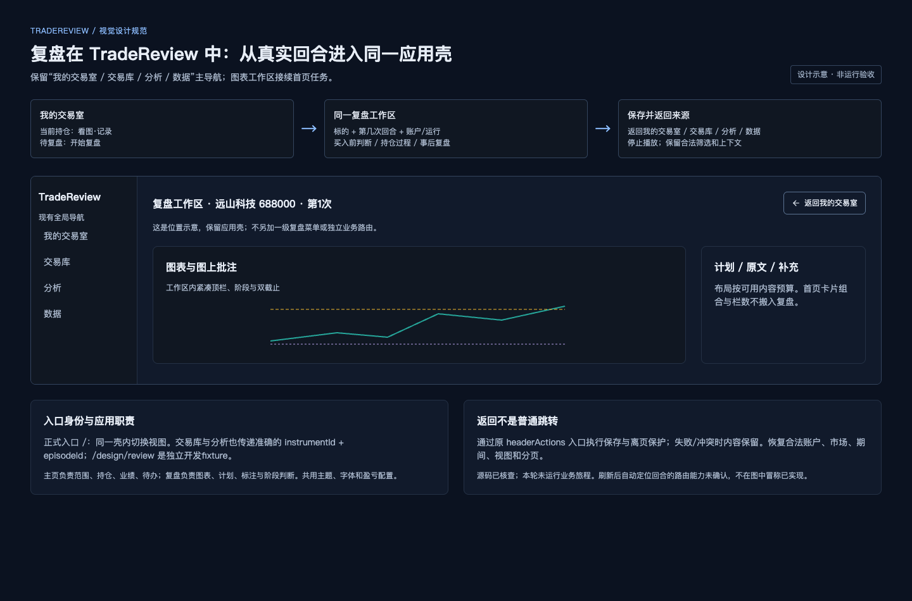

# 复盘工作区在 TradeReview 中的位置与主页兼容

版本：2026-10-11 / r1。范围：正式入口、应用壳、真实回合身份、来源返回和保存保护；本轮仅补充设计文档。依据为当前用户要求、既有CB规则及源码 `75b06cca`。没有运行入口旅程，以下源码核查不代表功能、持久化或视觉验收通过。

## 图片：从主页进入同一复盘工作区

图ID：IMG-14。图类型：入口关系设计示意；不是运行截图，也不是新的主页方案。图中表达导航位置与用户路径，不规定首页或复盘的栏数、比例、导航宽度与新增路由。可编辑源、生成时间、实际像素尺寸与SHA-256由本次[r1图像登记](image-manifest-r1.json)记录。源码参考版本为 `75b06cca`；实际浏览器字体、CSS视口和完整运行环境没有在本轮测量。示意没有真实交易行情、阶段或截止数据，不能用于证明行情揭示、刷新定位或保存行为。

## 说明：主页找回合，复盘对着图完成判断

TradeReview的正式入口是 `/`，默认进入“我的交易室”。用户可从首页当前持仓行的“看图·记录”、待复盘回合的“开始复盘”，或交易库、分析中的指定回合进入复盘。复盘是某个真实交易回合的工作状态，包含图表、标注、计划与阶段判断；它在现有应用壳内切换，不是另一套站点或一级模块。`/design/review`只承担开发样板与比较画面职责。

主页与复盘共享品牌、主导航、主题、中文文字角色、盈亏配置和数据管理入口。主页负责范围、持仓、业绩和待办，复盘以图表与批注为主工作面；首页方案B的卡片组合、栏数、比例不迁移到复盘。正式比较图须把现有应用壳计入同一视口预算，不能通过裁掉主导航取得与局部工作区图相同的密度。

进入时先确定标的、交易回合和来源，返回时回到用户开始这次任务的位置。相同股票的不同账户、不同历史回合或模拟运行不能互换。工作区顶部保留来源返回与必要父级动作，仍遵守紧凑规则；不为解释入口另加常驻标题行、全局顶栏或面包屑。

## 规范：NAV01–04

这些ID是本专题的追踪补充，产品规则权威仍为[视觉基线](visual-baseline.md)；所有者、任务和证据继续登记到功能的统一DESIGN-COVERAGE，不另设相冲突的实现任务表。

| ID / 对象 | 具体约束 | 分类与依据 | 例外与边界 | 映射与验收 |
| --- | --- | --- | --- | --- |
| NAV01 正式位置与入口 | `/`默认为“我的交易室”；复盘是现有 `TradeReviewWorkspace` 内的 `review` 视图，由准确回合入口进入。`/design/review`不承担正式用户入口。 | 当前源码事实；用户要求补充位置说明。 | 当前没有专属复盘URL；本轮不授权增加路由或一级导航。开发样板继续作为参考。 | CB01、E01；IMG-14；AC27-A |
| NAV02 应用壳与主页兼容 | 保留品牌、主导航、主题、盈亏配置和现有模块职责；复盘内部紧凑规则应用于工作区。正式视觉比较包含应用壳、完整父级动作与真实可用空间。首页B布局不迁移；不新增全局顶栏、面包屑或只承载说明的整行。 | 既有CB01/02及主页规格；本轮入口说明。 | 首页与复盘可按任务采用不同密度；图片不批准新的导航尺寸或名称。局部图须标明裁切和所在位置。 | CB01/02、E01；IMG-14；AC27-B |
| NAV03 准确回合与来源 | 首页持仓、待复盘、交易库、分析入口传递准确 `instrumentId` 与 `episodeId`；保留账户、实盘/模拟运行和有效队列来源。进入不以同股票其他回合替代，也不因入口类型隐式推进阶段、行情截止或成交揭示截止。 | 源码入口契约；既有阶段与知识边界规则。 | 回合变化或行情未就绪显示明确恢复入口/加载状态；无法定位时重新选择，不能展示DEMO或错误回合。恢复已保存上下文按现有领域契约执行，本图不另定默认阶段。 | CB01/02、E01；IMG-14；AC27-A/C |
| NAV04 返回、保存与上下文 | 返回根据来源显示“返回我的交易室 / 交易库 / 分析 / 数据”，沿用 `headerActions` 与现有离页保护。返回停止播放；保存失败或冲突保留内容和恢复动作。回到主页保留合法范围、视图、检索和分页；经交易库中转的首页来源也保留。 | 既有CB26、主页合法状态保留规则与源码返回边界。 | 已失效条件恢复到合法范围并解释变化；不把浏览器后退当作受保护业务返回。刷新后回合定位策略未证实，不能声称已支持专属深链或自动回到当前回合。 | CB02/26、E01/E20；IMG-14；AC27-D/E；关联AC22/23 |

“分析 / 数据”是当前可见主导航名称，历史规格中的“模式洞察 / 数据管理”描述相应模块职责。本次不授权随图示重新命名。应用主导航位置、绘图工具选择态与图形对象选中是三个不同层级，不混用同一个选中状态。

## 源码事实与当前接缝

下表绑定读取版本 `75b06cca`。行号用于当前追溯，代码变化后须重读入口、回合选择和返回保护，不能把行号或回调存在当作永久行为证明。

| 已读事实 | 源码依据 | 本轮证据的限制 |
| --- | --- | --- |
| `/`挂载真实父工作区，`showDemo=false`；默认 `dashboard` | [app/page.tsx](../../../../app/page.tsx#L32)、[视图初始化](../../../../app/components/trade-review-workspace.tsx#L1308) | 读取源码，未打开正式业务页面 |
| 当前主导航为我的交易室、交易库、分析、数据；策略未开放，设置为辅助导航 | [主导航](../../../../app/components/trade-review-workspace.tsx#L5680) | 本轮未测导航尺寸、布局或实际焦点行为 |
| 首页当前持仓“看图·记录”、待复盘“开始复盘”，共用正式回合回调 | [持仓入口](../../../../app/components/dashboard/room-holdings.tsx#L356)、[待复盘入口](../../../../app/components/dashboard/room-pending-reviews.tsx#L150)、[首页回调](../../../../app/components/trade-review-workspace.tsx#L5873) | 函数接线不能证明实际数据与回合已正确显示 |
| 交易库、分析也进入相同 `review` 视图并记录来源 | [交易库回调](../../../../app/components/trade-review-workspace.tsx#L5976)、[分析回调](../../../../app/components/trade-review-workspace.tsx#L6008) | 无本轮点击、队列及返回证据 |
| `RecallWorkspace`由正式父工作区挂载，父级提供数据、股票、返回、检查/修复、专注图表动作 | [真实挂载](../../../../app/components/trade-review-workspace.tsx#L6099)、[headerActions](../../../../app/components/trade-review-workspace.tsx#L6134) | 样板的回调和外壳不能代替这个接缝 |
| 返回按来源选择；存在首页来源范围恢复与异步离页保护 | [来源恢复](../../../../app/components/trade-review-workspace.tsx#L5243)、[来源返回](../../../../app/components/trade-review-workspace.tsx#L5257)、[离页保护](../../../../app/components/trade-review-workspace.tsx#L1317) | 未验证失败、冲突、连续点击导航或完整落库链 |
| `/design/review`限定开发环境与显式隔离库，访问会初始化fixture | [样板边界](../../../../app/design/review/page.tsx#L87)、[样板路由](../../../../app/design/review/page.tsx#L104) | 本轮未请求该路由，未写数据库；不能作为正式入口接受 |

主页兼容依据：[首页信息架构及合法返回状态](../../../specs/2026-09-19-trading-room-homepage.md#2-信息架构已确认)、[首页反馈规格的导航边界](../../../specs/2026-09-21-trading-room-homepage-feedback.md#6-对齐响应式和验收约束)。现有CSS中的“B2 trading-room shell”注释不是完整设计批准证据，不据此扩展首页方案B的迁移范围。

## 未来验收：AC27的具体动作

下列是[验收明细](acceptance.md)中AC27的专题解释。当前全部运行状态为 **NOT VERIFIED**；本轮文档检查与图示复核不改变这些状态。写入验收使用显式隔离数据库，记录版本、来源入口、回合ID、账户/运行、阶段、双截止和对照视口。

| 子项 | 操作与期待结果 | 必要证据 |
| --- | --- | --- |
| AC27-A 定位准确 | 分别由首页持仓、首页待复盘、交易库、分析进入指定回合；核对标的、回合、账户、模拟运行和来源返回文案，不能被同股票其他回合替代。 | 实际入口→真实图表连续操作；回合身份与来源截图；必要数据核对 |
| AC27-B 整壳兼容 | 桌面与较窄窗口对照包含现有应用壳的画面；主导航、返回、阶段、工具栏和图表可达，工作区密度遵从获选图。 | 非实现者同态截图比较；保留视口/DPR/缩放/完整内容；局部裁切说明 |
| AC27-C 空与失效恢复 | 无交易、原回合变化及行情读取中状态分别显示准确下一步；恢复后进入正确回合，不展示样板或旧身份。 | 空/失效/加载/恢复的真实状态截图及操作 |
| AC27-D 来源上下文 | `首页→查看全部待复盘→交易库→指定回合→保存→返回主页`，以及直接主页入口返回，保留合法筛选、期间、视图、检索与分页；失效范围变化有说明。 | 进入前与返回后范围/视图/分页对照；当前数据与来源一致 |
| AC27-E 离开与重开 | 保存中、失败与冲突时分别点击来源返回和一级导航，内容保留且保护生效；正常离开停止播放。保存后返回、重开同回合、刷新并按明确定位策略核对已保存内容与上下文。 | 真实隔离库持久化、返回、重开与刷新证据；关联AC22/23；不得用回调或fixture重渲染替代 |

浏览器刷新后的定位策略仍需在正式实现接缝中明确并验证。既有 `/` 入口初始化为主页这一源码事实，不能被写成“已支持刷新自动停留当前复盘”；也不能借此跳过已确认的保存、重开和刷新一致性验收。

## 状态与维护

- 用户已要求补充工作区位置、主页兼容与入口说明；本文沿用既有规则，没有新增页面布局、业务路由或产品默认参数。IMG-14为关系示意，精确视觉仍需相应图版确认。
- 本轮没有产品代码修改、数据库操作或运行旅程。入口行为、整壳视觉、保存保护、数据重开、刷新定位均保留NOT VERIFIED。
- root负责整体视觉与持久化流整合；后续任务按统一DESIGN-COVERAGE派发。入口、主导航名称、父级动作或来源恢复有变更时，同步本文、IMG-14、实现方案、AC27及来源记录，保留旧证据的版本边界。
