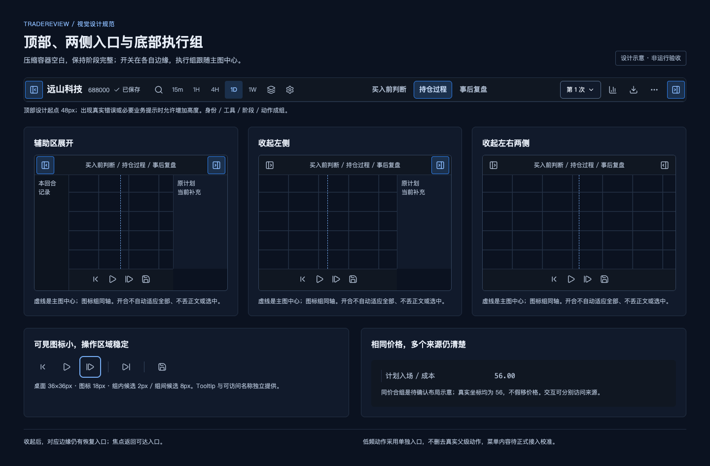
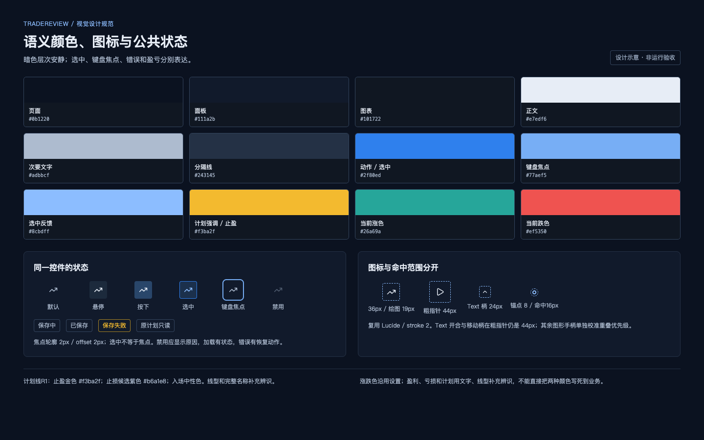
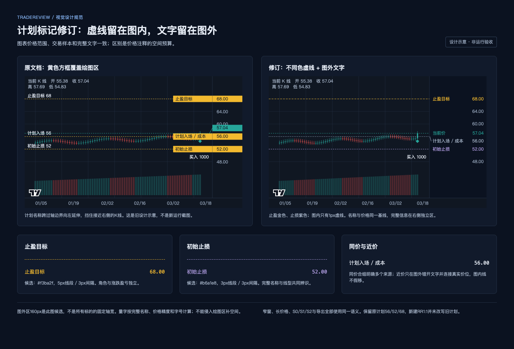
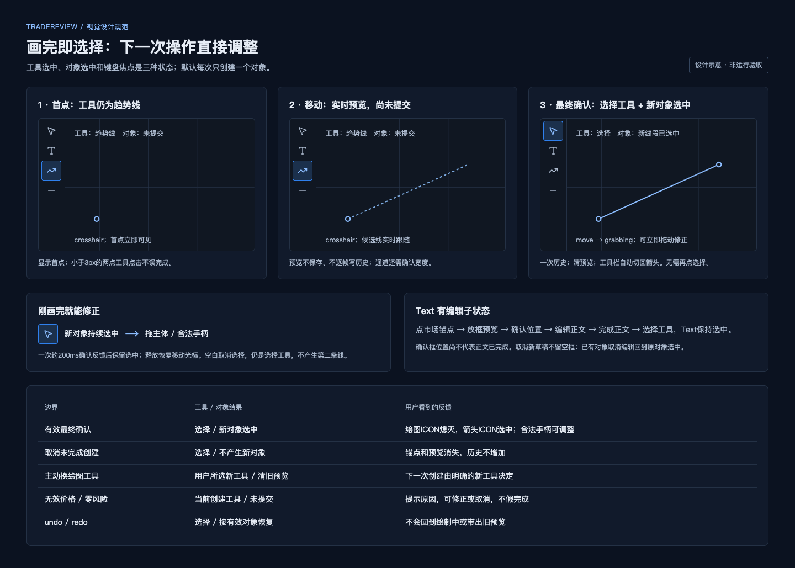
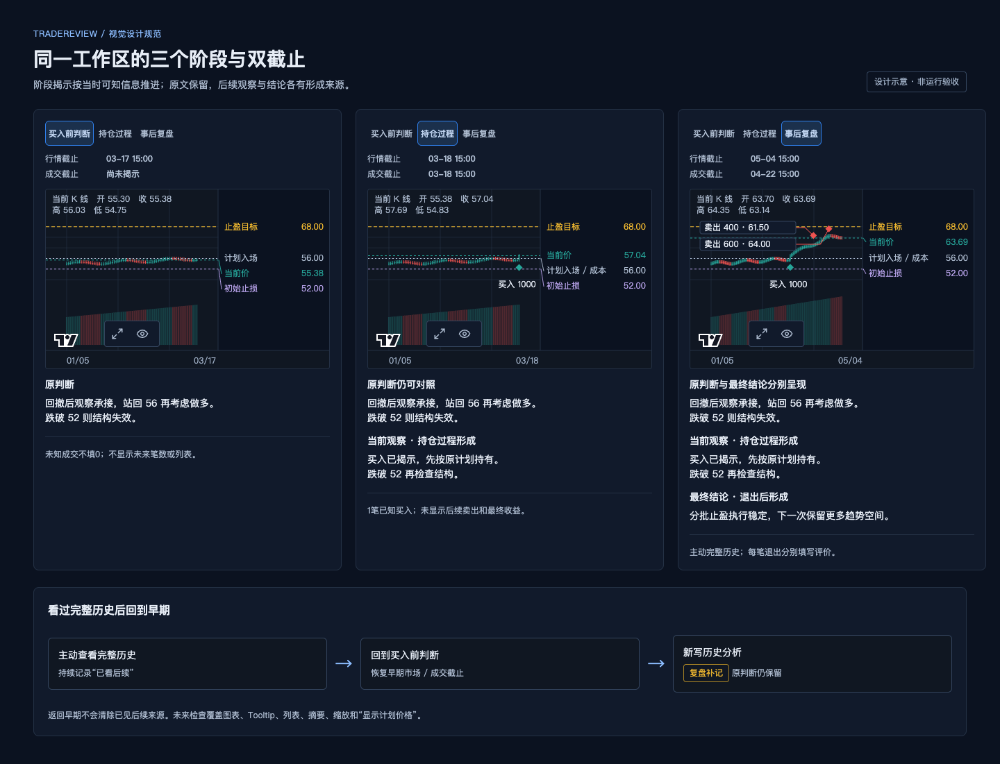
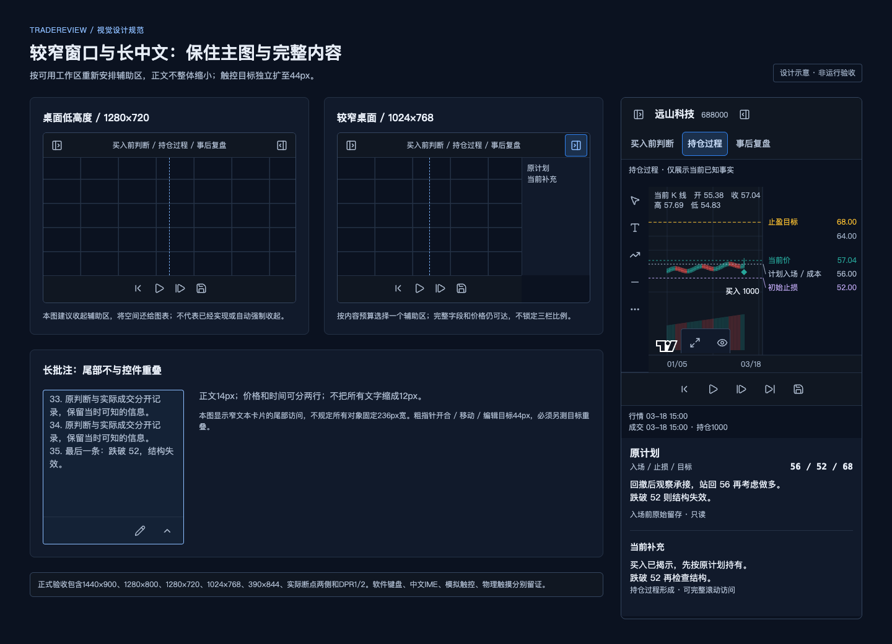
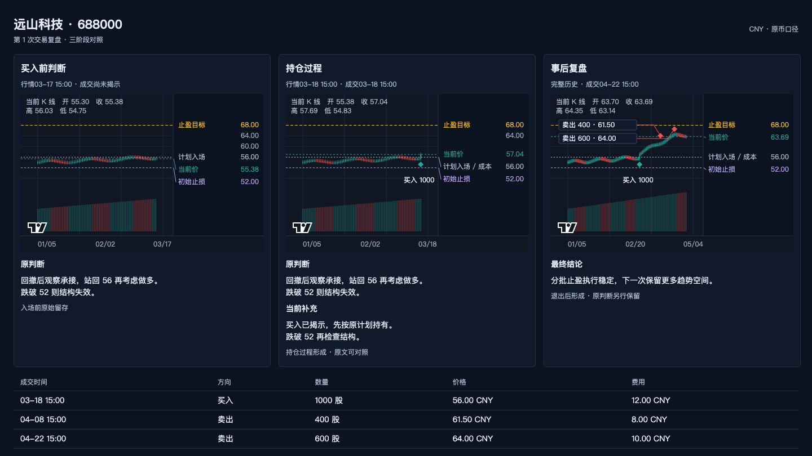
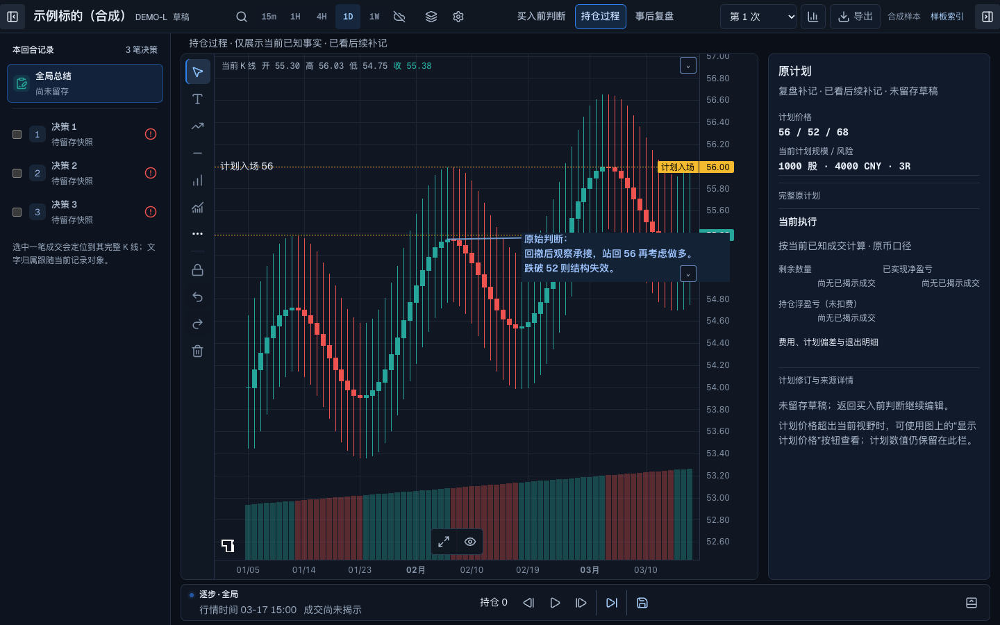

# 复盘工作区图文视觉规范

本册用图片说明整个工作区、文字、控件和关键操作的关系，供确认焦点、密度、阅读感受与操作清晰度。每章均有画面、解释和可检查的规则；对应的完整文字规则保持在[纯净视觉基线](visual-baseline.md)，实现接入见[兼容实现方案](implementation-plan.md)，逐项验收见[验收标准](acceptance.md)。本次r1按用户决定修订计划标记、绘制完成转选择与正式入口，完整规则同步更新；[原r0](illustrated-guide-r0.md)保留用于追溯。

**图01–15均为待确认设计示意，非实际运行金图。** 本次更新01/02/04/09/10/12，新增13状态机、14产品入口、15计划标记对照；其余沿用r0。用户已确定三项行为与位置要求，具体配色及空间参数仍待真实页面校准。 图01的产品画面为1440×900；其余是说明多个局部或步骤的图版，不是相同视口下的不同候选。图中的“远山科技 688000”以及全部行情、身份和交易均为设计fixture，不指代真实标的或真实交易；此来源说明放在产品画面外，产品内不添加DEMO、画板编号或说明横幅。

数值分为三类：**既有规则**继续约束后续开发；**空间候选**只用于这次看图，需在真实组件和完整内容中校准，不能因画出来就成为已确认尺寸；**图中样本值**用于保持状态自洽，不是所有交易的默认值。新UI功能、实际保存、系统光标、触控、中文输入法和动效时延均为 **NOT VERIFIED**；图片能确认拟采用的形式，不能证明这些操作已实现或通过。

## 00 产品位置：从我的交易室进入同一回合工作区

正式入口是 `/`，默认展示“我的交易室”。当前持仓的“看图·记录”、待复盘的“开始复盘”，以及交易库、分析里的指定回合，都进入同一应用壳内的复盘视图。`/design/review`是开发样板；这张关系图不新增 `/review` 路由或一级复盘导航。主页帮助找到回合，复盘对着图表、计划和批注完成阶段判断；首页方案B的卡片栏数和比例不迁入复盘。

保留品牌、现有主导航、主题与盈亏配置。进入时定位准确标的、回合、账户和实盘/模拟运行；返回时保留合法范围、期间、视图、检索与分页。完整正式画面将应用壳计入视口预算，图01仅展示内部工作面。入口图的示意导航宽度不是产品尺寸规范，刷新自动回到回合也尚未验证。

| 检查对象 | 参数或行为规则 | 验收方法 |
| --- | --- | --- |
| 正式入口 | NAV01/03、CB01：`/`同壳内review视图，首页持仓/待复盘和交易库/分析传递正确标的及回合 | AC27-A/C：真实入口核对身份、账户、运行、阶段及双截止 |
| 主页兼容 | NAV02、CB01/02：共享应用壳与主题，完整父级动作可达；不迁移首页B布局，不新加说明行或一级菜单 | AC27-B：同视口完整应用截图；不得裁掉导航来通过密度对照 |
| 返回保护 | NAV04、CB26：来源返回走headerActions及离页保护，停止播放、恢复合法上下文 | AC27-D/E：直接及首页经库中转分别保存/返回；失败、冲突和刷新按AC22/23核对 |

具体接缝、源码与未来验收见[入口及主页兼容规范](entry-compatibility.md)。本图为待确认的关系示意，未执行业务入口或持久化旅程。

## 01 整页：让图表承担主要工作

先看整页的注意力顺序：标的和阶段在紧凑的顶部，图表与图上批注占主要空间，计划与执行事实放在辅助区，执行图标位于主图下方中心。界面不再用一整行展示演示身份。左右面板通过各自边缘的入口开合；看图时可以判断入口是否容易找到、图表是否仍是最醒目的工作面。

这张图固定为“持仓过程”。买入1000股、成交价56已经揭示，当前价57.04，因此当前持仓1000股，已实现净盈亏0 CNY，持仓浮动盈亏1040 CNY（未计费）。原计划仍是56/52/68，冻结价格风险4000 CNY、预期3R；第08章另示意新建盈亏比图形56/52/60，默认1:1。两者含义不同，可以同时存在，本张整页未放入额外RR对象。行情和成交截止分别显示03-18的当前已知时间；原判断来自入场前，当前观察形成于持仓过程。这张S1示意没有主动看后续，不能附上“已见后续”或“复盘补记”来混淆来源。

| 检查对象 | 参数或行为规则 | 验收方法 |
| --- | --- | --- |
| 整体工作面 | CB01：框架沿用已确认方案；图表优先，不把这张图的栏数或百分比写成所有视口规则 | 在各视口检查主图、批注和辅助内容的可用空间；面板开合不重置图表范围 |
| 顶部身份 | CB02–03：真实名称/代码/周期及业务状态保留；无DEMO、合成样本、样板索引或常驻说明空行 | 对照产品完整截图和文案分类；“草稿”“保存中”不因净化被删除 |
| 阶段与来源 | CB04–05：导航保留“买入前判断 / 持仓过程 / 事后复盘”；行情与成交截止独立；原文和形成阶段可见 | 比对同一回合三个阶段，检查原判断仍可展开对照 |
| 图中交易样本 | CB06、21：原计划56/52/68为3R，新RR56/52/60为1:1；持仓/盈亏与已揭示买入一致 | 用同一fixture核对画面、图上标记、侧栏与真实保存数据；不把样本固定价格写进组件 |
| 本图的精确空间 | 顶部、侧栏、轴区与各区高度均为本图候选构图；具体预算仍需真实页面校准 | 记录rect、正文换行和价格标签；用户确认新画面后再登记选定数值 |

## 02 框架控件：开关在边缘，执行在中间

左面板从左边缘收起和恢复，右面板从右边缘收起和恢复，不需要横跨工作区寻找开关。底部常用执行动作以图标组成一组；两侧的时间、状态或低频动作变长时，中心组仍对准主图工作区中心。打开或收起面板之后，中心线跟随主图可用区域更新。

图中开关位置、可见入口和中心线用于确认动线；装饰性的中心线不进入正式产品。图标小不意味着点击范围小。收起不应改变回放位置、选中对象、编辑草稿或侧栏滚动位置。

| 检查对象 | 参数或行为规则 | 验收方法 |
| --- | --- | --- |
| 左右入口 | CB12：入口在对应边缘；open、closed、focus三态都可达 | 鼠标点击及Tab/Enter/Escape分别走完开合，截图记录焦点返回位置 |
| 中心执行组 | CB13：上一根、播放/暂停、下一根、下一笔决策、留存/更新快照为紧凑图标组，围绕主图中心 | 各面板开合及长状态文案下测中心线，不以整个浏览器宽度代替主图宽度 |
| 命中和名称 | CB10–11：常规桌面命中至少36×36px；粗指针至少44×44px；图标有可访问名称、Tooltip和焦点 | 记录可见图标与命中rect；键盘检查独立于鼠标 |
| 开合副作用 | 不推进phase或双截止，不清选择，不调用“适应全部”；卸载或移动控件时归还焦点 | 开合前后核对可见bar、价格范围、cutoff、选择身份和草稿 |
| 工具组间距 | 组内2px、组间8px等精确新布局值仍是候选；不能只照截图复制空白 | 真实工具、菜单和长文案接入后校准，登记获选值与例外 |

## 03 文字与间距：用稳定层级保持中文易读

图版将标的标题、面板标题、正文、标签和数值放在一起，方便直接比较。正文应当像正常阅读的中文段落，而不是一排被压小的说明。数字使用等宽数字，价格的位数变化不会让整列左右跳动。相邻输入、标签、图标沿明确的基线排列，不靠每个局部单独加padding补齐。

这里规范的是文字角色。不能在页面外层用一个通配规则把所有文字强制变成14px，也不能因为窄窗就整体缩小字号。相同字体栈不保证Canvas与DOM中的中文字形、字重和换行一致，仍要实测。

| 角色或空间 | 既有参数/规则 | 验收方法 |
| --- | --- | --- |
| 标的标题 | CB07：18px / 600 / 24px；窄空间16px / 600 / 24px | 长标的下观察层级，完整名称仍可访问 |
| 面板与分组 | 面板标题16px / 600 / 24px；分组标题14px / 500 / 21px | 原判断、当前补充、执行事实有清楚层次，不争抢主图 |
| 正文和Text | 正文14px / 400 / 21–22px；图上Text默认14px / 1.5；保留已存12/14/16/18/24/32px | 同一全文比较普通/选中/编辑和Canvas/DOM，行数、换行和字形稳定 |
| 标签和价格 | 标签12px / 18px；关键数值14px / 21px、tabular numerals | 多位价格、币种、负号与未知值不挤掉标签，不因位数变化失去对齐 |
| 间距和圆角 | CB09：4/8/12/16/24px间距档；常规控件6px、面板8px、对话框10px；紧凑图标底座4px及价格标签直角为明确例外 | 对照基线、边缘与容器内空白；不保留没有用途的大框 |
| 中文字体 | 沿用现有加载和系统中文回退，Canvas与DOM共同校准 | 记录computed style、实际字形环境与量字；未测glyph来源明确标NOT VERIFIED |

## 04 颜色与控件状态：选中、焦点和错误各有意义

蓝色表示动作、选中或焦点；计划强调保留黄色，止盈/止损用不同色虚线和图外名称区分（推荐金/紫候选，见第05章）；盈亏和K线颜色沿用用户当前配置。颜色不承担全部解释：选中还需要轮廓，键盘焦点有独立焦点环，错误有原因，锁定/只读有身份，未知写出“未提供”等状态。

图版中的色块是规范token，控件状态是拟采用的形式。色块之间的数学对比度不能代替半透明图上卡片、hover、错误或自定义颜色的实际对比度验收。特别是焦点和选中：Tab到一个控件，不应被误读为已经选择了图形。

| 检查对象 | 参数或行为规则 | 验收方法 |
| --- | --- | --- |
| 暗色层次 | CB08：page #0b1220、surface #111a2b、chart #101722、正文 #e7edf6、次要 #adbbcf、更弱 #9cacc2、分隔 #243145 | 在真实状态取色，包含alpha合成；不凭规范色块宣布页面通过 |
| 动作/计划/反馈 | 动作 #2f80ed、焦点 #77aef5、计划强调/止盈候选 #f3ba2f、止损候选 #b6a1e8、入场/成本中性 #adbbcf；绘图选中独立反馈 #8cbdff | 不覆盖对象保存颜色与opacity，低透明对象仍能识别选中 |
| 盈亏配置 | 现有默认上涨/下跌 #26a69a / #ef5350，经用户设置读取；不把固定颜色写死为盈亏含义 | 核对当前方案、文字正负号及实际成交含义；切阶段不重置设置 |
| 状态全集 | CB11：default、hover、active、selected、focus-visible、disabled、loading、error、readonly；保存失败可重试，禁用有原因 | 用真实操作分别截取状态，未出现或未验证的状态不能借图版补成PASS |
| 图标与命中 | CB10：Lucide线性图标、常规线宽2；常用约18px、绘图约19px、辅助约16px；命中36/44px | 分开测可见大小、视觉重量与命中rect；名称不能只用Tooltip代替 |
| 对比度 | 普通正文实际≥4.5:1；必要边界/图标/状态与邻接背景≥3:1；保留原始比值不四舍五入过门槛 | 按AC08逐状态取色计算，禁用例外注明标准依据 |

## 05 右侧内容：同一条对齐线承载完整信息

标题、字段名、正文和数值各有自己的层级，又共享稳定的边缘。计划价格与当前事实分组，原判断和当前补充有形成阶段。价格再长、中文再多，也不能通过删改判断、隐藏数值或缩小正文解决拥挤。未知、只读和可编辑字段有不同形式，避免把不可更改的原计划画成一排输入框。

图内只保留止盈金色、止损紫色的细虚线；完整名称和价格放在绘图区右侧，与轴文字同一基线。原计划仍为56/52/68，不改成新RR的1:1。上图使用相同样本、S1与48–70价格范围；右侧预算扩大，绘图宽度随之减少，这一空间取舍明确可见。160px是本图候选，正式图需要量字后决定，不能通过删掉重要价格维持旧宽度。

| 计划标记 | 候选视觉 / 固定规则 | 验收方法 |
| --- | --- | --- |
| 止盈目标 | CB08/14：金色#f3ba2f、1px、5px线段/3px间隔；图内无文字方框 | AC06/25：工作图及三阶段成品对照，虚线对应真实价68，图外名称和68.00完整 |
| 初始止损 | 紫色#b6a1e8、1px、3px线段/3px间隔；颜色与完整名称共同区分，计划角色不借涨跌色 | 保留实际价格52；取色/alpha合成核对对比度，候选色不是已验收token |
| 计划入场与成本 | 中性#adbbcf；同价合组注明两来源，不同价分别保留 | 56同价、近价、多位价格及多个来源；不将不同值合并，不隐藏价格 |
| 图外对齐与碰撞 | 名称左齐、完整数值右齐，与价格轴同字号/行高/基线；近价只在图外避让并连接真实y | 同价/近价截图+rect；线在真实价不动，不侵入K线区，图外连接不误读为另一个价 |
| 输出与边界 | S0/S1/S2及导出同语义；超出可见范围的价格仍在侧栏，主动显示无未来泄漏 | 三阶段成品及超视野操作前后范围/cutoff；RR风险收益区域保留 |

“是否提前退出”属于对应退出决策的评价，不能在S1强迫填写。到了事后阶段，需要通过退出决策选择器分别查看和保存；尚未填写与“不确定”不同，不得合并。原计划和原判断的全文应有明确展开或滚动路径。

| 检查对象 | 参数或行为规则 | 验收方法 |
| --- | --- | --- |
| 原判断与补充 | CB05、24：原文可对照，后续内容注明形成阶段；S1原计划只读，修订另记，最终结论在S2分开 | 推进及返回三个阶段，核对全文、来源和原图关联没有被覆盖 |
| 计划与事实 | CB06：计划入场/止损/目标、实际成交/成本/当前行情有标签或线型区分；未知数量/风险/R不显示0 | 正常、未知、长价、错误与只读分别截图，核对字段来源 |
| 数量和资金 | 股数/金额/仓位百分比一次只有一个主输入；派生值联动；参考资金有币种、时点、来源 | 切输入模式不串值、不偷偷归零；缺资金时不计算伪造比例 |
| 退出评价 | 每笔退出独立保存提前退出判断、原因与遵守计划情况；未填不等于不确定，未到目标不自动等于提前 | 切两笔退出来回编辑并保存重开，不串决策ID和计划引用 |
| 价格标签预算 | CB14：不同色虚线留图内；名称/完整数值在右侧图外，与轴文字同基线；同价来源、近价避让、长价共同预算 | 密集/同价/超出视野前后图；完整价格可访问，不遮K线 |
| 显示计划价格 | 超出视野时保留侧栏数值，提供主动入口，不自行扩大范围 | 检查按钮动作前后可见bar、价格范围与双截止，无未来数据泄漏 |

## 06 Text：普通、选中和编辑保持同一份正文

普通Text是安静的暗色卡片；选择它之后，只增加细边框和真正可操作的柄，不把整块变成醒目的亮色框。正文换行、卡片位置和尺寸保持稳定。编辑时出现输入与操作区，底层重复正文隐藏；正文选字使用文本光标，移动卡片使用独立移动柄。

关闭编辑器、折叠正文、删除对象是三件事。折叠后要能明确恢复，长文滚到底时最后一行不能被展开/收起柄遮住。图版中的光标是行为标注，不是系统原生光标的验收证据。

| 检查对象 | 参数或行为规则 | 验收方法 |
| --- | --- | --- |
| 默认阅读 | CB16：14px / 1.5、安静暗色背景、小型开合/编辑控件；合法已存样式保留 | 普通→选中→取消逐段比对原文和换行，不用新默认重置旧字号/宽度 |
| 编辑结构 | 仅一套正文布局；编辑隐藏底层重复正文，主操作常驻、样式入口可见，窄屏可达 | 编辑/取消/完成分别截图，核对全文及未提交草稿保护 |
| 长文尾部 | 已校准展开正文padding为4px 4px 48px；不外推为固定卡片高度 | 至少35行中文滚至底部，对照末行、滚动位置和控件覆盖情况 |
| 开合和移动柄 | CB10、17：细指针各至少24×24px，粗指针至少44×44px；可见图标仍紧凑 | 真实点击、反复拖动和释放；独立测柄命中，正文选字不移动整卡 |
| 选中几何 | CB19：Text持续边框约1px、反馈独立；同图表帧位置/尺寸偏移≤1 CSS px，正文换行不变 | 同帧前后rect与截图互证；测量容差不能放行可见错位 |
| 光标和取消 | CB20：二维柄move/grabbing，正文text；Escape按层级退出或回滚，不静默丢输入 | 按住中间帧、释放与取消后直接观察系统光标，真实IME另列NOT VERIFIED |

## 07 价格锚定：先选价格点，再放文本框

第一步在真实bar/价格上建立锚点。移动指针时，连接线和候选文本框跟随，用户在确认前就知道批注会放在哪里；确认位置后再编辑正文。锚点的市场时间、价格与文本框的布局位置独立，连接线把两者联系起来。

拖文本框只移动阅读位置，原价格点不变；拖锚点只改变关联的bar/价格，正文和框不跟着被重写。平移和缩放图表后，连接仍指向同一市场坐标。自由文字是明确的另一种模式，旧水平价格标注保留原语义。

| 步骤或对象 | 参数或行为规则 | 验收方法 |
| --- | --- | --- |
| 锚点建立 | CB15：先点bar/价格，记录市场时间和价格；价格/bar时间准确完整，受截止限制 | 实际点击目标bar，核对界面读数、持久化anchor与可见数据 |
| 放置预览 | 锚点→候选文本框连接即时显示；两步点击或按住拖放完成位置 | 录下按住尚未释放的中间帧，Canvas/DOM读数使用同一预览，不只看结束图 |
| 框与锚点独立 | 框移动不改anchor；anchor移动不改layout和全文 | 两类拖动分别保存、重开、刷新比对；pan/zoom后核对仍是同bar同价 |
| 完成与取消 | 新Text完成正文后回选择工具且保持新Text选中；确认框位置不等于正文完成；preview不持久化、不逐帧写历史，取消新草稿不留空框 | 创建一次历史；Escape/切工具取消不留下半成品，空白取消不误新建 |
| 自由Text和旧标签 | 明确模式切换；旧水平价格标注不自动迁成锚定Text | 打开旧记录核对语义与数据，分别完成两种模式的实际旅程 |
| 图中的连接布局 | 连接线外距等新精确数值仍为候选，不把某个像素位置写入市场坐标 | 不同视野、边缘和长文中校准；保存的是市场anchor及独立layout |

## 08 绘图与选中：先看到预览，再看到结果

趋势线、横线、通道和盈亏比在第一步之后就给出锚点或预览，指针移动时持续反馈候选位置，最终必要步骤有效确认后才形成对象，并自动切选择工具且保持新对象选中。选择反馈遵循“立即显示 → 一次短确认 → 持续保留”：手柄与轮廓先出现，短暂外环淡出后仍有稳定标记。重复点击同一对象不反复跳动。

画完一个对象，左侧箭头ICON自动选中，刚画出的对象保留持续轮廓和合法手柄，下一次动作即可拖动修正。绘图ICON回普通态；工具选择、对象选中、键盘焦点分别表示不同含义。“连续预览”指移动期间的反馈，默认不是完成后继续画第二条。

| 当前状态 / 事件 | 下一状态 | 画面与数据要求 |
| --- | --- | --- |
| 选择工具→主动选绘图工具→首点 | 创建中；当前绘图ICON选中 | 锚点立即可见、移动预览；两点工具微移小于3px仅定首点，未提交 |
| 最后必要步骤有效确认 | 选择工具cursor + 新对象selected | 清预览、一次历史/保存；箭头选中、绘图ICON熄灭、一次200ms反馈后稳定；立即可拖 |
| Text框位置确认 | 新Text正文编辑子态 | 不提前认为文字完成；完成正文才回选择并保持Text选中；空草稿取消不留空框 |
| 通道基线确认 | 宽度预览 | 宽度有效确认后才最终完成；步骤取消不留半成品 |
| 未完成几何创建 / 空正文Text→Escape | 选择工具；没有新对象 | 清锚点/预览/空框，无历史、无保存；非空正文走下一行保护 |
| 非空Text草稿→Escape / 切工具 / 空白 / undo或redo | 先留编辑缓冲与草稿保护 | 可完成、继续编辑或明确放弃；不自动提交或静默删字。明确放弃新建清框回cursor无历史，已有对象回原值selected；取消取点/拖动只回滚对应几何，不丢正文 |
| 无效价格/零风险/错误方向 | 仍在当前创建步骤 | 有原因提示，可修正/取消，不伪装完成、不提交非法对象 |
| 主动切工具 | 用户明确所选的新工具 | 无非空Text草稿时先清旧预览；有草稿先按上行处理，再执行切换；不自动连续绘制 |
| 新对象选中→空白点击 | 选择工具；取消对象选择 | 不建第二条；phase、双截止和已见后续来源不变 |
| undo / redo | 选择工具；按有效对象恢复选择 | 有非空Text草稿先保护，处理后才执行历史；不回创建态、不带旧预览；对象删除则清无效selection |

所有左侧工具及更多菜单工具都使用此协议；两步点击与拖放分别验收。静态图只定义反馈形式，实际时延、拖动光标、历史和持久化均保持NOT VERIFIED。参见CB18–22与AC16/17/19/21。

图版中的不同对象是独立示例，不代表同一工作图同时多选。新盈亏比默认1:1；原计划3R仍保留。调价格、调时间/宽度、移动整个对象有不同柄和光标，不能摆出看似可拖却没有操作的角点。

| 检查对象 | 参数或行为规则 | 验收方法 |
| --- | --- | --- |
| 线段/区域创建 | CB18：第一点立即预览；两步点击/拖放可用；小于3px只定首点、通道先基线再宽度；最终确认自动cursor+新对象selected | 趋势/横/竖/标签/RR及通道逐个记录开始、移动、确认和取消 |
| 一次确认反馈 | CB19：目标首次反馈≤50ms；约200ms外环半径6→10px，Text外轮廓0→4px淡出；减少动态直接稳定态 | 帧级录像/采样测时；静态分镜不证明时延或动画结束无残环 |
| 持续反馈 | 线对象主线约2px，Text边框约1px；可见柄约8px、浅蓝边2px；使用独立#8cbdff | 低opacity、自定义色、重复选择、hover及移开后分别对照，原style不改 |
| 柄与光标 | CB10、20：其他图形柄细指针目标16px、粗指针44px；二维move/grabbing，价格ns-resize，时间/宽度ew-resize；锁定无假柄 | 实际逐柄拖动、主体移动、取消、锁定；原生光标与粗指针分别取证 |
| 新RR默认 | CB21：价格域target=2×entry−stop，按统一精度；多头56/52→60，空头56/60→52 | 新建多空、完成后调价并保存重开；旧56/52/68及自定义比例不重写 |
| 非法RR | 零风险、错误方向、无效价格提示且不提交，不自动翻转止损 | 逐一反例；核对没有错误对象或额外历史命令 |
| 其他工具/历史 | CB22：所有工具最终确认回选择+新对象选中；undo/redo不恢复创建预览；菜单关闭归还焦点、不穿透 | 全部受影响工具实际走完旅程；preview不填历史，一次确认一次命令 |

[查看选中动效示意](images/selection-motion.svg)；在[浏览图册](visual-spec.html#chapter-08)中可重播。示意只演示约200ms的外环/轮廓淡出与持续选中态，不证明产品已实现动效或达到时延要求。

## 09 三阶段与双截止：回看保留原判断

三个阶段在同一复盘工作区中展开，而不是三个无关页面。入场前只看当时可知行情和计划；持仓中加入已揭示成交和当前观察，原计划只读；事后再加入最终结论和对应退出评价。图形和原文继续关联，可以展开对照。

“行情已看到哪里”和“成交已揭示到哪里”分别标明。主动查看完整历史后，再回到早期新增分析仍带已见后续/复盘补记来源。S0不会列未来决策总数，S1不会提前展示退出事实或最终盈亏。未来信息检查不仅看K线，也看Tooltip、列表、摘要和缩放。

| 状态或动作 | 参数或行为规则 | 验收方法 |
| --- | --- | --- |
| S0 买入前判断 | CB04、23：截止前行情，无揭示买入事实；计划数量可见但不是实际持仓，不显示未来决策/最终结果 | 图表、Tooltip、列表和摘要逐项对照截止，不能用透明未来K线或未来高低点定轴 |
| S1 持仓过程 | 原判断可追溯；当前补充按形成阶段记录；不要求提前填写最终结论 | 从S0推进真实目标bar/成交；计划与事实、两截止和持仓同步 |
| S2 事后复盘 | 主动揭示完整历史，保留已见后续来源；未平仓区分已实现与浮动，逐退出决策评价 | 全部历史及对应提示一致；不为未完成/缺失阶段编造内容 |
| 返回早期 | CB05、24：恢复对应工作图、双截止及视野；已见后续来源不可清洗，新增历史分析为补记 | 返回、保存、重开核对原文、owner、provenance、viewport |
| 下一根/播放/下一笔 | 下一根保留缩放，必要时滚到目标证据；播放有连续中间帧，暂停停止；下一笔真实成交可见 | 真图观察bar和成交，不用状态变量或mock证明；末尾/缺行情/同bar多决策有反例 |
| 周期与信息检查 | 周期按知识时间映射；完整历史换周期仍完整；自动缩放和显示计划价不泄漏未来 | 按AC13覆盖K01，换周期及返回逐项核对；源码风险不冒充已复现失败或通过 |

## 10 窄窗口与长内容：调整空间，不缩小正文

空间不足时，先降低低频常驻内容、收起辅助面板，再按实际工作区预算调整呈现；不是把桌面三块区域一起缩小。长中文保留阅读字号，末尾可通过滚动和展开访问。手机图中的大命中框是粗指针要求，视觉图标仍可保持紧凑。

各小图用于说明适配方向，不是把其中的栏宽、高度或断点定为全局规则。低高度桌面尤其需要检查：顶部变紧凑以后，若下方表单仍把图表压成很小的一块，并没有解决任务空间问题。手机软件键盘与中文输入法需要真实环境测试，图版不能代替。

| 检查对象 | 参数或行为规则 | 验收方法 |
| --- | --- | --- |
| 实际空间预算 | CB01、25：按工作区可用宽高调整；不预设固定栏数和比例，不迁移首页B布局 | 1440×900、1280×800、1280×720、1024×768、390×844分别检查；断点±1 CSS px |
| 主图约束 | 有效绘图区至少240px为既有最低约束，不允许正常桌面长期按240px最低线排版 | 测主图有效区与整个容器rect；1280×720现状260px主图不能直接冻结为推荐密度 |
| 长中文与长价 | 不缩正文字号、不删原判断或固定评论；长值完整访问 | 35行中文、全角标点、长数字、尾行和滚动位置同状态对照 |
| 指针方式 | 常规36/44px、Text柄24/44px、其他图形柄16/44px分别校准；触屏不依赖hover | 模拟粗指针与实体触摸独立记录，模拟不替代物理触摸 |
| 键盘与IME | 中文合成输入不被Enter误提交；软件键盘出现后按实际可视区域分配 | 真实IME、手机软件键盘分别验收，目前均NOT VERIFIED |
| 保存的样式 | CB28：旧宽度、字号、颜色和比例等合法设置保留；必要错误/知识提示可多占空间 | 老记录和响应尺寸对照，例外记录触发状态与理由，不自动改写用户设置 |

## 11 保存状态：让用户知道内容是否安全

“草稿”表示工作流尚未完成，“已保存”表示当前内容已进入持久化，它们可以同时出现。保存中保持轻量反馈；失败和冲突需要清楚的原因和可达操作，同时保留用户刚输入的内容。图版显示这些状态应如何表达，不能证明实际请求已经成功或数据库里已经存在数据。

保存闭环还包括返回真实列表、重新进入及浏览器刷新。锚点、全文、布局、字号、阶段来源、双截止和图表视野都要回得来；选中、hover和预览只是临时状态，不进入历史或持久化。

| 检查对象 | 参数或行为规则 | 验收方法 |
| --- | --- | --- |
| 业务和请求状态 | CB03、11：草稿/待确认/完成与保存中/已保存/失败/冲突分别表达 | 真实状态来源核对，不由演示固定文案假装保存成功 |
| 正常提交 | CB26：确认操作进入一次历史动作及保存队列；选中/preview不提交 | 真实创建/修改后的隔离SQLite读回，确认历史次数及revision |
| 返回/重开/刷新 | 本文、anchor、layout、width/font、phase、双截止、provenance与保存viewport一致 | 按AC22实际完整闭环，含换决策/周期后返回；覆盖K02漏存viewport风险 |
| 失败和冲突 | 内容保留、可重试、离开保护有效；不无确认覆盖服务端新revision | 请求失败/CAS冲突反例及离页操作；“已保存”必须有真实证据 |
| 空/加载/只读/缺数据 | 未知不写0，禁用原因和恢复动作可理解 | 真周期、标的、回合与返回入口逐项检查，不沿用样板no-op |
| 验收范围 | 真实工作区→真实图表→repository/API→隔离SQLite，样板只提供视觉参照 | G1功能、G2数据和G3视觉分别通过；本图没有把任何运行项标PASS |

## 12 输出：保留三阶段故事与完整证据

输出按入场前、持仓过程、事后复盘组织，让读者同时看到原计划、变化过程和最终判断。原文、重要价格、形成阶段和交易表属于成品内容；工具栏、键盘焦点环、临时选中手柄不进入成品。缺失阶段明确显示缺失，不用后来结论倒填成当时判断。

计划目标/止损按第05章使用不同色虚线，文字在图外与价格列对齐，缩略阶段也不使用遮图名称方框。图版中的缩略画面说明顺序和构成，不能证明成品已经完整可读。实际导出仍按现有实现规则检查尺寸、构图、全文和表格；既有图表署名保留。

| 检查对象 | 参数或行为规则 | 验收方法 |
| --- | --- | --- |
| 图像构成 | CB27：既有三阶段图像导出保持16:9；保留完整阶段内容、价格、来源和交易表 | 打开实际成品逐段核对，长文/长价不得因版面删除 |
| 临时交互 | 工具、焦点、选中柄和动效不进入导出或快照 | 选中/焦点状态下实际导出对照，检查临时状态未写入数据 |
| 缺失与来源 | 不编造缺失阶段判断，不改原始内容；保留图表署名 | 缺一阶段、未平仓、补记与多退出样本分别核对 |
| 无障碍 | 中文可读、焦点独立、图标有名称、键盘可操作，实际对比度符合规则 | 实际键盘、读数和对比度检查，与视觉比较独立记录 |
| 偏离与例外 | CB28：除合法旧设置与必要提示外，其他偏离记录触发状态、理由、元素、证据、接受人 | 按用户决定逐项一致，仅允许有证据的环境差异；不能自行放行小视觉缺陷 |

## 最新现状来源：与待确认设计图分开

[查看最新只读运行截图](images/source-current-1440.png)。来源为 `http://127.0.0.1:3046/design/review`，记录时间 `2026-10-11T03:45:06.968Z`，CSS视口1440×900、DPR1、浏览器缩放1。获取过程只读，屏蔽API写请求，没有做控件写入或保存闭环验收。它是当前实现的真实来源截图；图01–15是规范组织的待确认设计图，r1资源登记在[修订清单](image-manifest-r1.json)，两者不可互换。

历史布局、长Text及选中/锚点截图仍见[来源与决策记录](sources-and-decisions.md)。历史DEMO身份、测试正文和叠加对象不作为纯净产品默认内容；原有证据不覆盖、不改写。本册也不把旧截图的有限PASS移植到新的功能和视觉验收。

## CB01–28 图版覆盖

| 规则 | 主图版 | 必须保留的检查重点 |
| --- | --- | --- |
| CB01 图表优先 | 00、01、10 | 沿用框架、真实可用空间、不固定栏数/比例 |
| CB02 顶部紧凑 | 00、01、02 | 无说明空行；异常提示不截字或遮挡 |
| CB03 身份与状态 | 01、11 | 去演示外壳，保留业务草稿和真实保存状态 |
| CB04 三阶段 | 01、09 | 完整导航名、双截止、主动历史与已见后续 |
| CB05 形成阶段 | 01、05、09 | 原文可对照，补充/结论/补记来源区分 |
| CB06 计划与事实 | 01、05、09 | 计划与实际、主数量输入、资金来源、未知和逐退出评价 |
| CB07 文字角色 | 03、06 | 中文回退、等宽数字、完整正文与Canvas/DOM一致性 |
| CB08 语义颜色 | 04、05（图15） | 当前主题及盈亏配置、颜色不独自承担含义 |
| CB09 间距边界 | 03、05 | 间距档、基线、圆角及明确例外 |
| CB10 图标命中 | 02、04、06、08、10 | 可见大小与命中分开，36/44、24/44、16/44各自适用 |
| CB11 状态完整 | 04、11 | 焦点与selected不同，禁用/失败/重试可理解 |
| CB12 边缘开合 | 02 | 对应边缘恢复、焦点返回、草稿/选择/视野保留 |
| CB13 底部执行 | 01、02 | 主图中心图标组、状态与低频动作在两侧 |
| CB14 工具与标签 | 01、02、05（图15）、12 | 密度、轴/标签/侧栏共同预算、同价来源、主动显示计划价 |
| CB15 锚定Text | 07 | 点bar/价→预览→固定，框和anchor独立，旧语义保留 |
| CB16 Text结构 | 06 | 安静背景、单套正文、紧凑控件、长文尾部、三个不同动作 |
| CB17 Text拖编 | 06、07 | 选中后反复移动、选字不拖卡、草稿保护、几何稳定 |
| CB18 预览与完成转选择 | 07、08（图13） | 首点/最终确认边界、自动cursor+新对象selected，不连续创建 |
| CB19 选中反馈 | 06、08 | 首帧标记、一次200ms、持续轮廓、独立色、同帧不变形 |
| CB20 取消锁定 | 06、08 | Escape层级、正确光标、锁定无假柄、系统光标独立实测 |
| CB21 新RR1:1 | 01、08 | 价格域与精度、非法输入、旧3R及用户值保留 |
| CB22 其余工具 | 08（图13） | 同选择/取消/锁定/历史/阶段协议，无穿透、不改算法 |
| CB23 信息边界 | 09 | 真bar/成交推进、Tooltip/列表/摘要/zoom检查 |
| CB24 原文与补充 | 05、09 | 原判断追溯、S1只读、S2逐退出评价、长内容可达 |
| CB25 窄窗长文 | 06、10 | 调空间不缩文字、至少240px底线、IME/键盘/触控分开 |
| CB26 保存返回 | 00（图14）、07、11 | 一次历史、失败保护、真实隔离数据库闭环 |
| CB27 输出无障碍 | 04、12 | 16:9、全文/价格/来源/交易表、无临时控件、可达/对比度 |
| CB28 例外 | 01、03、10、12 | 合法旧设置保留；新精确空间仍候选；偏离有证据和接受人 |

本册用于确认设计形式。未来开发只有在真实功能旅程、隔离数据闭环和同状态独立视觉比较均取得证据后，才可声明通过；本轮仅整理图文规范，未进行产品开发。
