# 复盘工作区纯净视觉基线

规则编号 CB01–CB28 用于实现与验收追踪。本文件只定义产品设计；参考证据、候选参数和开发任务见同目录的配套文件。

完整图片、作用说明与逐项参数见[图文视觉规范](illustrated-guide.md)，可在[浏览图册](visual-spec.html)查看原尺寸图片与选中动效示意。以下图片均为待确认的设计图，不是实际运行验收截图。

## 工作面与内容

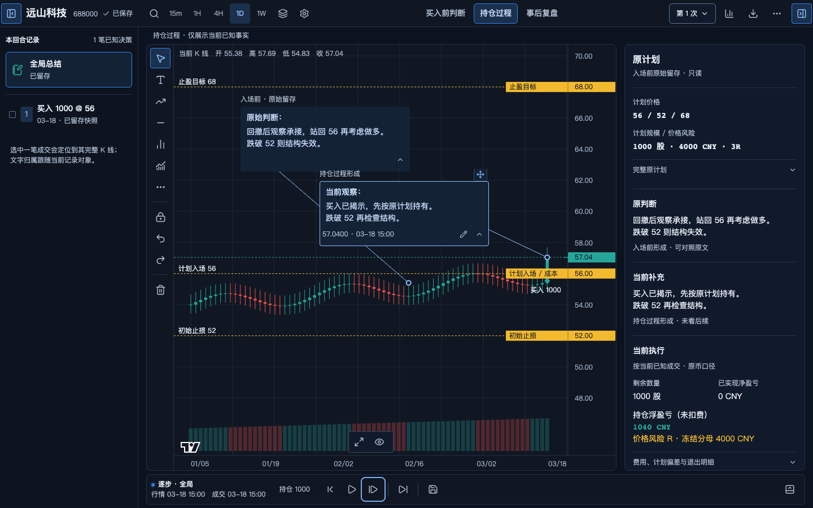

**CB01 图表优先。** 图表与图上批注是主工作面。沿用已确认的整体框架；面板开合为图表释放空间。按可用工作区尺寸安排辅助内容，不规定所有视口具有固定栏数或百分比，不迁移首页方案 B。

**CB02 顶部紧凑。** 标的、周期、阶段、状态和主要动作组成紧凑工具区；不新增只承载标题、说明或演示身份的常驻整行。优先减少重复信息、冗余容器内边距及大按钮外壳。真实业务提示和错误需要出现时，不能用截字或遮挡换取固定高度。

**CB03 身份与状态。** 显示真实标的名称、代码及周期。产品工作区不出现 `DEMO-L`、`合成样本`、`样板索引`、画板编号和设计说明。草稿、待确认、完成是业务工作流状态；保存中、已保存、失败、冲突是持久化状态，二者可同时成立。用紧凑状态呈现，不能因删除演示标签而删除这些语义。

**CB04 同一工作区的三个阶段。** S0 入场前、S1 持仓中、S2 退出后是规格中的阶段简称；导航保留已确认完整名称“买入前判断 / 持仓过程 / 事后复盘”，本文件不授权重新命名。三个阶段共享图表与标注，当前阶段有稳定的选中反馈。行情可知截止与成交揭示截止各自清楚，不能合并成一个误导的时间。切入事后复盘属于主动揭示完整历史，必须保留已见后续来源；返回早期不能消除该标记。

**CB05 判断的形成阶段。** 原判断与后续观察保留关联和可见证据，可以展开对照原文。新增内容注明形成阶段；已经看过后续行情后回填的历史分析标记“复盘补记”。不把事后结论伪装成入场前判断，不以改短固定评论或删除内容解决布局。

**CB06 计划与事实。** 计划入场、止损、目标与实际成交、成本、当前行情在颜色、线型、标签或标记上可区分。计划数量以股数/金额/仓位百分比中的一个主输入表达，派生值与资金/风险联动，不把多个输入伪装为独立同时生效。参考资金标明币种、时间和来源。未知数量、风险、R 不显示成 0。每笔退出的提前退出判断（是/否/不确定/尚未填写）、原因和遵守计划情况按对应决策分别保存；尚未填写不等于不确定。

## 文字、颜色与尺寸

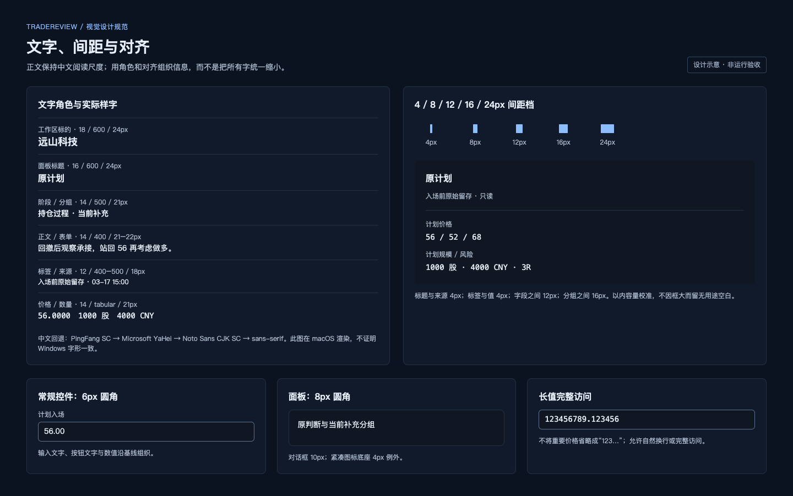

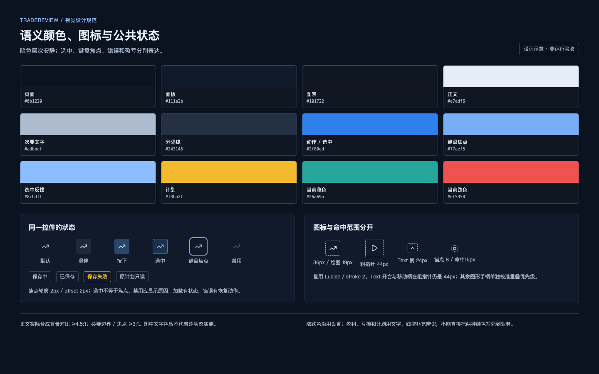

**CB07 文字角色。** 中文使用现有字体体系和系统中文回退；数字采用等宽数字。正文不因面板变窄而整体缩小。既有规范的文字角色如下；这些是角色参数，不授权页面外层通配选择器统一覆盖所有字号。

| 角色 | 字号 / 字重 / 行高 | 使用范围 |
| --- | --- | --- |
| 工作区标的标题 | 18 / 600 / 24px；窄空间 16 / 600 / 24px | 标的身份 |
| 阶段、动作 | 14 / 500 / 21px | 阶段、常用动作 |
| 面板标题 | 16 / 600 / 24px | 计划、记录等面板 |
| 分组标题 | 14 / 500 / 21px | 原判断、当前补充等 |
| 正文、表单内容 | 14 / 400 / 21–22px | 多行中文、输入内容 |
| 标签、次要说明 | 12 / 400 或 500 / 18px | 字段名、来源、时间 |
| 关键数值 | 14 / 400 / 21px，tabular numerals | 价格、数量、风险 |
| 图上 Text 默认 | 14px / 1.5 | 允许沿用已保存字号与用户样式 |

Text 的保存字号 12、14、16、18、24、32px 是现有支持范围；不得统一重置旧对象。Canvas 字重、字形回退与 DOM 的实际呈现须共同校准，不能仅凭相同 font-family 字符串判为一致。

**CB08 语义颜色。** 沿用现有暗色主题与用户盈亏配置。页面 `#0b1220`，面板 `#111a2b`，图表 `#101722`，正文 `#e7edf6`，次要文字 `#adbbcf`，更弱文字 `#9cacc2`，分隔 `#243145`。蓝色 `#2f80ed` 用于动作与选中，焦点 `#77aef5`；计划强调 `#f3ba2f`。现有涨跌色 `#26a69a / #ef5350` 通过设置使用，不直接写死到盈利与亏损语义。背景、标签、选中与错误不只依赖颜色区分。

**CB09 间距与边界。** 采用 4、8、12、16、24px 间距档；相邻文字和字段基线稳定。输入框、按钮与图标围绕同一对齐线组织，长值优先换行或提供完整访问。常规控件圆角 6px，面板 8px，对话框 10px；现有紧凑图标底座 4px、价格标签的直角外观可作为明确例外。大框不能只有一小段正文却保留无用途空白。

**CB10 图标与命中。** 复用 Lucide 线性图标，常规线宽 2，常用图标约 18px、绘图工具约 19px、辅助图标约 16px；混用时按视觉重量校准。桌面常规控件命中至少 36×36px，粗指针至少 44×44px。Text 内的紧凑开合柄和独立移动柄是明确例外：细指针命中至少 24×24px，粗指针至少 44×44px。其他图形锚点手柄的既有细指针目标为16px、粗指针至少44px，按邻近目标优先级单独校准，不误套常规按钮外壳。小可见图标与大命中范围分别记录。

## 公共控件与框架

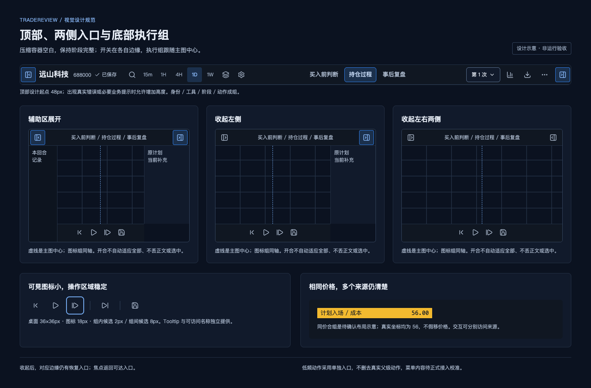

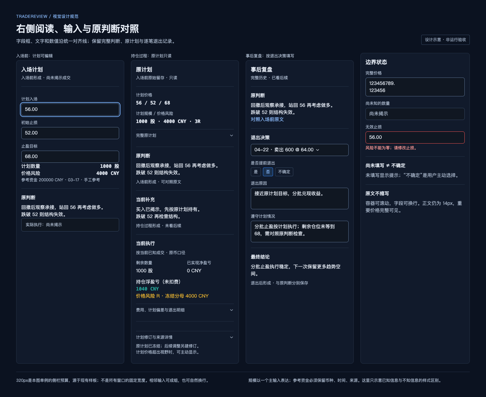

**CB11 控件状态完整。** 按钮、输入、菜单和图形覆盖默认、hover、active、selected、focus-visible、disabled、loading、error、readonly。焦点与选中不同：键盘焦点有独立轮廓，选中保留持续反馈。禁用控件说明原因；保存失败提供可达的重试动作。悬浮提示不能替代图标的可访问名称。

**CB12 边缘开合。** 左面板入口在工作区左侧，右面板入口在右侧，收起后仍可在对应边缘恢复。开合不推进回放、不改变判断来源、不清掉选中对象，不自动“适应全部”。组件被卸载或移动时，焦点回到可达入口；折叠不丢面板正文、编辑草稿与滚动位置。

**CB13 底部执行组。** 上一根、播放/暂停、下一根、下一笔决策、留存/更新快照以紧凑图标组呈现，在主图工作区水平中心对齐。状态信息和低频记录动作放两侧，不因文案长度推走中心线。开合面板后中心线随主图工作区更新。必要动作有名称、Tooltip、焦点和错误状态；下方按钮不统一做成大块文字按钮。

**CB14 工具与价格标签。** 图表工具栏密度一致；选中工具可辨。右轴与计划标签作为同一个空间预算检查，文字基线、背景高度和价格列对齐。相近或相同价格有可辨的多个来源；密集标签不能覆盖 K 线、截断价格或仅靠看不见的线表达。目标超出视野时保留侧栏数值，并提供主动显示计划价格的入口，不无故缩放主图。

## 图上 Text 与绘图

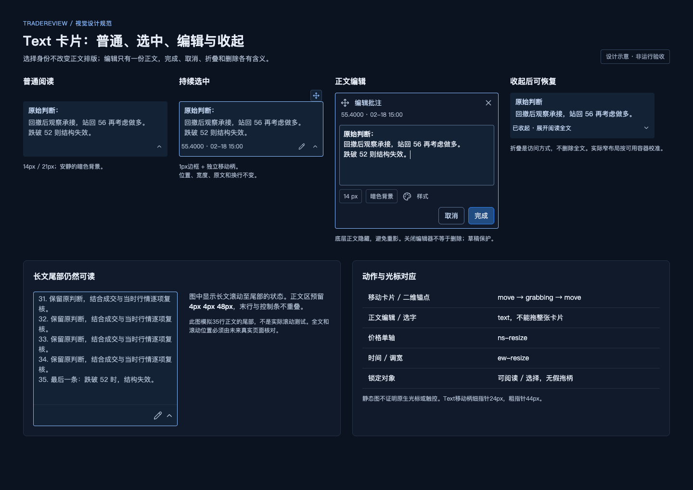

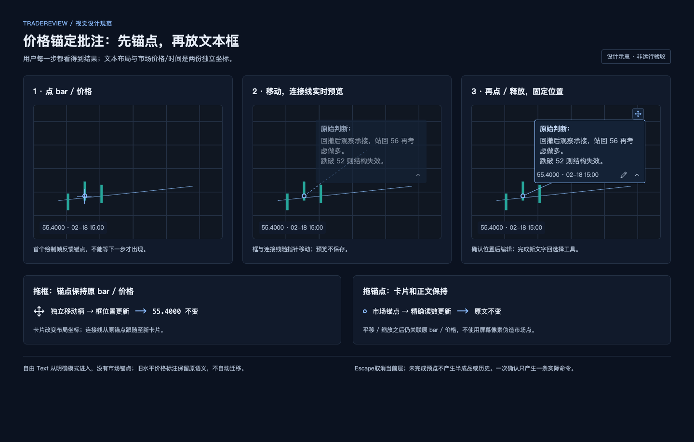

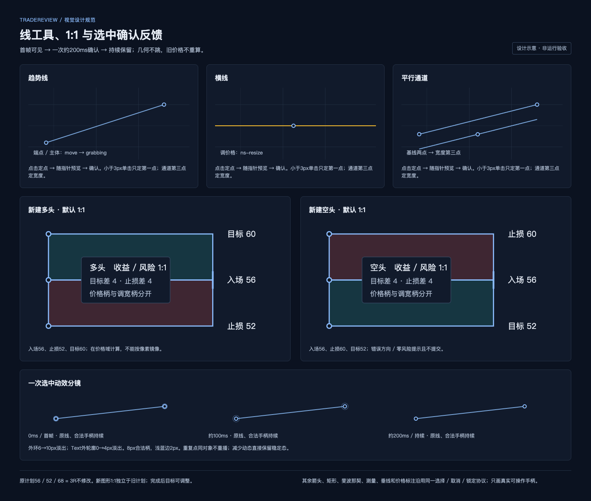

**CB15 价格锚定 Text。** 先点真实 bar/价格建立锚点，移动时显示从锚点到候选文本框的连接预览，再确认文本框位置。锚点记录市场时间和价格，文本框记录独立布局位置，价格与bar时间准确可见。平移或缩放后连接仍跟随同一 bar/价格；拖动文本框不修改锚点，移动锚点不改文本框与正文。新文字完成后回选择工具。自由 Text 由明确模式切换进入，已有水平价格标注保留其语义，不自动迁移成锚定 Text。

**CB16 Text 结构。** 默认卡片使用安静的暗色背景、14px/1.5 的中文与小型开合/编辑控件。取消选择、选中与编辑不突然变成高亮色大框；控制条不挤占正文，编辑时隐藏底层重复正文。主操作常驻、样式入口可见且窄屏可达。长文展开区保留已校准的 `4px 4px 48px` 内边距，最下行与开合柄不重叠。收起后明确可恢复，关闭编辑器、折叠正文与删除对象是三个不同动作。

**CB17 Text 拖动与编辑。** 选中后仍能反复移动；拖动柄 hover 可辨、拖动中显示移动光标，释放恢复。正文编辑使用文本光标和正常选区，不能拖整卡；价格锚点、卡片、控制条各自命中明确。Escape 按交互层级取消或回滚；未提交编辑不能静默丢失。选中前后正文换行、卡片尺寸与位置保持稳定。

**CB18 连续绘制预览。** 趋势线、横线、竖线、价格标签、盈亏比等工具点击后立即出现锚点或预览，移动期间反馈当前候选，确认释放后形成最终对象，不能等第二步结束才突然出现。两点线和盈亏比支持两步点击及按住拖动释放；小于3px的单击只定第一点，不提交零长度对象。通道先定基线再定宽度。取消预览不留下半成品，不为每帧预览写历史或持久化。

**CB19 选中反馈。** 新选中对象只播放一次约 200ms 的确认动效，手柄外环半径6→10px、Text辅助轮廓外扩0→4px并透明淡出，随后保留持续轮廓、主线或手柄。线对象主线约 2px；Text 持续边框约 1px；可见锚点手柄约 8px、浅蓝边2px。反馈使用独立主题色 #8cbdff，不改用户保存的线色/opacity；低透明对象选中仍可辨。动效层不抢指针、不扩大滚动区域，结束时真正消失。hover 不等于 selected，重复点同一对象不反复跳动。选中动作在同一图表帧中不改变正文换行，几何偏移不超过 1 CSS px。减少动态效果偏好跳过动画，保留稳定选中态。

**CB20 取消、锁定与光标。** Escape 优先关闭编辑/选择子模式，然后回滚当前拖动，再取消创建，再清除选择。空白处取消选择不误建图形。二维锚点/移动柄使用 move/grabbing，单轴价格使用 ns-resize，时间/宽度使用 ew-resize；正文文本光标、绘制与图表平移光标也须对应。整个拖动及释放/取消后保持正确。锁定对象仍可查看和选择，但没有暗示可拖动的手柄；仅改变 CSS cursor 不证明系统显示已验收。

**CB21 盈亏比默认值。** 仅新建多头/空头盈亏比图形默认 1:1。在价格域按目标=2×入场−止损、项目统一价格精度计算，不按屏幕像素镜像。例如多头入场 56、止损 52，则目标 60；空头入场 56、止损 60，则目标 52。零风险、错误方向或无效价格须提示且不提交，不能自动翻转止损。完成后目标/止损可独立调整，原有目标、已保存比例和用户修改不重写。原计划 56/52/68 的 3R 可与新建 1:1 图形共存，两者不是同一个默认规则。

**CB22 其余工具一致性。** 箭头、矩形、通道、斐波那契、测量及价格标签使用同一选中、取消、锁定、历史和阶段协议；只展示真正可用的手柄。工具菜单完整可达，关闭时归还焦点且不向图表透传点击。极小图形仍能访问价格、数量和风险；不借扩展本轮范围重写各工具计算算法。

## 状态、适配与输出

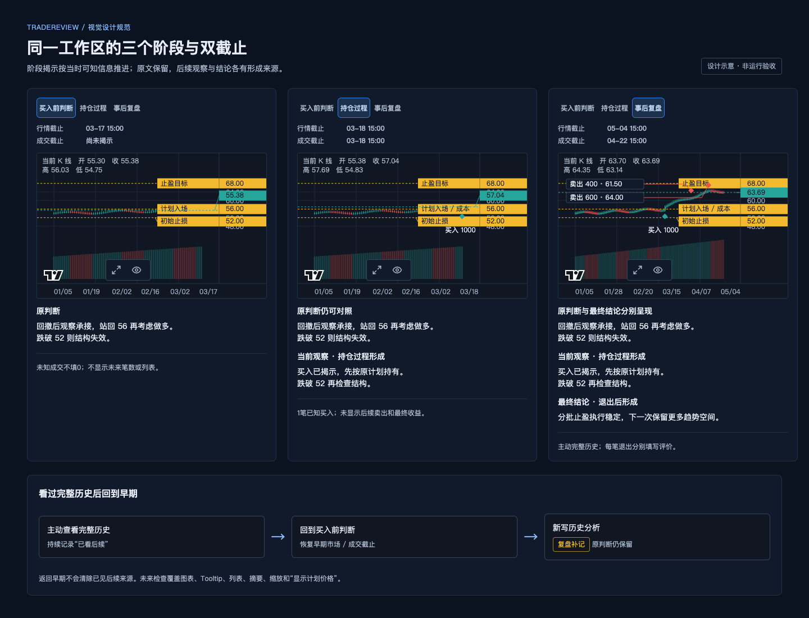

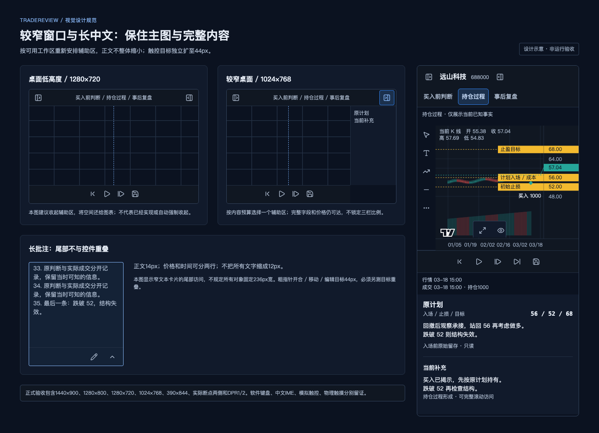

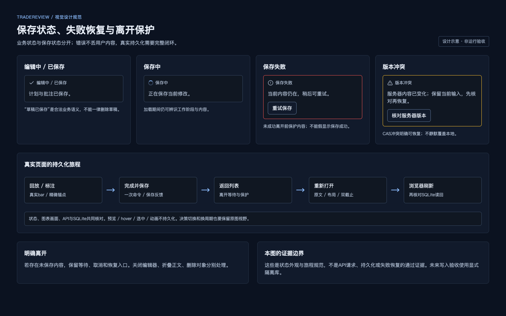

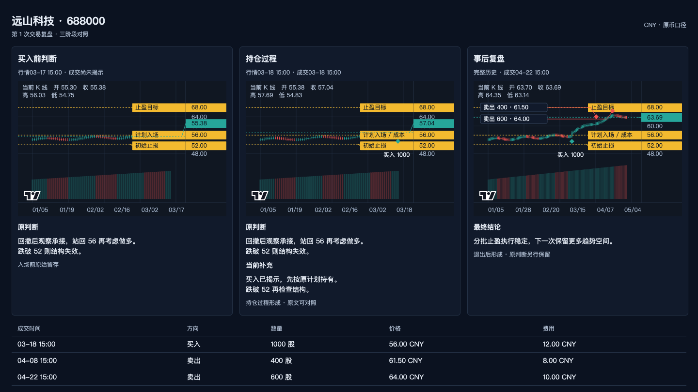

**CB23 信息边界。** S0/S1 只显示截止前可知的行情与成交。未来信息检查包括图表、Tooltip、列表、摘要、自动缩放和“显示计划价格”。完整历史为主动动作，持续告知已见后续；返回早期回放后新增内容保持补记来源。下一根或下一笔的成功必须在真实图上看到目标 K 线或成交。

**CB24 原判断与当前补充。** 阶段推进后原图形与原判断仍可追溯且不被覆盖。右侧按原计划/判断、当前补充、执行事实分组，标题、标签、正文、数值与框边统一对齐。S1 的原计划只读，修订另外记录，不强迫提前写最终结论；S2 分开最终结论与原文，以退出决策选择器查看对应判断。完整长内容、记录与快照可滚动、展开或跳转查看。

**CB25 窄窗口与长内容。** 先减少低频常驻项、收起辅助面板，再按实际主工作区预算调整呈现。窄屏可采用单辅助面板/抽屉等现有结构，不能把桌面各区统一缩小。保留图表有效绘图区至少 240px 的既有约束；这不是允许把正常桌面主图长期压成 240px。手机键盘、中文输入法、粗指针和桌面窄窗口分别验收。

**CB26 保存与返回。** 选中/预览不是数据提交。确认的操作进入一次历史动作和正常保存队列。保存失败或 revision 冲突保留用户内容、可重试；离开时的等待与保护正常。保存、返回列表、重新打开、浏览器刷新后，锚点、文本、尺寸、阶段来源和截止可核对一致。

**CB27 输出与无障碍。** 既有三阶段图像导出保持16:9，并保留完整三阶段内容、价格、形成阶段和交易表，不把工具、焦点框、选中手柄带入成品，也不为缺失阶段编造判断。保留图表现有署名。中文正文、焦点、图标名称、键盘操作及语义对比度均为产品质量要求；实际半透明背景按合成颜色测量。

**CB28 例外登记。** 已保存的颜色、宽度、字号、比例等合法用户设置优先保留；必要错误/知识边界提示允许占用额外空间。任何其他偏离需注明触发状态、理由、受影响元素、证据和接受人。未经确认的断点、侧栏宽度或高度上限不得从截图偶然值升级为固定规则。
