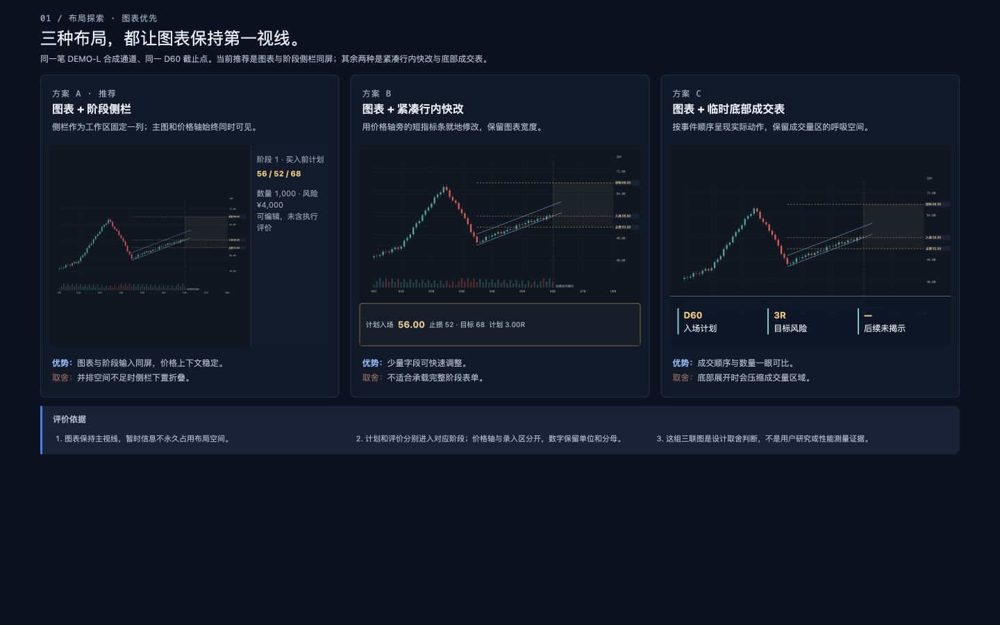

# 首页图文规范 1.0

首页把用户从“现在发生了什么”带到“下一步该做什么”。本代表预览先校准基础视觉规范和交互分镜；内容是设计说明，不是生产首页的事实快照。

## HP01 · 先看任务，再看分区 {#chapter-HP01}

<!-- stable-id: HOME-HP01-intro -->
首页首屏先回答三件事：当前范围是什么、哪些信息需要判断、下一步入口在哪里。布局说明保留真实页面的层级关系，样本文字只用于展示阅读密度。

| 对象及规则 ID | 要求与参数 | 如何判断符合 |
| --- | --- | --- |
| 页面标题 HOME-T01 | 使用 24px 专题标题，正文 16px/1.8；暗色环境下标题与说明有清晰层级。 | 不打开原图也能找到本章重点，正文不会被元数据抢走。 |
| 分区导航 HOME-T02 | 桌面侧栏约 248px；窄窗移到顶部，目录链接保持键盘可达。 | 目录与正文顺序一致，长标题可读且不造成横向溢出。 |
| 首屏动作 HOME-T03 | 核心入口位于首屏，并与当前范围、状态说明相邻。 | 用户能从说明直接定位下一步，不需先读完整附录。 |

图 HP-IMG-01｜这张图用于说明区域关系；示意图不代表首页已实现的内容或尺寸。

## HP04 · 状态变化与回看 {#chapter-HP04}

<!-- stable-id: HOME-HP04-intro -->
交互说明要把前态、用户动作、过程反馈和回看入口放在同一条阅读路径里。每一步都标注哪些信息已经可见，避免把设计分镜误读成产品实测。

:::state-demo
../../../../designs/2026-09-25-chart-first-review/handoff/images/02-chart-workspace.png|前态 · 仅显示当前范围|用户还没有展开后续信息；说明强调当前范围和可执行入口。
../../../../designs/2026-09-25-chart-first-review/handoff/images/07-interaction-states.png|动作后 · 显示反馈|点击下一步后，状态提示和相关区域出现；页面保留原判断上下文。
../../../../designs/2026-09-25-chart-first-review/handoff/images/05-final-review.png|回看 · 保留来源|回到早期状态时，已查看来源仍应可见；这是设计分镜，不代表真实回放结果。
:::

| 对象及规则 ID | 要求与参数 | 如何判断符合 |
| --- | --- | --- |
| 状态分镜 HOME-I01 | 提供上一步、下一步、重播；支持键盘左右键和 Escape；尊重减少动态。 | 当前图、状态标题和说明同步变化，末尾按钮明确不可用。 |
| 来源标记 HOME-I02 | 回看早期状态时保留已看后续来源，设计示意与产品实测分开标注。 | 读者能区分前态/后态，也能理解回看不是重新开始盲看。 |

查看实现提示

分镜图片可以评论，评论身份由 HOME-DOC、版本和 occurrenceId 冻结；不沿用策略台章节身份。

