# 首页视觉与交互规范 · 现状基线 v1.0

本文解释 TradeReview「我的交易室」当前为什么这样组织、每块希望你注意什么，以及后续实现和验收需要保留什么。唯一产品基线是 master 7a5d137d（2026-10-15 核对）；其它 worktree 用于追溯需求和取舍。正文记录现状，独立的《现状问题评估》讨论改进。

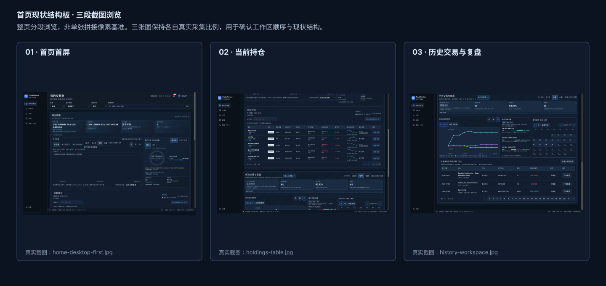

图 HOME-00A｜由 `home-desktop-first.jpg`、`holdings-table.jpg`、`history-workspace.jpg` 构成的三段真实截图板，用于确认当前首页的分段顺序和工作区关系；整页分段浏览，非单张拼接像素基准。

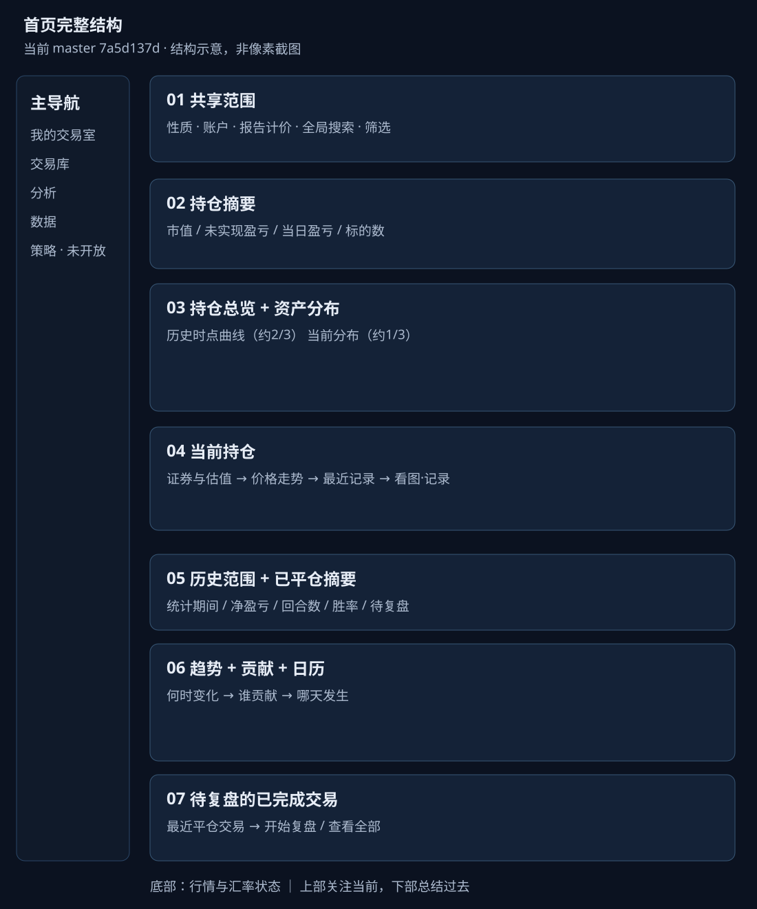

图 HOME-00｜完整结构示意，按当前组件顺序绘制，不作为像素截图。各章紧接真实基线截图，标准桌面对照为1440×1000。数据为本地隔离副本的采集样本，金额、数量、行情覆盖会更新，不是固定验收数值。

## 01 先理解首页的任务与取舍 {#chapter-HP01}

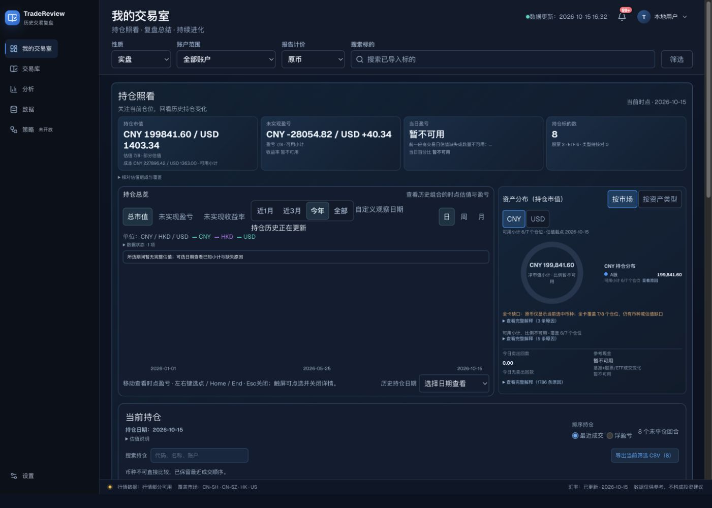

图 HOME-01｜1440×1000 首屏。先看到共享范围、持仓摘要、持仓曲线和分布；历史复盘在继续向下阅读后出现。

首页要帮助你连续回答三个问题：我正在看哪一组交易；现在的持仓处境如何；过去的交易有什么值得复盘。它把“当前状态”和“已完成交易”分成上下两个工作区，因为持仓市值、未实现盈亏与已平仓回合净盈亏的时点和统计口径不同。把它们合成一个“总收益”会让读者误以为可以直接相加。

目前的阅读顺序是：全局导航 → 共享范围 → 持仓照看（摘要、历史估值、分布、持仓行）→ 历史交易与复盘（期间、摘要、趋势、贡献、日历、待复盘）。持仓放在前面，是现有组合对日常照看任务的优先排序；它同时把复盘入口推到了页面下方。这一顺序是当前实现事实，不能把旧稿中“业绩优先”的顺序套到当前首页。

这里的设计取舍可以概括为：先保证数字可解释，再压缩展示；先保留范围与数据边界，再追求一个醒目的总数。小计、覆盖数、币种和缺失原因因此占用了较多版面。它们解决的是“这个数能不能相信”的问题，而不是新增交易指标。这个取舍有价值，但信息密度也构成了当前最大的可读性负担，详见最后的独立评估入口。

| 设计对象 | 当前规则与希望你注意的事 | 验收方式 |
| --- | --- | --- |
| 两个工作区 | 当前持仓与已完成交易分开；每区有标题、说明和时间含义 | 对照全貌图，确认顺序和两种时间不被合并 |
| 共享范围 | 性质、账户、报告计价放在页头，说明所有数字的阅读前提 | 改变范围时核对各模块的范围说明 |
| 局部控制 | 指标、粒度、日期、排序贴近所属模块 | 不把持仓搜索解释为全局搜索，不把图表粒度解释为总统计期间 |
| 证据层 | 结论旁留短状态，长原因放在详情中 | 缺数据时仍能找到原因；未知不写成零 |

### 历史要求如何进入这份规范

2026-09-19 的首页规格强调范围统一、交易表现和待复盘入口；2026-09-21 的反馈强调简约、清晰、展开日期必须有可见结果、金额口径可解释、持仓异常可处理。当前代码保留了其中不少语义要求，但布局已经演变为两个工作区。旧规格中的“默认本月”、三段视图和若干布局描述不能视为当前已落地事实；当前默认期间是今年至今。

其它 worktree 中的首页 v0.2/v0.3 视觉拉齐稿、市场页签和估值修复方案作为候选背景使用，不能覆盖当前截图。本次文档中的“为什么”是根据公开的需求、迭代记录和当前行为整理的设计解释；没有记录支持的动机不写成历史上已经确认的决策。

## 02 页面骨架、层级与阅读节奏 {#chapter-HP02}

图 HOME-02｜页头实际裁切。标题建立位置感，范围标签说明上下文，右侧搜索承担快速查找。

左侧导航提供跨模块位置感，当前项以底色和蓝色标记突出；“策略”带未开放状态并禁用，不能做成可以进入的假入口。页头说明“我的交易室”是什么，右侧更新时间和待处理数量提供信任与工作提示。底部状态条持续呈现行情和汇率状态。

页面用深色底、略亮面板、边线和间距划分区域。工作区边框将一组相关任务包起来，内部曲线和分布再做局部分区。这减少了在多个页面之间切换的成本，也使边框层级偏多。后续按现状复现时应保留结构；减少嵌套层级属于另一次设计变更。

| 层级 | 当前样式和位置 | 验收基准 |
| --- | --- | --- |
| 页面标题 | 实测 24px / 32px；位于正文左上，宽屏左右内距 24px | 1440×1000 对照 HOME-02；不套用旧 CSS 中被覆盖的 19px 标题规则 |
| 工作区标题 | 持仓照看、历史交易与复盘为 19px；标题下有任务说明 | 两区标题同级；内部小图表标题不能抢同样视觉重量 |
| 内部图表标题 | 1440px 下持仓总览、分布、趋势、贡献为 13px；390px 下多处为 14px | 数值是现状实测，未作为推荐可读性目标 |
| 工作区布局 | 桌面持仓曲线与分布约 2:1，间隔 8px；两个工作区纵向间隔 16px | 不拉伸成等宽；1054px 及以下按源码转单列 |
| 当前持仓标题 | 1440px 实测 18px；其表格比摘要紧凑 | 媒体条件下有紧凑样式，详见规则附录 |

## 03 共享范围、搜索与全局工具 {#chapter-HP03}

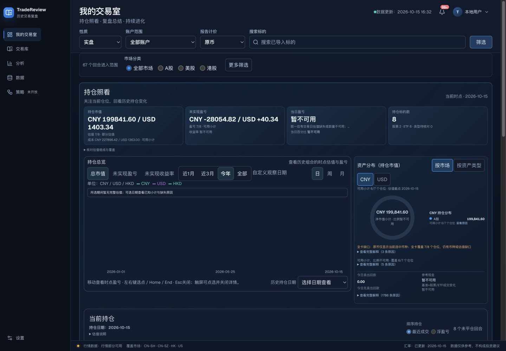

图 HOME-03｜筛选展开态。主控件持续可见，市场与更多筛选按需出现。

性质、账户和报告计价决定“在看谁、用什么口径读”。默认实盘、全部账户、原币；模拟盘要求选定一次运行，不能把不同模拟运行混成一个账户。原币模式下不同币种分别展示，是为了避免未经汇率转换就把 CNY、HKD、USD 加总。

“筛选”采用按需展开，降低默认页头的占用。展开后是市场分类及更多条件；选中条件形成可移除标签。清除附加筛选会清空账户选择及附加条件，但保留性质、模拟运行和日期。恢复默认范围则恢复实盘、全部账户和今年至今；报告计价维持当前选择。两者影响不同，按钮文案必须让用户知道操作范围。

全局搜索帮助快速找到已导入标的；持仓区搜索只缩小持仓列表。通知按钮的 99+ 是数量溢出表达，不表示只有 99 条。用户菜单是本地账户与范围辅助入口，不能暗示云账号能力。

| 控件 | 交互与注意力目标 | 验收步骤 |
| --- | --- | --- |
| 性质 / 账户 / 计价 | 选中值持续可见；模拟盘出现运行选择；不能跨运行合并 | 初始实盘 → 模拟盘未选运行 → 明确提示；再选运行核对范围 |
| 筛选 | 默认收起；点击后展开，同一位置可收起；有附加条件显示数量 | 点击一次看到实际条件区，检查 expanded 状态 |
| 条件标签 | 标签表示已生效范围，删除只移除该项 | 先组合两项，再移除一项，确认另一项仍在 |
| 全局搜索 | 输入、加载、结果、无结果和失败分开表达 | 搜索存在与不存在标的；结果选择进入相应标的上下文 |
| 铃铛 / 用户菜单 | 打开局部浮层，关闭后回到原上下文 | 鼠标、Esc、外点关闭分别核验，不以一个入口代表全部通过 |

## 04 持仓摘要与资产分布 {#chapter-HP04}

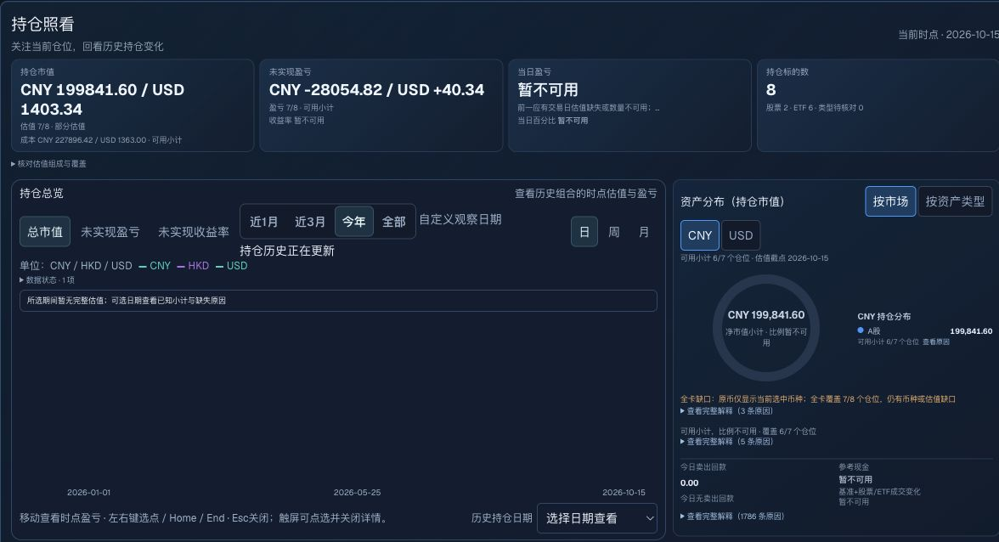

图 HOME-04｜当前持仓工作区上部。上排回答规模、未实现盈亏、当日变化和数量；右侧说明持仓结构。

摘要四格分别是持仓市值、未实现盈亏、当日盈亏、持仓标的数。粗体主值是第一阅读层，估值覆盖、成本和当日原因是第二层。大数字的意义依赖覆盖说明：7/8 是部分估值，不能因为有小计就称为完整组合。

分布图希望你注意集中度，支持“按市场”和“按资产类型”。原币下用币种页签选择可比较的集合；缺失估值时圆环只表达当前可用状态，不能用不完整小计画出可信的百分比分布。现金条把今日卖出回款与参考现金并列，二者含义不同，回款不等于账户余额。

| 元素 | 现状与设计意图 | 验收方式 |
| --- | --- | --- |
| 主值与覆盖 | 金额 / 不可用在第一层，覆盖数与小计说明紧邻 | 未完整覆盖时，“部分估值/可用小计”不能因窄屏消失 |
| 不可用 | 没有可靠的分母或当日基准时显示暂不可用 | 与真实 0.00 分开；保留可展开原因 |
| 分布切换 | 按市场 / 按资产类型是同级按钮；CNY/USD 等为币种页签 | 切维度与切币种分别核验，不误写为账户维度 |
| 原因详情 | 短说明先给判断，完整解释按需展开 | 原因多时可读且不挤出主数值；可用状态不能遮住全卡缺口 |
| 现金条 | 今日回款和参考现金标明各自口径 | 不把缺失现金基准显示成零余额 |

## 05 持仓历史、选点和日期状态 {#chapter-HP05}

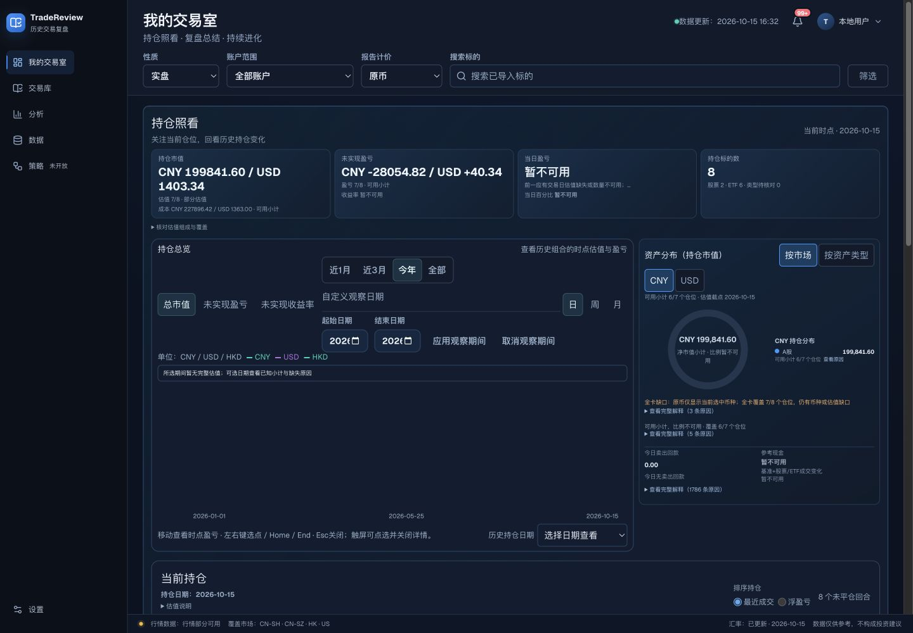

图 HOME-05｜观察期编辑在图表附近展开。输入是草稿，应用之后才改变生效区间。

持仓曲线把“当前有哪些仓位”延伸为“过去的组合如何变化”。总市值、未实现盈亏、未实现收益率回答不同问题，因此作为指标切换；日、周、月改变曲线粒度。观察日期属于持仓历史，历史交易的统计日期属于下方已完成交易，两者不能共用一个模糊的“日期”标签。

当前近1月的语义是本自然月，近3月是近3个自然月；不是滚动30/90天。自定义编辑必须保留“应用/取消”边界。所选期间没有完整估值时保留缺失状态和已知小计入口，不能用一条零线制造“组合没有变化”的印象。

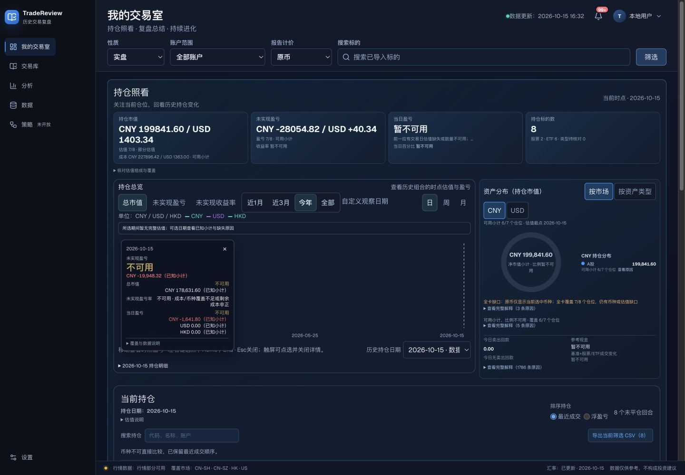

图 HOME-06｜真实日期选择后的详情采集。该截图用于说明已知小计与不可用共存；提示框可能随指针离开或重算关闭，当前行为还需独立稳定性复核。

| 控件 / 状态 | 期望表达与当前实现 | 验收方式 |
| --- | --- | --- |
| 指标与粒度 | 选中态持续高亮，维持同一观察区间 | 切指标、切粒度后分别核对标题、单位、点值 |
| 自定义日期 | 点击展开输入；应用提交草稿；取消保留原范围 | 先输入不合法起止，检查错误和旧范围；再应用合法期间 |
| 日期选点 | 指针、日期下拉和键盘入口提供时点详情 | 左右 / Home / End / Esc 逐一检查；无数据点仍能解释缺口 |
| 重算与失败 | 正在更新、失败和重试有独立反馈 | 不把旧曲线误标为新期间已完成；重试成功再恢复完成状态 |
| 断点与缺口 | 不跨缺失区间虚构连续数据 | 缺失行情样本下核对曲线和覆盖说明 |

### 交互分镜：从浏览到编辑

下方是实际截图的状态对照，可点击下一步回看。它用于讲解行为，不是首页产品动画，也不证明所有产品交互已验收。

:::state-demo
images/state-home-before.svg|浏览首页|持仓区域原图局部，先确认当前范围与持仓状态。
images/state-home-date.svg|打开观察日期|持仓区域原图局部，在图表内展开草稿日期，应用才生效。
images/state-home-point.svg|查看时点|持仓区域原图局部，选日期后阅读小计和覆盖原因，不能把不可用当成零。
:::

## 06 当前持仓：从扫描到记录 {#chapter-HP06}

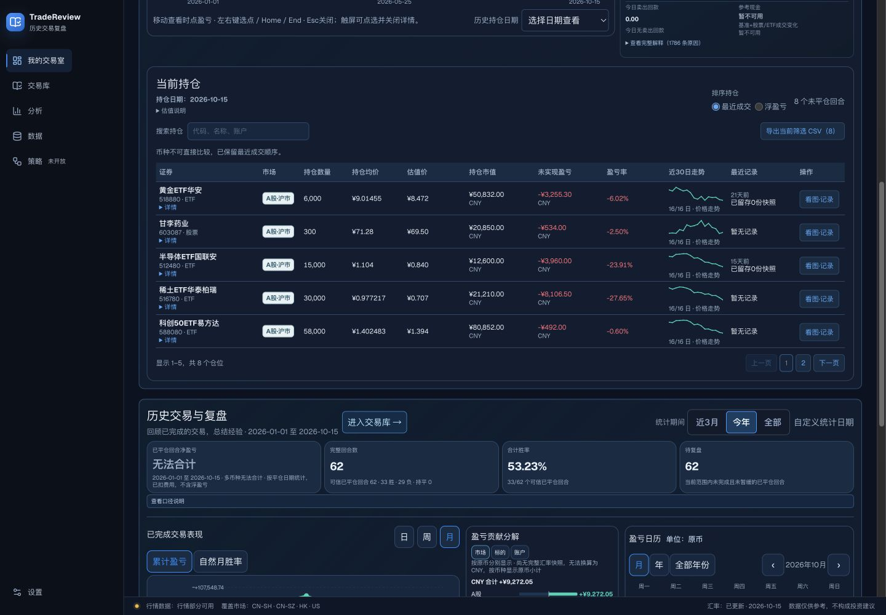

图 HOME-07｜持仓表每页5行。证券识别在左，数量与价格在中，短趋势、最近记录和看图记录在右。

表格把跨标的比较压在同一水平线上，适合快速扫描仓位和变化。名称下补代码与资产类型，避免同名或简称误认；市值和盈亏保留币种；近30日小图表达价格走势，不是仓位收益曲线。最近记录让你看见哪些仓位缺少记录，“看图·记录”把观察接到复盘工作流。

默认最近成交排序，能把近期活动放前面。跨币种不可比较时禁用浮盈亏排序并解释原因，比强行排出一个错误名次更重要。搜索只影响本表，CSV导出当前筛选集合；分页不应把导出误缩成当前5行。

| 列 / 控件 | 视觉与行为规则 | 验收要点 |
| --- | --- | --- |
| 证券 + 详情 | 名称优先，代码与类型次级；完整证据按需展开 | 长名称、同代码多账户、异常数量都应可辨认 |
| 数值列 | 数量、均价、估值、市值、盈亏分列；金额保留符号和币种 | 不为了列宽改变底层精度；精确值可核对 |
| 30日小图 | 价格走势与覆盖数同显，缺数据处断开 | 不把缺口连成完整走势，不标成收益率 |
| 搜索与导出 | 搜索后回第1页；无匹配时明确空态、导出禁用 | 本次已观察“没有匹配的持仓”和 CSV（0）禁用 |
| 行动作 | 看图记录是主动作，核对 / 重试随问题出现 | 按实际行携带回合信息；后续写入验收必须查持久化 |
| 分页 | 每页5行；当前页与边界禁用有差别于可点击页 | 第二页、上一页、搜索后页码归位分别检查 |

## 07 历史交易：摘要、趋势、贡献与日历 {#chapter-HP07}

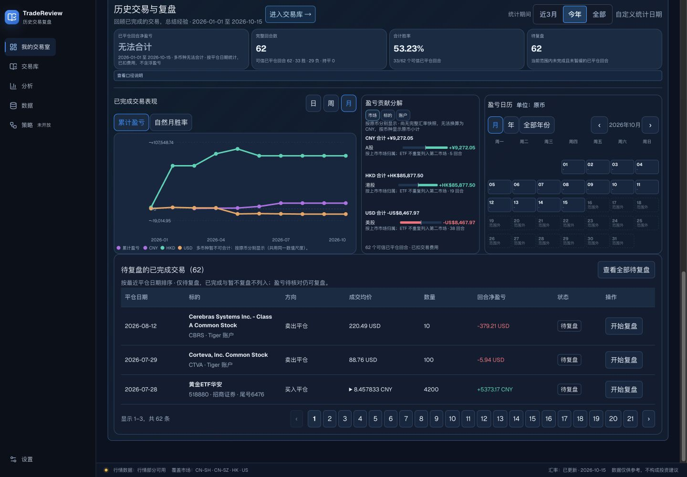

图 HOME-08｜历史区把结论、解释和行动串在一起。已平仓统计不能包含未实现盈亏。

历史摘要先回答赚亏、完成多少回合、胜率和待复盘数量；趋势回答变化发生在什么时候；贡献回答哪些市场、标的或账户形成变化；日历帮助定位具体日期。三个图表不是重复同一个数字，而是时间变化、来源分解与日期定位三种不同阅读方式。

“进入交易库”提供更完整的明细入口；“查看口径说明”承接计算解释。主卡不应被误读为全资产账户收益：当前统计按回合平仓日期，已扣交易费用，且排除不可信样本。多币种缺完整换算条件时显示无法合计，原币曲线仍可分别呈现。

| 模块 | 当前规则与注意力目标 | 验收方式 |
| --- | --- | --- |
| 历史统计期 | 近3月 / 今年 / 全部 + 自定义统计日期 | 区间文字与摘要一致；切换不应把当前仓位删掉 |
| 四个摘要 | 已平仓净盈亏、完整回合数、合计胜率、待复盘 | 胜率有分母；缺换算显示无法合计而非合并原币 |
| 趋势 | 日周月分桶、累计盈亏 / 自然月胜率；横轴时间、纵轴数值 | 原币多线需图例；改变分桶不改变统计定义 |
| 贡献 | 市场 / 标的 / 账户；正负金额和样本数 | 与资产分布维度区分；亏损同时有负号 |
| 日历 | 月 / 年 / 全部年份；翻页、范围下钻、日期详情 | 无样本 / 范围外 / 未来分开；有样本日期可定位交易 |

### 日历如何连接到复盘

:::state-demo
images/state-calendar-before.svg|定位月份|日历原图局部，通过上一月找到2026年8月，12日有一笔可信已平仓回合。
images/state-calendar-detail.svg|选择日期|日历原图局部，点击12日后出现日期汇总、交易和打开复盘入口。
:::

图 HOME-09｜真实日历鼠标操作的状态分镜。这里的1回合、金额和日期仅作为采集样本，验收使用对应测试数据的期望值。

## 08 待复盘列表与行动闭环 {#chapter-HP08}

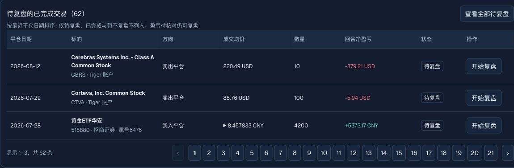

图 HOME-10｜待复盘列表显示平仓时间、标的、成交信息、净盈亏和状态；开始复盘是每行末尾的明确行动。

待复盘把“知道发生什么”转成“留下判断与经验”。它只列当前范围内未完成、未暂缓的已平仓回合，按最近平仓日期排序；盈亏待核对不应使交易失去复盘入口。查看全部待复盘提供完整工作队列，页码使首页长度受控。

| 对象 | 现状要求 | 验收步骤 |
| --- | --- | --- |
| 状态与数量 | 标题数量、分页总数、当前范围相互一致 | 切范围后检查；空列表不能保留旧交易 |
| 行信息 | 标的和账户可识别，方向、均价、数量、净盈亏分列 | 长名称换行不遮挡开始复盘 |
| 开始复盘 | 进入所点回合，而不是默认第一回合 | 点击不同两行、返回、刷新，核对对象与状态 |
| 完成闭环 | 保存后实际持久化，并更新待复盘语义 | 本次仅记录现有契约，未执行业务写入，不宣称该链已验收 |

## 09 视觉样式、状态与动效规范 {#chapter-HP09}

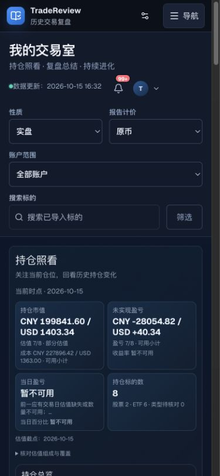

图 HOME-11｜390×844 实测。导航收成顶部入口，范围控件重排，摘要形成两列；这张图是当前状态样例，不代表已完成全部触摸验收。

深色主题依靠明度差和边线区分区域。蓝色用于操作和选中，绿/红用于正负结果，但必须同时有正负号、文本或状态。币种曲线还有独立图例色，不能把所有绿色曲线理解为盈利。禁用状态必须结合真实 disabled 语义，不仅是把文字调暗。

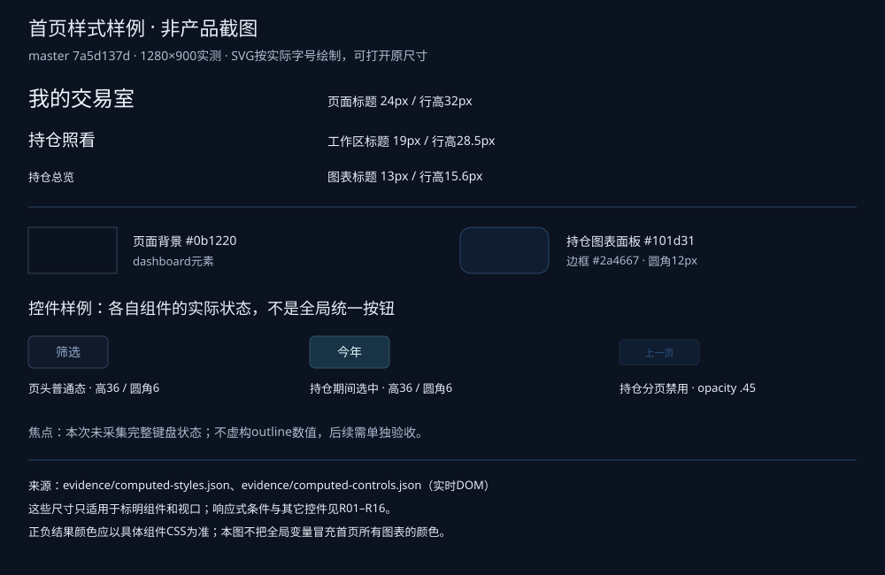

图 HOME-STYLE｜规范样例，非产品截图。具体标题、面板与控件来自1280×900实时DOM样式；精确值见 evidence/computed-styles.json 与 computed-controls.json。焦点状态未完整采集，标为待验。

当前首页存在多套密度：大标题、摘要主值、图表标题、表格正文、说明与日历小字并不统一。这份规范保留实际数值以便比对，不把现状的小字包装成推荐标准。源码细则与适用断点见《规则附录》；浏览器实测优先于从旧选择器推断的值。

| 视觉项 | 当前基线 / 状态规则 | 验收说明 |
| --- | --- | --- |
| 背景层级 | 页面深蓝黑；面板略亮；区域边线低对比；准确 computed 值见证据文件 | 保持背景、容器、选中三层区别，不以截图采样替代 CSS 值 |
| 字体 | UI sans-serif，含中文系统回退；标题24、工作区19、桌面图表标题13px为本次实测 | 字体文件未加载时的具体中文字体未鉴定，不承诺固定字面宽度 |
| 空间 | 桌面正文左右24px；工作区16px纵距、12px内距、9px圆角；图表两列8px间隔 | 嵌套组件各有条件样式，不能把一个圆角推广到所有控件 |
| 输入与按钮 | 页头桌面36px；主要窄屏/粗指针控件按源码≥44px；贡献局部按钮桌面存在23px紧凑值 | 23px是已记录问题背景，不能据此宣称符合触摸目标 |
| 选中 / 聚焦 | 选中用蓝色底和边框；键盘聚焦应可辨识且不改变选中值 | 键盘和鼠标分别验收；截图只证明被采集的状态 |
| 加载 / 错误 | 状态文字、更新中、不可用和重试各有语义 | 不用空白或持续旧值掩盖失败 |

### 动态效果的准确含义

本首页主要以状态切换提供反馈：筛选展开、日期草稿、按钮选中、详情打开、分页替换、图表选点与重算。没有证据支持统一的弹簧动效、数字翻滚或200ms入场规范，因此不能在现状文档中补造这些参数。若后续需要统一动效，应作为独立提案确认时长、缓动和 reduced-motion 行为。

| 触发 | 前态 → 后态 | 动态验收重点 |
| --- | --- | --- |
| 筛选 / details | 收起 → 同区域展开 | 用户能立即看到结果；焦点可继续进入内容 |
| 日期应用 | 草稿 → 校验 / 计算中 → 新范围 | 失败保持原生效范围，避免假完成 |
| 选点 | 默认图 → 日期与点详情 | 文本、日期、金额同一时点；离开/关闭行为一致 |
| 翻页 | 当前行集合 → 新行集合 | 页码与列表一致；不发生持久业务写入 |
| 重试 | 可点击 → 请求中 → 成功/错误 | 请求中不重复触发；失败保留原因 |

### 窄屏规则与边界

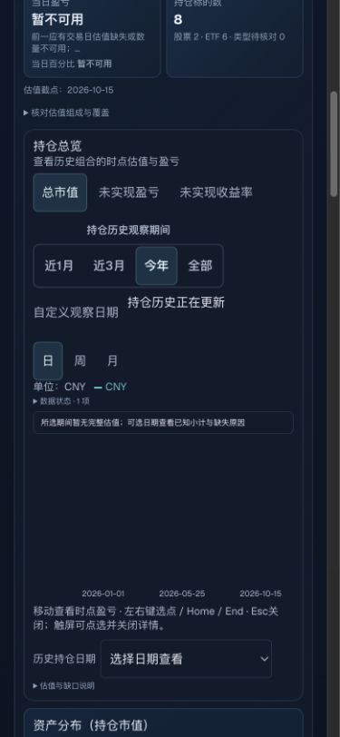

图 HOME-12｜390px 下观察期、指标、粒度分行。缺失数据下仍保持图表位置与解释入口。

持仓总览在1054px及以下改为单列；页头在759px及以下重新排列；320px进一步压缩页边距。持仓表在窄屏保留宽表并允许局部横向滚动，以保持列之间的关系，而不是把所有数值压成难读的小字。移动端存在更长的纵向路径，需要单独评估；不能以“没有整体横向溢出”代替可读性判断。

## 10 如何用这份文档实现和验收 {#chapter-HP10}

本规范包含三类内容：当前源码事实、实际浏览器采集状态、基于证据的设计解释。历史候选方案另外标明。后续实现时先选择要遵循的基线或已批准变更，再逐项核对；不要一边复现当前首页，一边悄悄采用未合入的候选样式。

| 验收层 | 需要的证据 | 本次交付边界 |
| --- | --- | --- |
| 结构与视觉 | 同视口、同范围、同展开状态截图；比较布局、层级、密度和关键元素 | 已采集1440×1000、390×844及各区域状态；详见验收记录 |
| 功能与状态 | 控件触发后可见结果、范围一致性、错误和空态 | 代表性采集不等于所有控件通过；未覆盖旅程明确未验证 |
| 数据与持久化 | 独立测试库中保存、返回、刷新、重新读取 | 产品业务写入不在本次文档任务内；文档评论另行验证 |
| 文档阅读与评论 | 目录、图片原图、状态分镜、文字/图片评论、连续保存和刷新恢复 | 使用独立本地评论存储；正文与图片都有稳定锚点 |

建议按“默认范围 → 筛选 → 持仓观察日期 → 持仓列表 → 历史日期 → 日历下钻 → 待复盘”逐条走查。具体规则编号R01–R16、控件来源和各断点见[规则附录](rules.md)。实际采集和未验证项见[验收记录](evidence/acceptance.md)。

### 资料与独立评估

- [现状问题评估：最大的设计问题是什么](assessment.md)：单独讨论，不改变本文的现状契约。
- [来源与版本说明](sources.md)：master、其它worktree、历史需求和截图来源。
- [规则附录](rules.md)：实现与验收的逐项规则。

评论可以针对选中文字或单张图片；保存后可继续下一条。请优先指出“哪个区域、哪个状态、希望注意什么”，便于把意见落到对应规则。评论保存在本机文件，不是多人实时云协作。
