# TradeReview 首页视觉与交互规范 V2.0

本文是首页 V2 的设计提案、数据口径说明和验收契约。图稿是设计板，不是产品截图；没有实现证据的状态都必须在验收记录中保持 NOT VERIFIED。标准桌面视口为 1440×1000 与 1280×800，100% 缩放；本轮不设计窄屏。所有尺寸、色值、状态和动效均以本文为准，不能从图稿目测后自行改写。

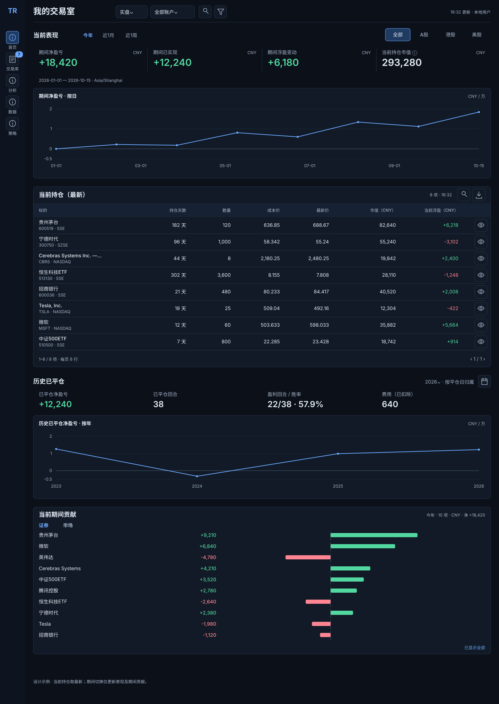

图 V2-01｜1440px 宽完整长画板（目标首屏 1440×1000）：今年表现先出现，当前持仓总为最新，历史区在下方连续展开。

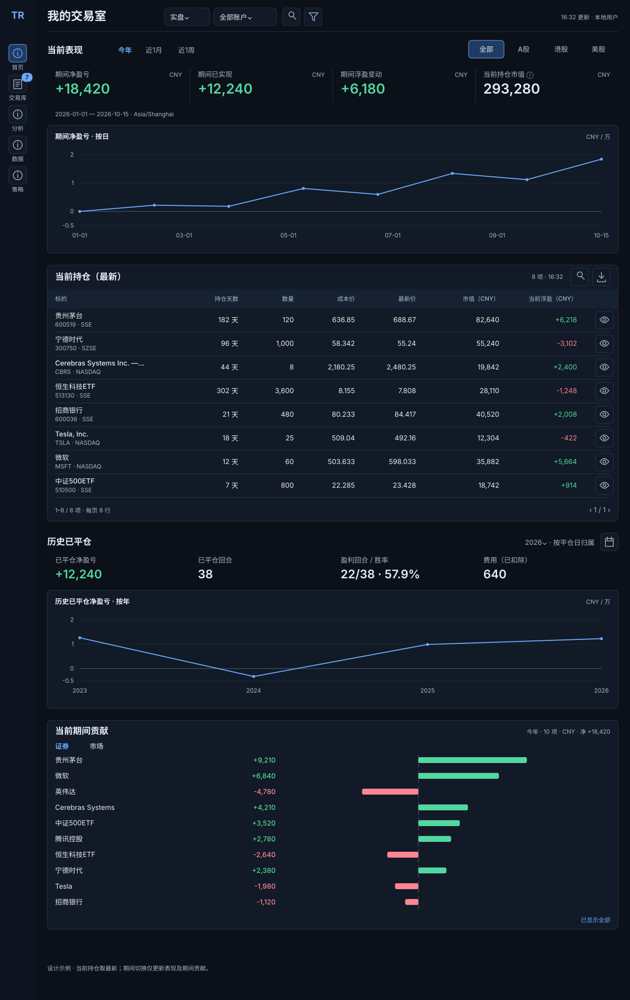

图 V2-02｜1280px 宽完整长画板（目标首屏 1280×800）：保留同一信息顺序和固定表格节奏，压缩空白而不折叠关键口径。

## 首页设计逻辑与取舍 {#chapter-HP01}

首页的首要任务是让用户在一次扫描中回答“今年表现如何、现在持有什么、哪些标的贡献了结果”，然后再进入历史核对或复盘。V2 把“当前表现”放在首屏的第一组结论，把“当前持仓”作为永远指向最新时点的独立工作区，把历史贡献与已平仓结果放在下方。这样既回应了希望首页简洁、减少口号和重复说明的意见，也保留当前状态与已完成交易不能相加的语义边界（C01、C02、C03、C04）。

V1 中“持仓照看 / 复盘总结 / 持续进化”式口号不再占标题下方的一整行。页头只保留产品标题“我的交易室”、当前范围和更新时间；工作区用短标题“当前表现”“当前持仓”“历史已平仓”“贡献分析”。长说明变成标题旁的 `i` 图标，tooltip 首句解释目的，详情放进可访问的说明浮层。这样给首屏留出约 56px 的有效高度，同时没有删除必要的解释入口（C01、C11、C17、C21、C22）。

整页采用单层表面，不使用嵌套卡片或右侧固定资产分布。首屏结构是：左侧 72px 导航；内容区域左右 24px；64px 紧凑单行页头（不放副标题）；公共范围控件；当前表现 KPI；全宽曲线；当前持仓表。历史已平仓与贡献分析在同一主列继续向下，不与持仓并排争夺宽度。资产分布不作为默认常驻块：若未来保留，只能从“贡献分析”或详情进入二级视图，必须先有使用频次证据（C17、C18）。

候选布局有两个。A 方案是“表现优先”：当前表现 KPI 与曲线占首屏，当前持仓紧接其后；优点是回答时效性问题最快，缺点是首次进入时持仓扫描稍向下。B 方案是“持仓优先”：当前持仓先出现，符合 V1 事实；优点是实时盯盘路径短，缺点是今年表现被推到首屏下方。V2 选择 A，因为评论明确要求今年与历年分开、今年更具时效性，同时把当前持仓保留在首屏下段而不是隐藏。这个取舍不把“总资产”或“总收益”造成为跨口径总数（C03、C04）。

页面基础尺寸：1440px 设计画板的正文内容宽 1320px（左侧导航 72px + 左内距 24px，右内距 24px），1280px 设计画板的正文内容宽 1160px（左侧导航 72px + 左内距 24px，右内距 24px）；页头 64px；工作区之间 24px；模块内间距 16px；表格标题区 48px；表头 40px；行高 48px；分页 48px；面板圆角 8px；边线 1px。1440 与 1280 只压缩横向留白和列宽，不改变标题级别、行高、指标口径或交互顺序。窄屏（C34、C38）在本轮明确排除，不能用桌面缩放假装已覆盖。

## 数据指标与年份 {#chapter-HP02}

今年表现默认显示“今年至今”，并提供“近 1 月”“近 1 周”两个快捷范围；删除“近 3 月”快捷项。日期以项目业务时区 Asia/Shanghai（UTC+08:00）切分，日界线为当地 00:00:00，结束日包含至当天 23:59:59。快捷范围表达自然时间边界：今年是本自然年 1 月 1 日至今天，近 1 月是本自然月 1 日至今天，近 1 周是本自然周周一至今天；它们不是滚动 30/7×24 小时。页面必须显示实际起止日期，跨午夜或夏令时的外部市场成交先按业务时区归属再换算。若未来要改为滚动范围，必须作为明确的设计差异重新评审，不能悄然改变 V1 的自然月语义。自定义范围可在日期选择器中输入，点击“应用”才提交；取消或校验失败时维持旧范围。期间控件只影响当前表现的 KPI、期间曲线和“当前期间贡献”分析，不改变当前持仓的最新时点，也不改变历史已平仓按平仓日归年的结果（C03、C04、C08、C16）。当前期间贡献与期间净盈亏使用同一范围、同一汇率和费用口径，证券/市场各行加总后应与期间净盈亏一致；历史已平仓贡献另在 HP06 以年份范围计算，不能与当前期间贡献混称。

四个 KPI 固定为“期间净盈亏”“期间已实现”“期间浮盈变动”“当前持仓市值（CNY）”。每张卡高 88px，标签 14px/20px，主值 28px/34px、等宽数字；前三张随当前表现期间切换，第四张始终读取最新时点。长口径进入 tooltip，不在卡片主面堆叠说明。其中：

`期间净盈亏 = 期间已实现 + 期末浮盈 − 期初浮盈`。

每日“当时实际持仓估值”只在期间曲线的日期点详情中查看：点选某日后，tooltip/详情浮层同时给出该日收盘可用行情下的持仓市值、该日浮盈、截至该日的期间累计已实现和期间累计净盈亏；它不是把当前最新市值回填到历史日期。首页第四张 KPI 的“当前持仓市值”保持最新时点，点击其信息图标可查看当前浮盈、估值覆盖数和原币明细；当前浮盈不能被标签写成“期间浮盈变动”。缺行情或汇率的日期显示不可用原因并保留缺口（C03、C16、C18）。

“期间已实现”按实际平仓成交净额计算，扣除交易费用；跨年交易归入实际平仓日所在年份，部分平仓逐笔按各自平仓日和金额归年；做空同样以实际平仓时间和金额为准。 “期间浮盈变动”是期末浮盈减期初浮盈，不能把当前浮盈总额误写成期间变动。“当前持仓市值”永远读取最新可用行情，属于当前状态，不随“近 1 周”切换到过去的期末。只有覆盖现金和负债时才可以另行设计“总资产”；本 V2 不使用这个名称（C03、C04、C10）。

跨市场“全部”视图统一换算成 CNY，并在 KPI 标题中显示 `CNY`；A 股显示 CNY，港股显示 HKD，美股显示 USD。汇率日期、来源和缺失原因在 `i` 浮层中说明，不能把缺汇率写成 0。正负值同时用符号、颜色和文字；盈利 #53D7A0，亏损 #FF8592，零值使用主文字 #E6EDF7 并显示 `0.00`。极端数字采用等宽数字、千分位和单位缩写但不截断精度：例如 `−¥1,234,567,890.12` 可换成两行，`+12.6%` 仍保留符号；tooltip 给出完整精确值和原币金额。

“历年已平仓结果”按年份分组显示：今年组是当前年份截至今天的已平仓净盈亏，往年组以平仓日归属，跨年买入/卖出或做空都不按开仓年追溯。通常过去年份在结转后趋于稳定，但补录、撤销或修正历史成交时，相关年份必须允许重算，并在区块中显示“已于 YYYY-MM-DD HH:mm（Asia/Shanghai）更新”；不能承诺历史结果绝不变化。年份切换只改变历史区的显示年份，不能反向改变当前持仓 KPI。每个年份展示净盈亏、已平仓回合数、胜率及费用；胜率必须同时给分母，例如 `4/7（57.1%）`，样本为 0 时显示“暂无已平仓回合”，不是 0%（C04、C10）。

跨年口径用一个可复核例子固定理解：上年成本 100，期初浮盈 20（期初市值 120），本年卖出 130，期间已实现为 30、期末浮盈为 0，所以当年表现为 `30 + 0 − 20 = 10`；历史已平仓结果按本年平仓日归属为 30。10 与 30 分别回答“本年持仓变化后的表现”和“本年平仓交易净额”，不能相加或互相替代。若有费用，费用按对应成交/平仓日进入同一口径。

候选指标呈现有二种。A 方案为四卡片并在卡片下方放短口径；优点是结构稳定，缺点是长解释不适合首屏。B 方案将已实现与浮盈变动做成可展开的计算式；优点是透明，缺点是默认视觉密度更高。V2 采用 A 为默认、B 作为 hover/focus 详情：首屏只显示必要的名称、数值和日期，鼠标悬停或键盘聚焦打开计算式，避免“截止该时间段实际盈亏”失去定义。

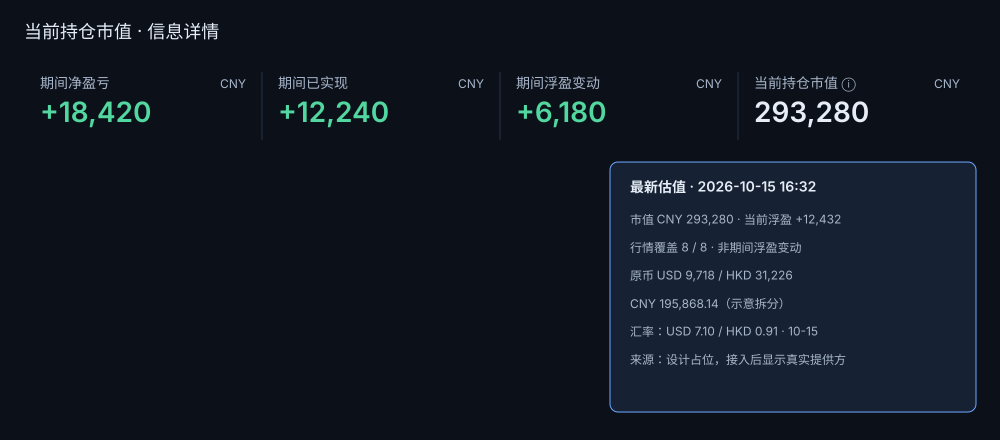

图 V2-30｜当前市值详情：当前浮盈、覆盖数、原币与汇率来源集中在二级浮层；示例拆分不是业务账户数据。

## 公共控件和联动 {#chapter-HP03}

公共控件位于页头，是“范围栏”，不再使用抽象的“性质”标题。左侧依次为 `实盘⌄`、`全部账户⌄`；右侧为搜索图标、筛选图标和刷新/更新时间状态。实盘下拉可切换模拟盘；模拟盘必须进一步选择单一运行，不能把多个模拟运行合并。账户下拉选择账户范围；`全部账户` 的文本本身就是当前值，不再额外占一个“账户”字段（C06、C07、C08、C11、C12、C21）。

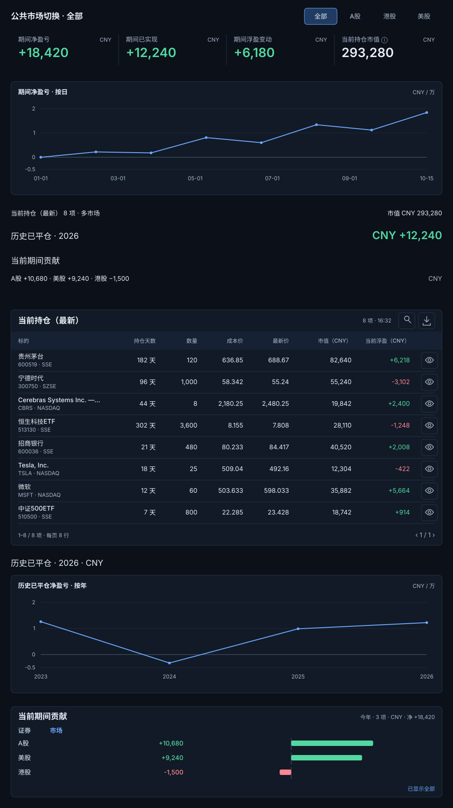

图 V2-03｜全部市场：市场 tab 同时决定历史区的作用市场与币种，全部视图使用 CNY。

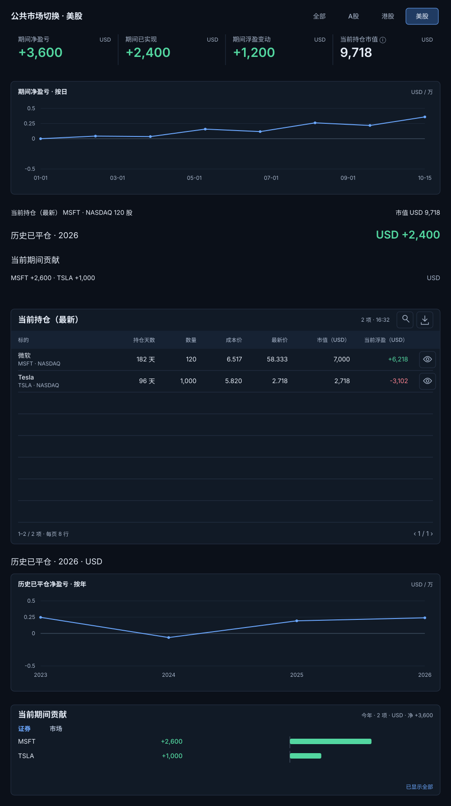

图 V2-04｜美股市场：切换 tab 后，历史区、贡献排序和金额单位一起切换为 USD；当前持仓仍取最新时点。

市场 tabs 固定为“全部 / A股 / 港股 / 美股”。它们作用于首页所有市场相关数据：当前表现按该市场重算，历史已平仓只显示该市场，贡献按该市场排序，当前持仓表筛选该市场。币种不再是独立公共控件，而是由市场决定：全部 CNY、A 股 CNY、港股 HKD、美股 USD。这样市场决定币种，形成单一且可预测的联动，而不是四处重复标签（C05、C15、C16）。

搜索使用图标入口，点击后在页头同一位置展开 360px 宽浮层；浮层有搜索输入、清除按钮、最近使用/热门缓存（若有）和结果分类。结果身份至少显示“标的名 · 代码 · 交易所”，类别筛选可选股票、ETF、基金等；交易所不能只藏在 tooltip。点击结果后进入当前范围内的标的上下文，Esc 或点击外部关闭并回到原页面。搜索浮层展开不推动 KPI 下降，采用绝对定位在页头下方，避免布局跳动（C11、C21）。

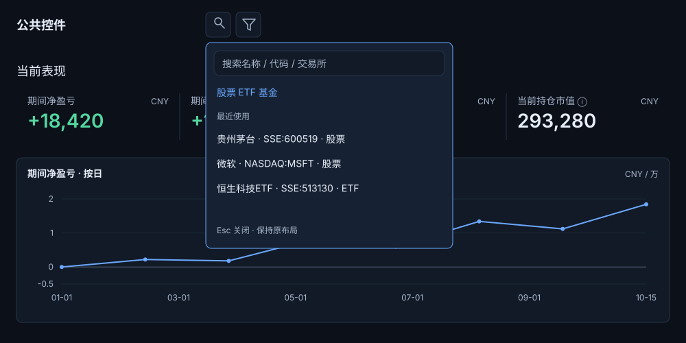

图 V2-05｜搜索点击前后：点击图标后展开浮层，结果含交易所身份和类别；关闭后页头尺寸回原值。

筛选使用图标加计数徽标，点击后展开 320px 宽 anchored popover；条件为市场（与 tabs 同步）、账户、标的类别、是否有未实现数据、是否待复盘。已应用条件在图标旁显示计数和可移除 token，不把动态条件插入页头流式布局。点击“应用”一次性提交；“清除筛选”只清除附加条件，保留实盘/模拟盘、账户和市场；“恢复默认”才恢复全部默认范围。点击外部或 Esc 关闭但不丢草稿。

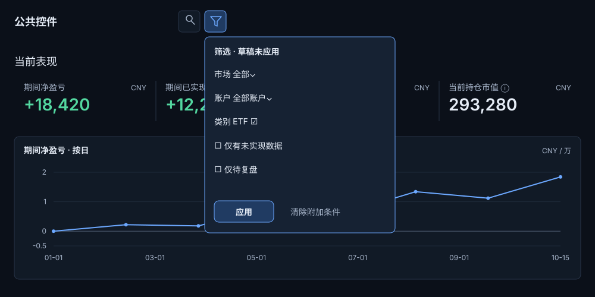

图 V2-06｜筛选打开态：浮层独立定位，页头和 KPI 不跳动。

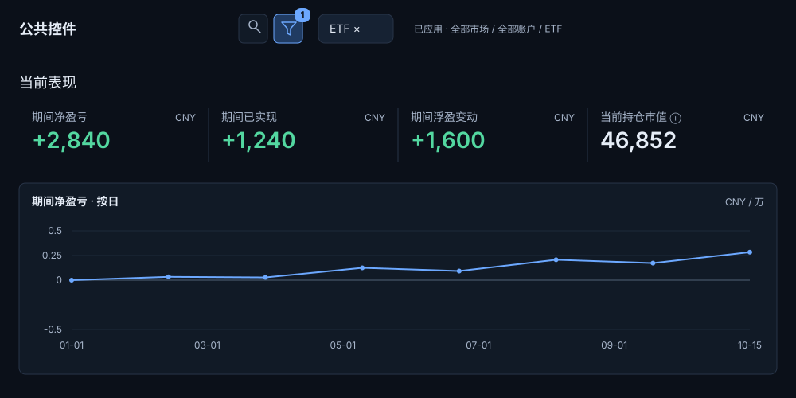

图 V2-07｜筛选应用态：计数、已应用 token 和结果范围同步；清除不误伤公共范围。

公共控件变更后的实际条件必须可见：切市场后 tab、币种、KPI 标题、曲线单位、表格金额标题和贡献维度同步改变；切期间只改变当前表现上区，当前持仓表仍是最新；切账户或实盘范围时所有区块重新取数；请求中显示“更新中”但保留旧有效数据。任何失败都回到上一组完整范围，不能留下半套市场或半个日期。

:::state-demo
images/market-all.svg|全部市场|统一 CNY；历史与贡献同一范围。
images/market-a.svg|A股|CNY，按 A 股重算。
images/market-hk.svg|港股|HKD，亏损显示负号与红色。
images/market-us.svg|美股|USD，曲线与金额一起变化。
:::

:::state-demo
images/home-1440.svg|今年|默认今年至今；前三 KPI 与期间贡献联动。
images/period-month.svg|近1月|本月 1 日至今；当前持仓市值仍为最新 293,280。
images/period-week.svg|近1周|本周周一至今；当前持仓市值仍为最新 293,280。
:::

### 公共控件的操作与返回分镜

下列设计分镜展示草稿、提交和返回边界；文字列明键盘路径。它们是实现合同，不把静态图当作已运行的产品控件。

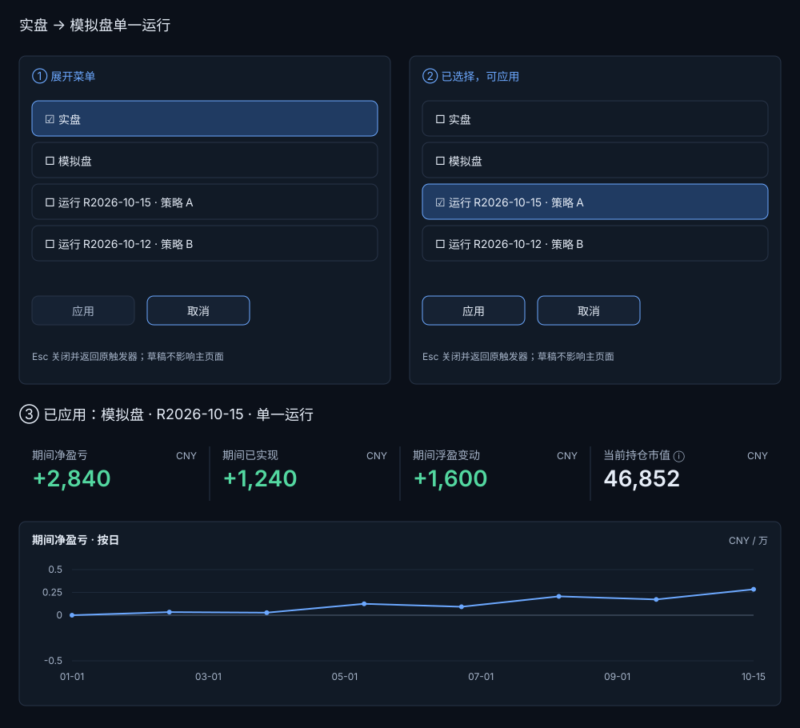

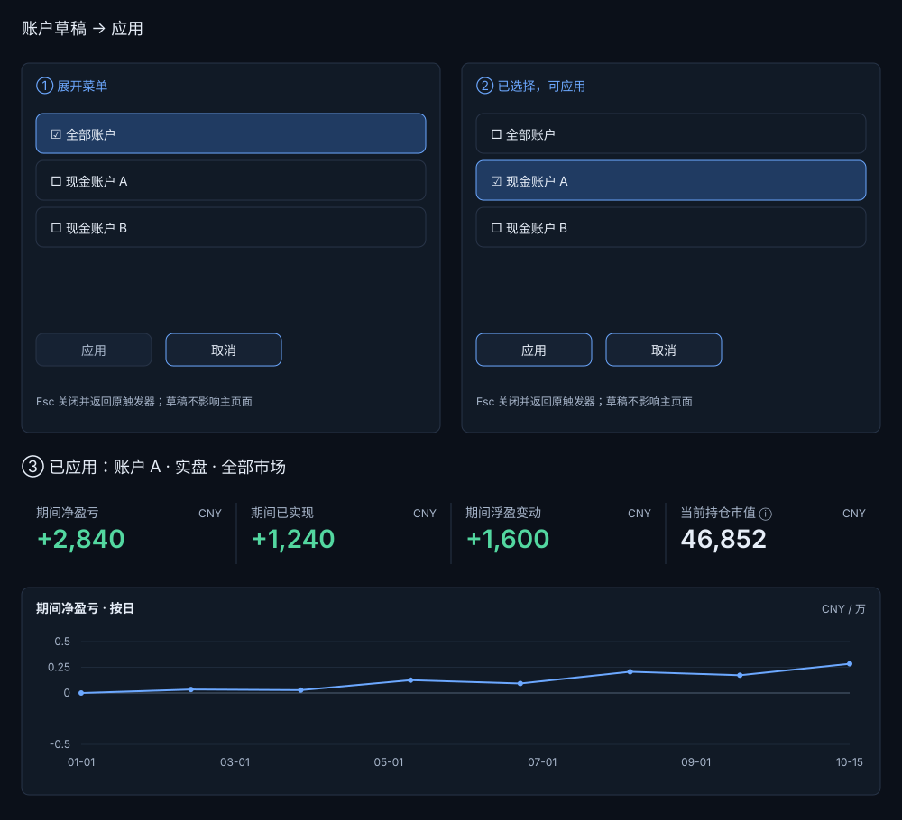

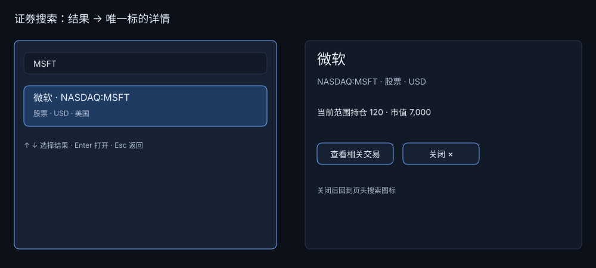

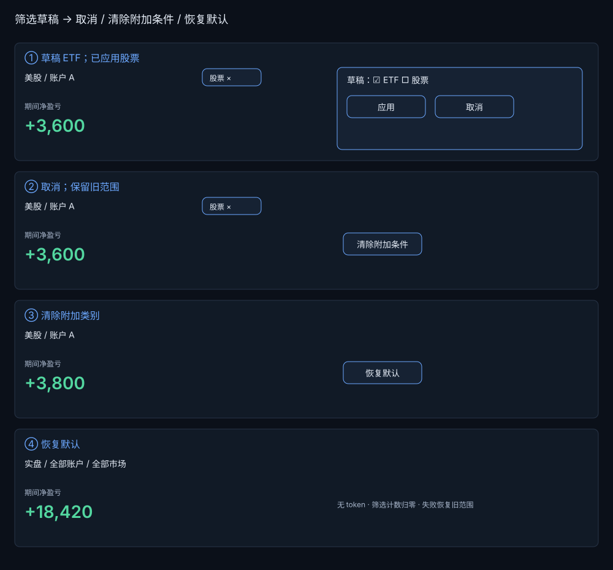

## 曲线和日期 {#chapter-HP04}

当前表现曲线为全宽主图，标题明确写“当前表现｜期间净盈亏（按日）”，横轴为业务时区日期，纵轴为该期间累计净盈亏；它不是账户净值曲线，也不显示账户净资产。图中只有一条主线，组成项“期间已实现”“期间浮盈变动”和计算式放在 hover/focus tooltip 中，不承诺三条系列线或固定三项图例。纵轴单位跟随市场 tab，全部视图标为 CNY/万（刻度按实际数值换算并在 tooltip 给出完整 CNY），单一市场显示对应市场单位。线宽 2px，正值/负值不通过改线色制造断裂；零线 1px #526176，网格线 #1E2A3A 1px、低对比。轴字号 12px、行高 16px，刻度最多 7 个，避免 1440 与 1280 出现拥挤；名称、符号和 tooltip 同时出现（C16、C18、C20、C31）。

当前持仓曲线若在详情中出现，名称明确为“当前持仓市值（最新）”，不得把期间曲线的日期选择悄悄作用到表格。图点 hover 显示日期、当日实际持仓估值、截至该日的期间累计已实现、期末浮盈、期间净盈亏和汇率状态；键盘聚焦沿日期点移动，Esc 关闭 tooltip。点位数据缺失时断线并保留缺口，不能插值连线；缺口可点击查看“该日无可靠行情/汇率”的原因。

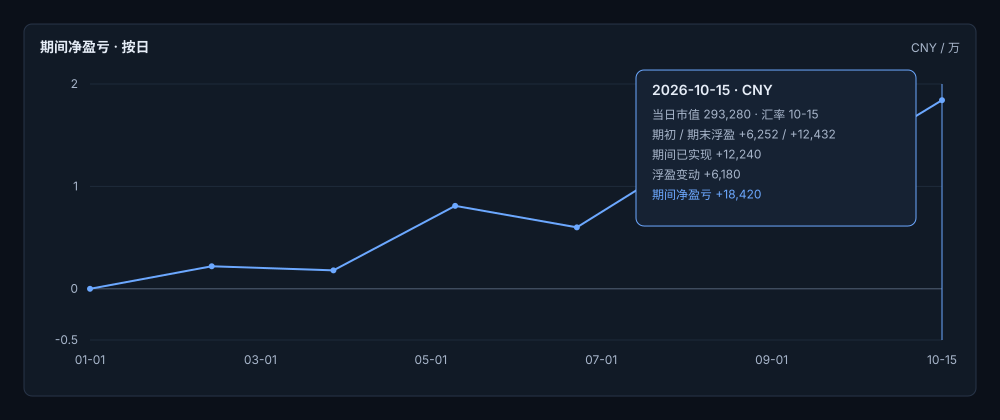

图 V2-08｜曲线 hover/focus：点、日期、数值和口径在同一浮层，图点不会改写下方当前持仓表。

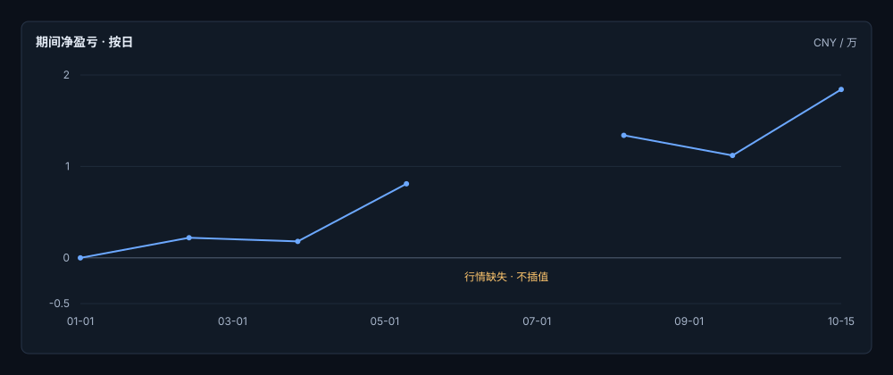

图 V2-09｜曲线缺口：缺失区间断开、保留已知点，显示原因入口，不用零线冒充无变化。

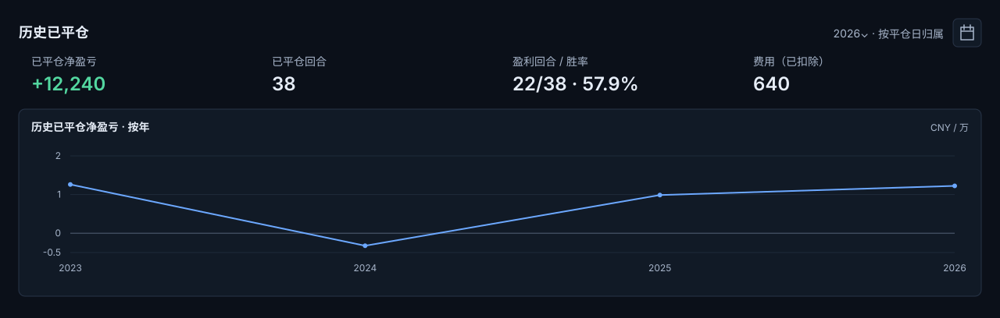

图 V2-09A｜按年已平仓净盈亏设计提案：历史图按年份展示已平仓净盈亏柱/线和年份标签；它不是账户净值图，也不承诺图中存在缺口年份分隔。切换年份不改变当前持仓最新时点。

日期范围编辑采用 anchored popover，输入起止日期与快捷范围；草稿、应用、取消三态清晰。应用后先进入“更新中”，成功后替换上区完整数据；失败则关闭更新态，保留旧范围和旧完整曲线，浮层只提供原因与异步重试。重试不阻塞用户看旧数据，也不改变当前持仓的最新查询。

D01“历史持仓日期”不是回放，不是把首页切回过去后允许修改交易；它只回答“某日的持仓敞口是什么”，用于核对某个图点。当前没有测量证据证明它频繁使用。V2 的展示提案只保留一个位置：图点详情内的二级入口“查看该日敞口”，优点是保留核对能力且不占首屏，缺点是发现性较低。页头一级“历史日期”不纳入展示。是否最终保留这个二级入口仍需用户确认；若确认删除，则从图点详情、`snapshot-options.svg` 和验收矩阵一并移除，不另保留第二个位置（C18、C20、C28）。

交互分镜沿用 V1 的 `:::state-demo` 语法，明确每一步的输入、可见结果和不变项：

:::state-demo
images/chart-hover.svg|查看今年曲线点|点击或键盘聚焦日期点，读取截至该日的期间累计已实现、浮盈变动和累计净盈亏；当前持仓仍显示最新值。
images/chart-gap.svg|查看缺失点|遇到缺口时显示无可靠行情或汇率的原因，曲线不插值，应用范围不改变。
images/snapshot-options.svg|打开历史持仓二级入口|从图点详情选择查看该日敞口；这是核对视图，不是回放，是否保留仍待用户确认。
:::

图 V2-10｜日期与曲线分镜：表现期间、最新持仓和 D01 的核对日期分别有独立语义。

:::state-demo
images/date-draft.svg|编辑期间草稿|编辑起止日期不改变已应用数据；取消返回旧范围。
images/date-invalid.svg|起止日期校验失败|错误紧贴字段，应用禁用；旧范围与当前持仓仍可读。
images/state-updating.svg|应用后后台更新|保留上一组完整有效数据，成功后原子替换；失败返回旧范围。
:::

图 V2-31｜期间编辑分镜：日期草稿与应用结果分离。

## 持仓和量级 {#chapter-HP05}

当前持仓标题写“当前持仓（最新）”，副说明只保留更新时间和覆盖状态。表格使用 8 行固定槽位，空行也保留 48px 高度，分页条固定 48px，避免市场切换和 0/5/10/20/50 行数改变页面跳动。表头 40px、正文 14px/20px、代码 12px/16px、金额使用等宽数字 14px/20px，右对齐。证券名最多两行，超长省略号；hover 或键盘 focus 显示全称 tooltip，tooltip 也显示代码、交易所和资产类别。没有行内展开、最近记录列或“详情”按钮；唯一入口是统一的“查看”图标（C22、C23、C24、C26）。

列宽契约：表格内宽为面板宽减左右各 16px。按 25% / 8% / 10% / 11% / 11% / 15% / 14% / 6% 分配标的、天数、数量、成本、最新价、市值、浮盈、查看，合计 100%。1440 画板内宽 1288px，1280 画板内宽 1128px，舍入差额归标的列；查看按钮 36px 居末列右侧。搜索、排序或市场改变均回第 1 页，清除搜索也回第 1 页；同名证券必须以代码+交易所区分身份。

列顺序为“标的 / 持仓天数 / 数量 / 成本价 / 最新价 / 持仓市值（市场币种） / 当前浮盈 / 查看”。持仓天数从开仓日至当前业务日期计算，跨夜按 Asia/Shanghai 归属；当天开仓显示 `0 天`，未知开仓日显示 `—`。`当前浮盈`是最新时点的累计未实现金额，不是期间浮盈变动；期间浮盈变动只在 HP02 的期间 KPI 和曲线中出现。金额标题内含币种，避免每行重复市场和币种。全部市场时持仓市值标题为 `持仓市值（CNY）`，切美股为 `持仓市值（USD）`；原币详情只在查看浮层出现。没有现金、负债覆盖时不称“总资产”。

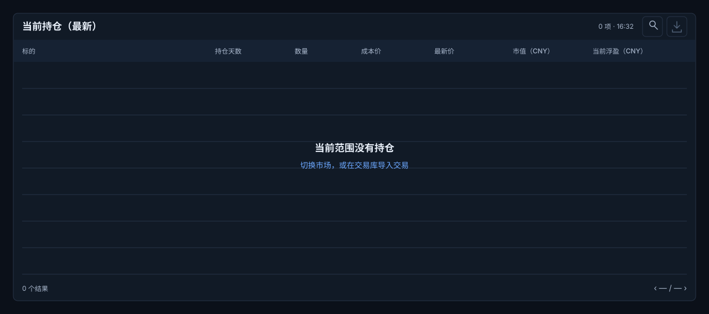

图 V2-11｜0 行：固定表头、空态说明和返回筛选入口，分页不出现误导的“第 1 页”。

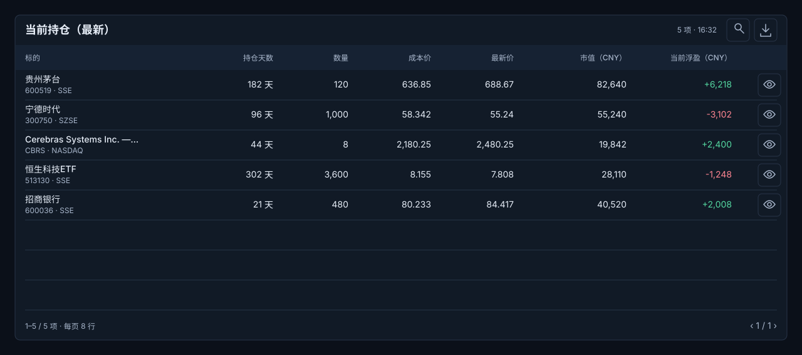

图 V2-12｜5 行：一页完整显示，表格底部仍保留固定分页空间。

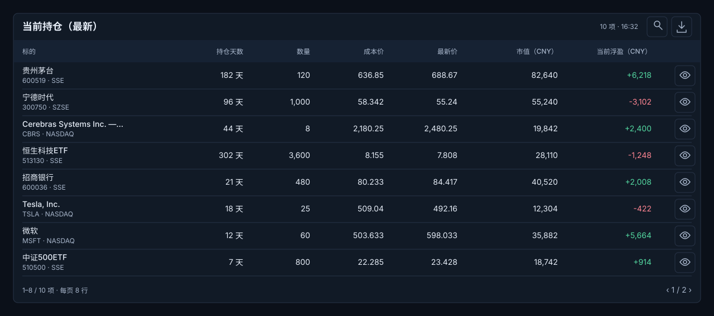

图 V2-13｜10 行：分页为两页，切页后仍从固定第一行开始，不因内容高度改变曲线位置。

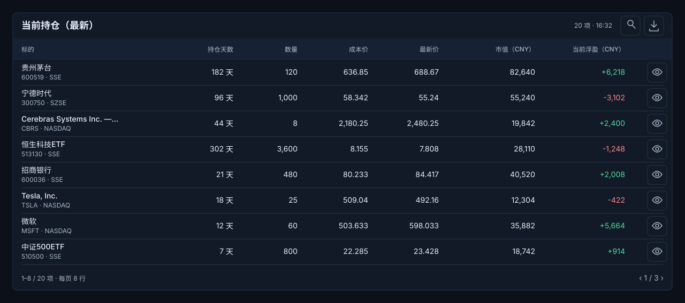

图 V2-14｜20 行：表格继续使用固定行高，页码和结果总数在底部可见。

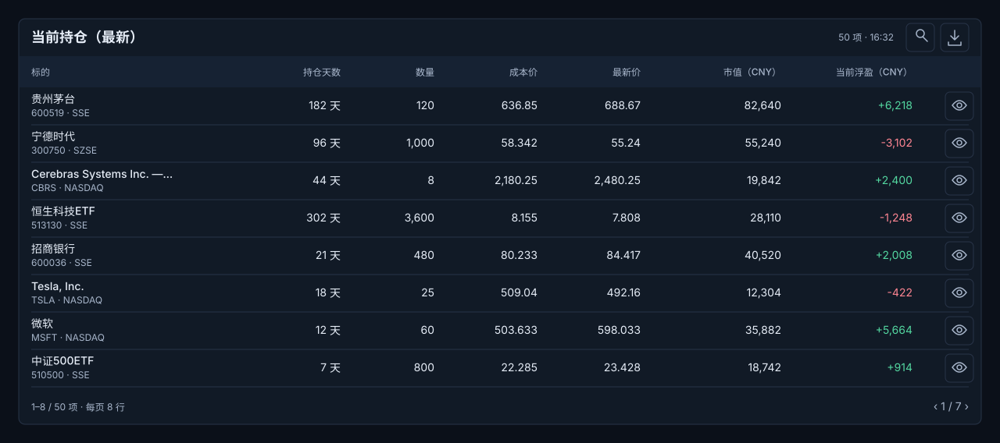

图 V2-15｜50 行：长列表以分页处理，不用压缩字体或展开行来塞入首屏。

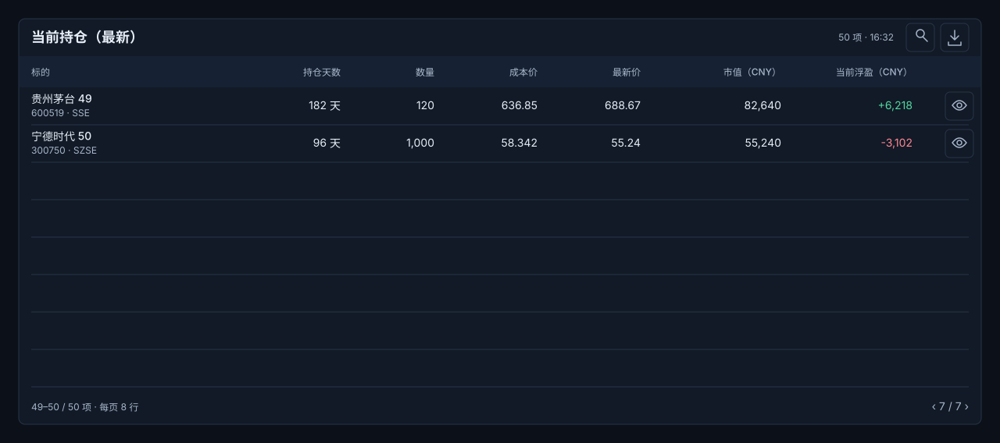

图 V2-15A｜持仓最后一页：页码、结果总数和最后一行仍在固定分页节奏内，切页不会把空槽误读为新范围。

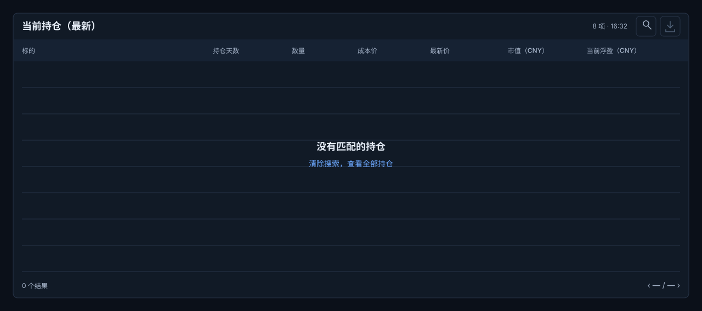

图 V2-15B｜持仓搜索无匹配：有持仓但关键词无结果时，保留清除搜索入口；它与 0 持仓空态分开呈现。

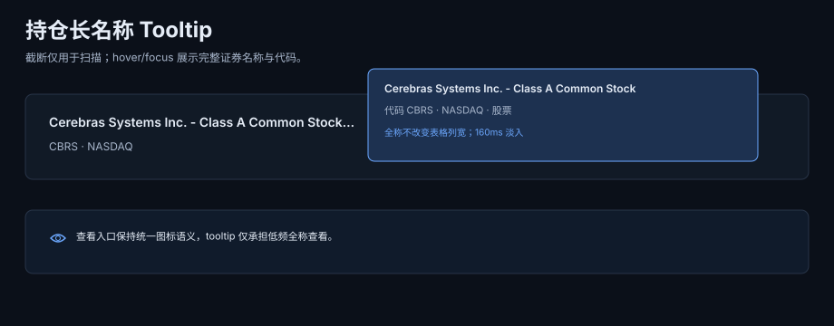

图 V2-15C｜标的名称 tooltip：超长名称、代码、交易所和资产类别在 hover/focus 浮层中完整可读。

数量极端时，数量列保持等宽数字并以完整精度显示；大额数字允许两行或 tooltip，不用科学计数法。负数量必须显示真实负号数值（例如 `−1,250`），不能只显示一个孤立的 `−`；空成本显示 `暂无`，无最新价显示 `待更新`，都不能写成 0。任何两行数字都必须在 48px 行高内完成，第二行用 12px/16px，不得撑高行或改变分页节奏。长名、同名不同交易所和极端小数必须在 1280 图稿中可辨认。

表格搜索只影响当前持仓表，使用表格标题右侧的搜索图标；点击后在表格标题下方展开 280px 局部浮层，输入后回到第 1 页，关闭后表格高度恢复。0 持仓是“当前范围没有持仓”，保留空表结构和“导入/切换市场”入口；有持仓但搜索无结果是“没有匹配的持仓”，保留清除搜索入口，两者不能共用一个空态。CSV 导出图标在当前筛选无行时禁用，因为导出空集合不能帮助用户核对范围，tooltip 明确“无可导出的持仓（0）”，不把禁用状态误读成故障。它不能调用页头的全局标的搜索，也不能改变当前表现的范围。排序通过列头按钮或更多菜单，排序状态有箭头、可访问名称和 tooltip。全部市场已经按统一汇率换算为 CNY，因此浮盈和市值可以排序；只有汇率不完整或覆盖不足时，相关排序才禁用，并在 tooltip 说明原因，不能因为跨市场本身而禁用。查看图标的 tooltip 是“查看持仓详情”，可访问名称相同；图标命中框桌面不小于 36px，44px 触控目标不在本轮范围内。键盘 Tab 顺序为搜索、表头排序、每行查看、分页。

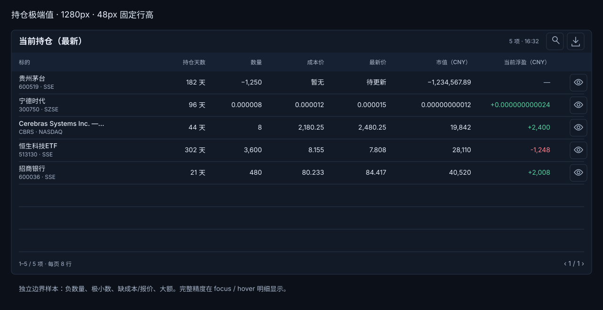

图 V2-32｜独立边界样本：负数量、极小数、缺失成本/行情和大金额。灰色破折号与待更新不可伪装成 0；48px 行高保持不变。

:::state-demo
images/holdings-50.svg|50 项首页|每页固定 8 行，显示 1–8/50。
images/holdings-last-page.svg|第 7 页|显示 49–50/50，保留 6 个空槽位，分页位置不变。
images/holdings-no-match.svg|局部搜索无结果|清除搜索即可恢复当前市场持仓，不改变上方期间指标。
:::

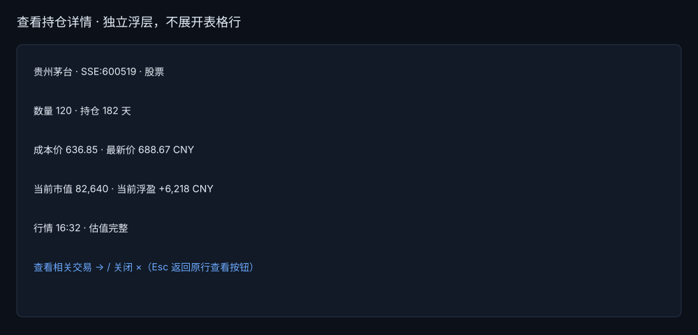

图 V2-34｜点击查看图标：浮层包含身份、数量、天数、价格、市值、当前浮盈和行情时点；Esc 关闭回到原行查看按钮，表格不展开。

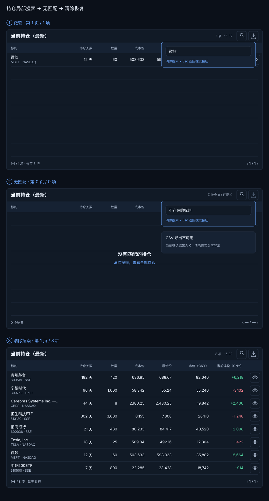

## 历史与贡献及移除内容 {#chapter-HP06}

历史区标题为“历史已平仓”，默认展开当前年份；下方按年份滚动显示已实现净盈亏、回合数、胜率和费用。它只包含已平仓交易，使用平仓日归年；切换市场后历史区与公共市场 tab 同步，切换期间不会改变历史区。空年份显示“该年暂无已平仓回合”，待复盘数量为 0 时显示“暂无待复盘”，不保留过期数字。

贡献分析独占全宽区域，维度 tab 为“证券 / 市场”，默认按绝对贡献降序。首页默认显示的是“当前期间贡献”，严格复用 HP02 当前期间的起止日期、市场、汇率、费用和实现/浮盈公式；证券/市场行加总等于期间净盈亏。历史区另提供“历史已平仓贡献”，按当前展开年份的平仓日归属，只包含已平仓净额；它与当前期间贡献分开命名、分开图例和分开验收。正负方向、金额符号和样本数并存。贡献不是资产分布的替代品：它回答哪些证券或市场形成了指定范围的结果，而资产分布只回答结构占比；鉴于资产分布是低频需求，V2 从首页默认布局移除（C17、C29、C31）。

图 V2-16｜0 条贡献：显示无可归因数据和口径说明，不画空圆环或伪造 0 行。

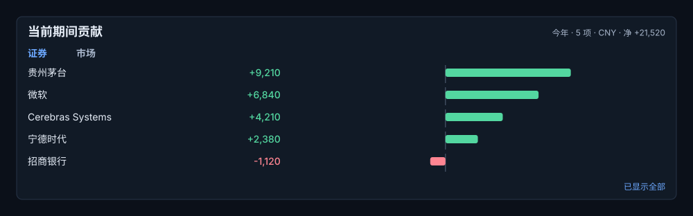

图 V2-17｜5 条贡献：全部显示，正负条形共用零轴并保持排序。

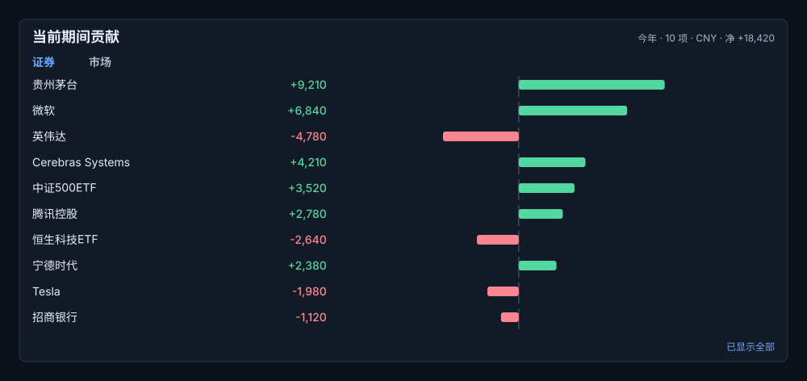

图 V2-18｜10 条贡献：默认上限 10 行，页面保持单列扫描。

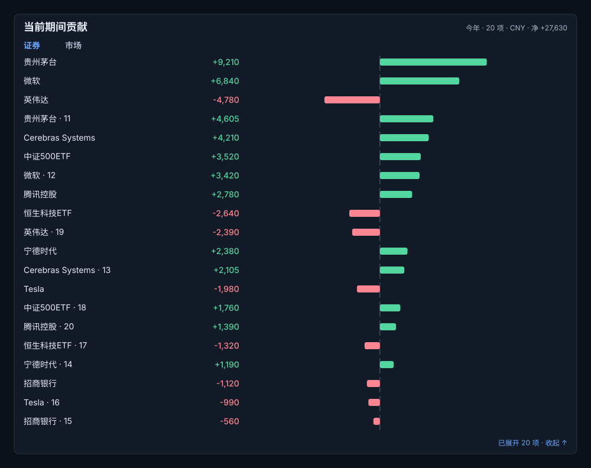

图 V2-19｜20 条贡献：点击“展开更多”后逐 10 行增加，按钮附近保持视线锚点。

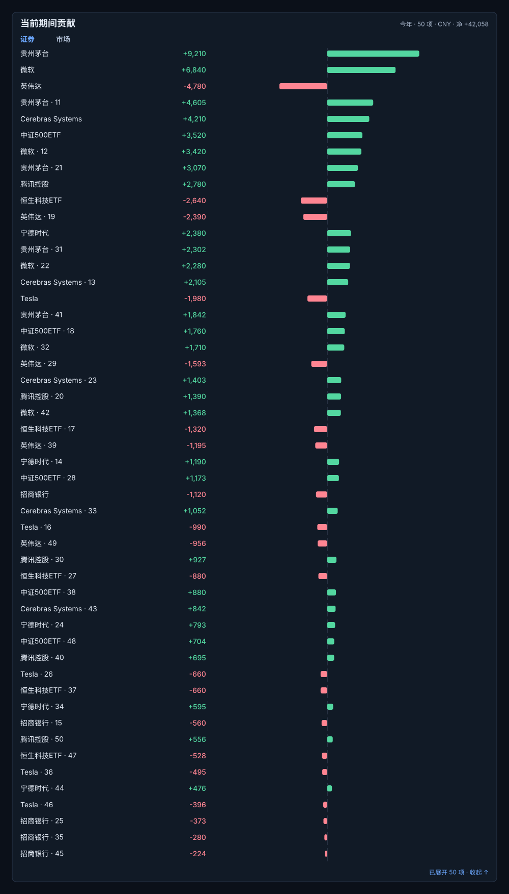

图 V2-20｜50 条贡献：继续逐 10 行加载，不把并行卡片挤成不可读的窄栏。

图 V2-20B｜按市场贡献设计提案：市场维度与证券维度共用当前期间口径，行加总与期间净盈亏一致。

展开动画 200ms，使用高度和透明度过渡；展开后视线保留在按钮附近，屏幕不自动跳到列表底部。减少动效时直接切换到最终高度。贡献数据更新时保留旧行并显示小状态环，成功后原子替换；失败回到上一组完整结果。

日历和待复盘列表从首页默认布局移除，原因是用户已明确希望把日期检索和队列工作放入交易库，而不是继续堆在首页（C31、C32、C33）。这是 V2 已确定的信息架构，不是待确认的删除候选。首页提供“在交易库按日期检索”图标入口。以下是待实现的参数契约，不是现有产品事实：交易库目标路由为 `/trades?date=YYYY-MM-DD&market=<market>&scope=<scope>`，点击日历日期时带入业务时区日期、当前市场和当前范围，进入后日期筛选已应用，交易行按平仓日排序。首页“待复盘”入口目标路由为 `/trades?queue=pending-review&scope=<scope>`，左侧图标显示未复盘数量徽标；数量为 0 时隐藏数字但保留可访问名称，超过 99 显示 `99+`。交易库返回首页时必须保留来源路由和滚动位置，返回路径为 `← 返回首页 /home`；刷新交易库不丢日期、市场、队列或范围参数。只有 D01“历史持仓日期”仍需用户确认去留（C27、C28、C31、C32、C33）。

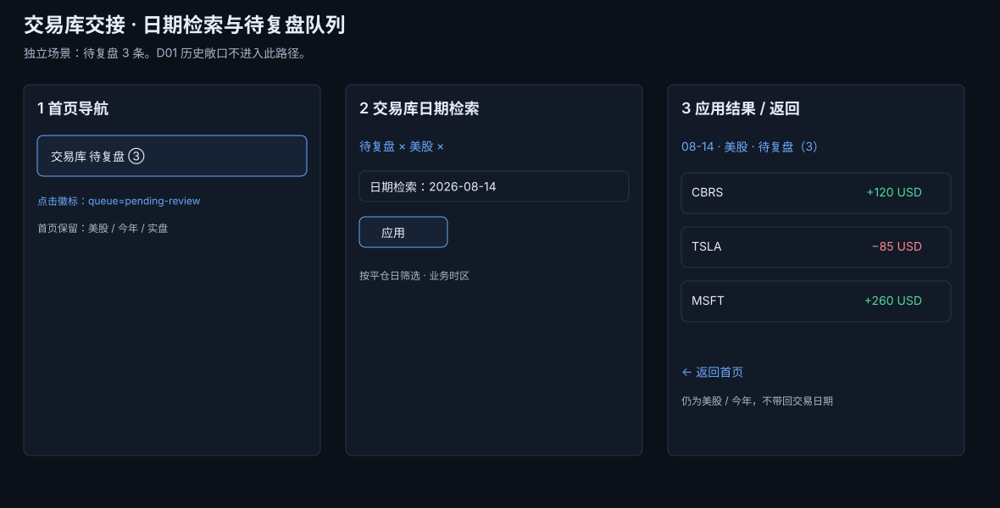

图 V2-20A｜交易库交接设计提案：日期入口与待复盘队列携带日期、市场、范围或 queue 参数，并提供返回首页路径；该图是待实现的路由交接提案，不代表现有产品已具备该路由。

“进入交易库”“查看口径”“展开更多”都使用图标加 tooltip 和可访问名称，避免大号文字按钮破坏密度。图标不能只靠颜色或形状传达意义；例如贡献分析入口名称是“打开贡献分析”，历史检索入口名称是“在交易库按日期检索”。

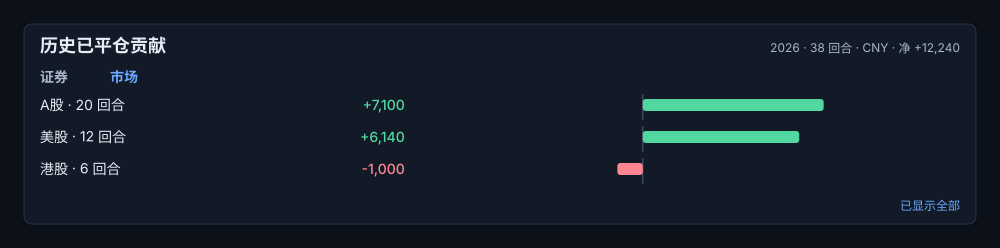

图 V2-33｜历史贡献独立样例：2026 年 38 回合，按市场归因，7,100 + 6,140 − 1,000 = 12,240；不与期间贡献相加。

## 异常与后台更新 {#chapter-HP07}

异常是页面状态，不是主界面日志。首载骨架保持最终尺寸：标题、KPI、图表、表头和 8 行槽位都占位，避免空白或首屏跳动。已有缓存数据在后台更新时仍可读，页头显示“正在更新”小状态环；更新成功替换整组数据，失败保留旧数据并在状态图标 tooltip 里给出原因和异步“重试”。重试按钮只出现在异常浮层或状态图标中，不进入主用户动线，不阻塞搜索、筛选和表格浏览（C09、C19、C25、C30、C36）。

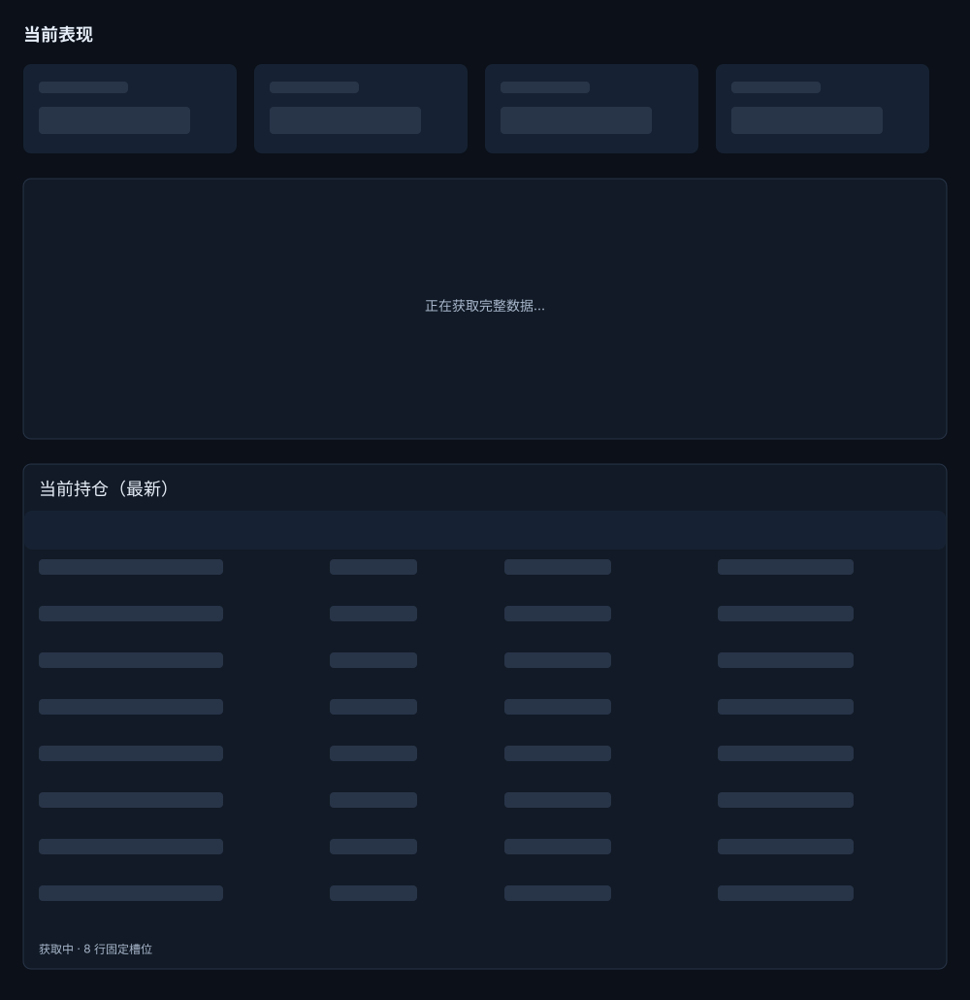

图 V2-21｜loading：固定尺寸骨架，不把未加载误显示为 0。

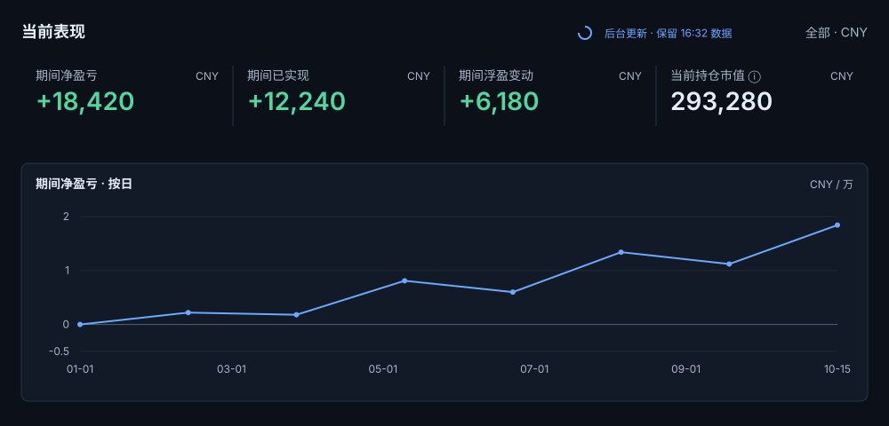

图 V2-22｜updating：保留旧有效内容，小状态环 1.2s 旋转；用户可继续浏览。

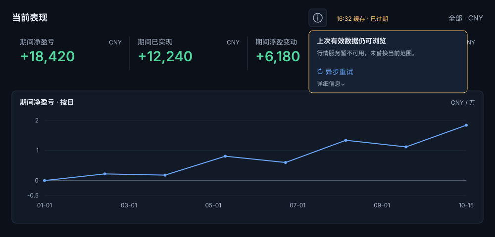

图 V2-23｜stale：旧数据仍可读，清楚显示更新时间和过期原因，禁止冒充最新。

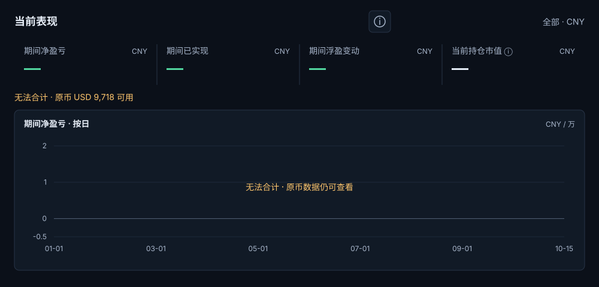

图 V2-24｜no-fx：原币可见、统一换算暂停，汇总显示“无法合计”而不是 0。

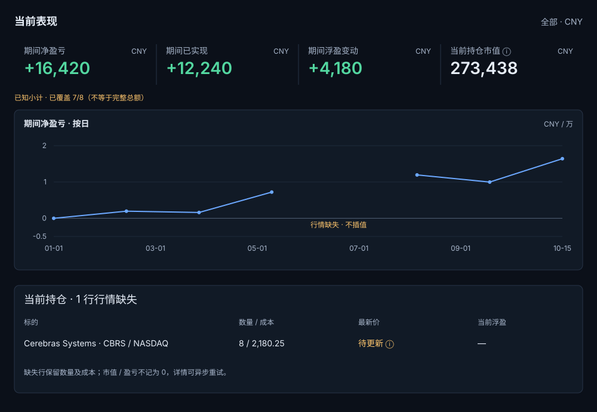

图 V2-25｜partial：已知小计和覆盖数并存；缺失标的显示原因，不清空有效行。

图 V2-26｜error：小警告图标加 tooltip 详情与异步重试，保留上一组完整范围。

状态颜色：loading 使用 #6B7C95，updating 使用 #6CA8FF，stale 使用 #FFC66D，error 使用 #FF8592；颜色旁必须有文字或可访问名称。错误浮层宽 320px，标题 14px/20px，正文 12px/16px，最多两行摘要，详细错误可展开。失败不把空卡片留在页面上，也不把日志堆在 KPI 中。

无行情时，最新价显示“待更新”，浮盈显示“—”；无汇率时，市场原币仍能查看，全部市场的 CNY 汇总标为“无法合计”；部分覆盖显示 `已覆盖 7/8`；筛选无结果显示稳定空态；0 持仓与加载完成后的 0 明确区分。`no-fx` 在首载且没有同范围缓存时显示固定尺寸骨架后进入“无法合计/原币可用”，不闪现 0；若存在同一市场、账户、期间和筛选条件的缓存，则保留缓存数值并标记“汇率待更新”，禁止把不同 scope 的缓存冒充当前结果。切换 scope 时请求必须原子提交：新 scope 全部成功才替换旧内容，失败则回滚到旧 scope 的完整 KPI、曲线、贡献和表格，并说明失败原因；不得出现新市场标题配旧市场金额的混合状态。图表遇缺口断线，表格保留可用行。后台更新不改变当前持仓“最新”语义，也不把历史期间错误替换成最新值。

动效规则是小状态环 1.2s linear；弹层 160ms 淡入并上移 4px；hover 120ms；贡献展开 200ms。`prefers-reduced-motion: reduce` 时取消旋转和过渡，立即显示最终状态。任何动画都不改变金额、日期或表格行数的业务顺序（C09、C19、C25、C30、C36）。

:::state-demo
images/cold-error.svg|首次加载失败，无可用缓存|无缓存不显示虚假数值；固定槽位保留。
images/retry-result.svg|重试中、成功与再次失败|按钮禁用防止重复请求；旧缓存持续可读，成功原子替换。
:::

## 可复用 tokens 与原子控件 {#chapter-HP08}

颜色 tokens：`--bg #0B1019`、`--surface #111A26`、`--surface-raised #162233`、`--border #283448`、`--text #E6EDF7`、`--text-muted #A8B6CB`、`--text-subtle #71829B`、`--action #6CA8FF`、`--profit #53D7A0`、`--loss #FF8592`、`--warning #FFC66D`、`--focus #A9C8FF`。背景只有页面、单层表面和浮层三层，不用渐变、霓虹光晕或重复阴影。

排版 tokens：UI 使用系统无衬线栈 `ui-sans-serif, -apple-system, BlinkMacSystemFont, "Segoe UI", sans-serif`，中文由平台回退；本规范不虚构 TradingView 的字体，也不要求未授权的字体文件。页面标题 24px/32px/600；工作区标题 18px/24px/600；模块标题 14px/20px/600；正文 14px/20px/400；说明 12px/16px/400；数字使用 `font-variant-numeric: tabular-nums`。候选排版以同一 1440×1000 内容、同一 `−1,234,567.89 / +12.6% / 2026-10-16` 样本比较：A 系统栈 14/20（推荐）跨平台加载稳定、中文覆盖最好，但字面宽度略有差异；B 固定 Web 无衬线 14/20 字宽一致，代价是字体加载失败时闪烁、包体和授权边界增加；C 等宽字体用于整页数字，数字辨识好但中文与长名称过宽，破坏表格密度。最终选择 A 作为文字、A 的 `tabular-nums` 作为数字，不选择全页等宽或未经授权的 Web 字体（C35、C37）。

间距 tokens 以 4px 为基准：4、8、12、16、24、32；圆角 6px（小控件）、8px（面板/浮层）；桌面控件高度 36px，表头/页头/分页分别 40/64/48px。按钮、图标、tab、输入框有统一 hover、focus、disabled、pressed 状态：hover 背景 `#1C2B42`，pressed `#243B5C`，focus 2px 外描边 #A9C8FF，disabled 文字 #53647B 与边线 #202B3A。桌面图标命中区 36px；本轮不宣称 44px 触控合规。

原子控件包括：`IconButton`（明确 tooltip 与 aria-label）、`SegmentedTabs`（当前值和键盘方向）、`Select`（当前值持续可见）、`Popover`（焦点进入/退出与 Esc）、`Token`（单项移除）、`Metric`（值、单位、状态、详情）、`StatusBadge`（文字+颜色）、`DataTable`（固定槽位、排序、分页）、`ChartTooltip`（日期、单位、口径）、`EmptyState`（原因和下一步）、`RetryAction`（只在异常上下文）。图标禁止用无意义的“更多”替代具体动作；tooltip 文案和 aria-label 必须一致或前者更简短。

### 11 个原子控件验收矩阵

下表是 C39 要求的最小可执行矩阵。每个控件的默认、hover、focus、pressed、disabled、loading、empty、error 状态只在“适用”时验收；不适用必须保留理由。默认桌面命中区为 36px，44px 触控不在本轮范围。键盘验收使用 Tab/Shift+Tab、Enter/Space、方向键、Esc，并记录焦点环和返回位置。

| 控件 | 尺寸与默认 | hover / focus / pressed | disabled / loading | empty / error | 键盘验收 |
| --- | --- | --- | --- | --- | --- |
| IconButton | 36×36，图标 16，tooltip 120ms | 背景 #1C2B42；2px focus；pressed #243B5C | disabled 降对比；loading 图标替换为 1.2s 状态环 | 无 empty；error 用警告图标+tooltip | Tab 到达，Enter/Space 触发，Esc 关闭浮层 |
| SegmentedTabs | 高 36，单项内距 12 | hover 底色；focus 外描边；pressed/selected #243B5C | 请求中保留旧选中，禁用不切换 | 无 empty；error 回滚旧 tab | 左右/Home/End 选择，Enter 提交 |
| Select | 高 36，最小宽 120 | hover 边线；focus 2px；pressed 打开菜单 | 请求中保留值；disabled 不打开 | 无选项显示“暂无可选项”；错误说明 | Enter/Space 打开，方向键，Esc 返回 |
| Popover | 搜索浮层宽 360（输入高 36）；筛选宽 320 | hover 仅作用触发器；focus 进浮层；pressed 保持打开 | 提交中按钮 loading，草稿不丢 | 无结果有空态；校验错贴近字段 | 自动聚焦首控件，Tab 循环，Esc 回触发器 |
| Token | 高 24，文字 12/16，删除区 24 | hover 删除区；focus 外描边；pressed 移除 | 无 disabled token；提交中保留旧 token | 无 token 不占位；删除失败恢复 token | Tab 到删除，Enter/Space 移除 |
| Metric | 高 88，主值 28/34，标签 14/20 | hover/focus 显示口径详情 | loading 固定骨架；disabled 不显示假数 | 无数据“—”；error 显示状态图标 | Tab 进入详情，Esc 关闭 |
| StatusBadge | 高 24，图标 12+文字 12/16 | hover 显示更新时间；focus 显示原因 | updating 状态环；disabled 不用于状态 | stale/partial 有明确文字；error 有详情 | Tab 到详情，Enter 打开 |
| DataTable | 表头 40、行 48、分页 48 | 行 hover；单元格 focus；排序 pressed | loading 保持 8 行骨架；禁用排序降对比 | 0 行与无搜索结果分态；错误保留旧表 | 表头排序、行查看、分页可顺序 Tab |
| ChartTooltip | 最小 192×80，字号 12/16 | 图点 hover；键盘 focus 同样显示；pressed 固定 | loading 不显示过期新 tooltip | 缺口显示原因；错误显示不可用 | 方向键移动点，Esc 关闭 |
| EmptyState | 最小高 120，图标 24，正文 14/20 | CTA hover/focus；pressed 触发下一步 | 无 loading；disabled CTA 明确原因 | 0 持仓、无搜索结果、无贡献各有文案 | Tab 到 CTA，Enter 执行 |
| RetryAction | 高 32，图标 16，文字 12/16 | hover/focus/pressed 同 IconButton | 请求中 loading 且防重复；无权限 disabled | 仅错误上下文出现；成功后移除 | Tab 到重试，Enter/Space 重试，结果播报 |

来源图 `tokens.svg`、`controls.svg`、`motion.svg` 对应颜色/尺寸/状态样本；逐项验收时须在同一视口截图并标注控件名、状态和键盘路径。矩阵不适用于窄屏，不能以“整体无溢出”替代单控件检查（C39）。

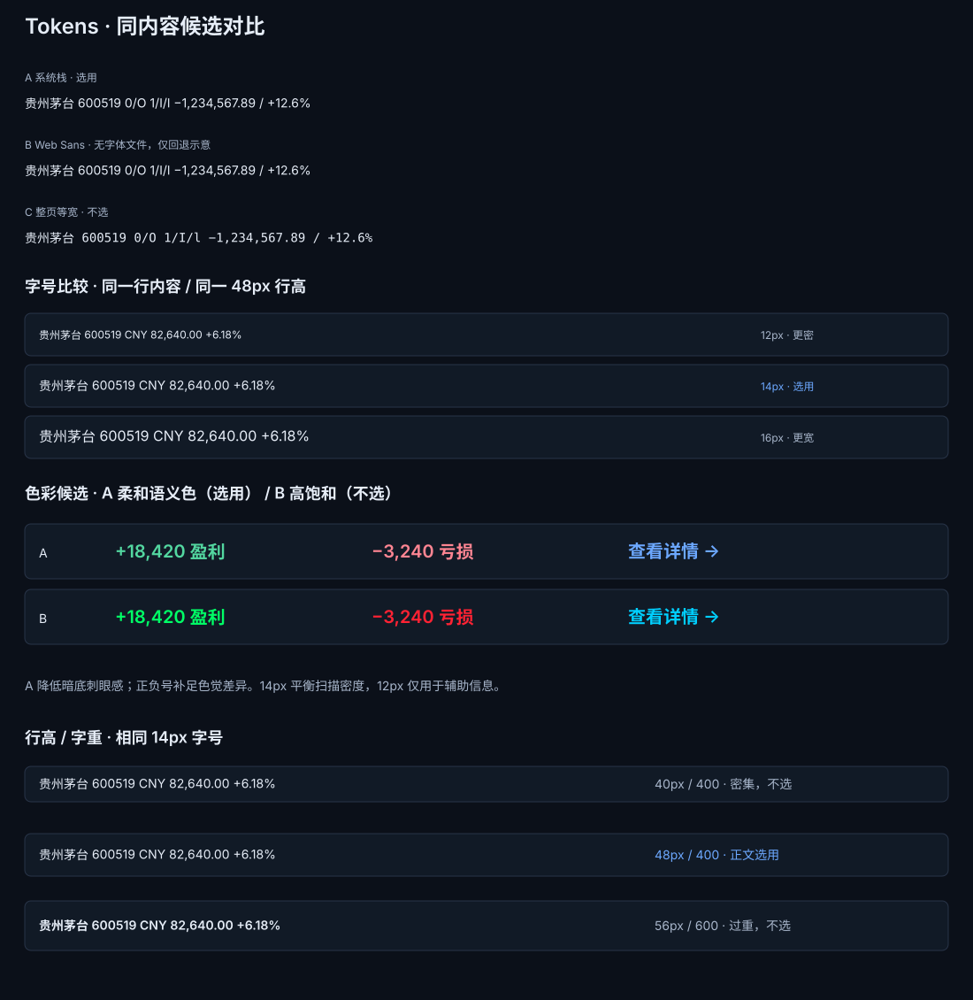

图 V2-27｜tokens 样例：颜色、字号、间距和数字对齐的原子基准。

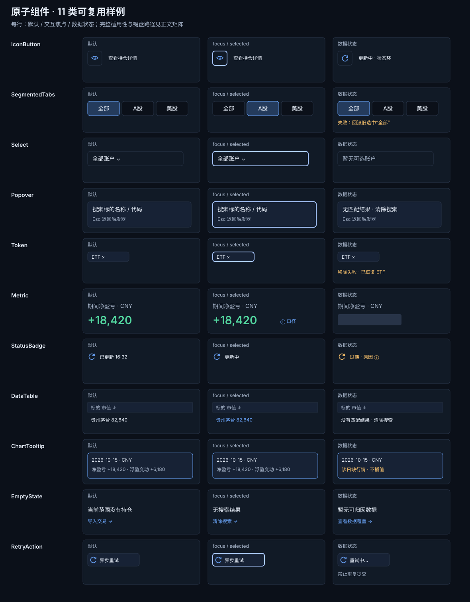

图 V2-28｜11 类原子控件：默认、焦点/选中、数据状态的实际示例。每类完整适用性见矩阵，不将静态样例视为键盘行为已实现。

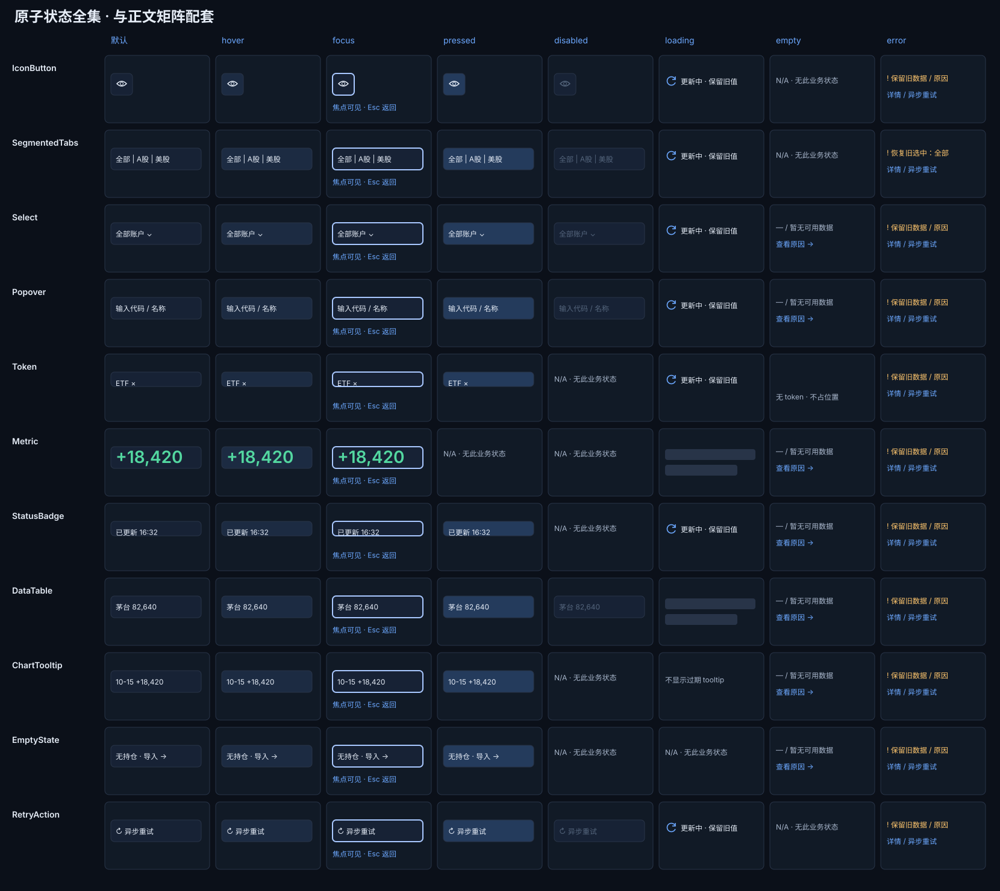

图 V2-35｜11 类 × 8 状态：与控件实样和正文矩阵联合验收；N/A 表示没有该业务状态，不替代实现验证。

动效候选为 A 立即切换、B 160ms 淡入加 4px 位移、C 300ms 弹性缩放。A 反馈最快但层级出现较突兀，作为减少动态模式；B 能说明浮层来源且不占阅读时间，作为默认；C 容易分散对价格的注意，因此不采用。贡献展开选 200ms 高度过渡，原 10 行保持可见；不滚动至新列表底部。

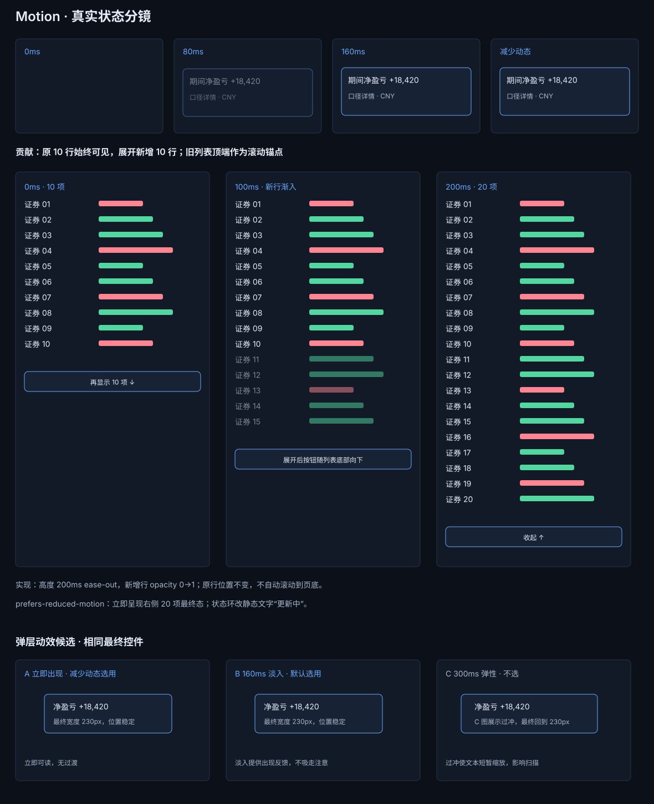

图 V2-29｜motion 样例：hover、popover、更新环和 reduced-motion 的前后状态。

## 验收与待决定 {#chapter-HP09}

验收分为四个独立门槛。第一是视觉：在 1440×1000 和 1280×800、100% 缩放下逐项比较布局、字号、行高、颜色、边线、空白和层级；桌面固定 36px 命中区，窄屏标记不适用。第二是交互：真实点击、键盘 focus、Esc、外点关闭、筛选应用、搜索结果、分页、图点和异常重试都要有前后状态证据。第三是数据语义：期间只作用当前表现，当前持仓始终最新，市场决定币种，跨年按平仓日归年，缺失不等于 0。第四是持久化/回归：若实现写入复盘或筛选偏好，必须在隔离数据库中保存、返回、刷新并重新读取；本轮文档本身不执行业务写入。

图稿到实现的映射必须逐项记录：每个控件的 token、尺寸、状态、图号、点击前后和异常结果；缺少对应规范先标记 NOT VERIFIED，不能用“整体看起来一致”替代。图稿需由独立审查者直接比较渲染结果，协调者在真实浏览器打开，检查没有水平溢出、图表点和表格时点没有暗改、更新中旧数据仍可读；静态 SVG 通过不代表产品通过（C34、C38、C39）。

评论交叉引用表：C01、C02、C03、C04 → HP01/HP02；C05、C06、C07、C08、C11、C12、C13、C14、C15、C21 → HP03；C09、C19、C25、C30、C36 → HP07；C10 → HP02；C16、C18、C20 → HP02/HP04；C17 → HP01/HP06；C22、C23、C24、C26 → HP05；C27、C28、C29、C31、C32、C33 → HP06；C34、C38、C39 → HP09；C35、C37 → HP08。C18、C28 涉及 D01 的去留，保留“建议与待确认”；C32、C33 的日期检索与复盘队列已按用户意见确定迁移到交易库，并非待确认删除。

待决定事项只有一项需要用户确认：D01“历史持仓日期”是否保留在曲线图点详情中的二级“查看该日敞口”。目前没有频次测量证据，因此不提供页头一级入口。若用户决定删除，需同时更新 HP04、`snapshot-options.svg`、覆盖矩阵和验收记录；若保留，必须验收它不触发回放、不改变当前持仓表、不修改历史交易。日历与待复盘队列进入交易库的路由已经确定，不属于待确认删除。

本规范完成的是 V2 的可读设计契约与候选取舍。当前状态为设计评审版可交付：R4 逐条审查 37 条设计覆盖 PASS、2 条用户排除，D01 待用户决策。53 张设计图和 6 组分镜已落盘；阅读器与评论刷新恢复已验。产品实现及其目标视口运行验收尚未开展，不能以本次静态设计复核替代。详见 [验收记录](acceptance.html)。

阅读入口：[评论阅读器](comment-review.html) · [来源与版本说明](sources.html) · [Markdown 来源登记](sources.md)
