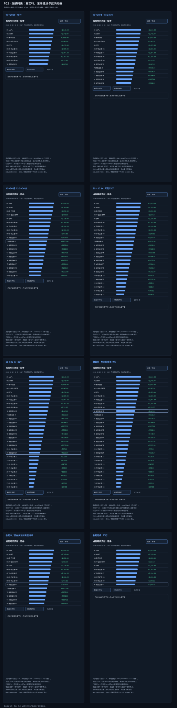
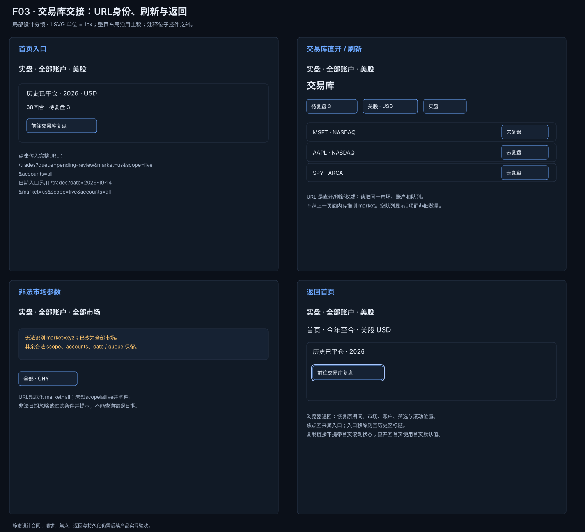
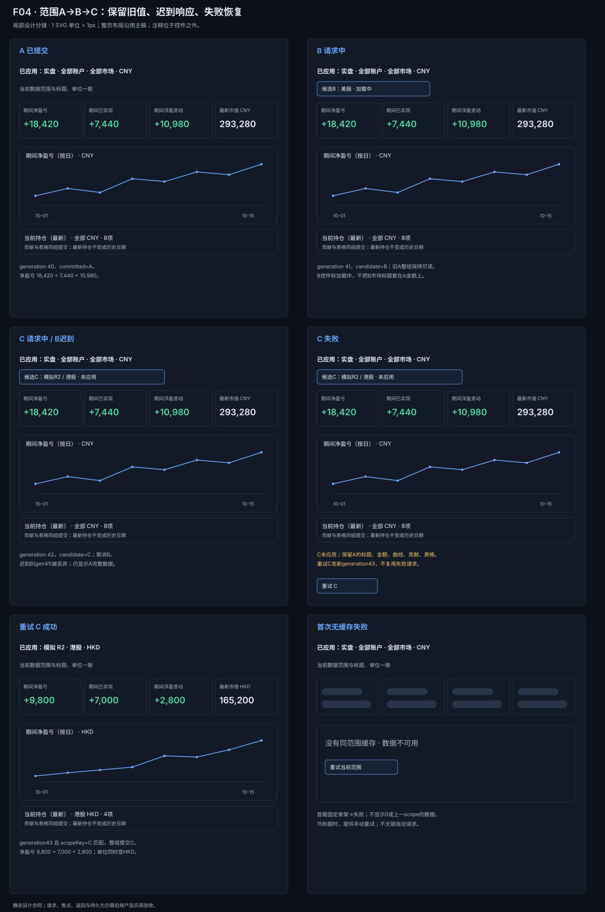
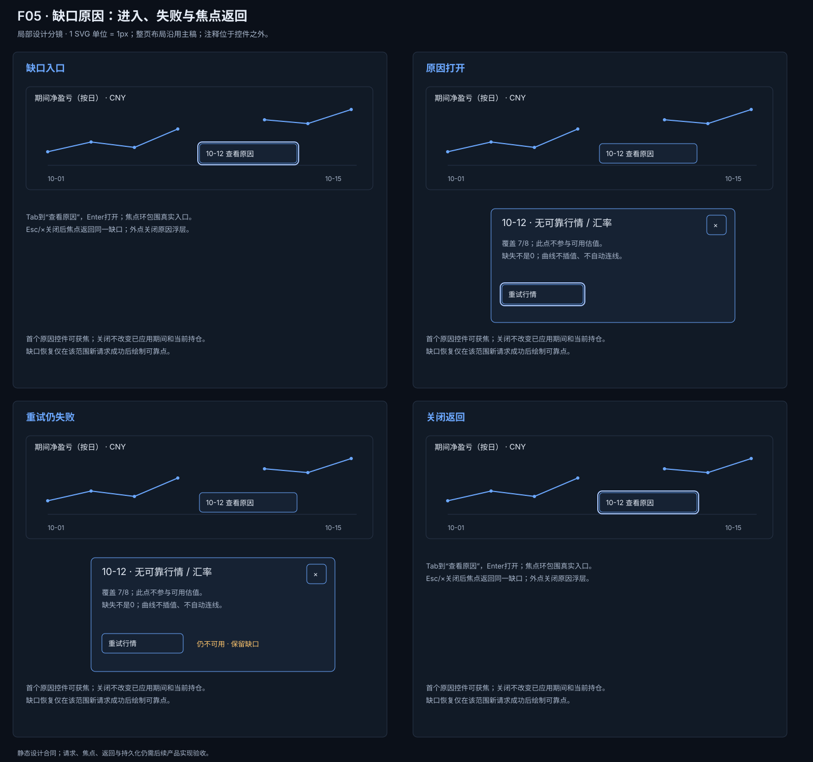
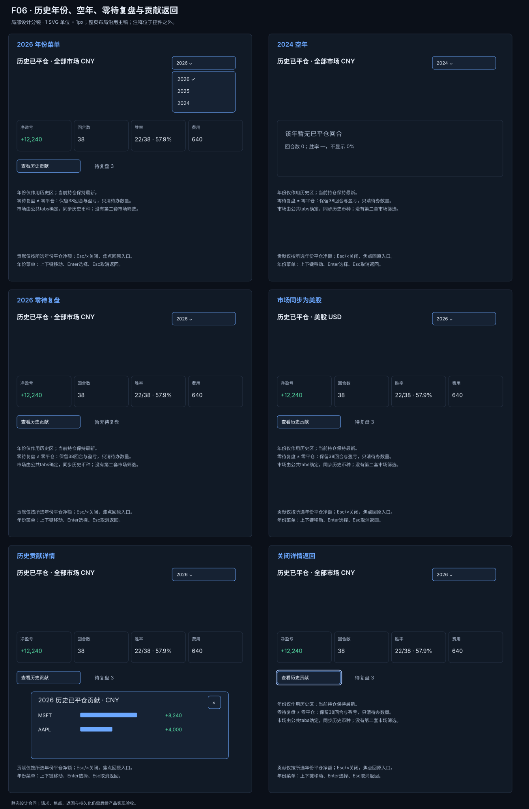
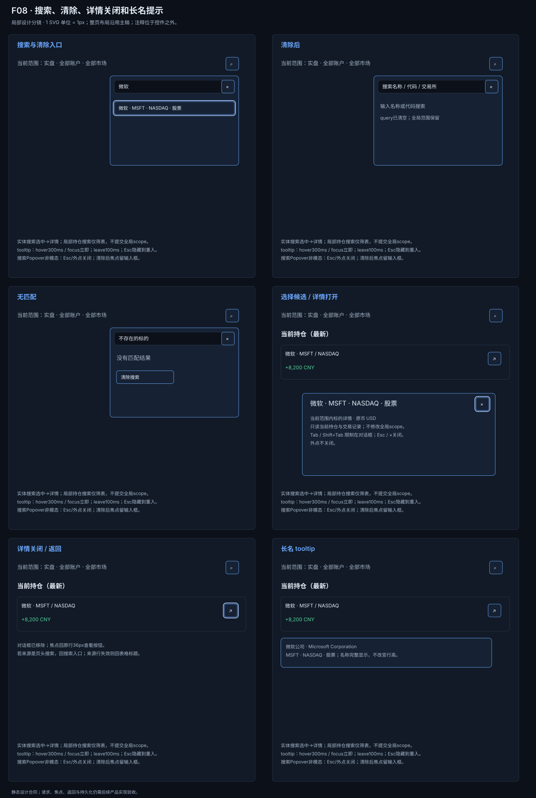
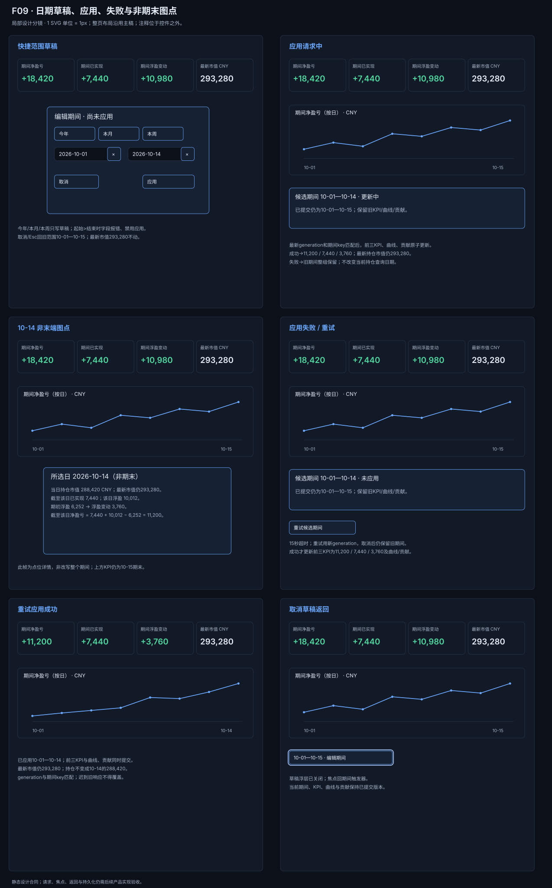

# V2.1 旅程合同

本组分镜是 V2.1 修订旅程的实现合同。它们是设计分镜，不是产品截图，也不是运行时验收证据。分镜采用可量测的局部控件画板，整页层级以首页主稿为准；不把整页压缩进小框，不用文字摘要代替真实行、输入框或按钮。

## 来源与重建

源文件为 [`build-journey-revision.py`](build-journey-revision.py)，从仓库根目录执行：

```bash
python3 docs/design-system/baselines/2026-10-17-homepage-v2.1/build-journey-revision.py
```

生成器将以下七张图写入 `images/`：















每张图都是深色桌面分镜，使用大尺寸状态框、可见控件、标签、数值、焦点环和响应说明，避免把状态压缩成只有文字的卡片。

## 共同状态选择

- **F02** 保留已有行的 viewport 位置，展开按钮随新增行下移；行高 32px，动画 200ms，reduced-motion 为 0ms。键盘展开聚焦第一条新增行；键盘收起先聚焦保留的第 10 行，完成后若按钮不可见才用 nearest 滚入。鼠标不强行移动键盘焦点；同向重复不重复追加，反向从当前高度继续。
- **F03** URL 显式携带 `market=all|a|hk|us`、`scope=live|sim`、`accounts`、`date`、`queue`。直开、刷新和浏览器返回保持同一状态。非法 market 回退 `all` 并显示解释；URL 是权威来源，不能从内存猜市场。
- **F04** 分开 `committedScope A`、`draftScope B` 和 request generation。市场/账户/live-sim 的 B 显示待应用/加载中，但标题、单位、KPI、曲线、贡献和持仓仍是 A 的整组数据。A→B→C 时取消 B 并忽略迟到 B；只有最新 generation 且 scope key 匹配才提交。C 失败原子回到 A，提供手动重试；无缓存初载失败显示骨架/错误，不显示 0；请求超时 15 秒，不自动无限重试。日期期间变更只提交期间 KPI、曲线和贡献，当前持仓仍取最新值。
- **F05** 缺口是可聚焦的原因入口。鼠标 hover 延迟 300ms，focus 立即打开，leave 100ms 后隐藏，Esc 隐藏至重新进入。原因浮层区分无行情和无汇率；关闭后焦点回到缺口入口。
- **F06** 覆盖年份选择、空年、0 待复盘、市场同步、进入历史贡献和返回。历史贡献按平仓日归属，仅含已平仓净额，和当前期间贡献分开。
- **F08** 清空只清 query；无匹配有独立清除入口。名称 tooltip 的 hover 延迟 300ms，键盘 focus 立即打开；Esc 隐藏至重新进入。选择候选打开当前范围内的标的详情，不提交或改变首页全局账户/scope。详情使用 focus trap，Esc/× 关闭，外点不关闭；关闭后焦点回原行“查看”，行失效则回表标题。
- F09 快捷范围（今年、本月、本周）只编辑日期草稿，只有“应用”才请求数据。中间日期示例使用 10-14：期初 6252，截至所选日浮盈 10012、已实现 7440、变动 3760、净 11200，当日市值 288420。浮层明确所选日不是期末，当前持仓 KPI 仍取最新值。

## 覆盖矩阵

| 问题 | 图稿 | 必须出现的状态 |
|---|---|---|
| F02 | `journey-contribution.svg` | 10→20前/中/后、20→30前/中/后、收起前/中/后与反向；局部按钮坐标、scrollTop=S和焦点 |
| F03 | `journey-library.svg` | 直开 URL、刷新、返回、非法市场回退 |
| F04 | `journey-scope.svg` | A/B/C 竞态、迟到 B 忽略、失败回 A、手动重试 |
| F05 | `journey-gap.svg` | 默认缺口、鼠标/focus 原因、键盘打开/关闭、焦点返回 |
| F06 | `journey-history.svg` | 年份、空年、0 待复盘、市场同步、历史贡献进出 |
| F08 | `journey-search.svg` | 打开、清空、无匹配、候选详情、Esc/× 关闭、焦点返回 |
| F09 | `journey-date.svg` | 快捷范围、草稿/应用、成功/失败/重试、10-14 非期末浮层 |

本旅程合同覆盖 F02–F06、F08、F09；F01/F07/F11 原子图和 F10/F12 协调者工作不在文件边界内。
