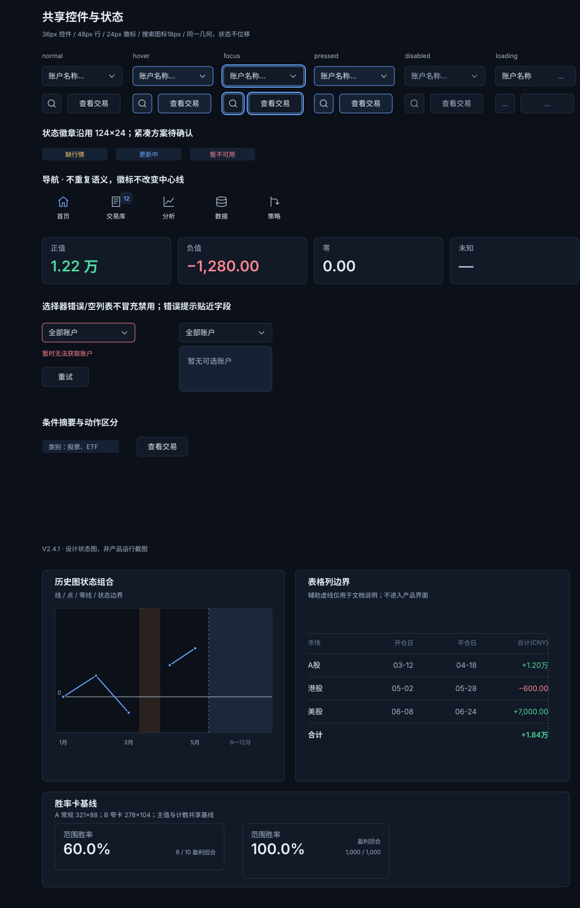
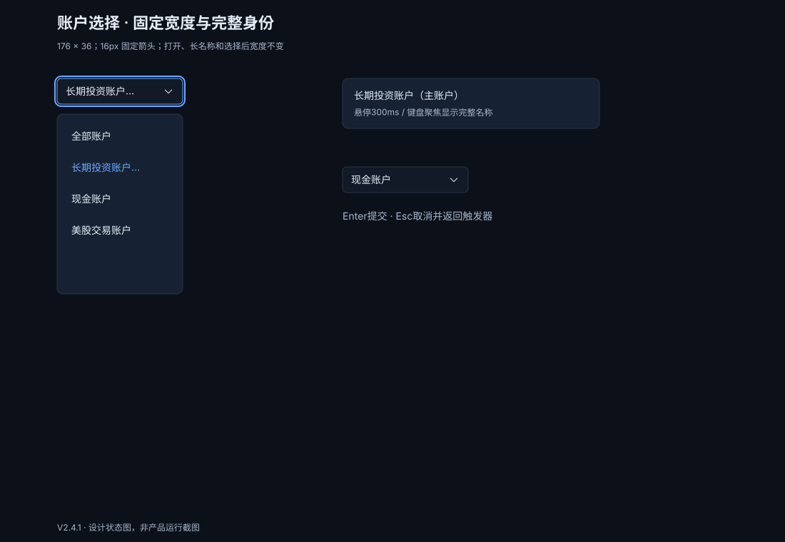
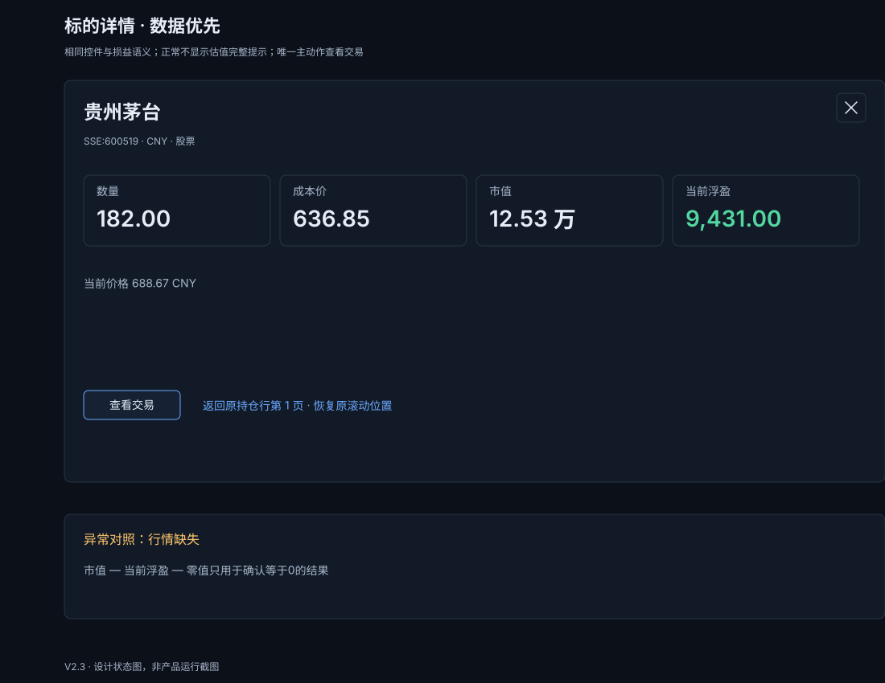
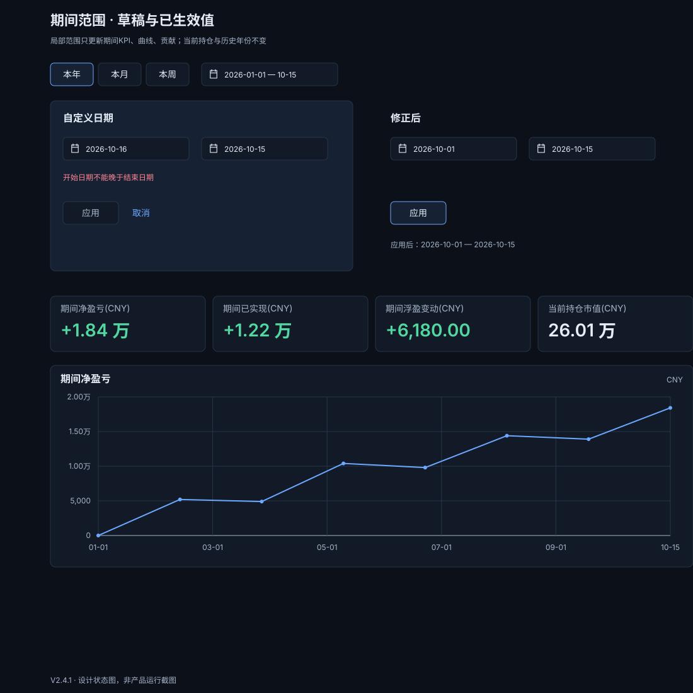
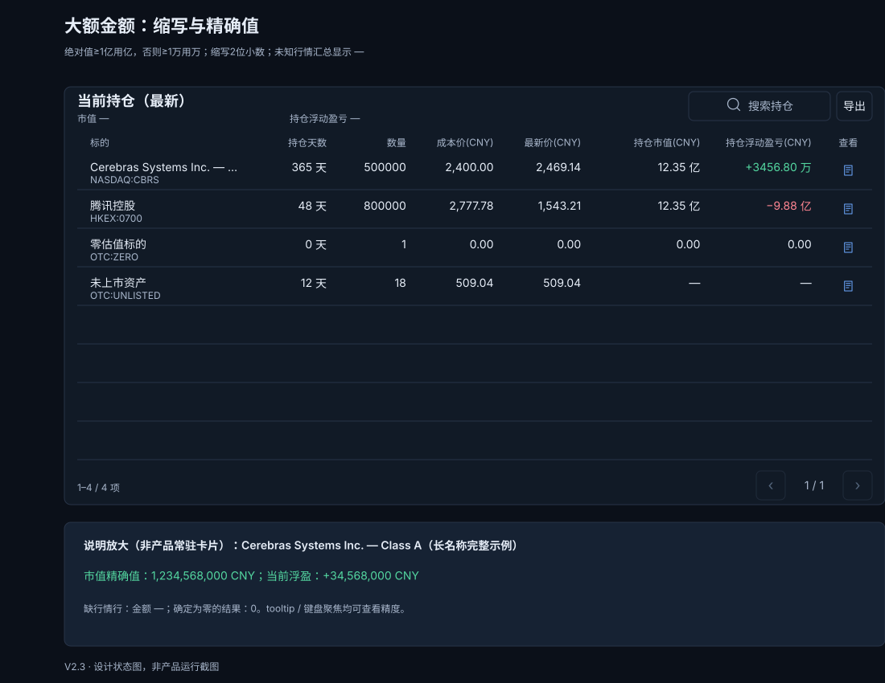
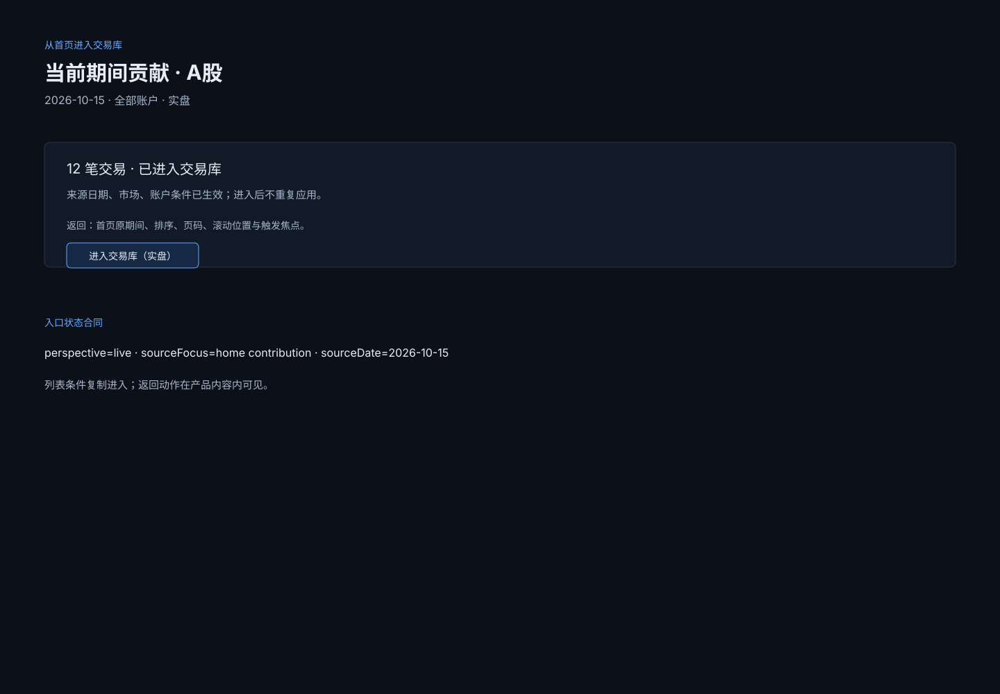
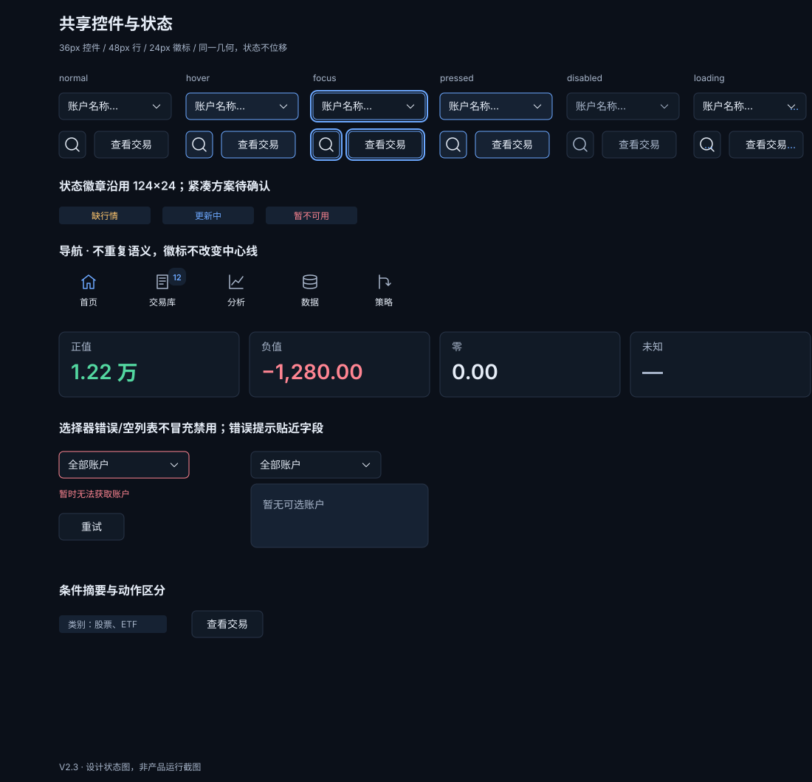

# 首页视觉与交互设计规范 V2.4.1

首页是一张交易工作台：先看这一段时间的表现，再检查当前持仓与历史统计，最后在底部贡献区理解盈亏来源，并进入交易核对与复盘。本规范从这条使用路径出发，说明页面为什么这样安排，以及每个模块应如何显示和响应操作。

文档包含整页设计、模块规则、可切换的交互分镜和可复用控件。设计人员可以按章节阅读，开发人员可以查阅尺寸与状态，验收人员可以用最后的检查表逐项对照。图中的交易数据用于说明设计。

## 一、设计目标与取舍 {#chapter-HP01}

### 首页首先回答什么

用户打开首页时，最需要知道的是“最近表现如何”“现在持有什么”“结果由哪些交易或标的形成”。因此，页面从当前表现、当前持仓读到历史统计，最后通过底部唯一的贡献区解释盈亏来源。贡献区可切换当前期间与历史已平仓，两种口径复用同一个位置。日期检索和待复盘入口把阅读结果自然接到交易库中的后续工作。

首页只呈现实盘。模拟交易属于子模块能力，不混入首页的选择器、统计或数据。这样，同一屏上的数字始终有明确、稳定的业务范围。

### 为什么采用这套层级

|设计选择|解决的问题|取舍|
|---|---|---|
|当前表现放在最前|首先回答当前期间是否盈利、变化从何而来|持仓列表略向下，但紧随曲线，仍是第二个核心模块|
|期间、最新持仓、历史结果分区|避免不同时间口径被误读成一个总数|保留三个明确的时间概念，不能为压缩界面把它们合并|
|一个主曲线，组成项放入详情|让趋势可快速辨认，减少多线竞争|具体原因需要悬停或聚焦后查看，详情字段必须完整|
|公共范围放页头，局部操作留在模块内|让用户知道一次操作会影响哪里|同为搜索也要区分“找标的”和“筛持仓”，不共用模糊入口|
|固定高度的八行列表|翻页和数据量变化时，下方模块保持稳定|少量数据保留空行槽，大量数据通过分页查看|
|异常时提示，正常时保持安静|避免状态徽章和操作按钮抢占核心数字|缺失原因仍需可查，恢复动作集中到一个入口|

视觉上的科技感来自清晰的数字层级、精确对齐、克制的深色表面和明确的操作反馈。首页不使用口号、重复背景卡片或常驻资产分布侧栏；口径说明放在标题旁的可访问说明入口，给数据留下空间。

### 贯穿所有模块的原则

**先解释数字，再突出数字。** 金额要同时说明币种、时间范围和数据覆盖情况。未知显示缺失原因，不能写成零。最新持仓市值不包含现金和负债，不能命名为“总资产”。

**操作范围可预测。** 市场和账户作用于整页；期间只作用于期间统计；持仓搜索只作用于当前表格。任何范围变化都应让标签和数据一起更新。

**位置稳定，状态可恢复。** 浮层覆盖内容，分页替换行，加载保留占位；打开、关闭或等待数据都不推动主要布局。进入详情再返回，应找得到之前的行和位置。

**只展示必要动作。** 详情保留一个“查看交易”主动作；数据异常只保留一个全局“一键修复”入口。按钮名称说明实际结果，而不是要求用户猜测。

## 二、整页布局与视觉基础 {#chapter-HP11}

### 阅读顺序与空间

整页图说明已确认的模块布局；局部控件的最新效果由[第四轮](../prototypes/round4/index.html)与[第五轮原型](../prototypes/round5/index.html)补充。两者共同构成本版规范，原型不会替换整页布局。

页面从上到下依次是：页头范围工具、当前表现、当前持仓、历史统计、贡献区。当前表现由四张指标卡和一张曲线组成。底部只保留一个贡献区：当前期间模式沿用当前表现的日期，历史已平仓模式沿用历史统计的年份范围，不再增加第三套日期控件。

本版将功能区标题固定为18px/600，图表标题固定为16px/600；同一语义角色在整页、局部图和状态图中共用规格。功能区标题使用公共内容起点，卡片标题使用卡片自身内边距；子图表接受宿主内容边界，不重复叠加页面边距。

切换贡献模式只更新底部模块，当前表现、持仓和历史统计保持原来的位置。当前期间与历史已平仓分别保留分类、排序和局部展开状态；页头的市场条件始终只有一套，不随模式切换回退。

:::state-demo
images/home-1440.svg|当前期间贡献 · 1440px|首页各模块保持原位，底部显示当前期间贡献。
images/home-history-1440.svg|历史已平仓贡献 · 1440px|仅切换底部贡献口径；当前表现、持仓和历史统计的布局不变。
:::

:::state-demo
images/home-1280.svg|当前期间贡献 · 1280px|首页各模块保持原位，底部显示当前期间贡献。
images/home-history-1280.svg|历史已平仓贡献 · 1280px|仅切换底部贡献口径；当前表现、持仓和历史统计的布局不变。
:::

|布局部位|尺寸与规则|
|---|---|
|左侧导航|宽72px|
|页头|高64px，所有控件垂直居中|
|内容区域|左右各24px；1440与1280宽度下，主内容约1320与1160px|
|模块间距|24px；模块内部主要间距16px|
|表面层级|单层模块表面；浮层使用更高一级背景，不套重复卡片|
|适用画面|桌面1440×1000、1280×800，100%缩放|

每张分镜只呈现一个完整状态，并在图外说明它位于整页的哪个位置、由什么操作触发。前后帧使用相同视口与缩放；局部图省略其他区域时必须明确标注。读者可以展开完整界面，或以100%原尺寸滚动查看。实现尺寸仍以本规范的尺寸表为准。

常用控件的局部对照见：[布局与颜色样例板](images/visual-samples-board.svg)。样例使用真实控件名称、表头、金额和状态色；它是尺寸和对齐的视觉校准，不是新增页面或新的入口。

### 颜色、文字与对齐

深色背景承载整页，表面和边线划分区域；蓝色表示可操作或当前选择，绿色和红色表示盈亏，黄色提示数据需要关注。颜色必须配合文字或可访问名称，不能单靠颜色表达状态。贡献柱使用已确认的专用负色 #EF7F89；普通亏损数字仍使用下表的 #FF8592，两者按角色区分。

|用途|颜色|
|---|---|
|页面背景 / 模块表面 / 浮层表面|#0B1019 / #111A26 / #162233|
|边线|#283448|
|正文 / 次要文字 / 弱提示|#E6EDF7 / #A8B6CB / #71829B|
|操作 / 焦点|#6CA8FF / #A9C8FF|
|盈利 / 亏损 / 提醒|#53D7A0 / #FF8592 / #FFC66D|
|悬停 / 按下背景|#1C2B42 / #243B5C|
|禁用文字 / 禁用边线|#53647B / #202B3A|

|文字层级|字号 / 行高|
|---|---|
|页面标题|24 / 32px|
|模块标题|18 / 24px|
|正文、金额、控件文字|14 / 20px|
|说明、代码、坐标轴|12 / 16px|
|指标主值|28 / 34px|

字体使用系统无衬线字体，中文由平台字体补齐。相比固定下载字体，这种选择更稳定，也不会增加字体加载和授权依赖；全页等宽字体会损害中文与长名称的阅读，因此只对数字启用等宽数字特性。

间距以4px为基础，使用4、8、12、16、24、32px。小控件圆角6px，面板和浮层圆角8px；键盘焦点为2px浅蓝外描边。金额和数值表头对齐右边界，名称与说明左对齐。

颜色 token 必须落到控件上使用：背景用于页面和模块表面，#283448 用于边线与网格，#A8B6CB 用于零线与次要文字，#6CA8FF/#A9C8FF 用于操作与焦点，#53D7A0/#FF8592 用于盈利/亏损，#FFC66D 用于提醒。颜色样例和对应控件见 [布局与颜色样例板](images/visual-samples-board.svg)。

全局对齐规则是：按钮和分段标签的文字在命中盒内水平、垂直居中；搜索、日期输入和选择器当前值左对齐，左右内边距至少12px，箭头占独立位置；每张表由同一列定义计算表头和值的锚点，数值列共用右边界，动作列在自己的列中心居中；说明、名称和错误文案左对齐。列定义同时给出最小宽度与溢出策略：身份列可省略并在悬停/聚焦显示全值，数值列不换行，非金额按规定精度显示；金额按万／亿规则缩写，悬停、键盘聚焦及详情可查看完整值，复制和导出保留完整值，动作列保留36px命中盒。36px高控件使用14/20px文字，上下各留8px。金额使用等宽数字，不以缩小字号换取列宽。金额表头保留单行，单位与字段按同一可见文字右缘校准；半角括号用于避免字形右侧空白造成表头与数值的视觉错位。坐标框和辅助对齐线只用于验收，不能替代可见字形的逐列比较。

V2.4.1 的公共样例板补充三类组合示例：历史图的线、点、零线、缺口与未来灰区；表头、数值行与合计的共享右边界；胜率宽卡与窄卡的主值、计数基线。这张板用于说明局部组合，辅助对齐线不进入产品界面。完整工具栏、查看入口、分页及交互状态，以对应章节和已确认原型为准。

## 三、页头范围、搜索与筛选 {#chapter-HP03}

### 同一排工具，各自有明确职责

页头从左到右为页面标题、市场切换、账户选择、标的搜索、筛选、更新时间。市场固定使用“全部 / A股 / 港股 / 美股”四个标签，用户不必先展开下拉菜单才能识别当前范围。

账户选择器高36px，建议宽176px；当前账户始终可见，箭头固定靠右，长名称省略并提供全称。相邻控件间距8px，选择不同值不改变控件宽度。搜索与筛选是独立图标按钮，视觉图标18px、绘图坐标24×24、命中区域36×36px。

|操作|影响范围|币种或结果|
|---|---|---|
|切换市场|表现、持仓、历史、贡献区|全部和A股为CNY，港股为HKD，美股为USD|
|切换账户|整页当前账户范围|选择器保留当前值|
|标的搜索|查找标的并打开详情|不改变市场、账户或期间|
|附加筛选|按已应用条件限制数据|条件以计数和可移除标签显示|

账户选项浮层与176px触发框共用左右边界；选项文本左对齐、左右留16px。长账户名在选项中省略，悬停或聚焦显示全名，不能让文字越过浮层。选中标记占独立区域，不推移其他选项。

### 找到标的，再进入详情

点击页头搜索图标，打开覆盖页头和首页内容的全局搜索遮罩。桌面搜索舞台最大宽960px，左右至少留24px；窄屏使用可用宽度减去两侧24px，剩余空间不足时舞台全宽。页头仍可见为结构背景但不接受输入，遮罩阻断底层操作；输入框和结果区在舞台内共用列锚点，结果区独立滚动，不推动首页布局。[TradingView 的 Symbol Search](https://www.tradingview.com/charting-library-docs/latest/ui_elements/Symbol-Search/)同样将顶部入口与搜索对话框分开；这里继承其职责分离，不继承旧的窄浮层尺寸。局部持仓搜索仍是表内 inline filter，只筛选当前表，不打开全局遮罩。

搜索结果同时显示名称、代码、交易所、币种和资产类别，帮助用户区分同名标的。交易所直接可见，不只放在悬停提示中。

输入停顿300ms后查询；中文输入尚未完成组词时不查询，确认完整词后再提交。清除按钮只清空查询词和候选结果。浮层关闭不改变首页范围。

|步骤|用户动作|画面与返回行为|
|---|---|---|
|打开|点击搜索图标|遮罩覆盖页头与内容，搜索舞台使用最大960px与24px外侧间距；页头、指标与表格位置不变|
|输入|输入名称或代码|等待300ms后显示匹配结果；无结果明确说明|
|查看|选择一个结果|打开详情对话框，保留原查询和结果位置|
|进入交易|点击“查看交易”|按所选标的进入交易库|
|关闭详情|关闭按钮或Esc|回到原搜索结果，保留查询词、滚动和所选行|
|退出搜索|Esc、明确的关闭按钮或点击遮罩外|回到搜索触发按钮；关闭不等同于清空查询|

详情对话框锁定键盘焦点，外点不关闭；搜索结果浮层允许外点关闭。不同层级使用不同退出规则，避免误触丢失详情上下文。

:::state-demo
images/search.svg|搜索结果|搜索返回结果
images/search--detail.svg|无匹配|搜索无匹配
images/search--empty.svg|请求失败|搜索请求失败
images/search-detail.svg|打开详情|只有“查看交易”一个主动作；关闭后回到刚才的结果位置。
images/search-motion.svg|搜索遮罩关闭|点击关闭或按 Escape
images/search-overlay-open.svg|输入聚焦|点击页头搜索入口
images/search-overlay-reduced-motion.svg|减弱动效：直接呈现结果面板|系统启用减弱动效
:::

### 筛选：编辑与生效分开

筛选一共包含市场、账户、标的类别、仅看未平仓持仓、是否待复盘五个维度。“仅看未平仓持仓”包含持仓浮动盈亏为0的未平仓持仓。市场和账户在页头，独立的 320px 筛选浮层承载其余条件，使用直接多选，避免在浮层中继续嵌套下拉。它不复用全局搜索遮罩；字段和操作按钮高 36px。

同一维度中任一所选项满足即可，不同维度之间必须同时满足。用户编辑的是草稿，点击“应用”后一次生效；已生效条件用数量角标和可移除标签表达。

|动作|结果|
|---|---|
|应用|一次提交当前草稿，成功后更新条件和数据|
|清除附加|清除附加筛选，保留市场、账户与实盘范围；编辑仍按应用规则生效|
|恢复全部默认|恢复默认市场、账户及附加条件；不改日期期间|
|Esc或点击外部|关闭浮层，保留未提交草稿；重新打开可继续编辑|
|切换市场或账户|关闭浮层并丢弃旧范围的筛选草稿|

请求失败时保留提交前的完整已生效范围和当前草稿，并显示错误原因；不得留下新标签配旧数据。Esc 或点击外部只关闭浮层，不提交草稿；重新打开继续编辑，切换市场或账户才丢弃旧范围草稿。

恢复默认独立放在第二行，与清除附加和应用分开，底部保留16px空间。

:::state-demo
images/filter.svg|编辑条件|选择附加条件，应用前保持页面现状。
images/multi-applied.svg|筛选已应用|点击应用筛选
images/multi-applied--reopen.svg|重新打开筛选|再次打开筛选器
images/clear-attachments.svg|清除前|打开附件筛选
images/clear-attachments--after-clear.svg|清除后|点击清除附件
images/reset.svg|未保存修改|改变筛选条件
images/reset--reset.svg|已重置|点击重置
images/cancel.svg|日期草稿|打开日期选择器
images/cancel--cancelled.svg|取消日期|点击取消
:::

## 四、当前表现：指标、期间与曲线 {#chapter-HP02}

### 四个指标如何解释结果

当前表现帮助用户同时看清结果和构成。前三张卡回答所选期间发生了什么，第四张卡回答现在持有多少市值。

|指标|含义|随期间变化|
|---|---|---|
|期间净盈亏|期间已实现，加上期末与期初浮盈的差额|是|
|期间已实现|按实际平仓日归属、扣除费用的已实现结果|是|
|期间浮盈变动|期末浮盈减期初浮盈|是|
|当前持仓市值|最新可用行情下的持仓市值|否|

计算关系为：**期间净盈亏 = 期间已实现 + 期末浮盈 − 期初浮盈**。部分平仓逐笔按平仓日期和金额计算，做空也使用实际平仓时间和金额。期间浮盈变动不能替换成当前浮盈总额。

四张卡同时存在，高88px；标签14/20px，主值28/34px。正值绿色、负值红色、零值正文色。当前市值的详情还需显示当前浮盈、覆盖数量、原币金额与汇率来源。

例如，上年成本100，今年期初市值120、浮盈20，今年以130卖出：今年期间已实现为30，期末浮盈为0，期间净盈亏为30＋0−20＝10；历史已平仓按今年平仓日记录30。两个数字回答不同问题，不能相加。当前期间允许跨年，并按相同公式计算。

### 期间选择与更新时间

快捷项统一为“本周／本月／本年”，同时显示实际起止日期。按上海时区，本周从周一、本月从1日、本年从1月1日起，均截止今天并包含首尾日期。跨午夜成交先转换到同一业务时区。以2026年10月19日为例，本周为10月19日至19日、本月为10月1日至19日、本年为1月1日至10月19日。

点击快捷期间右侧显示起止日期的控件，直接打开“自定义日期”浮层，不需要先经过另一个下拉菜单。开始日期、结束日期和“应用”在同一浮层内；日期输入文字左对齐，快捷期间和“应用”按钮文字居中。修改日期只改变草稿，点击“应用”且校验通过才更新期间；开始晚于结束时显示字段错误并禁用应用。取消或Esc关闭后，原已生效期间保持不变。

日期变化更新前三项指标、曲线与贡献区的“当前期间”模式数据，但不切换贡献模式。最新持仓、历史统计与“历史已平仓”模式保持不变。

更新时保留上一组完整数据；成功后范围标签和数字一起替换，失败则保留原范围并说明新选择未应用。不能出现新日期配旧金额。

### 曲线应让用户注意到什么

主曲线表达“当前表现｜期间净盈亏（按日）”，重点是趋势、转折和相对于零线的位置。仅绘制一条主线，组成项进入日期详情，避免多条曲线同时争夺注意力。

线宽2px，点径6px（默认态不持续显示，悬停或聚焦时显示），坐标文字12/16px，纵轴最多7个刻度。金额轴在轴附近明确标注市场币种，刻度按万／亿规则缩写并保留两位小数；提示框与可访问读数提供带千分位的完整金额。零线使用#A8B6CB，网格使用#283448，两者帮助读数；双向虚线十字线和轴端日期、金额标签帮助定位。提示框靠近边缘时自动避让，不能遮住主要曲线。缺口断线、未来未覆盖区使用中性灰背景并保留截止边界，不能绘制虚假点或继续连接趋势；真实零仍显示为零，未知显示“—”和原因。

图表增加网格、双向十字线、轴端标签和缺口说明。

|日期详情字段|要求|
|---|---|
|日期|使用所选图点的业务日期|
|当日持仓市值、当日浮盈|使用该日实际数据，不能回填最新值|
|累计已实现、累计净盈亏|截止所选日的累计结果|
|费用、汇率、行情覆盖|费用保留；行情和汇率正常时不常显勾选，异常时由表头说明图标提供缺失原因；金额可查看完整精度和原币|

日期详情宽264px，高度随实际字段和换行增长，不固定为112px。内容四周至少留12px，末行文字的可见底边也必须在内边距内；先按完整内容确定高度，再避让绘图区上下左右边缘，不通过裁切文字或压缩字号塞入旧容器。六行金额与日期使用同一份字段顺序，鼠标和键盘状态保持一致。正常行情与汇率不显示勾选文字；出现异常时，表头使用16px说明图标，悬停或键盘聚焦可读具体原因。日期和说明使用12px次要色；市值为12px正文色，浮盈、已实现及净盈亏按数值正负使用绿色或红色，零值使用正文色；当前图点的期间净盈亏为13px。标签与值分开着色，不能让“市值”和“盈利”共用一段绿色文字。缺失值使用“—”与原因，费用说明不使用盈亏色。

鼠标悬停300ms后显示提示，移开100ms后关闭；键盘聚焦立即显示。左右键选择相邻有效点，Home/End跳到首尾，Enter固定详情，Esc关闭并返回触发点。Esc关闭后，重新进入该点才再次显示。

缺行情或汇率时曲线断开，不插值，也不制造虚拟点；提示写清日期范围、缺失原因，未知金额显示“—”。日期详情不提供“查看该日敞口”二级入口。

:::state-demo
images/chart-hover.svg|鼠标悬停|鼠标移入图表
images/chart-hover--keyboard.svg|键盘聚焦|Tab 聚焦图表
images/chart-gap.svg|遇到数据缺口|保留断线，说明缺失日期与原因，金额未知时显示“—”。
images/chart-scale.svg|紧凑比例|选择紧凑图表
images/chart-scale--normal.svg|常规金额范围|金额落在常规范围时，保持统一的金额缩写、市场币种和边缘留白。
images/chart-scale--wide.svg|宽图表|选择宽图表
images/chart-scale--extreme.svg|极值比例|选择极值图表
:::

## 五、当前持仓：稳定扫描与逐行查看 {#chapter-HP04}

### 列表的阅读重点

持仓表首先帮助用户辨认标的，再比较持有时间、数量、成本、最新价、市值和浮盈。模块标题明确写“当前持仓（最新）”，与上方期间统计区分。名称和交易所代码组成身份区域，数值沿固定右边界排列。

标题区高48px、表头40px、每行48px、分页区48px，固定八行槽。即使只有五条数据，分页区和下方模块也不向上跳动。

|列|内宽比例|展示与对齐|
|---|---|---|
|标的|25%|左对齐；名称最多两行，代码与交易所可辨认|
|持仓天数|8%|右对齐；当天为“0天”，未知为“—”|
|数量|10%|右对齐；保留真实精度与负号，不用科学计数法|
|成本价|11%|右对齐；两位小数|
|最新价|11%|右对齐；两位小数|
|持仓市值|15%|右对齐；列头带市场币种|
|持仓浮动盈亏|14%|右对齐；正负号与颜色共同表达结果|
|查看|6%|独立详情图标，36px命中区|

列宽按面板内宽减去左右各16px后计算，固定比例为25% / 8% / 10% / 11% / 11% / 15% / 14% / 6%，舍入差额归标的列。数值列的完整标题和数据共用同一右边界；不同位数、正负号和千分位不得造成对齐漂移。1440与1280画面仅调整列宽，不改变行高和槽数。

标题区左侧为18/24px功能区标题“当前持仓（最新）”，汇总指标采用已确认的 C 方案放在标题右侧并列；右侧仍保留搜索入口与导出空间，不挤压长金额或长名称。市值与持仓浮动盈亏使用14px正文/金额层级，标签12/16px次要色，市值保持中性色，浮盈正值绿色、负值红色、零为正文色。它们与标题区共用上边界，不占表头或数据行。示意数据用于展示真实标的名称和数字密度，产品不渲染“样例”“样本”等前缀。说明性整行蓝框不属于产品设计，必须删除；详情图标默认无框，键盘焦点提示保留。分镜讲解与操作提示放在产品画布外。

|控件或文字|对齐与样式|
|---|---|
|表头|12/16px次要色；数值标题右对齐，名称左对齐|
|表格数值|14/20px；市值中性、浮盈按正负着色|
|搜索入口|高36px；文字14/20px，与图标作为一组居中|
|搜索输入|高36px；输入文字14/20px，左对齐，清除图标独立靠右|
|导出与翻页按钮|高36px；文字14/20px居中，禁用态仍保持位置|
|分页数量与页码|12/16px次要色；数量在左，页码组在右|

零条时保留表头、八行槽和底部分页区域的空间，但不绘制可操作翻页箭头；一至八条只有一页，上一页/下一页禁用；九条进入第二页，第二页只显示一条并保留其余空槽；多页末页同样保持高度。表头与数值列边界在这些状态下不变。

成本价、最新价统一显示两位小数，并明确数值表头与内容的共同右边界。显示精度不改变原始交易精度。大额金额采用已确认规则：绝对值达到100,000,000显示“亿”，否则达到10,000显示“万”；缩写保留两位小数。悬停、键盘聚焦和详情提供完整值，复制和导出保留完整值；单价仍保留两位小数。阈值与精度由同一格式函数统一，展示缩写不改变原始数据。

:::state-demo
images/count-scales.svg|5 条|列表共 5 条
images/count-scales--ten-items.svg|10 条|列表共 10 条
images/count-scales--twenty-items.svg|20 条|列表共 20 条
:::

### 搜索、排序、导出与分页

局部搜索使用表格工具栏内联输入框，只过滤持仓表；输入防抖300ms，中文组词期间不查询。输入新词、清空搜索、排序或切换市场都回第1页，清空局部搜索不重置全局范围。输入、清空与失焦均不改变表格高度，不另开搜索结果浮层。

排序入口为列头按钮或菜单，显示箭头、可访问名称和说明。全部市场完成CNY换算后，市值与持仓浮动盈亏可以排序；汇率不完整或覆盖不足时禁用，并说明原因。导出针对完整筛选结果，而不只导出当前页；没有数据时禁用，提示“无可导出的持仓（0）”。

:::state-demo
images/local-search-pages.svg|第 3 页|搜索结果翻页
images/local-search-pages--one-match.svg|单条匹配|搜索命中 1 条
images/local-search-pages--clear.svg|清除搜索|点击清除
:::

:::state-demo
images/50-items.svg|第 1 页|进入 50 条列表
images/50-items--page-7.svg|第 7 页|翻到末页
:::

### 详情与返回

查看按钮的提示和可访问名称为“查看持仓详情”。按钮位于最后一列的6%区域，并在该命中盒内居中，不能左贴表格边缘；详情内唯一主动作“查看交易”同样水平居中。关闭详情后，恢复来源行、搜索词、排序、页码和滚动位置；来源行若因刷新消失，焦点回表格标题。这个返回目标与标的搜索进入详情时的结果列表不同。

键盘依次经过局部搜索、表头排序、逐行查看和分页。名称被省略时，悬停或聚焦可读到全名、代码、交易所和资产类别。

:::state-demo
images/holding-return.svg|进入详情前|点击持仓行查看
images/holding-return--detail.svg|详情|点击查看详情
images/holding-return--after.svg|返回详情后|按 Escape 或点击返回
:::

### 空数据、长名称与极值

|情况|画面与操作|
|---|---|
|没有持仓|保留空表结构与下一步说明，不显示“第1/1页”；空状态图标、说明、动作分开，避免重复与遮挡|
|有持仓但搜索无匹配|显示“当前搜索无匹配”而不是“没有持仓”；输入框尾部 X 是唯一清空入口，清空只重置局部搜索并回到第1页，空态正文不再增加同义按钮|
|缺少成本 / 最新价|分别显示“暂无” / “待更新”，不能写成零|
|长名称|保留身份识别，省略部分在悬停或聚焦时完整展示|
|超长数值|可使用第二行12/16px说明或提示框，不撑高48px行|
|最后一页不足八项|保留八个行槽和稳定分页位置|

:::state-demo
images/empty.svg|无匹配|搜索无匹配
images/empty--zero-holdings.svg|零持仓|清空持仓结果
:::

:::state-demo
images/count-boundaries.svg|单条记录|列表仅剩 1 条
images/count-boundaries--nine-items-last-page.svg|9 条末页|列表共 9 条
:::

## 六、历史统计与底部贡献区 {#chapter-HP05}

### 历史已平仓：按平仓时间范围核对

历史统计位于当前持仓下方、底部贡献区上方，默认展开，向下滚动即可看到，无需点击卡片或进入另一个页面。它回答“所选范围内已经结束的交易最终留下了多少收益”，与仍可能波动的当前表现分开。

模块从上到下依次是标题与年份范围、四张等宽指标卡、历史趋势图。四卡为已平仓净盈亏、已平仓回合数、胜率、已扣费用，整页图与局部图保持相同顺序。净盈亏突出所选范围的结果，回合数说明样本量，胜率同时给出盈利回合数与总回合数，费用帮助核对已扣成本。没有已平仓回合时显示“暂无已平仓回合”，胜率为“—”，不显示0%。功能区标题使用18px/600，图表标题使用16px/600；历史子图沿用宿主公共内容起点，不重复增加外层左边距。

胜率卡在常规宽度（321×88px）采用 A：百分比主值与“盈利回合／总回合”共用文字基线；窄宽压力例（278×104px）采用 B：说明位于计数上方4px，仍与右侧计数对齐。该规则允许 0%、100%、极大回合数、未知、加载和失败状态共用同一层级，不改变胜率分母口径。

年份范围支持单年、今年、年份区间和全部；单年按月、跨年按年展示。单年图表的标题和轴刻度使用“每月净盈亏／累计净盈亏”，跨年或多年度范围使用“每年净盈亏／累计净盈亏”；年份只表达范围，不再与另一个粒度选择器重复。月份刻度写“1月、2月”等，年度刻度写“2024、2025”等，日期刻度保留可识别的业务日期，不能把月份或年份显示成无语义的01/02序号。盈亏默认显示各期结果，可切换为从所选范围起点开始的累计值。胜率趋势始终按各期独立计算，无回合的月份或年份留缺口；范围胜率为总盈利回合数除以全部已平仓回合数，不平均分期胜率。

切换盈亏、胜率或回合数时，图表容器、绘图区和操作区保持位置与尺寸。金额轴在轴附近标明市场币种并与四卡口径一致，胜率轴标明“%”且固定0%–100%，回合轴标明“回合”并使用覆盖数据范围的整数刻度；金额按万／亿规则缩写，完整值在读数中可查。不同单位的曲线不直接变形过渡；加载保留空间，刻度预留足够宽度，避免切换抖动或截断。

点击标题右侧年份范围选择器并应用，同步更新历史指标、曲线与贡献区的“历史已平仓”模式数据；不强制切换当前可见的贡献模式。当前表现、持仓与“当前期间”模式保持原样。年份选择器使用年份与下拉箭头语义；具体日期或日期区间使用日历图标，静态日期或图表轴刻度不使用日历图标。按交易平仓日归年，未完成的回合不混入年度已平仓统计。历史成交补录、撤销或修正后，相关年份可以重新计算，并显示带业务时区的更新时间。

鼠标悬停或键盘聚焦曲线日期点，才显示该日期的提示框和十字线；移开或Esc后回到默认曲线。悬停提示包含日期粒度、金额/百分比/回合单位和完整读数；键盘焦点提供相同说明。提示框属于图表临时读数，不是进入下方页面的入口。历史结果与期间贡献口径不同，不能相加。

下面的历史分镜分别呈现同一模块的默认、悬停、加载和异常状态，每帧使用一致的视口与比例。说明放在图外，不在产品画布中增加额外图框。年度切换分镜若只展示历史模块，必须标明“首页历史模块局部状态；上方当前表现、当前持仓以及下方贡献区保持原位，本图省略”，不得被读作新页面。历史区域通过向下滚动进入，滚动不改变首页模块顺序。默认状态、触发操作和结果按下表阅读。

|起始状态|操作|结果与退出|
|---|---|---|
|首页默认|滚动到当前持仓下方|直接看到历史四卡与曲线，无新增入口；贡献区位于其后|
|历史范围已显示|打开年份范围选择器并选择另一范围|更新历史统计与历史贡献数据；不切换贡献模式；加载保留原完整数据，失败保留原范围|
|历史曲线|悬停或聚焦一个日期点|显示日期详情；移开或Esc关闭，不跳转页面|
|所选范围无已平仓回合|范围读取成功|回合数为0、胜率为“—”，显示空态说明，不伪造收益曲线|

**读图范围：** 以下静态分镜展示首页历史模块，其他模块省略且保持原位。图稿说明选择器、刻度、线点与异常背景；操作过程可在[历史图表交互原型](../prototypes/round5/history.html)中查看。

:::state-demo
images/history.svg|各期盈亏|默认按期展示；上方表现和持仓、下方贡献区保持原位。
images/history-stats-cumulative.svg|累计盈亏|从所选范围起点累计；同一容器内切换。
images/history-stats-win.svg|各期胜率|纵轴固定为0%至100%，无回合的期间留空。
images/history-stats-rounds.svg|回合数|使用整数刻度，不改变绘图区位置。
:::

年份范围的等待与异常也发生在原历史模块中，不是新的首页布局。无回合、真实零、历史缺失、未来未到达和读取失败使用不同的状态：无回合使用低干扰区域背景，并在悬停或键盘聚焦时说明“该期间无已关闭回合”；真实零保留零值和已有回合数；缺失处断线并说明原因；未来区使用中性灰背景并说明尚未到达或未覆盖；失败保留原范围与原数据并提供重试。任何状态都不制造零值或虚假趋势。

第五轮历史图表原型用于核对这些状态和粒度的组合：[历史图表原型](../prototypes/round5/history.html)。其 hover、触屏和未列出的全量正式 SVG 仍按本规范的独立验收要求处理。

:::state-demo
images/journeys-year.svg|读取新范围|等待期间保留完整旧数据与原范围。
images/history-stats-empty.svg|范围无回合|范围成功应用但没有回合，显示空态。
images/history-stats-error.svg|读取失败|保留原范围，允许重试。
images/history-stats-source-missing.svg|数据缺失|缺失与没有交易分开表达，不以零代替。
images/history-stats-extreme.svg|大额与边界|金额轴按范围调整，保留可读刻度。
:::

### 底部贡献区：解释当前与历史结果来自哪里

贡献区位于历史统计下方，是首页唯一解释盈亏来源的区域。模块内切换“当前期间 / 历史已平仓”：当前期间沿用当前表现的日期，历史已平仓沿用历史统计的年份范围。切换只更新本模块，不移动上方区域，也不增加另一套日期控件。当前期间与期间净盈亏使用相同市场、账户、费用和汇率口径；适用范围内，全量贡献合计应与期间净盈亏一致。

页头选择“全部”时，先显示A股、港股、美股的市场条形汇总。点击某一条形，在贡献区内展开该市场的标的明细；页头仍为“全部”，面包屑显示“全部市场 > A股”等当前位置。点击面包屑返回市场汇总。页头直接选择A股、港股或美股时，贡献区直接显示对应标的明细。全局市场始终只有一套，不能因切换贡献模式而恢复成另一个市场。

“做多 / 做空 / 打新”互斥，切换时摘要、条形或明细、合计与分页同时更新。分类、排序和“仅看未平仓”是三个独立状态；标签使用14px文本下划线，排序选择器使用28px视觉表面和36px命中区，并与同一行其他元素对齐。“仅看未平仓”使用16px复选框和文字，命中区高36px；历史已平仓模式保留该控件但禁用，切回当前期间恢复原选择，避免工具行跳动。打新只包含获配及后续卖出，上市后自行买入归做多。“盈利最高”按值降序，“亏损最大”按值升序；下钻保留全量合计，让读者区分局部结果与整个范围的结果。

正负贡献分别从零线两侧绘制。实心表示期间已实现贡献，中空表示期间浮盈变化（期末浮盈减期初浮盈）；两者可能异号，不能把负值也堆成正宽度。同方向的实心和中空段使用同一方向颜色，填充/中空只表达构成；正值使用盈利绿 `#53D7A0`、负值使用贡献柱专用粉红 `#EF7F89`，零值和未知保持中性。两种段的可见外高同为14px，中空描边内缩，不以边框撑大极小数值；同号段从零线连续堆叠，异号段分置零线两侧。当前期间允许跨年，完整口径为期间内已实现贡献加期末浮盈减期初浮盈，不能漏掉期间平仓部分的期初浮盈。例如期初浮盈100、期间实现150、期末浮盈0，期间贡献为50。缺少必要估值时显示“不可计算”，不得以0代替；真零按分归一化后显示中性0.00且不绘制假柱。历史贡献只统计选定范围内已平仓回合，不混入当前浮盈。

标的明细每页固定八行；五十项共七页，最后一页两项。市场汇总只有三个市场，不套用标的明细的分页数量。翻页不推动上方模块，键盘焦点进入新页首行。合计来自全量数据，而非当前页。

当前期间与历史已平仓分别记忆分类、排序、局部下钻和页码。点击标的进入其交易详情，关闭后恢复来源模式、条件、页码、滚动位置和原触发焦点。若数据刷新使原标的消失，焦点回到贡献区标题，保留仍有效的条件。

以下各帧只展示底部贡献区；上方当前表现、持仓和历史统计均保持原位。静态图展示筛选控件、条形构成和状态；[贡献交互原型](../prototypes/round5/contribution.html)可操作市场下钻、模式切换、分页与返回。详情遵循本章的完整返回规则。

:::state-demo
images/contribution-states.svg|全部市场|底部唯一贡献区先显示市场汇总。
images/contribution-current-a-share.svg|A股明细|点击A股条形进入标的列表；顶部全部市场不变。
images/contribution-historical-a-share.svg|历史已平仓|在相同位置切换口径，使用历史年份范围。
:::

贡献的异常状态沿用相同组件；计算口径以上文公式为准。

:::state-demo
images/contribution.svg|估值缺失|缺少期初或期末估值时，不可计算的值不显示为零。
images/contribution-loading.svg|等待数据|保持模块与操作区尺寸。
images/contribution-empty.svg|没有贡献|明确区分无结果与零金额。
images/contribution-error.svg|读取失败|保留可恢复的范围和状态。
images/contribution-extreme.svg|极值|大额缩写显示，完整值可查。
images/contribution-mixed-sign-demo.svg|同一市场内的正负贡献|已实现与浮盈分别按正负方向绘制，净额为两者之和；以下两例为边界设计样例。
:::

市场汇总进入路径必须可追溯：先选择具体市场行，再进入该市场的证券列表（market row → symbol list），再从证券列表选择标的，进入已有交易详情容器。返回时恢复原市场、证券、日期、账户、筛选、排序、页码、滚动位置和触发焦点。不得从泛化“进入贡献”按钮直接跳到固定证券详情，也不得为此新增没有合同依据的双栏容器。

第五轮贡献原型展示实心/中空、正负同号同色、筛选密度、全量合计和返回焦点：[贡献原型](../prototypes/round5/contribution.html)。该原型的详情为连接占位，不能替代既有交易详情容器的正式布局验收。

## 七、交易库：从首页进入、核对与返回 {#chapter-HP06}

### 从数字走向具体交易

日期检索把趋势上的日期接到具体交易；待复盘入口把交易结果接到复盘任务。进入交易库后，来源日期、市场和账户条件已经生效，不要求用户再次应用。条件摘要是只读说明，应与按钮分开，不画成待确认的操作。

|旅程|进入后的状态|返回与刷新|
|---|---|---|
|按日期查看交易|显示该日和来源市场、账户，按成交日期筛选交易；保留未平仓成交。统计页另按回合平仓日期归属|刷新保留条件；回首页恢复原期间及位置|
|进入待复盘|显示来源范围内的待复盘交易|数量与首页范围一致；完成后可核对队列变化|
|打开交易详情|携带正确交易或回合|关闭后回到来源列表上下文|
|返回首页|重新读取首页数据|恢复范围、筛选、持仓与贡献页码、排序和滚动|

待复盘数量为0时隐藏数字，仍保留可访问名称；超过99显示“99+”。日期或筛选参数不合法时使用明确的默认值并提示，而不是静默展示一个不同范围。

图稿仅呈现用户实际看到的页面；来源条件、焦点恢复和参数传递规则写在本章正文，不作为产品界面文案。入口帧的导航按钮负责进入交易库；到达帧显示已经生效的条件与交易列表，不再要求重复点击“进入交易库”。

这组分镜从首页日期入口进入交易库，再返回原来源。

:::state-demo
images/journeys-date.svg|带条件到达|日期、市场和账户已生效，列表按成交日筛选。
images/hcr06-final-return.svg|返回来源|恢复首页的范围、位置与触发焦点。
:::

前三帧仅展示首页的待复盘入口；后续帧展示点击后到达的完整交易库及返回来源。

:::state-demo
images/journeys-pending.svg|没有待复盘|首页入口局部：数量为零。
images/journeys-pending-normal.svg|查看待复盘数量|首页入口局部：点击后进入交易库的待复盘列表。
images/journeys-pending-99plus.svg|超过九十九条|首页入口局部：使用99+，徽章尺寸保持不变。
images/hcr06-final-pending-library.svg|到达待复盘列表|交易库保持来源的账户与市场，状态为待复盘。
images/hcr06-final-pending-library-1280.svg|较窄桌面|相同条件与操作在1280px视口中展示。
images/hcr06-final-pending-return.svg|返回首页来源|返回后恢复原位置和入口焦点。
:::

### 交易库的共享布局与条件 {#chapter-HP07}

首页入口默认进入实盘。来源日期、市场、账户、标的和返回上下文随入口传入，条件到达后立即生效。交易库内修改条件不回写首页；返回首页恢复原期间、滚动位置和触发焦点。

交易库分为互斥的“实盘 / 模拟盘”视角，复用列表和统计组件。两个视角各自记忆日期、市场、账户条件、搜索、排序、页码、滚动位置与焦点；列表和统计共享当前视角的日期、市场及账户条件。切换视角不得覆盖另一视角已保存的账户选择，也不得把实盘账户作为模拟盘练习的身份。此处只约定条件的保存与恢复，不新增模拟盘账户控件或账户业务模型。

日期支持单日、区间、全部及“本周／本月／本年”快捷范围。按上海时区，本周从周一、本月从每月1日、本年从1月1日起，均截至今天并包含起止日；实际起止日期必须可见。实盘列表按每笔成交日期筛选，统计按回合平仓日期归属；两页明确标注日期口径，未平仓成交仍可在列表查看。回合详情保留范围外必要的开仓上下文；模拟盘按导入文件保存的练习日期归属，不以行情日期代替。

模拟盘以一次练习为列表入口：一次练习包含一个标的的多个交易回合，同一标的同一天的反复练习也保持独立。列表分别显示练习记录数与已平仓回合数。点击练习直接进入该练习的回合集，操作与实盘进入某个标的的回合集一致，不增加中间页面。进入回合复盘再返回时，恢复原练习、筛选、排序、页码、滚动位置和焦点。

中途加减仓按最近开仓优先配对。例如先买100、再买50、卖80，依次配对50与30。配对不跨练习，每个有效配对算一回合，因此本例为两回合；余70仍未平仓，排除在已平仓回合统计之外；不要求练习另有开始或结束状态。扣费后收益大于0为盈利、小于0为亏损、等于0为持平。胜率分母包含持平回合，平均盈利和平均亏损不含持平回合。

统计页复用趋势与盈亏分布。日期跨度不超过31天按日、超过31天且不超过两年按月、超过两年按年展示。分布默认使用回合收益率，可切金额。每个区间显示回合数与占比，占比保留2位小数；窄栏将占比放到回合数下一行。占比分母固定为当前范围全部有效回合，展开区间明细不改变分母。点击分布区间只展开该区间的回合明细，不改变顶部条件、不重算原分布；进入复盘并返回后，恢复原区间与列表位置。

交易库搜索是局部 inline filter，只过滤交易库表，不调用全局标的搜索遮罩。标题工具区保持搜索220px、刷新36px、间隔28px和独立条件摘要；表头与结果区不重叠。交易库日期筛选使用日历图标，年份选择使用下拉箭头，静态日期不添加图标。

### 从入口到回合，再回到来源

|阶段|用户动作|界面与退出结果|
|---|---|---|
|首页日期点|打开日期详情后点击查看交易|进入实盘交易库，来源日期、市场和账户立即生效；无需再次应用|
|实盘列表|打开某个标的的交易|在已确认的详情容器内查看该标的的回合集，不增加中间页面|
|练习列表|切换到模拟盘并打开一次练习|直接显示这次练习的回合集；同标的的其他练习不混入|
|回合集|选择一个回合进入复盘|携带该回合及必要的开仓上下文；范围外上下文不改变统计归属|
|复盘返回|关闭或返回回合集|恢复原标的或练习、筛选、排序、页码、滚动与触发焦点|
|交易库返回首页|使用返回来源入口|恢复首页原期间、贡献模式、表格状态、滚动与触发焦点|

列表、统计和复盘是同一链路的不同阶段。图外分镜标题用于解释当前阶段，不属于网站界面。按日期到达、待复盘到达、练习到回合及复盘返回分别由本章对应分镜展示，不能把两帧拼接成新的首页布局。

### 练习到回合的逐步阅读

:::state-demo
images/hcr06-final-sim-ab.svg|练习列表|相同标的的多次练习分别保留。
images/hcr06-final-rounds-a.svg|一次练习的回合集|点击练习后直接到达，不增加中间层。
images/hcr06-final-replay-a1.svg|第一个回合|复盘携带练习和回合身份。
images/hcr06-final-replay-a2.svg|第二个回合|最近开仓优先配对，剩余未平仓部分不计入已平仓统计。
images/hcr06-final-replay-b1.svg|另一练习|同一标的的其他练习不混入当前回合集。
:::

### 统计与分布下钻

:::state-demo
images/01-live-normal.svg|实盘统计|按回合平仓日期统计。
images/02-simulation-normal.svg|练习统计|按练习保存日期统计；一次练习承载单一标的的多个回合，同标的同日的再次练习保持独立身份。
images/03-distribution-selected.svg|分布下钻|选择区间后展开对应回合，顶部条件和原分布保持不变。
images/04-return.svg|复盘后返回|恢复区间与列表位置。
images/05-loading.svg|切换范围时等待|保留绘图区和坐标位置，等待当前请求返回。
images/06-empty.svg|范围没有已平仓回合|空态与数据缺失分开表达，不生成虚构回合。
images/07-error.svg|读取失败与重试|显示可恢复的错误状态，重试保留原筛选条件。
images/08-extreme.svg|极端分布|检查大额、负值和集中分布下的刻度与读数。
images/09-missing-input.svg|计算输入缺失|缺失值显示为破折号，明确不可计算的回合；不将缺失混入完整分布。
:::

## 八、异常状态与动效 {#chapter-HP09}

### 等待、缺失和失败分别表达

正常状态保持简洁，不展示“估值完整”等常驻徽章。异常才出现简短原因，颜色辅助识别：加载为灰蓝，更新为蓝，数据过期为黄，失败为红。所有状态都提供文字或可访问名称。

|状态|画面|用户可以做什么|
|---|---|---|
|首次加载|标题、四指标、图表、表头和八行槽按最终尺寸占位|等待数据，不被布局跳动打断|
|已有数据、后台更新|保留上一组完整有效数据|继续阅读，辨认更新状态|
|没有数据|区分空持仓、搜索无匹配、零贡献、零待复盘|按照对应空态继续操作|
|缺行情或汇率|未知金额用“—”，曲线缺口断开|查看原因，使用全局修复|
|首次加载失败|明确不可用，不伪造零值|使用全局恢复入口|
|更新失败或超时|保留旧范围和有效值，说明新范围未应用|通过同一全局入口重试|
|部分修复成功|更新已完成部分，仍显示剩余缺失|了解未完成原因，再次使用同一入口|

首页只有一个全局“一键修复”。修复中禁止重复提交；成功后相关数据一起刷新，失败后恢复同一按钮。图点和局部模块只说明原因，不增加第二个补全、日志或修复入口。

:::state-demo
images/empty.svg|无匹配|搜索无匹配
images/empty--zero-holdings.svg|零持仓|清空持仓结果
images/loading.svg|初始加载骨架|首次进入页面
images/loading--stale-data.svg|旧数据加载|刷新数据
images/error.svg|首次读取错误|接口读取失败
images/error--update-failure.svg|更新失败|刷新接口失败
images/repair.svg|全局修复|修复中防止重复提交；完成或失败后反馈结果。
:::

### 快速连续操作也不能串数据

用户连续切换范围时，只应用最后一次仍然有效的选择。等待期间，标题、币种和数据继续对应原范围；较早的请求即使晚到，也不能覆盖新选择。新请求失败时保留原范围，并说明新选择没有应用。

例如，用户正查看全部市场，先选港股、随即又选美股：选择器显示等待反馈，标题、币种、指标、曲线、贡献和表格仍共同指向全部市场。港股请求被取消，迟到结果不显示；只有美股读取成功后整组切换。若失败，则明确提示“美股未应用”，继续保留全部市场的数据。

日期切换同步替换期间指标、曲线与“当前期间”贡献数据，不切换贡献模式；历史统计和历史贡献保持不变，当前持仓始终保持最新时点。请求超过15秒转为手动恢复，不无限自动重试。开发所需的请求识别方式放在附录中。

### 动效用于解释变化

|变化|动效|不应发生的结果|
|---|---|---|
|浮层打开 / 关闭|160ms缓出，透明度变化并移动4px|不能推动触发器、标题或表格底边|
|鼠标悬停|120ms颜色变化|不能改变控件大小|
|数据替换|150ms淡入|金额不滚动跳数，不出现半组新数据|
|翻页|替换行，保持容器高度|其他模块不移动|
|键盘焦点|立即移动、清晰描边|不靠动画才能辨认当前位置|
|图表提示|显示和关闭，不缩放|不遮住主要曲线或超出边界|

用户启用减弱动效时，移除位移、计数和淡入，直接显示最终状态。

## 九、共享控件与状态标准 {#chapter-HP08}

### 统一外观，保留各自职责

子模块必须优先复用这些控件的尺寸、颜色、焦点和状态规则；新增组件前先检查与现有组件合并或扩展的可能，并明确自身的数据范围。不能因为都使用同一种按钮，就把搜索、筛选、修复或详情混成一个操作。

|控件|用途|关键尺寸|
|---|---|---|
|图标按钮|单一语义动作，如搜索、筛选、查看|36×36px命中；通用图标16×16坐标，页头搜索/筛选使用18px视觉图标、24×24坐标|
|分段标签|少量互斥范围，如市场|高36px|
|选择器|显示并选择当前账户|高36px、最小宽120px；页头建议176px|
|浮层|全局实体搜索或编辑筛选|搜索舞台最大960px、桌面两侧至少24px且窄屏全宽；筛选宽320px、输入高36px|
|条件标签|显示与移除已应用条件|可见高24px，外层与删除命中高36px|
|指标卡|结果与口径说明|高88px，主值28px|
|状态徽章|需要注意的状态|当前高24px|
|数据表|稳定扫描与逐行操作|表头40px、行48px、分页48px|
|图表提示|解释选中日期与金额|宽264px，高度按内容计算；四周至少12px内边距，完整显示后避让边缘|
|空状态|说明没有结果及下一步|最小高120px|
|全局修复按钮|恢复缺失数据或失败请求|可见高32px、命中高36px|

正文、控件手册和各状态图共用以下边界：数值表头与数据列使用同一列右边界，并在字体就绪后检查可见字形右缘；不能把相同坐标误当作视觉对齐。日期、搜索和刷新控件以36px高度的中心线排列，文字14px，刷新使用SVG图标，不使用字体字符代替。日期使用日历图标，年份选择使用下拉箭头，静态日期不添加可点击暗示。

产品图只保留指标名称、当前范围、数值及必要操作。历史范围选择器下方不再常驻重复的“按平仓时间 · 年份”副行。次要统计口径通过统一说明图标在悬停和键盘聚焦时展示；参数名、请求约定、恢复规则和设计解释写在正文或附录，不能作为网站常驻文案。正常状态不展示成功勾选，异常说明必须有可访问名称，不能只依赖颜色。

常用控件的局部样例见 [布局与颜色样例板](images/visual-samples-board.svg)；样例呈现选择器、表头、数值、按钮及状态颜色。其余控件的完整状态见下方手册与各模块分镜。

### 每个状态都应有明确结果

默认态说明可操作边界；悬停态提供轻反馈；焦点态支持键盘定位；按下态确认触发；禁用态说明为什么不能操作；加载态保留上下文；空态区分没有数据与没有匹配；错误态说明原因和恢复位置。

[控件状态手册](component-manual.html)逐一列出12类控件的八种状态，包含触发、反馈、退出、键盘和错误恢复，以及对应图稿。共96个状态组合，其中85个适用、11个因控件性质不适用；不适用的状态也明确说明，不用一张缩略图代替完整交互规则。

## 十、实现与验收 {#chapter-HP10}

### 按用户路径检查

|检查范围|必须观察到的结果|
|---|---|
|整页布局|表现、持仓、历史、底部唯一贡献区顺序一致；两个桌面尺寸保持相同层级|
|范围切换|市场、账户、币种和数据一致；失败不留下新标签配旧数字|
|期间选择|三项期间指标、曲线与当前期间贡献数据一起更新；不切换贡献模式，持仓、历史统计与历史贡献不变|
|搜索与筛选|输入法、清除、应用、Esc与外点符合各自规则；浮层不推动页面|
|持仓表|0、5、10、20、50条及末页保持结构；数值右对齐；长名和缺失值可理解|
|贡献与历史|全量合计不随分页变化；历史范围切换与零样本口径正确|
|查看和返回|恢复来源行、页码、筛选、排序与滚动；来源消失时有合理焦点|
|异常恢复|首次失败和更新失败不同；只存在一个全局修复入口|
|可访问操作|鼠标与键盘均能完成核心路径，焦点和说明清楚可见|

视觉检查使用1440×1000和1280×800、100%缩放，分别比较布局、字号、行高、颜色、边线、空白和层级；不能用“没有溢出”代替视觉对照。窄屏和触屏需要单独设计与验证，不能把桌面证据当作触屏证据。

功能、数据持久化与视觉分别验收。从交易进入复盘并保存时，要在隔离测试数据库中检查保存、返回、刷新和重新打开后的结果；静态分镜只说明预期行为，不证明产品已实现。

## 附录一、版本变化与待决策

正文描述当前完整设计。本表集中说明版本来源与变化，阅读各模块时无需来回查阅历史文档。

版本身份：这是累计修订的 V2.4.1 规范，保留此前确认的布局与共识，并整合 D01–D17 的决定、评论和第五轮原型结果。历史版本与候选用于追溯；验收以当前正文和图稿为准。第五轮原型是设计合同的局部证据，不等于正式产品全部状态已验收。

|内容|来源与演进|当前规则|
|---|---|---|
|首页任务与数据口径|V1提出核心任务；V2重新组织页面|表现、持仓、历史、底部唯一贡献区分区，日期检索和复盘任务通过交易库衔接|
|主布局、四指标与视觉体系|V2形成，V2.1补细|表现优先，单层表面，保留四指标和既定颜色、文字、表格尺寸|
|搜索、详情、请求与返回|V2.1补齐边界|输入法处理、焦点返回、连续请求、刷新与直达保持上下文|
|贡献位置与分页|本轮共识修订|历史之后只保留一个贡献区；当前期间与历史已平仓复用组件，标的明细每页八行|
|实盘范围与恢复动作|V2.2修订|首页只呈现实盘，唯一全局修复入口|
|图表读数辅助|V2.2新增；2026-10-18确认配色|网格、双向十字线、轴端标签、缺口说明与边缘避让；零线#A8B6CB、网格#283448|
|V2.3 视觉样例与对齐|本轮评论5–20补充|补充布局与控件局部样例；全局按钮文字居中，输入左对齐、数值表头右对齐，名称与说明左对齐；颜色 token 落到实际控件|
|V2.4.1 D01–D17|2026-10-20—21 评论、决定与第五轮原型|表头可见字形右缘、持仓 C 方案、18/16px 标题层级、公共内容边界、图表单位与粒度、状态背景与说明、胜率 A/窄 B、贡献筛选密度、贡献几何与同号同色，以及图表/表格/KPI 公共样例；章节二稳定锚点为 `chapter-HP11`|
|V2.4.1 评论修复|2026-10-22，C01—C10|将批准的表头字形校准固化到图稿；提示框按内容容纳；交易库动线合章；共享控件一致；回合占比保留2位小数，窄栏换行|
|日期详情入口|V2.2修订|移除“查看该日敞口”，保留全部日期详情字段|
|筛选、价格与对齐|V2.2修订|恢复默认独立一行；价格两位小数；数值标题和内容共用右边界|
|交易表工具区|V2.2修订|搜索和刷新独立占位，空态图标与文字分开|
|本次文档组织|V2.2编辑整理|从任务与原则起笔，按模块完整叙述；版本记录集中到附录，设计规则不变|

|未决项|当前使用的规则|边界|
|---|---|---|
|O02 状态徽章是否进一步紧凑|继续使用24px高|20px高、自适应宽方案仍待确认；不改变本版已确认的功能区、图表和贡献布局|

[本轮排查与修复验收](../review-records/2026-10-22-comment-repair/REPORT.md) · [历史修订依据](revision-log.html) · [历史21条评论与图稿](reviews/2026-10-18-source/comments.html) · [旧轮评论回应](comment-review.html) · [当前未决项](../review-records/integration-report.html) · [V2.4.1 评论整合记录](../review-records/comments.html) · [整合报告](../review-records/integration-report.html)

文档中的对齐辅助层仅供检查表头、列宽和边界，默认关闭，不属于产品界面，也不应复制到视觉基线。

### 持仓汇总位置：已确认的视觉方案

正文和 V2.4.1 展示图统一使用 C：标题右侧并列汇总。搜索与导出保持独立空间，正常金额、大额、1280px 和1440px 状态均沿用同一结构。A/B 仅作为历史候选保留，不能作为当前默认。

|方案|优点|取舍|
|---|---|---|
|A 标题内副行|延续已有阅读顺序，占用较少空间|长金额需要保持与工具栏的间距|
|B 独立紧凑栏|汇总与标题、操作各自清晰|增加一行高度|
|C 标题右侧并列|汇总醒目，纵向较紧凑|横向空间更紧，需要检查较窄桌面|

### 历史候选 A：标题内副行

:::state-demo
images/holding-option-A-normal-1440.svg|普通金额 · 1440px|历史候选，仅供追溯；不替换 V2.4.1 默认布局。
images/holding-option-A-normal-1280.svg|普通金额 · 1280px|历史候选，仅供追溯；不替换 V2.4.1 默认布局。
images/holding-option-A-large-1440.svg|大额与长名称 · 1440px|历史候选，仅供追溯；不替换 V2.4.1 默认布局。
images/holding-option-A-large-1280.svg|大额与长名称 · 1280px|历史候选，仅供追溯；不替换 V2.4.1 默认布局。
:::

### 历史候选 B：独立紧凑栏

:::state-demo
images/holding-option-B-normal-1440.svg|普通金额 · 1440px|历史候选，仅供追溯；不替换 V2.4.1 默认布局。
images/holding-option-B-normal-1280.svg|普通金额 · 1280px|历史候选，仅供追溯；不替换 V2.4.1 默认布局。
images/holding-option-B-large-1440.svg|大额与长名称 · 1440px|历史候选，仅供追溯；不替换 V2.4.1 默认布局。
images/holding-option-B-large-1280.svg|大额与长名称 · 1280px|历史候选，仅供追溯；不替换 V2.4.1 默认布局。
:::

### V2.4.1 默认方案 C：标题右侧并列

:::state-demo
images/holding-option-C-normal-1440.svg|普通金额 · 1440px|V2.4.1 默认展示：标题右侧并列汇总，保留搜索与导出空间。
images/holding-option-C-normal-1280.svg|普通金额 · 1280px|V2.4.1 默认展示：标题右侧并列汇总，保留搜索与导出空间。
images/holding-option-C-large-1440.svg|大额与长名称 · 1440px|V2.4.1 默认展示：长金额和长名称不挤压工具区。
images/holding-option-C-large-1280.svg|大额与长名称 · 1280px|V2.4.1 默认展示：长金额和长名称不挤压工具区。
:::

## 附录二、开发接口与状态约定

本附录保存实现所需的精确约定，避免把接口参数写进界面文案。

|项目|约定|
|---|---|
|按日期进入交易库|`/trades?date=YYYY-MM-DD&market=<market>&scope=<scope>&accounts=<accounts>`|
|进入待复盘|`/trades?queue=pending-review&rangeMode=<mode>&from=<YYYY-MM-DD>&to=<YYYY-MM-DD>&market=<market>&scope=live&accounts=<accounts>`；传递首页已应用范围，全部范围使用`rangeMode=all`且不带起止日期|
|按标的进入交易库|`/trades?symbol=<symbolIdentity>&rangeMode=<mode>&from=<YYYY-MM-DD>&to=<YYYY-MM-DD>&market=<market>&scope=live&accounts=<accounts>`；标的身份包含交易所与代码，必要时包含资产类别；目标为该标的的交易集合，不代入固定首行|
|范围重建|刷新与直达按URL重建已应用范围；自然快捷项交接实际起止日期。非法或不完整范围显示可修正提示，不静默扩大全部；来源快照不能替代目标页范围|
|市场参数|`all/a/hk/us`；非法值回`all`并提示|
|交易范围参数|`live/sim`；首页只产生`live`|
|账户参数|必须显式传递；刷新与直达以URL参数为准|
|返回首页|`/home`，恢复来源上下文并重新读取数据；快照包含当前期间、历史范围、全局市场、账户及附加筛选，持仓搜索/排序/页码，贡献当前模式及两模式各自的分类/排序/下钻/页码，以及滚动和原触发焦点。原对象消失只回退到来源容器标题，不清空仍有效条件|
|请求一致性|递增请求编号（generation）与完整范围标识（scope key）同时匹配才允许更新；取消旧请求并忽略迟到结果；重试创建新编号|
|输入法|`compositionstart`至`compositionend`之间不提交查询；结束后提交最新完整词|
|业务时区|`Asia/Shanghai`|
|字体|`ui-sans-serif, -apple-system, BlinkMacSystemFont, "Segoe UI", sans-serif`；数字启用`tabular-nums`|
|浮层动效|`translateY(-4px)`到0及透明度变化，160ms `ease-out`；关闭反向|
|减弱动效|`prefers-reduced-motion`时直接呈现最终态|
|图标绘制与实现|部分分镜SVG用24×24坐标绘制路径；产品通用图标仍遵循16×16坐标规范，页头搜索/筛选为24×24例外。分镜源文件不能直接当作产品图标库|

[完整控件状态手册](component-manual.html) · [当前控件状态数据](inherited-contract.current.json) · [图稿索引](boards-index.json)
