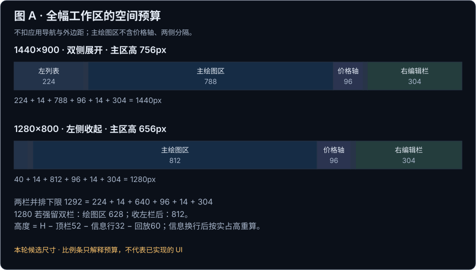
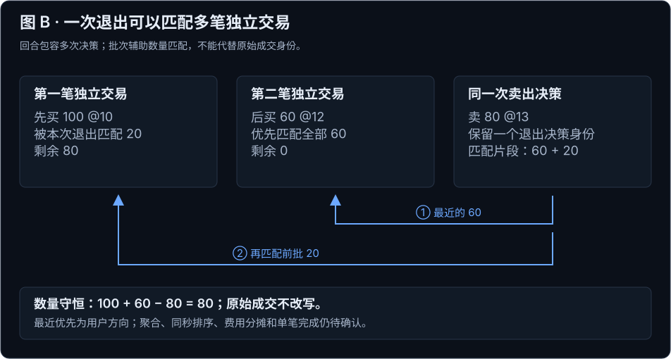
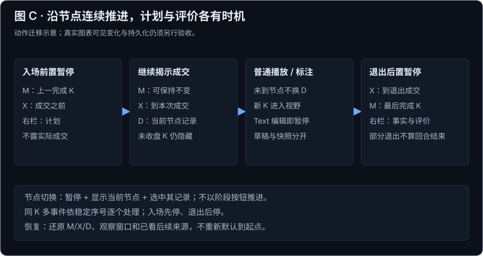
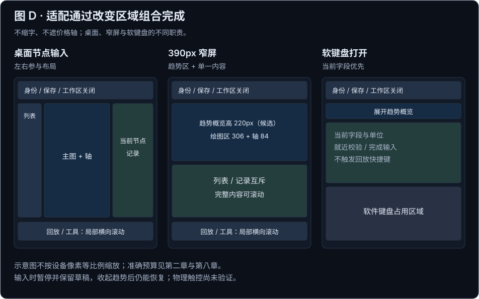

# 复盘页视觉规范 V1.0

2026-10-24 全文改写候选 · 范围仅限复盘工作区 · 待审阅

复盘工作区围绕一笔笔交易展开：从交易库进入标的，找到最近一笔待复盘交易，在入场节点补充计划，随着行情推进留下判断，在退出节点核对事实并评价。主图承载这条连续过程；左右区域帮助选择交易和编辑当前记录，不要求用户靠“入场前、持仓中、事后”三个按钮完成流程。

本次将 12 项文档设计任务整合为十章。第一至三章说明设计方向、空间和工具；第四、五章确定交易对象与推进边界；第六、七章说明计划、判断、指标和评价；第八、九章处理空间变化、保存及出口；第十章集中列出任务覆盖和验收。每章先回答设计问题和取舍，再给规则、参数和依据。

**本版是完整改写候选，不是产品实现验收。** 用户明确提出的方向作为设计输入，已有的数据安全约束继续保留；新增尺寸、批次归并细则和评分算法以“候选”标注。缺少参考操作证据的 TradingView 槽位继续保留编号。本轮不改首页、历史列表、交易库内部页面或业务数据。

## 一、设计目标与取舍 {#chapter-RV01}

本版用“交易节点驱动、主图连续观察”组织复盘。目标是让用户在回忆一笔交易时，能区分当时知道的事实、后来补充的判断和最终结果。空间、工具、数据和成果版本都围绕这一目标设计。

### 从用户的操作顺序决定页面结构

用户从交易列表选择一笔交易，遇到入场节点时需要输入计划，播放中主要看图和标注，遇到退出节点时需要摘要与评价。因此工作区覆盖整个网页，左侧选择交易，右侧处理节点内容，主图与底部回放保持连续。三阶段仍用于说明记录语境和组织成果，但退出常驻主导航；阶段恢复能力归入记录与快照入口。

这个选择增加了节点识别、自动展开和进度恢复的状态要求，换来更符合实际复盘顺序的操作过程。自动变化必须可解释、可暂停，不能夺走正在输入的焦点。绘图是判断工具，实际成交是只读事实，计划与评价是独立记录，四者不能因画在同一张图上而混成一个对象。

### 哪些决定已经有依据

|层级|本版采用内容|效力及取舍|
|---|---|---|
|用户明确方向|网页全幅工作区；关闭回交易库；左右可收缩；交易节点驱动；同向加仓视作独立交易；减仓优先匹配最近反向入场；四维五星评价|作为本轮设计目标，具体配对与评分细则仍需审阅|
|用户明确参考|绘图图标与实际功能逐项对齐 TradingView；底部按钮形态沿用参考；纠正箭头、旋转矩形和框内 T 的失真|专用工具覆盖旧版通用 Lucide 规则；外观和实际功能分别验收|
|继承约束|原始成交只读；行情与成交分别截断；未知不填 0；计划风险冻结；真实保存；完整决策和快照可追溯|新布局不能削弱这些约束；回合正式完成条件不随单笔评分改变|
|本轮候选|区域尺寸与收缩优先级、拆单归并及同秒排序、独立交易评价完成、默认评分规则、触屏适配|本稿提供明确方案供审阅，不能视作用户已经批准|
|证据缺口|TradingView 槽位名称、完整创建及编辑手势、原图缩放条件、真实工具和回放持久化|按第三章逐项补证，不以静态图或候选名称关闭缺口|

### 以稳定空间支持连续思考

<!-- stable-id: HOME-DOC-B039 -->
本地输入不丢失，错误提示不能把主图挤出当前可见区域。反馈优先占用已有状态入口，详情在右侧局部展开；播放、侧栏开合和错误恢复遵守同一套时间与视野规则。“视口”只用于浏览器尺寸，“图表视野”表示当前时间和价格范围，“可见区域”表示用户当前能看到的画面。

### 规范之间如何衔接

|依据|负责说明什么|本次更新边界|
|---|---|---|
|用户当前评论及截图|操作主线、全幅布局、交易划分和专用工具参考|优先于旧文应用壳、阶段主导航及统一 Lucide 的组织方式|
|[全站 V2.5](../../2026-10-22-homepage-v2.5/visual-spec.html#sitewide-principles)|公共表面、文字、焦点和作用域|不照搬首页卡片和列表；专用工具按第三章处理|
|[原复盘需求](../../../../specs/2026-09-25-chart-first-review-ui.md)与[元素表](../../../../specs/2026-09-25-chart-first-review-ui-elements.md)|原始成交、时间边界、Text、版本、完成和 E01–E22|新提案变更逐项列在第十章；未明确改变的约束继续有效|
|[交易库规范](../../2026-10-22-trading-library-v1.0/visual-spec.html#chapter-BT06)|来源身份和返回状态|只规定交接，不重设计交易库|
|[TradingView 对齐合同](../prototypes/tradingview-alignment-v0.1/contract.md)|13 个绘图槽位、7 个回放入口和证据分级|沿用其参考事实；与全篇衔接的候选布局以本稿为准|

## 二、沉浸式工作区与空间预算 {#chapter-RV02}

工作区将网页空间交给当前标的的复盘。左侧回答“正在看哪笔交易”，右侧回答“当前节点需要记录什么”，主图回答“行情怎样演进”。应用导航和外部标签栏退出工作面，工作区右上角的关闭按钮负责返回交易库。

### 区域职责先于像素参数

顶栏依次放标的与周期、前后交易及待复盘入口、保存状态、导出和工作区关闭；“更多”只收纳重新回放、完整历史、记录与快照等低频动作，并在菜单内明确命名。第二行显示当前观察时间、成交截止、记录归属和补记来源，不能把这些信息压成难懂的技术变量。

左侧交易列表按最近到最早展示独立交易及所属回合，区分待复盘、进行中和评价已完成。首次进入推荐最近未完成项，但不自动覆盖已有草稿；列表只显示第五章允许的身份与状态，未来退出、价格和盈亏不提前泄露。交易列表不兼任绘图工具列。收藏绘图条位于主图内部，其移动和停靠避开价格轴、当前编辑内容与底部回放条。

右侧在入场节点展开计划，在退出节点展开摘要与评价；继续播放时收起自动展开内容。候选增加“固定展开”，让主动固定的侧栏保持打开；编辑时先暂停播放，输入提交或取消后由用户继续。两个侧栏独立开合，开合只改变布局，时间边界和记录归属不随之变化。

### 用完整宽度推导收缩顺序

以下是本轮 **CSS 尺寸候选**，不是从参考截图像素直接换算。全幅工作区不再扣应用导航或外侧卡片边距。默认桌面状态为左列表展开、节点编辑时右栏展开；可用宽度不足时优先保住当前编辑栏和主图，收起另一侧。用户主动打开左栏时，在不能并排的宽度下让右栏收起并保留草稿。

|区域|候选参数|空间职责|
|---|---|---|
|顶栏 / 信息行 / 回放条|52 / 32 起 / 60px|顶栏文字基线统一；信息长时换行并计入实际占高；回放条与第三章候选 60px 对齐|
|左交易列表 / 收起轨道|224 / 40px|独立滚动；收起后仍有名称与恢复入口，触控入口扩至 44px|
|右节点编辑栏 / 收起轨道|304 / 40px|沿用 300–320px 范围；核心字段在前，来源与完整记录折叠|
|主绘图区|桌面优选下限 640px|不含轴和左右分隔；工具浮在图内，不再重复扣 48px 固定工具列|
|价格轴 / 两侧分隔|96px / 各 14px|右侧分隔位于价格轴和编辑栏之间，左侧分隔隔开交易列表；标签不可穿入表单|
|主区高度|1440×900 为 756px；1280×800 为 656px|高度减去 52+32+60；长信息行增加的高度必须重新扣除|

并排两栏需要 **1292px = 224 + 14 + 640 + 96 + 14 + 304**。1440px 时主绘图区为 788px；1280px 时若强留两栏只剩 628px，因此收起左栏至 40px，主绘图区变为 812px。此时右栏仍为 304px，没有缩字或压窄输入。

图 A｜比例条专门解释宽度与高度预算，不是重复的产品截图。1440 的双栏与 1280 的左收起状态不同，禁止用此图证明两种尺寸下默认状态相同。

### 布局变化与图表观察分开处理

|组合|主绘图区宽度公式|适用边界及行为|
|---|---|---|
|两侧展开|W−652|W≥1292；节点输入与列表同时可见|
|左收起、右展开|W−468|W≥1108；优先用于入场/退出编辑|
|左展开、右收起|W−388|W≥1028；用于查找交易|
|两侧收起|W−204|W≥844；主图观察优先|
|更窄工作区|转为趋势区＋单一内容区|不再硬守 640px；按第八章安排工具、列表和表单|

这些边界是当前候选尺寸的推导结果，改动任一栏宽必须重算，不能沿用旧应用导航推导的 1102px。软件键盘和宽屏触控另计命中尺寸，不由桌面宽度代替判断。

侧栏内部滚动不拖动主图，开合保持当前时间与价格范围。推进时目标 K 或成交必须进入图表视野；开合、刷新、错误说明出现时则保持用户的观察窗口，两种行为按第五章分别处理。

依据：[用户工作区方向与旧图差异](../evidence/full-rewrite-20261024/scan-and-rewrite.md)、[原元素尺寸 E01/E05/E09](../../../../specs/2026-09-25-chart-first-review-ui-elements.md)。完整响应与异常规则见[第八章](#chapter-RV08)。

## 三、视觉语言与 TradingView 专用工具 {#chapter-RV03}

复盘界面需要同时保持全站一致性和交易工具的可辨认性。公共表单、文字、状态沿用 V2.5；用户指定的绘图收藏条和底部回放采用 TradingView 参考。专用图标的轮廓、工具身份及动作必须逐一对应，不能用一套通用图标替换后仍称 1:1。

### 公共视觉承担层级，图形承担对象含义

|角色|取值与用法|约束|
|---|---|---|
|页面 / 面板 / 浮层|#0B1019 / #111A26 / #162233|共享颜色的单一来源仍为 V2.5；参考工具的原图对照保留原样|
|正文 / 次要 / 弱提示|#E6EDF7 / #A8B6CB / #71829B|重要缺失原因不能只用弱提示色|
|边线 / 操作 / 焦点|#283448 / #6CA8FF / #A9C8FF|焦点环 2px；选中不表示判断正确|
|计划 / 实际成交 / 判断|琥珀虚线及名称 / 菱形及动作文字 / Text 与连接线|计划、成交和文字靠名称及形态区分；绘制箭头不代表下单|
|财务正负|#53D7A0 / #FF8592，同时显示正负号、币种|独立于 K 线配色；K 线保留用户 colorScheme|
|层级与对齐|标的 18/24，栏标题 16/24，输入正文 14/20，辅助 12/16px|系统中文后备；数字 tabular-nums；顶栏同基线，长数值不缩字|
|公共控件|高至少 36px，触控至少 44px；圆角 6/8px；间距 4/8/12/16/24/32px|普通界面图标可沿用 Lucide；以下两个专用工具区排除通用替换|

图表保留网格、成交量、成交标记、成本线和配色设置；成交与成本线还需满足可知边界。布局变更不重置设置，不另立本地权威副本。详细公共状态引用[V2.5视觉基础](../../2026-10-22-homepage-v2.5/visual-spec.html#sitewide-visual)与[控件手册](../../2026-10-22-homepage-v2.5/source/component-manual.html)。

### 按截图槽位锁定图标与功能

截图实际为 2318×1250；现有对照稿用 2048×1104 归一坐标。截图缩放和 DPR 未知，几何相似不等于 CSS 像素级一致。红框是用户批注；图表背景、报价和品牌区域不自动纳入复刻范围。

|槽位|图形与候选功能|当前证据与限制|
|---|---|---|
|H00|点阵拖动柄|可见轮廓；拖动边界、停靠与重开位置待核|
|D01|层级横线：斐波那契回撤|官方能力可查，槽位待提示核名|
|D02|T：文字|需区分普通文字与画布锚定文字|
|D03 / D04|L / S：多头 / 空头仓位|高置信候选；测量风险收益，不是买卖指令|
|D05|四角圆点：矩形|创建手势与编辑手柄待实操|
|D06|斜向空心箭头|Arrow / Arrow marker 尚未消歧|
|D07|两端圆点斜线：趋势线|延长、吸附和默认样式待实操|
|D08 / D09|向上 / 向下空心箭头|候选为位置标记；按参考轮廓对齐，不接实际买卖|
|D10|倾斜矩形与节点：旋转矩形|三个创建点不等于三个编辑手柄；现有描摹保留参考六个圆点|
|D11|多节点交错线|身份未知，不能先替换成折线或头肩形态|
|D12|框内 T、竖线与圆点|身份未知；字形与外框比例独立校验，不替换成普通 Text|
|D13|单圆点向右横线：水平射线|单一起点与右延伸为候选；身份仍需核名|

可直接审阅[原图、修正后的候选与状态对照](../prototypes/tradingview-alignment-v0.1/index.html)。用户指出的 D08/D09、D10、D12 失真已纳入该候选修订：成对箭头采用镜像几何，旋转矩形按参考控制点重画，框内 T 使用路径字形，边框改为不挤压 SVG 的内描边。它仍是候选描摹，不是取得官方原始矢量后的像素级验收。

### 底栏保留参考语义，交易导航另设入口

|槽位 / 参考外观|动作对应|复盘中的候选处理|
|---|---|---|
|R01 日历、“选择日期”、下拉|选回放起点|暂停后选合法日期或 K；取消不改状态|
|R02 播放三角|播放 / 暂停|受节点、输入、末尾和缺行情约束；暂停形态须补参考|
|R03 三角加竖线|单步向前|逐根推进，不替代下一笔交易；步长与 R05 关系待核|
|R04 1x|调整播放速度|仅改调度间隔；本项目默认每秒一根为继承候选，不等同已证实 TV 1x|
|R05 天|周期或回放更新间隔待确认|保留槽位，未核实前不连接未经确认的业务动作|
|R06 三角加双竖线|返回实时候选|推荐保留参考语义，只有历史数据时禁用并解释；不能偷换为下一交易|
|R07 最右 X|关闭回放面板|暂停并收起底栏，保留进度及重新开启入口；工作区关闭在顶栏|

“下一成交节点”和“下一待复盘交易”在工作区明确命名，不能占用 R03/R06 的图标语义。底栏候选高 60px，收藏条候选高 48px、宽约 647px；图标不作不等比拉伸。窗口容纳不下时保留可滚动的完整工具序列，第八章的触控方案仍需审阅。

### 证据缺口按外观、动作和恢复分别补齐

|编号|需要补什么|通过标准|
|---|---|---|
|G01 名称|全部 D 槽 tooltip / 菜单，优先 D06/D11/D12；R05/R06 含义|截图同配置、同语言，逐槽名称唯一|
|G02 外观|版本、系统缩放、浏览器 zoom / DPR、默认/悬停/选中/禁用与矢量来源|同条件叠合，轮廓、线宽、端点、字形、间距逐项核对|
|G03 操作|逐工具创建、选中、整体/锚点拖动、属性、取消、删除、撤销重做、重开录屏|13 项真实生命周期分别成立；未知手势不能由相似工具补齐|
|G04 回放|日期取消、步长、倍率、周期、返回实时、关闭前后及末尾|名称、可见变化和前后状态对应；不能只看游标改变|
|G05 选型与落地|当前 Lightweight Charts 的扩展/替换评估、组件获取条件及版本能力|不能把网站工具或 Advanced Charts 文档当作当前库已有功能；本稿不批准换库|

已有公开研究及逐槽字段见[对齐合同与官方来源](../prototypes/tradingview-alignment-v0.1/contract.md)；用户参考见[原图](references/2026-10-24-tradingview-toolbar-reference.png)和[要求归档](references/2026-10-24-tradingview-toolbar-contract.md)。绘图与计划对象的关系见[第六章](#chapter-RV06)，时间状态统一按[第五章](#chapter-RV05)。

## 四、交易单位与连续复盘动线 {#chapter-RV04}

<!-- stable-id: HOME-DOC-B383 -->
复盘沿交易节点连续前进，三阶段负责说明计划、判断和评价的内容语境，不再要求用户逐段切换按钮。已确认的基础是：交易回合描述一段持仓过程，交易决策描述一次买入、加仓、减仓或清仓决定，成交明细是券商实际成交，拆单不自动产生多个决策。新增的批次归属、排序和完成门槛仍是本轮候选，须与用户确认后才能成为业务契约。

### 关系模型与取舍

一个回合从净持仓为零开始，到净持仓回到零结束；未回到零时保持开放。回合是复盘和完成确认的容器，不把每一次同向加仓误切成孤立回合。

回合包含多个交易决策。首次建仓、加仓、减仓、清仓各自有稳定的决策身份、记录、Text 和决策快照。逐根推进只改变行情边界，不改变当前记录归属；节点调度器暂停后自动切换到当前节点，用户也可选择交易节点或快照明确切换 D（记录归属）。

用户已确认：每一次新增同向持仓都是一笔独立交易。这里的“独立交易”记录原始数量、价格、费用、时间、来源成交明细及剩余数量；它仍属于同一回合，但拥有独立的记录、指标和复盘完成语境。一次历史交易决策可包含多条成交明细，但不得静默合并不同决策。

为实现数量匹配，可把独立交易映射为候选批次；批次是候选计算模型，不改写历史 decision/fill 对象。退出决策可以匹配多个独立交易片段，并保留每段来源。批次全部退出与每个退出片段何时标为完成，仍是候选完成规则。

用户已确认减仓优先匹配最近的独立交易。候选批次模型以 LIFO 表达该方向：按可匹配独立交易的稳定时间序列，从最近者开始扣减，扣完再进入更早者。稳定序列必须包含成交时间、同秒内的稳定序号和导入来源身份；时间相同不能靠数组顺序猜测。聚合判据、平局排序和完成标记仍待确认。

例：先买 100，再买 60，随后卖 80。按用户提出的最近优先方向，卖出 60 匹配第二个独立交易，剩余 20 再匹配第一个独立交易；第一个余 80，第二个余 0。卖出决策已完成其退出记录，但两个独立交易的剩余状态分别保留，不能把第一个 100 整批标成已退出。

同一卖出决策可以横跨多个批次，并保留每段匹配数量、价格、费用分摊和来源。部分退出只减少匹配批次的剩余数量；多批次退出不改变原始成交明细，也不制造虚构成交。费用无法按来源可靠分摊时保存原始总额并标为待核算，不能以零代替未知。

做空沿用同一关系，但方向相反：卖出建立空头批次，买入回补产生退出匹配，数量为正的“开仓/退出”含义由方向字段解释。反向操作若先使净持仓回到零，再产生另一方向持仓，应结束旧回合并新建回合；若一次反向成交同时平旧仓并开新仓，拆成两个方向明确的匹配段，是否属于一个用户决策列为待确认。

同一 K 线可有多个决策。同秒事件必须展示时间、方向、数量、价格、动作和稳定序号；X 不是单一时间戳，而是“时间 + 稳定序号”的成交截止。券商拆单若有共同操作身份，归属于一个交易决策；来源无法证明共同操作时保留多条成交明细并标待确认，不自动聚合。

本轮候选取舍是：回合负责完成和返回，决策负责记录和评价，批次负责数量匹配，成交明细负责可审计来源。候选的批次聚合判据、同秒平局排序、反手归属、拆单归并、费用分摊以及“独立交易全部退出是否才可标记其复盘完成”均不能冒充用户已批准。

图 B｜只解释数量配对，不声称费用分摊、同秒排序和完成规则已经批准。

### 与旧完成规则的差异及兼容

[CONTEXT 的“已完成复盘”](../../../../../CONTEXT.md)以回合为单位。本稿增加独立交易和匹配片段帮助导航、计量与评价；它们不能悄然替代旧正式完成状态。下表将继承约束、用户方向和未决候选分开，避免“持仓已清零”被读成“复盘已完成”。

|对象 / 状态|旧规则或用户方向|本轮处理及列表表现|快照、导出与兼容；决定状态|
|---|---|---|---|
|回合正式完成|清仓＋每个真实决策至少一份快照＋用户统一保存确认|继续用“回合复盘已完成”；完成动作留存全局成果组合|全部决策仍需覆盖；可导出进行中版本但不能标完成；**继承**|
|交易决策|首次、加仓、减仓、清仓各有快照要求|有记录/已有快照/评价完整分别显示，不增设独立正式完成入口|同一次退出匹配两批也只对应一个真实退出决策；不新增虚构决策快照门槛；**继承**|
|独立交易|用户要求每次新增同向持仓独立复盘|候选列表分别显示数量状态与评价状态，如“已退出 · 待评价”；默认不标正式完成|建议清零且相关评价完整后显示“评价已完成”，仍不解除回合快照门槛；这一单笔门槛 **待决议**|
|计算批次|旧规则无独立批次完成|仅显示剩余数量、已退出数量及来源待核；没有“批次复盘完成”按钮|由独立交易映射，聚合/反手归属为 **候选**；导出注明匹配算法版本|
|退出匹配片段|一个退出决策可涉及多条成交，旧规则不按片段增加决策|显示分配数量与该片段评价依据，不制造第二个退出决策|建议片段评价完整可独立标识，但不自动完成独立交易或回合；**候选**|
|三阶段选集|旧需求以三阶段组织选集；三图齐全不代表完成|改为节点驱动导航，阶段仍作为记录标签与导出叙事|阶段代表图引用原决策快照；保留原 ID/正式版本，旧成果不自动重算；导航调整为 **用户方向**|

买 100、加 60、卖 80 后，第二笔只能先显示“已退出”，第一笔显示“剩余 80”，回合仍开放；仅填写卖出评价不会自动补齐任一入场快照。待用户决定单笔评价门槛后，只增加关联状态，不改写旧正式完成标志或历史成果。

### 三条完整旅程

#### 旅程 A：最近未复盘独立交易的普通入场与退出

入口列出最近一个尚未复盘的独立交易，并显示证券、方向、入场决策时间和“从首次可知行情开始”。进入后先处于入场前内容语境：主图只显示 M 截止的已知 K 线，真实入场、退出、该回合最终净持仓、最终盈亏和未来 K 线隐藏；计划可填写但不阻塞推进。

用户按“下一根”逐根推进。若下一根范围内遇到入场或加仓节点，调度器先停在节点前置边界：M 保持在该节点之前的上一根完成 K，X 保持在该成交之前的稳定序号，不揭示完整未收盘 K。到达首次成交节点时自动暂停并打开右侧入场记录；目标成交时刻可用待揭示节点位置提示，但不显示该成交价格、数量或未完成 K 的 OHLC。

右栏先显示计划和入场记录；用户继续后才揭示该笔成交，并把 X 按稳定序号前进。节点调度器暂停后自动执行可见的“当前节点切换”，将 D 切到该节点记录；这是已确认的自动展开合同。用户主动点击下一节点也切换 D。若节点发生在同一 K，主图不换根，右侧列表显示稳定序号。普通继续播放会收起右栏；节点暂停、用户主动展开和恢复工作图的行为分别记录，不重复打断已处理节点。

退出节点在成交事实已揭示后暂停并打开退出记录，显示该事实的摘要。用户可逐次评价退出；独立交易和退出片段的完成标记按候选规则审阅；回合正式完成继续遵守第九章的既有门槛。进入结果视图后才显示可见范围内的结果摘要，未平仓回合不得显示最终平仓结果。

#### 旅程 B：加仓后减仓、部分退出与多批次匹配

从首次建仓决策继续播放到加仓节点。加仓前置节点先显示该次计划；继续后才揭示第二个独立交易及候选批次，右侧显示截至 X 的净持仓与两笔交易的剩余数量。决策快照由用户显式留存，节点到达不会自动生成已确认快照。原批次初始计划只读。调整计划必须以带时点和原因的新修订保存，不能覆盖初始风险基准。

随后卖出 80 的节点在成交事实揭示后暂停。右侧退出明细展开最近优先的候选匹配预览：第二个独立交易匹配 60、第一笔独立交易匹配 20；每段数量、价格、费用和来源可展开。确认保存的是历史退出决策、原始成交明细和候选匹配结果，不是把第一笔 100 结束。之后再卖出时，列表仍能找到第一笔余量 80 和对应决策。

同一 K 的连续成交按稳定序号逐个选择。自动节点切换和用户点击某一节点都切换 D；hover 或预览不能替换正在编辑的草稿。若方向变为做空，界面明确显示旧回合剩余为零或未平仓、空头新批次和待确认反手边界。

#### 旅程 C：恢复未完成复盘

入口显示最近草稿的证券、回合身份、保存版本、阶段语境、M、X、D、视野和“已看后续”来源。恢复时先还原持久化工作状态，不以默认起点覆盖用户草稿，也不把阶段文字当作游标证据。

用户可继续逐根推进；播放从保存的 M/X 继续，当前 D 保持不变。节点暂停时自动切换到可见的当前节点，用户点击某节点也明确换 D；返回工作图则保留已编辑字段并恢复工作视野。主动查看完整历史会记录来源类型和时间，回到早期时仍显示“已看后续后补记”，但未来画面重新按当前 M/X 隐藏。

若缺行情，主图显示缺失原因、数据集版本和重试入口，缺失段不填零。若输入字段有焦点、Text 正在编辑或中文 IME 处于组词/确认阶段，播放暂停并屏蔽回放快捷键；输入草稿不能因节点切换丢失。保存、重开后必须恢复同一 M/X/D、视野、来源标识和草稿。

图 C｜分开前置计划和事后评价，节点切换是可见动作；此图不是回放已经工作的证据。

### 左右区域和节点行为

左侧列表承担入口、回合/独立交易筛选、决策/快照查找和稳定身份展示；hover、展开、滚动本身不推进行情，也不替换当前编辑对象。点击列表中的交易或节点是合法的明确跳转，会按其 M/X 边界和视野定位。右侧侧栏承担当前阶段字段、节点记录、批次匹配、评价和来源详情；它不拥有独立的第二个时间游标。

入场前置节点只显示合法的时间位置与计划；成交揭示后，目标标记与当前决策在主图和右栏对应。退出节点在事实可见后暂停并打开摘要。普通下一根和播放完成后收起右栏，保持主图观察空间。用户主动固定右栏可作为候选便利行为，但不能改变 M/X/D 或暂停规则。

三阶段只作为内容语境：入场前组织计划，持仓中组织判断和计划修订，事后组织退出事实与评价。不强制提供阶段导航，也不把切换阶段当作推进；入口必须通过回合、独立交易列表、决策列表、节点选择和恢复状态保持可达。

## 五、回放的时间与信息边界 {#chapter-RV05}

回放必须回答四件事：主图此刻能看到什么、成交何时可见、记录归属于谁、用户已经主动看过什么。M、X、D 和 phase 分开持久化；任何动作都必须说明前态、边界变化、可见/隐藏字段、视野和保存结果。

### 状态字段

M 是行情可知截止，按完成 K 的时间序列推进；X 是成交可知截止，值为时间与稳定序号；D 是当前记录归属，可为空、指向回合工作图或明确决策/快照；phase 是内容语境，不是第三个时间游标。普通逐根推进不换绑 D；节点调度器暂停后通过可见的“当前节点切换”自动换 D，用户主动选择下一节点也换 D。

|状态/动作|前态与变化|主图轴与 K 线|列表/侧栏|评分与结构化字段|视野与持久化|
|---|---|---|---|---|---|
|首次进入|M=首次入场前完成K；X=首次成交前；D=入场记录；phase=入场前|仅显示 M 内完成K；轴只用可知价格|左列显示独立交易；右栏显示计划，入场成交隐藏|计划可编辑；退出评分、最终净持仓和最终结果隐藏|保存 M/X/D/phase 与初始视野|
|下一根/播放，无交易节点|M 前进至下一完成 K；X 前进到该边界内已知事件；D 不变|新增 K 进入视野；不伪造缺失行情|收起自动展开的右栏；手动固定除外|现有记录不换归属；后续评分隐藏|保存 M/X、视野与播放位置|
|前置入场节点|暂停；M=节点前上一完成K；X=该成交前序号；D=入场记录；phase=入场前|不揭示该成交；同K不伪造完整未收盘K|右栏打开并显示计划|入场记录可编辑；后续成交、评分隐藏|保存 M/X/D、节点序号、视野和草稿|
|继续揭示入场|M 可保持前置边界；X 前进到该成交序号；D=当前节点记录；phase=持仓中|成交事实进入主图；未收盘K仍按边界呈现|右栏显示当前节点和摘要|当前决策可编辑；其他评分隐藏|保存 M/X/D、节点序号、视野和草稿|
|退出节点|X 到退出成交序号；M 为此刻最后完成 K；D=退出记录；phase=该次退出评价|退出标记和事实摘要可见；未来后续隐藏|右栏暂停打开并显示摘要|退出评分可编辑；未选退出评分隐藏|保存 M/X/D、节点序号、视野和草稿|
|同K下一节点|成交时间可不同，K 所属相同；X 按稳定事件序列推进，入场仍先停在其前序；D 可见切换|M 可保持不动；揭示后目标标记变化，未完成 K 仍隐藏|右栏只切当前节点；上一草稿保留|评分只属于当前选择|保存序号，不能只存时间|
|上一根/回看|M/X 回退到目标边界；D 不因回退自动改变|隐藏越过边界的K、成交和提示；轴重算只用可知范围|列表保留已看来源；若 D 晚于 X，右栏隐藏后期 Text、计划和评分，显示“归属在观察边界之后”及选择当前可知节点入口|已存记录不删除；不生成新评分|保存回看边界和“已看后续”标识|
|选择成交/快照|用户明确选择；D 切到对象；快照冻结其 M/X|定位目标 K 与价格；预览不替换工作图|左列选中身份；右栏显示对象来源|编辑只写对象草稿，返回工作图另行操作|保存对象 ID、M/X、D 和视野|
|主动展开结果/完整历史|M/X 到允许的完整边界；来源=主动揭示|结果、后续K、提示和摘要可见；未平仓仍无最终结果|右栏打开结果/历史；来源时间必显|可见结果评分可编辑；早期评分归属不变|保存揭示来源与时间；返回时恢复原边界|
|切周期/刷新/侧栏开合|M/X/D/phase 不变|只显示新周期内已知完成K；不 fit 到未来|列表和右栏职责不变|字段、评分和草稿不变|保存窗口偏好；不写新节点|
|缺行情|M 保持；标记缺失原因和数据集版本|缺失段留空或断线，不填零、不用未来值定轴|显示重试和数据状态；不伪造成交|受影响指标为未知/null|保存缺失状态与重试结果，不改原始成交|
|输入/IME|M/X/D/phase 暂停不变|主图不推进；输入期间不触发节点|右栏保持焦点与草稿|数字、Text、评分完整保留|保存草稿后才允许离开或恢复|
|关闭/重新开始/下一待复盘交易|R07 暂停并收起回放；工作区关闭返回入口；重新开始恢复当前交易起点的 M/X/D/phase/视野，保留正式版本、快照和已看来源；下一待复盘交易选择另一独立交易|重新开始隐藏未来；下一交易按其合法起点|入口分别显示关闭返回、重新开始、下一待复盘交易|不复制或清除原记录；重新开始不等于新回合|分别持久化动作来源和目标身份|
|保存/重开|恢复最后持久化 M/X/D/phase|恢复同一窗口、轴和可见边界|恢复列表选中与右栏开合语境|恢复字段、来源、评分和版本|不得回到默认阶段或另一游标|

### 未来信息的整面约束

未来边界覆盖 K 线、价格轴、tooltip、摘要、交易提示、列表数量、盈亏和评分。时间轴可为布局保留空白，但不得用未来事件、波动或数据密度暗示走势。当前选中交易的证券、方向、入场时间和用户复盘进度是入口身份例外；未揭示退出、未来交易数量、已清仓状态和结果标签不出现。未来 K 线不以淡色占位，轴不使用未来高低点；列表不先显示未来成交数量或结果标签。周期切换只重采样 M 内已知数据，不把当日未完成行情变成已知。

主动揭示完整历史是用户行为，必须记录来源类型和时间；它不改变原始成交，也不把未来知识写回早期的“当时可知”字段。回到早期时画面按 M/X 隐藏未来，但列表可保留“已看后续”语境。未平仓只能显示截至边界的浮动事实，不能显示最终回合净额。

关闭、重新开始和下一待复盘独立交易的入口与返回职责，应分别与 RV03 的工作区入口和 RV09 的保存/返回契约交叉承接；它们不是同一个“继续”动作。

回放默认逐根推进。推进成功的证据是新增 K 或目标成交真实进入可见主图，并且轴、列表和记录对象一致；只改变游标数字、数组长度或阶段文字不算成功。末尾禁用继续推进并说明最后可用行情；仍可选择已有节点或回看。若末尾仍有未完成成交样例，必须显示未完成状态和可用节点入口，不能把“到末尾”误报为回合完成。关闭、重新开始和“下一待复盘交易”分别属于返回、重置当前工作状态和选择另一入口。

### 引用与效力

本章的三阶段、双截止、Text、回放和未来信息原则以现行术语和元素规范为边界。术语以 [`CONTEXT.md`](../../../../../CONTEXT.md) 为现行定义，元素行为以 [`2026-09-25-chart-first-review-ui-elements.md`](../../../../specs/2026-09-25-chart-first-review-ui-elements.md) 为依据。

批次聚合、平局排序、反手归属、拆单归并及独立交易完成标记保持候选；已有回合完成门槛仍有效。普通 K 推进、入场前置与退出后置采用不同状态迁移，后续实现必须分别验证。

## 六、节点计划、图形与判断记录 {#chapter-RV06}

用户在开仓或加仓时只需冻结一次计划，随后直接在主图记录依据，并能回到同一批次核对。计划、图形、判断分别保留对象边界和历史版本，避免为每根 K 线制造虚构成交或重复填写同一段心态。阶段和交易单位沿用[RV04](#chapter-RV04)，可知边界沿用[RV05](#chapter-RV05)；本章不重新定义配对或回放推进。

### 先冻结独立入场批次的计划

一次首次入场或加仓动作建立一个独立入场批次。批次计划在确认时冻结入场价格、初始止损、目标、方向、规模口径及其来源；后续调整创建带时间、原因和操作者的修订，不能覆盖最初风险基准。减仓、清仓按既定配对规则引用批次，评价和指标再引用被选中的计划版本，见[RV07](#chapter-RV07)与[RV09](#chapter-RV09)。

预期 R 只有在同一批次同时有有效入场、有效初始止损和有效目标时才成立。价格已填且有效的单线可以显示，但计划组仍标为“未完成”；缺失的线不画，方向不符、无效价格或零风险也不画，不能用线或数值虚构未知信息。多头应满足止损 < 入场 < 目标，空头应满足目标 < 入场 < 止损；价差和方向必须一起校验。只有买卖两价不能伪造预期 R，计划未完成仍可看图和推进。

多头预期 R =（目标−计划入场）/（计划入场−初始止损），空头预期 R =（计划入场−目标）/（初始止损−计划入场）；3R 同时显示为收益:风险 3:1。名义金额 = 计划数量×计划入场；仓位占比 = 同币种名义金额/资金基数；风险占比 = 初始计划风险/资金基数。交易单位、汇率或基数未知时，对应项保持未知。

规模模式只允许一个主输入：数量、金额或仓位比例。模式切换按已有值和已知基数换算，并提示最小交易单位、币种和舍入；不能因为基数缺失而偷偷归零。规模对象保存数值、模式、单位、币种、舍入结果和输入来源。资金基数另存金额、币种、时点与来源（手填参考、导入快照或未提供）；来源未知时只显示“未提供”，不冒充账户净值。缺资金时比例及依赖指标保持待计算，跨币种不能用未换算数直接计算。具体计算口径由[RV07](#chapter-RV07)统一，E11–E13 的字段和状态见[元素规范](../../../../specs/2026-09-25-chart-first-review-ui-elements.md)。

|计划字段|必须保留|缺失或无效时|
|---|---|---|
|方向、入场、止损、目标|批次 ID、精度、来源、冻结版本|有效单线可显示；缺失/无效对应线不画，不计算预期 R|
|规模|模式、原始值、单位、币种、舍入结果|不能用 0 代替，提示基数或单位缺失|
|资金基数|金额、币种、时点、来源|比例与依赖指标待计算|
|修订|时间、原因、操作者、父版本|旧版本仍可查看和引用|

### 计划线与 TradingView 图形不是同一对象

E06 原计划线是计划对象的视图：名称、价格、方向、批次和冻结版本共同决定它是否显示。拖动计划线等同于编辑计划草稿，已冻结版本必须先显式创建修订；缺项或无效值不生成伪线。

TradingView 参考中的多头/空头仓位图形是独立绘图对象，用于测量或解释风险收益，不是买卖指令，也不会默默写入计划。用户必须执行“导入当前节点计划”这一显式动作；导入时复制入场、止损、目标和方向到草稿，重新做缺项、方向和零风险校验。图形的跨度只作为导入来源元数据，不成为计划价格字段。普通趋势线、水平线、矩形、箭头及未知槽位同样只属于图形对象。工具身份、锚点和手势以[TradingView 对齐契约](../prototypes/tradingview-alignment-v0.1/contract.md)为参考；该契约仍是候选提案，不能当作产品已经实现。

### 图形与 Text 共享可核对的生命周期

每个图形或 Text 都有稳定 ID、类型、锚点类型、时间/价格或归一化画布坐标、样式、文本、记录拥有者、创建时 M/X、当前修订和保存状态。以下是图形能力的设计要求，本轮未实施或运行验证。

1. **创建**：先选工具，再在主图放置；未完成的多点对象显示临时态。Text 先定位再输入，中文 IME、换行和数字编辑期间暂停回放。
2. **编辑与取消**：选中后可整体移动、移动适用的锚点、改文本和样式；Esc 取消未完成创建或本次编辑，恢复编辑前值，并保留可恢复草稿。点击空白退出选择。
3. **删除与撤销**：Delete 只作用于已选中且输入焦点已离开的对象；一次连续拖动或一次确认编辑形成一个撤销步。删除、恢复和重做都保留稳定 ID 的历史，不重排其他对象。
4. **版本与重开**：保存草稿、留存快照和正式完成是不同承诺。快照引用当时的对象修订和 M/X/D；重开恢复相同修订、视口语境和未保存提示，不把后来修订写回旧快照。失败或冲突时保留本地内容，不能伪装成已保存。

### 逐工具合同：已知轮廓与待验证动作分开

下面逐项登记创建、编辑和保存合同。**所有行的 TradingView 实际操作均为 NOT VERIFIED**；“候选”只用于审阅本项目如何承接，不证明参考工具采用同样手势。G01 核名后按 G03 录制每行完整操作；若录屏不符，更新该行，不把候选倒写成参考事实。

表中的 **L** 指上节通用生命周期：创建中 Esc 取消；选中后 Delete 删除；连续编辑作为一个撤销步，可重做；保存和重开保留对象 ID、所属记录 D、批次引用、锚点与修订。未知身份的工具在核名前不提供可执行创建入口，也不保存伪造类型。取消/删除/撤销的参考快捷键与事务粒度仍须逐行验证。

|槽位|创建与锚点合同|编辑属性及边界|取消、撤销、保存与所缺证据|
|---|---|---|---|
|D01|候选两端定位回撤范围；点选/拖动次序未核|端点、层级值与样式；默认层级、反向及延伸未核|L；保存层级和两端坐标；需完整创建、反向、端点编辑录屏|
|D02|候选先定位后输入；时间价格或画布锚定待核|正文、字号、颜色、背景；不与 D12 合并|L＋IME 焦点保护；保存锚点类型；需核名、换行、移动、重开录屏|
|D03|多头仓位候选；创建点数与次序未核|入场/止损/目标、跨度及数量；不下单；导入计划须显式确认|L；保存测量参数及导入来源；需多头创建、调手柄、属性和重开录屏|
|D04|空头仓位候选；不直接镜像 D03 的手势|方向、三价、跨度及数量；校验空头价格关系|L；保存空头参数；需单独空头生命周期录屏，不能用 D03 替代|
|D05|矩形候选两角；点选与拖拽方式未核|整体、边角、边框及填充；角/边手柄数待核|L；保存实际锚点集；需创建、缩放、整体移位录屏|
|D06|Arrow / Arrow marker 未消歧；不确定一锚点或两端|方向、长度和箭头样式均不能由图标推断|L 仅为本地存储约束；核名前不生成对象；需 tooltip＋完整操作|
|D07|趋势线候选两个时间价格点；手势未核|两端、整体、延长、吸附和样式|L；保存延伸/吸附配置；需创建、单端移动、延长及重开录屏|
|D08|向上标记候选单锚点；是否可改宽高未核|位置、大小和颜色；不触发买入|L；保存实际支持的锚点与样式；需该槽独立创建/移位录屏|
|D09|向下标记候选单锚点；不以 D08 验收代替|位置、大小和颜色；不触发卖出|L；保存实际支持字段；需该槽独立创建/移位录屏|
|D10|旋转矩形候选三点创建；截图六圆点不等于创建步数|旋转、边长、整体和填充；六点各自语义待核|L；保存参考实际锚点模型；需三点过程及每个手柄拖动录屏|
|D11|多节点交错线，身份与创建点数未知|禁止先定义为折线/头肩；属性及编辑方式未知|核名前不创建、不导入计划；取得名称、完整点序、结束/取消、重开证据后填合同|
|D12|框内 T 与引线圆点，身份与锚点关系未知|禁止用普通 Text 替代；文本框/引线/圆点编辑关系待核|核名前不创建；需核名、输入、框与锚点分别移动、删除/恢复证据|
|D13|水平射线候选单一起点向右延伸；手势未核|起点时间/价格、线样式、价格标签；不能改成普通线段|L；保存射线类型及标签设置；需创建、改价、延伸与重开录屏|
|H00|工具条布局柄，不创建绘图对象|候选拖动整条并限制在绘图区；停靠/吸附待核|Esc 取消本次拖动为候选；位置属于用户布局，不进图形撤销或交易快照；需拖动、窄屏、重开证据|

每一行都须独立验证取消未完成对象、删除已存对象、撤销重做及重开。共享 L 是避免重复定义本项目数据安全承诺，不能减少 G03 的逐工具参考取证。

Text 默认展开一张短卡，最多同时展开两张；默认字号 14px，并保留既有工作区的 T 快捷键、字号 12/14/16/18/24/32px、用户颜色、背景和换行样式。这些是本工作区已保留的约定，不是 TradingView 默认快捷键或已核实的 TV 样式。普通 Text 与画布锚定 Text 仍需区分，不能凭相似轮廓合并。长文显示摘要与展开入口，编辑时全文可达且不得遮挡价格轴，详见 E08 和[响应式规则](#chapter-RV08)。

生命周期的验收对象按以下边界区分：

|状态|用户可见结果|数据承诺|
|---|---|---|
|创建中|临时线/文字和下一步提示|未生成正式对象，不写成交|
|已创建|选中态、锚点、类型和来源标签|稳定 ID 已分配，可取消或撤销|
|编辑中|字段、样式、锚点可修改|回放暂停，D 和原始成交不变|
|已留存|快照版本、M/X/D、引用批次可查|旧修订冻结，新改动另起版本|
|重开/冲突|恢复原视口并标出本地未保存内容|不得静默覆盖或丢弃输入|

### 判断记录的归属、锚点和时间边界

术语固定为：M 是当前可知行情截止，X 是当前可知成交截止，D 是记录拥有者（决策、回合或快照）。计划另以 batchID 关联独立入场批次，不能把 D 当作批次字段。本轮候选默认只关联当前明确选中的独立交易批次；节点 D 涉及多个批次且没有单一选中项时，先归属 D 并标“尚未分配批次”。不按图形跨越的时间范围自动共享。共享保存一份正文及显式引用关系，按下表处理版本；独立副本必须由用户主动创建。

|归属动作 / 状态|本轮候选默认与可见反馈|版本、评分及导出边界|
|---|---|---|
|新建 Text / 形态|归属当前 D；明确单批次时关联该批次，否则只存节点记录并提示未分配|批次归属不由时间跨度、图形面积或后来的加仓决定；未分配不能充当批次评分依据|
|显式共享到其他批次|属性区“关联批次”展示当前已揭示、同回合批次，用户勾选后确认；不预选未来批次|引用同一对象 ID；共享不改变 M/X/D 或补记来源，不允许把后见记录包装成早期证据|
|编辑共享正文|显示“影响 N 个关联批次”，确认后生成新修订；所有当前引用看到新修订|旧快照、已冻结评分和导出仍引用旧修订；新评分须显式选择新版证据|
|仅修改一个批次|选择“为本批次建立独立副本”，新 ID 保留来源对象/修订，当前批次改指副本|其他批次仍用原对象；复制动作可撤销，不复制成交或补记时间|
|解除共享|“关联批次”中移除一个引用；只解除关联，不删除正文|旧快照/正式成果保留原引用；无批次引用时仍属于 D，并显示未分配|
|批次退出、评价完成或来源重关联|清零与评价完成不删除 Text；历史批次不提供破坏性删除；导入更正保留原来源并提示比较|不得静默迁移到另一批次；评分不能随关联变化自动重算，已留存成果保持原版本|
|回看 / 导出|按创建边界和后见来源决定可见性；共享不能绕过第五章|导出用已留存版本，每个对象正文只列一次并列出引用批次；不同独立副本分别列出|

这些是可审阅的明确默认方案，尚未宣称现有产品支持共享和复制。选定方案后仍须验证编辑影响范围、撤销、保存重开及解除共享的历史版本。

时间/价格锚点记录判断发生时的可见坐标；若产品采用画布锚点，另存归一化位置与锚点类型。锚点移动只改变显示位置，不改变 M、X、D、批次关联或成交事实。保存快照冻结文本、锚点、样式、引用计划版本和当时视口；回看早期时隐藏越界信息，但保留“已看后续后补记”来源。快照只能通过显式编辑产生新修订，不能改写历史。

普通逐根推进、未到节点的播放、切周期、开合侧栏和刷新都不改变 D；但节点调度到达入场前、加仓或退出后，会暂停并明确显示当前节点，按节点契约自动选中相应 D。用户也可显式选择“下一决策”、批次、记录或快照切换归属；同一根 K 线的多个成交和判断仍可分别选中。系统不要求每根 K 线写一条思想记录，也不把每根 K 线转换为交易节点。输入焦点、Text 编辑和 IME 只影响播放控制，不改变对象归属。

最小连续故事板按下表验收，任何一步只改变表中列出的状态：

|动作|M/X|D 与对象|必须看见|
|---|---|---|---|
|普通逐根推进|随可知事实推进|D 不变，成交只读出现|新 K 进入视野|
|节点到达入场/退出|按前置/后置边界暂停|按契约自动选中相应 D|入场前只见计划与节点位置；退出后可见目标成交|
|确认首次批次计划|冻结至当时边界|D 拥有该记录，计划关联 batchID|入场/止损/目标线和缺项状态|
|显式导入多空图形|不推进|计划草稿产生待校验修订|来源为“图形导入”，不伪造下单|
|在图上写判断|不推进|默认单一选中批次，否则仅归 D；共享须显式确认|Text、锚点、归属和来源标签|
|回看早期并留存|恢复对应 M/X|快照冻结原修订|未来隐藏且已看来源保留|
|离开后重开|恢复持久化边界|D、版本和视口一致|未保存/冲突状态可解释|

### 交叉边界与待证项目

RV04 负责阶段、批次、加减仓及评价对象的语义；RV05 负责 M/X/D 的回放迁移和未来信息；RV07 负责风险、预期/实际 R 与费用等指标；RV09 负责保存、冲突、快照、完成和导出。它们引用本章的对象 ID、版本和缺失状态，不在各章复制一套计划或 Text 规则。

“候选”“待核实”的工具身份、默认手势、联动方向、批次共享判据、锚点恢复细节和图形持久化能力均不能写成用户已确认。真正产品验收须在真实图表完成最小旅程：冻结独立计划→推进到目标成交→显式导入或独立绘图→创建/编辑 Text→回看早期→保存、离开、重开；静态图、DOM 状态、原型点击或旧画板都不足以证明该能力。

## 七、过程指标与退出评价 {#chapter-RV07}

过程指标的价值是让复盘者能重算“当时承担了什么、之后发生了什么”，而不是把结果包装成确定的能力分数。指标必须绑定对象、行情截止 M、成交截止 X、记录归属 D 与版本；缺失保持未知，不能用 0 填平。退出评价把触价、实际成交和主观原因拆开，评分卡同时保留未评分、资料不足、系统建议和人工修改。本章沿用原始事实、未知不填零和风险冻结约束；新增指标采样与默认评分是候选，不改变既有回合完成门槛。
目标是支持单次交易决策、独立交易、交易回合三个观察层级，并在逐根回放中不泄露未来。
取舍是优先可审计和可复算，允许首版少做跨交易统计；不为了完整图表而推断 OHLC 内部顺序。
指标显示跟随当前已揭示 M/X；事后指标可引用完整事实，但必须标注“事后计算”，不能回填早期画面。
交易回合仍按 `CONTEXT.md` 的既有定义；同向加仓独立、减仓最近优先是用户方向，批次聚合与配对细则属于候选对象规则，不写成已批准词汇替换。

### 指标字典（候选规则）

|指标|对象|公式与方向|固定口径|采样/截止与计算时点|
|---|---|---|---|---|
|毛盈亏|批次、决策、回合|多头 `Σq_out(p_out-p_in)`；空头 `Σq_out(p_in-p_out)`|成交价，不含费用；原成交币种|按已知成交 X 累加；每次保存后计算|
|净盈亏|同上|毛盈亏−可归属费用；费用不能重复扣|费用币种先换算到显示币种，汇率版本必存|仅在费用完整且汇率有效时计算；事后可重算|
|初始风险 R0|独立入场批次及其聚合|多头 `Σ q_i·(p_i−s_i)`；空头 `Σ q_i·(s_i−p_i)`|各批次首次确认计划的止损、数量、入场价冻结；原币种|确认计划时冻结，未确认仍为草稿基准；新批次揭示前不加入组合风险|
|R 倍数|批次或明确的组合|毛/净盈亏 ÷ R0；选择哪一项必须显式显示|R0 为固定初始风险；R0≤0 或缺失则 `null`|按当前 M/X 只计算已实现或已揭示浮盈亏|
|MAE|单批次的持有区间价格波动；多批次和回合另算|单批次多头 `min(0,min_t(low_t−p_in))`；空头 `min(0,min_t(p_in−high_t))`；金额乘该批次原始数量 q|不因无止损而缺失；R0 缺失只使 R 为 `null`|仅入场至退出范围；入/出整 K 含持仓外区间时标记范围不确定；按 M/X 截断|
|MFE|单批次的持有区间价格波动；多批次和回合另算|多头 `max(0,max_t(high_t−p_in))`；空头 `max(0,max_t(p_in−low_t))`；金额乘原始 q|与 MAE 同一价格口径；不是资金盈利|同上；未来按 M/X 截断|
|回合权益与峰值回撤|交易回合|`E(t)=截至X已实现盈亏+剩余qty按M标记的浮动盈亏−已知费用`；回撤 `min_t(E(t)−max_{u≤t}E(u))`|加减仓按剩余数量和各批次入场价计算，不把价格 excursion 与资金盈利混称|按可知 M/X 的权益序列采样；只在峰值和后续观测存在时算|
|退出偏差|退出决策|触价、实际成交、计划目标的差异分别记录|不把偏差直接解释成纪律好坏|在退出成交 X 后计算，触价可先于成交出现|

金额与价格默认使用成交原币种；跨币种需保存汇率、时间和版本，不能静默换算。
费用必须带 `fee_amount`、`fee_currency`、归属成交身份和换算状态；缺费用时净盈亏与净 R 为 `null`，毛指标仍可见。
行情采样单位、周期、复权、交易时段和时间标签随数据版本保存；同一 K 的 OHLC 只能证明区间，不证明 high 先于 low。
“截至时点”是数据可知的 M 或成交可知的 X；“计算时点”是生成指标的保存/导出版本时间，两者分开显示。
回放中只展示截至 M 的已完成 K；成交事实按其实际 X 揭示，成交时间可以晚于 M 的最后完整 K，不能用 `t≤M` 粗暴截断成交。最终 MFE、MAE、回撤直到相应观察窗口揭示后才出现。

R0 的 p_i/q_i/s_i 指冻结计划值，实际盈亏和 MAE/MFE 的入场价来自真实成交，两者不能互换。未确认计划可展示带草稿标识的预估值，不纳入正式比较。以下合成样例的计划和实际入场价、数量恰好一致。单批次 MAE/MFE 金额是按原始数量折算的价格机会量，部分退出后不代表账户当时实际承受的金额；资金路径应看回合权益。

### 可复算算例

正常多头：100 股 @10，止损 9，故 `R0=100×(10−9)=100`。
若已成交退出 100 股 @13，毛盈亏 `100×(13−10)=300`，毛 R=`300/100=3.00R`。
若费用为 2 CNY，净盈亏 298 CNY，净 R=`298/100=2.98R`；费用只扣一次。
若入场至退出范围内可确认的最低价为 9.5、最高价为 13.5，则每单位 MAE=`min(0,9.5−10)=-0.5`、MFE=`max(0,13.5−10)=3.5`，原始 100 股金额分别为 -50 与 350；若入场或退出所在整 K 含持仓外区间，范围标记不确定。
这个 MAE 是相对入场的最不利波动；峰值回撤则从此前峰值衡量。例如固定头寸的收益序列 0→2R→−0.5R→3R，MAE 为 −0.5R，最大峰值回撤为 −2.5R，不能写成同一指标。

加减仓：先买 100 @10、止损 9，再买 60 @12、止损 11；候选规则建立两批冻结风险 `R0=100×1+60×1=160`，新批次加入后回合风险扩展，各批次 R0 仍分别冻结为 100 与 60。
在 80 股 @13 退出时，按最近批次优先匹配 60 股，再由前批次匹配 20 股。
该次退出毛盈亏为 `60×(13−12)+20×(13−10)=120`；截至本次退出，组合已实现毛 R=`120/160=0.75R`，这是两批风险分母已建立后的组合已实现 R，不是该退出动作自身的新分母。
若 M 时剩余前批次 80 股标记价为 11，则按冻结初始止损计算的剩余名义风险为 `80×(10−9)=80`，浮动盈亏为 `80×(11−10)=80`，组合截至该 M 的毛盈亏为 200。
第二批已实现毛 R=60/60=1R；第一批截至此时已实现毛 R=60/100=0.6R，仍有 80 股未退出；不能将组合 0.75R 写给任一单笔。剩余名义风险不等于最大损失保证，费用归属和完整回合 R 不能从这一次退出单独臆测；必须按剩余数量、费用和 M 继续计算。

做空：100 股 @20，止损 22，故 `R0=100×(22−20)=200`。
若 100 股 @17 平仓，毛盈亏 `100×(20−17)=300`，毛 R=`300/200=1.50R`。
若已揭示最高价 21、最低价 17，则每单位 MAE=`min(0,20−21)=-1`、MFE=`max(0,20−17)=3`，原始 100 股金额为 -100 与 300。
方向必须来自交易对象；方向未知或缺可用行情时 MAE/MFE 未知；缺止损、零风险或止损方向无效只使 R 未知，不抹掉仍可计算的盈亏金额和价格波动。

### 缺失、顺序与未来统计

缺止损、数量、方向、行情或费用时显示字段级原因与“待计算/待核算”，不显示 0 星、0 CNY 或 0R。
只有一根 K 的 OHLC 时，若无法知道 high/low 先后，区间指标标记“顺序未知”，不伪造路径。
“入场后 X 根的亏损概率”仅定义采集字段：交易身份、入场 X、目标根数、可见窗口、收益定义、样本纳入/排除原因和数据版本。
跨交易概率、分组阈值和分析大屏属于未来统计候选；当前不生成概率、不为评分自动引入阈值。

### 对象与可见性矩阵

|对象|回放中可见|事后可见|不可推断|
|---|---|---|---|
|当前交易决策|已揭示成交、当前标记价、当下 MAE/MFE|完整成交、费用和退出事实|尚未到 M/X 的成交与最终峰值|
|独立交易|所属批次、匹配数量、冻结 R0|批次盈亏、退出偏差、评分依据|未确定的聚合或未来统计概率|
|交易回合|已揭示组合持仓与风险摘要|全回合权益、回撤、完成状态|清仓前的最终回撤与最终评分|

计算值必须携带 `as_of_market`、`as_of_execution`、`record_owner` 和 `calculated_at`。
同一事实在多个对象出现时保留来源 ID，展示层可以汇总，不能复制费用或重复计算风险。
阶段切换只恢复对应 M/X/D 与快照；不能因为进入事后而把结果倒灌到入场前画面。

### 退出事实与评分卡

每个退出决策独立展示：触价时间/价格（若有）、实际成交时间/价格/数量、匹配批次、退出原因、剩余数量与当前阶段。
触价表示行情曾达到条件；实际成交表示成交事实；主观原因表示用户回忆，三者不互相替代。
提前状态四态为：是、否、不确定、未评价；不确定不自动判错，未评价不自动判为不提前。
部分退出、多批次、未平仓和无计划时，卡片只显示可归属事实，不显示虚假的最终结果。

四个维度固定为纪律、机会、仓位、体验；每维有四种状态：未评分、资料不足、系统建议、人工修改。未评分与资料不足都不显示星级；系统建议必须显示规则、输入与版本；人工修改同时保存原建议、修改后星级、理由、修改者及时间。

评分采用以下 **V0 候选**，目的是提供可讨论的算法，不声称阈值已经有统计依据。统一阈值可以使首版易于解释，代价是粗糙，因此用户未确认前不用于产品默认值或绩效排名。

|维度|候选输入与计算|候选 1–5 星分档|缺失与取舍|
|---|---|---|---|
|纪律|退出时已可核验的预先记录规则；C=符合条数/可核验条数，规则等权|C＜0.25→1；＜0.50→2；＜0.75→3；＜0.90→4；≥0.90→5|无有效规则或关键证据缺失则无建议；盈利不进入公式，退出理由不直接判合规|
|机会|入场前明确的机会条件清单；Q=当时满足条数/适用总条数|与 C 同分档，但只评入场条件完备度|任一适用条件未知则资料不足；不用事后涨幅倒推机会，捕捉率另作未来分析|
|仓位|事先记录的风险限额 L(t)；U=max(已揭示各时点剩余名义风险/L(t))|U≤1→5；≤1.10→4；≤1.25→3；≤1.50→2；＞1.50→1|限额≤0、基数或风险不明则无建议；该指标只衡量限额遵守，不奖励越小仓位|
|体验|用户自报压力 P、决策清晰度 C，均 0–10；体验值 S=((10−P)+C)/2|S＜2→1；＜4→2；＜6→3；＜8→4；≥8→5|缺任一自报则资料不足；不从点击、停顿、盈亏推断心理状态；可直接人工评分|

例如纪律四条可核验规则中三条符合，C=0.75 得候选四星；没有原计划时没有系统建议，不能默认三星。某批盈利 3R，但违反已记录退出规则，不会因盈利变成五星。仓位限额未知时即使已算出 R0，也不能给出仓位建议。体验输入 P=4、C=8 时 S=7，得候选四星；这是自报映射，不是系统对心理状态的诊断。

退出原因保留预设项及“其他”说明；执行符合度仍为按计划/偏离/无原计划/未评价，独立于四维星级。每项记录引用决策 ID、匹配批次、计划版本、评价时点和证据 Text/快照；一次退出匹配多批次时，先分别呈现事实，公共原因用引用关系关联，不复制一份评分冒充每批独立判断。

图 E｜展示状态与依据的差别。人工修改保留系统原建议，资料不足不显示三星；四维独立保存，不默认合成总星级。

规则变更不自动重算历史。用户显式选择新版本重算时，新结果保留原规则、原建议和证据引用；它不自动更新已冻结快照与导出。以后调整候选阈值需记录理由，不能把新阈值悄悄套到旧成果。

## 八、窄屏、键盘与异常状态 {#chapter-RV08}

尺寸变化时，用户仍需要知道当前交易、看到观察依据、继续输入并能安全返回。适配因此优先改变区域组合，不缩小字体，也不把完整表单挤到图上。异常与输入状态使用同一原则：保住当前对象和草稿，再提供恢复动作。

### 从并排转为单一内容区

桌面按第二章的真实容器宽度预算收缩。宽度不足时，当前输入优先保留，另一侧收起；没有正在输入的内容时，可由用户选择列表、记录或主图。左右收起入口始终可达，不能用删除功能换取整洁。

|比较状态|候选布局|必须保留的内容与边界|
|---|---|---|
|1440×900，节点输入|左 224、右 304，绘图区 788，轴 96，主区高 756px|列表、当前节点、图和底栏可同时看见；两个 14px 分隔计入宽度|
|1292 / 1291px|双栏刚好 / 优先收左栏|临界两侧不发生文字溢出；布局变化不换 M/X/D|
|1280×800，节点输入|左轨道 40、右 304，绘图区 812，主区高 656px|当前输入优先；打开左列表时按预算收右栏并保留草稿|
|1108 / 1107px|左收右开刚好 / 双侧收起或切内容模式|不能强压主图；用户仍可进入记录编辑|
|1028 / 1027px|左开右收刚好 / 双侧收起或切内容模式|交易查找不影响当前输入归属|
|844 / 843px|双轨道刚好 / 趋势区＋单一内容区|不把 640px 下限硬塞进窄屏；记录与图可切换|
|390×844，候选手机布局|趋势区高 220px（200–240 范围），绘图区 306＋价格轴 84px|顶栏允许两行；列表/记录互斥；趋势区可折叠，恢复入口常驻|
|宽屏触控|按至少 44px 命中区重算|40px 轨道若扩至 44px，上述边界相应变化，不能照抄桌面断点|

图 D｜说明信息如何让位，不是已适配产品的运行截图。手机上保留趋势概览和当前输入；软键盘出现后可折叠概览，把空间交给字段、校验和完成输入按钮。编辑结束恢复之前的时间/价格窗口，不能自动推进到另一交易。

### 工具形态与触控适配分别审阅

桌面绘图条维持参考的排序与比例，窄屏采用工具条内部横向滚动、可见溢出提示和保持选中项可达；不让整个页面横向溢出。回放仍保留 R01–R07 对应关系，必要时将整条置于独立可滚动区域，交易跳转与留存入口归工作区动作。触控命中区可以大于可见图标，但不能相互重叠。

以上触控与窄屏方式是本项目适配候选，不声称 TradingView 原生如此。1:1 外观验收以相同桌面条件为准；触控另核实际设备上的拖动、选中和误触率，不能用鼠标或模拟触控替代物理触屏证据。

### 输入期间的焦点与快捷键

Tab 顺序按顶栏、交易列表、主图工具、当前记录、回放和返回入口组织；每个图标有可读名称、焦点态和适用的按下状态。收栏后焦点回到开栏入口，打开菜单后进入第一项，关闭后回到触发器；节点自动出现时只更新提示，不抢走键盘焦点。

输入、Text 编辑及中文 IME 组合期间暂停回放。空格、方向键、T、Delete 由当前编辑器处理，不触发图表动作；Esc 优先取消当前编辑或关闭顶层浮层，再允许回到工作区。未指定的 TradingView 快捷键继续等待证据，不自行假定。长正文在编辑区完整可达，摘要与全名有展开入口；大金额、长证券名和单位允许换行，价格轴标签不进入表单。

### 异常反馈固定在能恢复的位置

|状态|显示位置与操作|保持不变|
|---|---|---|
|加载中|保留图和侧栏槽位，说明所载对象；只禁用依赖未就绪数据的动作|原焦点、布局尺寸和已有草稿|
|空数据 / 缺行情|图内局部说明、数据来源与重试；不填零 K、不画假结果|交易身份、已知边界和返回路径|
|字段无效|字段就近解释并关联可访问性说明；侧栏内部滚动|已输入文本、其他有效字段、图表视野|
|末尾 / 禁用|按钮状态加可读原因；仍允许回看、选择已有节点|不自动标为完成，不跳到下一交易|
|保存失败 / 冲突|顶栏状态入口＋右侧局部详情，重试/比较/保留本地|本地草稿、M/X/D、未来暴露来源|
|长文 / 标签密集|摘要展开、轴标签避让或聚合后查看完整值|价格映射和原文；不靠缩字或截断存储解决|

### 逐区域状态与操作承诺

以下矩阵是工作区控件的候选行为合同。工具图标的状态外观仍以 G02 参考取证为准；本表规定可观察反馈与数据边界，不宣称 TradingView 原状态已核实。所有操作入口支持可见焦点、可访问名称；Tab 依视觉顺序移动，菜单 Esc 返回触发器，文本/IME 焦点不触发回放或删除快捷键。

|状态|适用区域与可观察表现|操作、焦点与展开行为|M/X/D、草稿和保存承诺|
|---|---|---|---|
|default 默认|列表无悬停；工具未选；右栏按当前节点；回放显示暂停；保存显示真实状态|焦点环只在键盘焦点出现，颜色不承担唯一含义|仅展示，不推进、不保存、不完成|
|hover 悬停|列表行、工具、开合/回放/保存入口显示局部底色与名称提示|不自动切对象、开菜单或夺取输入焦点；触控不依赖 hover|M/X/D 与草稿不变|
|active 按下 / 播放中|点击瞬间显示按压态；播放中 R02 改暂停语义；其他入口不常驻按压|释放才提交单次动作；重复按下不产生重复保存；输入开始时暂停|按压本身不改状态；只有回放调度按 RV05 推进 M/X，节点才换 D|
|selected 已选|当前交易行有标记和文本；绘图工具有选中底；图形显示适用手柄|Enter/Space 执行命名动作；选工具后焦点保留，可 Esc 退出；选列表先处理原草稿|选工具/图形不推进；显式选交易才按 RV05 切 M/X/D，先保留原对象草稿|
|disabled 禁用|不适用工具、末尾单步、无合法导出版本等降低强调并显示原因|不可提交动作，保留可读原因及可达帮助；不能只去掉点击反馈|不改状态；不把缺能力伪装成成功|
|expanded 展开|左列表、右记录、工具属性/菜单显示展开指示；自动展开与“固定”有不同标识|显式开菜单移焦点至首项，Esc 返触发器；自动节点展开只公告，不打断输入；关闭恢复入口焦点|手动开合不改 M/X/D；节点调度本身按 RV05 迁移；草稿保持，播放收起非固定右栏|
|loading 加载|列表/行情/记录各在所属区域显示加载；导出显示生成进度|旧内容标加载中，不装成新对象；仅相关动作禁用，取消回到原焦点|加载成功后才原子切换状态；失败保留原 M/X/D 和草稿|
|empty 空内容|无交易、无标注、无快照各显示具体空态和适用入口|空列表可返回；空记录可输入；无快照可继续回放或留存|空不等于零值，不自动建立虚构对象|
|error 错误|字段就近校验；行情/导出/保存错误在相应区域显示原因与重试|提交错误聚焦首个相关字段，背景错误不夺焦点；可返回/取消|失败不部分推进或清空输入；导出失败不改快照|
|saving 保存中|顶栏显示保存中；当前编辑内容仍可读|完成/离开需按 RV09 处理；不得同时提交重复完成；焦点留当前动作|未获确认不称已保存；后续编辑作为新修订待提交|
|conflict 冲突|保存状态显示版本冲突，右栏展示本地/远端字段对照|显式选择比较、保留本地或取消；取消恢复原焦点，不静默覆盖|M/X/D 和本地草稿保留；提交引用预期修订|
|end 末尾|回放显示末尾与禁用原因，播放/前进一步禁用|仍能回看、选已有节点；焦点不跳到下一交易|不自动完成回合或切 D；保留当前位置|
|longtext 长文|交易名、Text、摘要和原因有摘要/完整展开入口；轴标签避让|完整编辑区可滚动，键盘输入可见；不以缩字压缩全部内容|存储全文，展开不修改正文、归属或观察窗口|
|missing 缺资料|计划、指标、评分、行情明确列出缺项；显示“未提供/不可计算”|提供补充或来源入口，播放是否可继续取决于缺的是行情还是可选记录|未知不填零、不填三星；补齐产生新修订，旧快照不自动更新|

列表、工具、右栏、回放和保存/导出均适用通用焦点规则；表内未适用的状态不人为制造。实际产品验收需逐状态截图和键盘记录；本轮仅确认设计规则覆盖上述 14 类状态。

错误说明增加的是侧栏内容，不增加一排全页告警来挤走主图。反馈恢复、旋转屏幕、刷新和开合区域都不得隐式 fitContent；确需调整观察窗口的回放或节点导航按第五章单独处理。

依据：[空间预算](#chapter-RV02)、[未来边界](#chapter-RV05)、[保存恢复](#chapter-RV09)与[原可访问性约束](../../../../specs/2026-09-25-chart-first-review-ui-elements.md)。本章只规定待实现验收场景，未宣称真实键盘、物理触控或产品控件已通过。

## 九、保存、完成与工作区出口 {#chapter-RV09}

保存草稿、留存快照、单笔评价完成和旧回合正式完成是四种不同承诺；按钮命名与状态反馈必须分开。离开、失败、冲突、重载、切对象和重开都保留 M/X/D、观察窗口与未来暴露来源，不能因导航丢失上下文。导出是冻结版本的叙事交付，不是完成凭证；三图一表负责主叙事，全部事件、字段、指标和评分来源进附录。关闭回放 R07 只结束回放；关闭工作区回到交易库并恢复筛选、滚动位置和当前对象语境，二者不可合并。
### 目标与取舍

目标是让用户可回答“哪些内容已保存、哪个对象完成、导出的版本是什么、返回后从哪里继续”。
取舍是保留本地输入与证据链优先于无提示地替换，失败时宁可停在可恢复状态也不显示假成功。
既有正式完成条件继续有效：回合清仓、每个交易决策至少一份决策快照、用户按回合统一保存确认，并在该完成动作中留存全局成果及版本组合；本章不增加或降低门槛。

|动作|对象与结果|状态合同|
|---|---|---|
|自动保存|复盘草稿|请求确认前为保存中；服务端确认后才是已保存；失败/冲突保留本地|
|留存快照|当前决策或全局观察组合|冻结 M/X/D、图、Text、计划、成交、指标、评分引用及版本|
|单笔评价完成|一个退出/决策评价|仅标记该对象字段完整；不代表回合完成|
|保存并完成回合|整个旧回合正式成果|仅在既有门槛满足后生成正式版本；缺项清单先行|

“保存并完成”不因三张阶段图齐全、导出成功或盈利而自动触发。
保存中离开提供等待、重试或保留本地草稿；失败不清空输入，冲突先保留本地并提供比较与显式重载。
重载前明确会替换哪些未保存字段；取消保留本地，确认后才同步字段、派生值、M/X/D 与保存状态。
切换对象先完成当前异步请求或进入明确的本地保留态；不可把另一交易的字段、图或评分串入当前对象。

### 保存状态与恢复矩阵

|状态|允许继续编辑|离开动作|再次打开|
|---|---|---|---|
|保存中|允许，排队或合并请求|等待、保留本地或取消|恢复本地与服务端版本标识|
|已保存|允许|正常离开|加载最近确认版本|
|失败|允许|重试、保留本地或取消|显示失败原因与本地草稿|
|冲突|允许本地编辑|比较、重载或取消|保留本地/服务端两份来源|

服务端未确认前，顶栏不得显示“已保存”；重试不得创建重复快照或重复成交。
比较视图必须标明字段来源和派生值版本；取消比较回到原焦点，不能悄然丢弃输入。
快照失败不改变草稿内容，导出失败不改变快照版本；所有失败反馈须可再次触发同一动作。

### 快照、导出与版本

快照是不可悄然变动的证据组合，必须带数据版本、规则/评分版本、计算时点和来源对象。
既有 Markdown＋图片导出继续保留；新增演示导出首选 PPTX，文件需可离线打开，不依赖应用内部图片 URL。PPTX 的文字和数据表可编辑，K 线是高分辨率图片，不承诺逐点编辑。实际文件生成属于后续业务实现。

导出冻结所选快照与导出清单：三张阶段图（一张入场、一张持仓、一张事后）和一张可编辑总结表构成主叙事，图像使用 16:9 独立导出画布，不含工具、侧栏或焦点框。
总结表至少含计划、初始风险、实际成交、费用/币种、M/X/D、过程指标、退出事实、四维评分状态、规则版本与缺失说明。
全部事件、批次匹配、Text 修订、字段原值、派生算式、人工改分理由和附属成交进入附录；不能因四页叙事而删掉。
优先采用已留存且可比较的周期与时间窗口；禁止用最终高低点倒推早期价格轴。历史构图不同则保留原图并说明差异，导出重排产生副本，不覆盖原快照。
缺阶段或未留存修改显示明确缺失/未包含；不从最终图伪造早期图，不用旧图承载新评分或新指标版本。
导出成功只证明文件生成并引用某个冻结版本；它不自动保存未提交草稿，也不自动完成回合。

### 两层关闭与返回

“关闭回放”退出 R07 播放语境，保留当前工作区、对象、草稿、M/X/D 和观察窗口；再次进入可恢复同一回放位置。
“关闭工作区”离开编辑工作区，返回交易库；恢复进入前的筛选条件、对象、列表滚动位置与来源页面状态。
两者均先处理未保存状态；保存失败时提供重试/保留本地/取消离开，不能用“已保存”文字掩盖失败。
重开恢复持久化的 M/X/D、阶段、所选决策/快照、时间/价格窗口和未来暴露来源；恢复后仍按原截止禁止未来信息。
刷新、返回、切对象和重开都不能隐式 fitContent、推进回放、切换 D 或显示尚未可知的成交/行情。

### 设计验收边界

本稿只做设计验证，不实测业务保存、真实图表、数据库或导出服务；这些在实现阶段分别通过真实持久化、返回导航、reload 和隔离数据验收。
正文引用：[领域上下文](../../../../../CONTEXT.md)、[原 UI 需求](../../../../specs/2026-09-25-chart-first-review-ui.md)与[元素规范](../../../../specs/2026-09-25-chart-first-review-ui-elements.md)。
所有新增阈值、批次聚合、评分等级与重算策略均保持候选，待用户决议后才能升级为已确认规则。

## 十、任务覆盖、证据与验收 {#chapter-RV10}

本版以完整候选正文承接 12 项文档设计任务。任务覆盖表示问题已经得到论述、方案和验收条件，不表示所有产品决定已经批准，也不表示图形、回放和持久化已经实现。验收应分别回答：文档是否自洽、设计是否获确认、真实功能是否成立、画面是否贴合参考。

### 十二项任务怎样进入正文

|任务|改写目标与执行思路|正文与解释图|设计验收标准 / 剩余证据|
|---|---|---|---|
|01 交易单位|分开回合、决策、独立交易、批次和成交；数量账验证最近优先|RV04；图 B|100＋60−80 后余 80/0；拆单归并、同秒顺序、反手与单笔完成仍待决议|
|02 TV 参考研究|将截图、官方能力、槽位猜测分层|RV03；既有研究合同|13 绘图槽、7 回放入口完整；研究已完成，未知身份保留|
|03 连续动线|沿普通、加减仓、恢复三旅程确定节点前后边界|RV04/RV05；图 C|入场前停、退出后停；每动作的 M/X/D、可见范围、视野和恢复可追踪|
|04 沉浸布局|按左右职责与真实容器计算区域|RV02；图 A|1440/1280 与四种侧栏组合可复算；无旧应用导航占位|
|05 TV 对齐合同|逐槽规定外观、语义、生命周期和缺证|RV03/RV06；对照原型|同条件外观与真实创建/编辑/撤销/重开分验；G01–G05 未补齐不称 1:1 完成|
|06 计划与标注|冻结批次计划，图形显式导入，Text 独立留存|RV06|缺项不造 R；单线与完整计划分开；版本、归属、IME 和重开覆盖|
|07 过程指标|用指标字典及多头/加减仓/空头算例统一口径|RV07|风险分母、费用、币种、采样、MAE/回撤与可知截止可复算|
|08 退出评分|事实、原因、四维星级与规则版本分开|RV07；图 E|四种状态可辨；资料不足无星；候选阈值和手工改分可追溯|
|09 保存与出口|拆开四种保存承诺及两层关闭|RV09|失败/冲突不丢草稿；完成条件不降低；导出保留全量附录与来源|
|10 响应与异常|按新预算、键盘和异常位置安排空间|RV08；图 D|断点两侧、390、长文、软键盘与禁用原因均有规则；触控待单独确认|
|11 全文论述|逐章重定论点，先目标与取舍后规则引用|导言与 RV01–RV10|原导言/十章均有去向，每图提供独立信息；扫描记录可审阅|
|12 整合验收|追踪评论、元素、旅程、版本与剩余门槛|本章与证据目录|文档检查、设计批准、功能与视觉证据分别记账，不用局部通过代替整体验收|

### 原元素与新工作区逐项对应

E 编号继续标识原需求，位置和职责的变化明确记录。N01–N04 是本轮新增设计标识，不冒充旧元素。

|元素|本版位置 / 去向|继承、调整及验收重点|
|---|---|---|
|E01 工作区顶栏|RV02/RV09|全幅顶栏；保存、导出、更多、工作区关闭有独立职责|
|E02 阶段导航|RV04/RV05/RV09|退出常驻主导航；语境与快照恢复保留，不能删阶段资料|
|E03 绘图工具|RV03/RV06|由固定左工具列改为参考收藏条；13 槽与完整生命周期分别核验|
|E04 K 线与成交量|RV05|完整 K 可知边界、用户设置、缩放平移与目标可见性|
|E05 价格轴|RV02/RV08|96px 候选、窄屏 84px；14px 分隔和标签不入表单|
|E06 原计划线|RV06|有效单线可见；完整预期 R 需三价有效，冻结修订不被图形暗改|
|E07 成交标记|RV04/RV05|只读事实、稳定序号、同 K 多事件；入场前隐藏|
|E08 图上 Text|RV06/RV08|独立对象、14px 默认、锚点与版本、IME 与焦点保护|
|E09 侧栏开关|RV02/RV08|左右独立；自动展开与手动固定区别，开合不改时间边界|
|E10 价格组|RV06|方向、入场、止损、目标；来源与无效原因明确|
|E11 规模组|RV06|数量/金额/比例一次一个主输入，换算不归零|
|E12 资金基数|RV06|金额、币种、时点与来源；未知不当账户净值|
|E13 派生指标|RV06/RV07|名义金额、风险占比、预期 R 与实际 R 分开，缺项为未知|
|E14 持仓侧栏|RV04/RV06|只读原计划与已知事实，修订有版本，不显示未来退出评价|
|E15 事后摘要|RV07|已揭示退出对应摘要；完整结果与截至结果分开|
|E16 退出选择|RV04/RV07|决策身份不因匹配多批次丢失，切对象不串评价|
|E17 提前退出|RV07|是/否/不确定/未评价，未达目标不自动判错|
|E18 原因与符合度|RV07|原因、执行符合度与四维评分分开保存；引用计划版本|
|E19 回放条|RV03/RV05|R01–R07 参考槽保留；下一交易/留存移到工作区明确入口|
|E20 保存状态|RV09|真实确认、失败、冲突和本地保留；不以动画假成功|
|E21 导出|RV09|三图一表主叙事＋全部事件附录；冻结构图、缺项和版本|
|E22 记录/快照|RV04/RV06/RV09|左列表和完整记录入口；多决策、多快照仍可达|
|N01 交易列表|RV02/RV04|回合与独立交易关系、最近待复盘、选中跳转和数量边界|
|N02 节点调度|RV04/RV05|入场前与退出后暂停、可见归属切换、无重复打断|
|N03 过程指标|RV07|逐时点来源、风险冻结、费用与采样不确定性|
|N04 四维评价|RV07|四状态、系统建议依据、人工改分与历史规则版本|

### 评论、旧图与证据保持可追溯

四条原评论保留原文、状态和旧图引用。本次仅提供正文定位与原图迁移关系，不代替评论者确认解决。术语意见进入 RV01/RV08；重复图意见进入 RV02 的尺寸解释；连续交易、指标和评分意见进入 RV04–RV07/RV09；全幅布局、工具和出口意见进入 RV02/RV03/RV08/RV09。

旧 01–10 画板保留作历史材料，不再作为新工作区通过的证据。本轮图 A–E 分别解释空间、配对、动线、响应和评分状态；TradingView 采用既有原图与修正候选对照，未知身份仍未定案。五张解释图并非全套高保真状态稿，完整视觉验收要等设计决定确定后，以匹配状态的产品截图另行完成。

逐章问题与处理见[全文扫描记录](../evidence/full-rewrite-20261024/scan-and-rewrite.md)；任务进度、评论迁移、版本和验证见[本轮验收记录](../evidence/full-rewrite-20261024/acceptance.md)。原始来源及 TV 缺证保留第三章链接。

### 定稿与产品交付的分开门槛

本轮检查全文论述、引用、尺寸算式、数量与指标算例、元素覆盖、评论保留，以及实际浏览器中的目录、解释图和评论读取。设计批准仍需确认批次与单笔完成、默认评分、响应适配及工具证据缺口；文档通过不能自动关闭这些决定。

后续产品先在真实图表通过最小旅程：进入待复盘交易→入场前计划→揭示成交→推进到加仓与退出→Text→快照→保存→离开→重开，再扩展同 K、多批次、异常和窄屏。推进必须看见目标 K/成交；持久化必须经隔离数据库、返回和重载；视觉必须由非实现者在相同条件下对照参考。键盘、鼠标、模拟触控和物理触控分别留证，任何在范围内的 FAIL 或 NOT VERIFIED 都保留为阻止相应交付的条件。
