# 策略台视觉设计方案 V1.2

> **11/6 最新进展：** [本轮决定与完整文档入口](../../../iterations/2026-11-06-current-visual-progress/README.md) 优先；整体分区与首页同款四指标卡已确认，其余新增参数推荐、暂定。旧截图与验收仅适用原版本，不能覆盖本轮修订。

策略台是一处研究投资方法的工作空间。用户把选股、买入与退出的想法整理成策略，在指定的历史起点创建实验，逐日观察策略如何执行，再通过结果与事件证据判断方法的表现。

这套设计围绕一个问题展开：**怎样让用户既看懂策略做了什么，也清楚这些判断是在什么条件、什么时间下形成的？** 因此，策略身份、实验条件和日期始终先于结果出现，图表与原因相邻，计划与实际成交分别呈现。

全文先说明研究背景、目标与取舍，再建立设计理念、完整流程和整体布局；随后按用户的任务展开页面与交互分镜，最后说明异常、窗口适配、公共组件及实现检查。精确规则随对应章节收纳，历史资料集中在附录。图中数据用于说明设计，均为虚构样本。

## 一、研究背景、设计目标与取舍 {#chapter-ST01}

### 从一个投资想法到一份可解释的结果

一个投资想法通常同时包含几类判断：哪些标的值得关注，什么条件下买入，什么时候退出，以及如何分配资金。把这些判断变成收益曲线，只能回答“最后怎样”；研究者还需要知道当时有哪些候选、规则为什么触发、计划是否实际成交，以及结果使用了哪些数据。

策略台把这段研究过程组织起来。用户负责选择方法、设定条件和阅读证据，买卖由策略与执行约定决定。它服务于历史条件下的研究，不在候选名单上提供手工买卖入口，也不把目标仓位当成已经发生的持仓。

### 本方案要达到什么

设计需要同时支持三件事，缺少其中任何一项，研究都难以复查。

- **方法能够复用。** 用户可以找到、理解并组装策略，明确使用的是哪一份规则和版本。
- **过程能够理解。** 创建时看清假设，观察时把日期、走势、成交与原因对应起来，区分当时可知与后来获知的信息。
- **结果能够追溯。** 从收益、风险或组合差异回到具体事件，返回后仍找得到原来的研究位置。

方案覆盖策略库、三类包的管理与组装、实验列表、四步创建、观察与回看、阶段结果和组合对比，以及这些任务共用的状态和组件。永久删除、跨页批量归档、团队权限、文件夹、原子条件编排和脚本上传不在V1.2范围。

### 为什么作出这些取舍

| 设计选择 | 希望解决的问题 | 需要承担的成本 |
| --- | --- | --- |
| 策略与实验分别保存 | 复用方法时，历史研究仍使用原来的条件 | 创建实验时需要明确选择版本 |
| 先确认条件，再开始运行 | 避免把不同资金、费用或数据条件下的结果直接比较 | 创建过程保留四步及最后确认 |
| 图表与当日原因相邻 | 看见一次变化后，可以就近核对原因 | 检查区占用横向空间，窄屏需要纵向阅读 |
| 保留完整观察信息，允许页面向下滚动 | 长原因和正常字号不必为单屏压缩 | 部分内容需要滚动查看 |
| 回看保留已经看过的后续记录 | 让研究结论包含真实的信息背景 | 回到早期日期也不能恢复首次盲看的状态 |

策略台沿用全站V2.5的公共视觉与控件标准，并按研究任务分配空间。首页的模块顺序和固定八行表属于首页布局。策略台保留已确认的54px折叠导航、200px展开导航与48px顶栏，同时使用公共导航的同源线性图标、选中表面和焦点反馈。四指标卡摘要、观察舞台和回放工具作为公共组件的业务组合，统一登记在共享扩展中。后文先解释这些选择如何形成完整流程，再逐步落实到页面。

## 二、设计理念与完整研究流程 {#chapter-ST13}

### 用三个对象组织研究

策略台先区分方法、研究和研究中的组合，再安排页面。**策略**保存可复用的方法；**实验**保存一次研究的起点、区间、版本和进度；**组合**是在该实验中采用某个完整策略、使用独立本金运行的一组资产。一个实验可以比较多个组合，它们共用研究环境，但各自保留账本。

完整策略由标的筛选、买入信号和止盈止损三个包组成，并包含排序、仓位分配与再平衡配置。包说明用于理解方法，当日原因用于解释一次运行；两种内容分开，用户才能从规则走到证据，而不把说明当成执行结果。

| 对象 | 回答的问题 | 主要承载位置 |
| --- | --- | --- |
| 包与完整策略 | 用什么方法，规则和版本是什么 | 策略库、包详情、策略组装 |
| 实验 | 从哪里开始，在什么条件下研究，进行到哪里 | 我的实验、创建步骤、工作台页头 |
| 实验中的组合 | 这套方法怎样使用资金，形成哪些持仓与结果 | 组合选择、观察图表、结果与对比 |

### 从理念拆解到界面

信息的安排遵循“先确定上下文，再阅读证据，最后形成判断”。这不是只在页头增加说明，而是贯穿整个研究过程。

- **身份清楚。** 库里辨认策略与版本，创建时锁定版本，观察和结果页继续显示来源。修改库中的方法不会改写已经开始的实验。
- **时间可信。** 创建时说明数据截止，观察时区分查看日与已经展开的历史，结果中限定统计区间。切换视图不能悄悄揭示新行情。
- **原因可查。** 创建预览展示入围依据，观察展示当日信号和成交，结果通过事件回到发生当天。用户可以沿同一条证据链往返。

### 一次研究怎样展开

**准备方法 → 创建实验 → 逐日观察 → 解释结果 → 比较与继续研究**构成主流程。已有方法可以直接进入创建；缺少方法时，在选择步骤就地组装，保存后回到原处继续。

| 阶段 | 用户的主要问题 | 界面的主要响应 | 交接到下一步的内容 |
| --- | --- | --- | --- |
| 准备方法 | 有什么方法，它适合什么范围 | 库中先读摘要，再进入包说明与组装 | 明确的完整策略版本 |
| 创建实验 | 从哪天开始，按什么条件运行 | 四步建立时间、策略、预览和确认 | 锁定条件的未开始实验 |
| 逐日观察 | 今天发生了什么，为什么 | 日期、主图、实际持仓与原因一起变化 | 已完成进度与真实已看记录 |
| 解释结果 | 表现如何，由哪些事件形成 | 先读区间表现，再从贡献和事件下钻 | 可回到来源位置的事件调查 |
| 比较与继续研究 | 哪些组合可比，下一次要改什么 | 共同区间比较，基于来源创建新草稿 | 保留原研究的新实验 |

例如，用户继续一份实验草稿，在选择策略时查看筛选包、组装并保存新版本，再回到原选择确认创建。进入工作台后，先核对起点的目标配置与实际现金，推进到首次成交；随后从阶段结果进入事件日查看原因，最后返回原结果位置。后续各章按这条路径展开，使每个页面都有明确的来处与下一步。

返回也是流程的一部分。看包说明不等于选包，关闭事件详情不等于返回结果；按钮分别描述这些动作的实际结果。需要保存的跨页内容与重开规则集中列在第十五章，便于实现时沿完整路径核对。

## 三、信息架构、整体布局与视觉层级 {#chapter-ST15}

### 两个入口承接准备与研究

策略台在业务层分为“策略库”和“我的实验”。前者整理方法，后者管理研究；新建策略从库开始，新建实验从我的实验开始。观察、阶段结果和组合对比属于同一个实验，不再作为三份互不相干的工作区。

| 层级 | 页面或区域 | 用户在这一层完成什么 |
| --- | --- | --- |
| 应用导航 | 策略台 | 进入研究模块 |
| 业务入口 | 策略库 / 我的实验 | 选择整理方法或继续研究 |
| 对象页面 | 策略详情与组装 / 实验创建与工作台 | 处理一个明确的策略或实验 |
| 局部视图 | 净值与K线、组合详情、结果、比较 | 从不同角度理解同一研究 |
| 说明层 | 包说明、锁定配置、事件详情 | 补充阅读，关闭后回到原上下文 |

导航的两种宽度共用首页、交易库、分析、数据和策略台五个入口，当前策略台明确高亮。折叠时保留图标和可读名称，展开时增加标签；改变宽度不改变当前研究。具体样例见[公共扩展 SW01](../../../shared/strategy-workbench-v1.2/manual.html#SW01)。

### 观察画面的阅读顺序

观察是策略台最集中的研究场景。画面从上到下先交代实验和组合身份，再给出资产与风险摘要、正在查看的日期，随后进入主图和相邻解释区，回放动作靠近图表。读者先知道“在看什么、看到哪天”，再解释曲线和成交。

桌面主图与320px检查区并排。净值和标的K线共用主舞台，检查区承载概览、调仓和统计。高频的播放、单步、日期与结果入口常驻，配置、复制和派生收进“更多”。这让观察工具位置稳定，同时为曲线和完整原因留出空间。

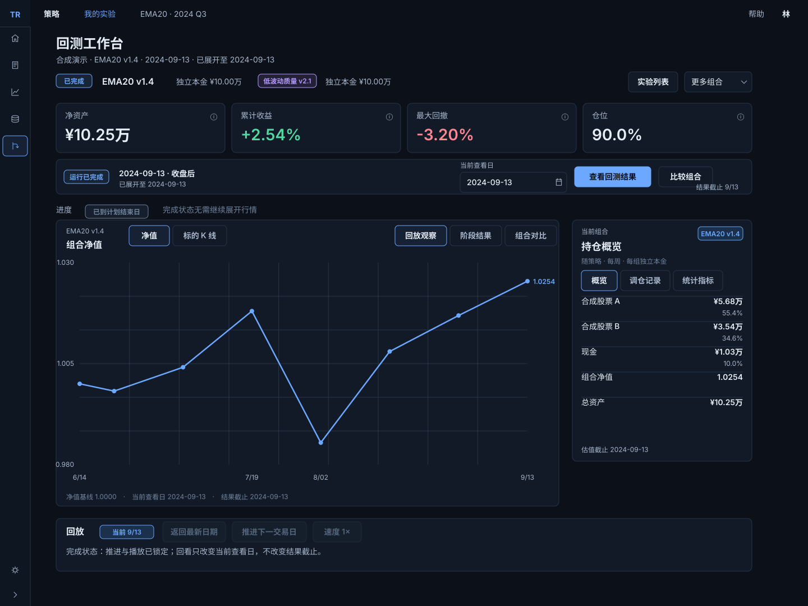

图 ST06｜整页图用于理解各区域的关系；第八章说明当日证据如何联动，第九章用分镜解释推进与回看。摘要采用首页同款四张独立等宽卡，高88px、间隔12px，标签和主值共用左起点；标题说明入口承接口径，不保留底部重复说明；页面可纵向延续，图表净绘图区不因长说明而持续缩小。

### 视觉语言怎样服务研究

深色背景承载工作区，表面和边线区分层级，数字的字号与对齐体现重要程度。蓝色表达动作和选择，盈亏使用绿、红，黄色提示需要关注的限制。版本、日期和普通说明保持中性，避免每条信息都争夺注意力。

全站V2.5提供颜色、文字、间距、圆角和焦点标准。策略台在此基础上组织四指标卡摘要、观察舞台和说明层，不增加一套独立视觉语言。指标卡标签和主值使用共同左起点；表格金额列使用等宽数字并右对齐，说明和名称左对齐；长内容依靠换行、详情与滚动保持可读，而不持续缩小字号。第十四章将这些原则对应到具体公共控件。

下列尺寸规定整体空间预算。导航与顶栏属于策略台框架；四指标卡摘要及图表分配是本方案的视觉建议，公共控件尺寸的来源另见组件章。

查看布局尺寸与适用范围

| 区域 | 本版规则 | 来源/数值性质 |
| --- | --- | --- |
| 全局框架 NAV01 | 导航展开200px、折叠54px；顶栏48px；折叠状态跨页面保留 | 沿用融合契约 H04；非首页72/64 |
| 内容 NAV02 | 左右24px、模块间24px、内容最大1240px；工作台不叠加策略库的40px业务标签栏 | 历史H04/H07；本版整合 |
| 摘要 OBS02 | 四张等宽卡，高88px、间隔12px、圆角8px、内边距16px；28/34主值与14/20标签同左起点 | ALIGN-ST-02修订2已确认；不扩展到统计公式或窄屏 |
| 图表 OBS04 | 桌面图+320px检查区、间隔24px；1440画布净图区360px；1280最低320px | 保留H06完整观察重心，尺寸为本版候选 |
| 滚动 NAV03 | 观察页面外层纵向滚动；覆盖层独立滚动；结果/比较的长明细在有高度预算的表区滚动 | H06后续决定优先旧固定单屏方案 |
| 低频操作 OBS08 | 配置、复制、派生集中“更多”；播放、单步、日期、结果入口常驻 | H04/H05 |

策略台入口目标为应用导航“策略台”。当前生产入口是否开放不由这份设计确认；设计浏览链接不是正式业务入口。

## 四、策略库与方法查找 {#chapter-ST02}

### 先判断方法，再阅读规则

策略库帮助用户找到可复用的方法，并判断是否需要进一步了解。默认展示完整策略，标的筛选、买入信号和止盈止损三个目录与其并列。名称、版本、规则摘要和状态构成一行的主要信息；查询工具位于列表上方，便于连续查找和比较。

本方案采用紧凑行，让同一屏可以扫描更多策略。完整规则进入详情阅读，因此摘要应足以说明方法用途，不能只留下一个名称。查询、页码与滚动位置在返回后恢复，用户无需从头寻找刚才的对象。

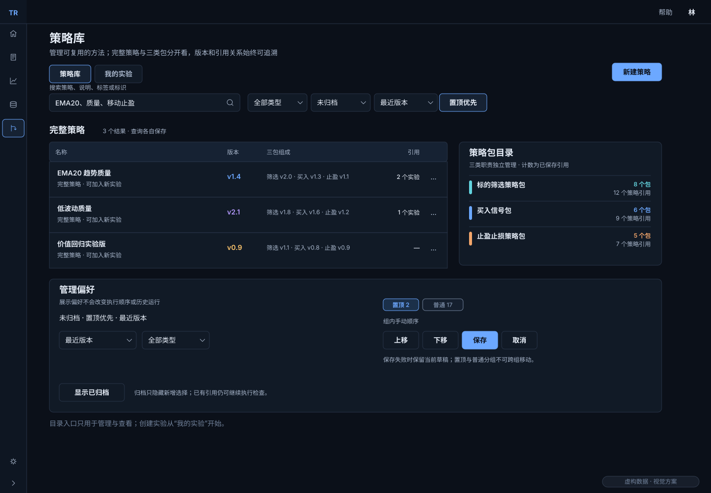

### 阅读详情与使用方法分开

从列表进入详情，用户可以理解方法、版本和数据要求。包目录额外展示使用策略数与版本发布时间，帮助判断依赖关系和新旧程度。查看说明只是阅读，回到选择列表后点击“使用此包”才改变配置；多一步明确选择，能够避免浏览时误改策略。

搜索、筛选和排序只作用于当前列表。完整策略与三类包各有自己的目录，置顶表达个人查找偏好，不改变策略执行顺序。库内的主动作是“新建策略”，保存后进入策略详情；开始一次研究则回到“我的实验”。

### 让目录整理不破坏历史引用

标签、备注、置顶和个人顺序用于管理方法，不产生新的执行版本。归档用于从新增选择中收起不再常用的包，旧策略与旧实验仍保留原引用；是否能够继续执行，还需要检查对应版本的能力。

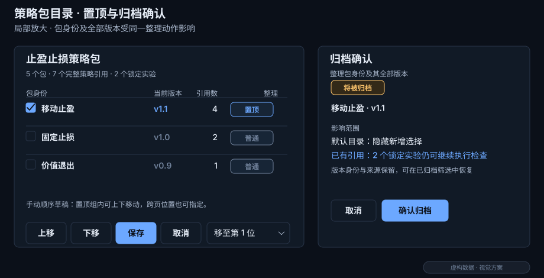

整理模式提供组内移动和定位，保存后应用个人顺序，取消则回到原查询。归档前说明影响范围，失败保留确认状态。查询、计数及归档的细节列在下方。

本章的两行策略列表、勾选与管理排序采用[公共扩展 SW05](../../../shared/strategy-workbench-v1.2/manual.html#SW05)；控件的外观与适用状态在公共部分定义，本章说明它们怎样服务当前任务。

查看查询、引用统计、置顶和归档规则

| 元素 | 操作与状态 | 完成/失败后的表现 |
| --- | --- | --- |
| LIB01 查询 | 搜索名称/说明/标签/标识；按类型、标签、来源、生命周期筛选；显式显示排序方向 | 修改查询回第1页；库与实验各存自己的条件；返回详情恢复查询/页码/滚动/焦点 |
| LIB02 默认顺序 | 默认未归档、最近规则版本发布在前、置顶优先；置顶仅作用匹配结果 | 不改变策略执行顺序；空库与无匹配分别说明 |
| LIB03 计数 | 使用策略数按完整策略最新版本引用包身份去重；当前版本数是子集；历史版本与锁定实验另列 | 未保存草稿不计；未知用“—”，不显示0；日期区分首次开发、版本发布与导入 |
| LIB04 管理信息 | 标签、备注、置顶属于包身份的管理信息 | 不产生执行版本；不改规则发布时间；单次置顶失败回滚 |
| LIB05 整理顺序 | 置顶与手动顺序是个人偏好，三类包分别跨会话保存；独立整理模式暂显本类型全部未归档包，置顶/普通组不可跨组排序；组内上下移动、拖动或到本组第N位，支持跨页 | 保存后手动排序；取消恢复原查询/顺序；失败留草稿；冲突提示重新读取，不覆盖别人修改 |
| LIB06 归档/恢复 | 归档覆盖包身份及其全部版本，确认展示引用影响；隐藏新增选择，但旧策略/旧实验引用保留，仍独立检查可执行性 | 新增草稿提交时遇到归档需恢复/替换；编辑/复制已有策略可明确沿用原归档版本；恢复原身份，普通组末尾、不自动置顶 |

归档不是删除，也不是执行禁用。归档失败留在确认层；成功定位邻行，空末页回最近有效页。永久删除、跨页批量归档、团队权限和文件夹不在V1.2范围。

## 五、完整策略组装与版本保存 {#chapter-ST03}

### 把三类判断组合成一份方法

策略组装把三个包的职责连接起来：标的筛选确定关注范围，买入信号决定何时形成买入意图，止盈止损规定退出条件。页面按这个顺序展示包名、版本、预设和关键规则，使用户先理解每一部分负责什么，再核对参数与数据要求。

排序、仓位分配和再平衡仍由完整策略配置承担，不能用第三个包代替。缺少必要职责、接口不兼容或执行含义不清楚时，页面指出具体位置，不能将它保存为可运行方法。

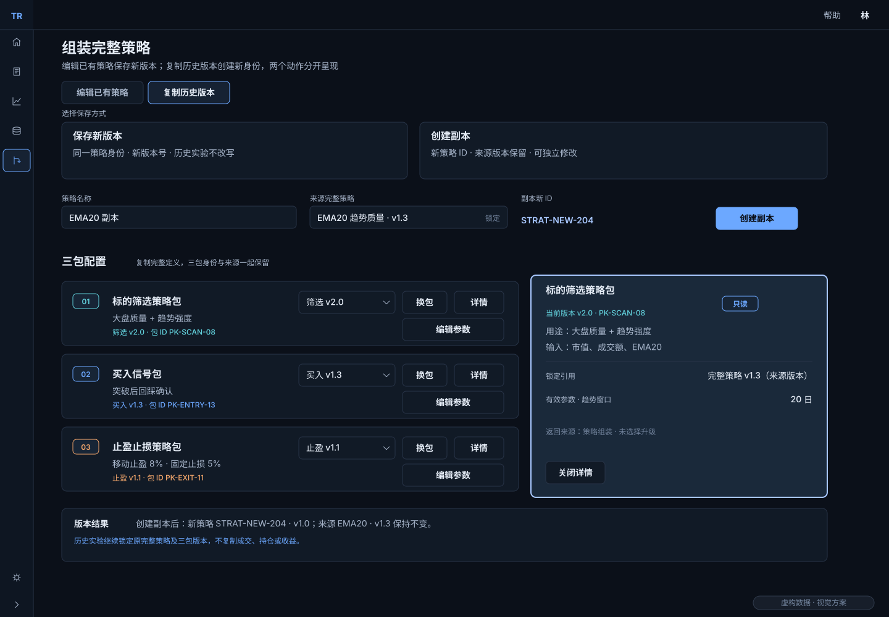

### 长说明与当日证据使用不同空间

用户组装时需要读完整说明，包括用途、输入输出、市场范围、预热与兼容性。包详情采用480px说明层；运行中的320px检查区用于当日证据。两者分工会增加一次打开说明的动作，但避免长配置常驻挤压图表。

在包目录中，详情是对象页面；从选择、组装或锁定配置打开时，详情覆盖当前页面，逐层关闭后恢复原位置与焦点。未保存的输入保留，查看说明不自动选包、升级或保存。

### 保存结果必须能被辨认

“保存新版本”延续当前策略身份，“创建副本”建立独立策略。保存成功后明确显示准确版本，创建实验时再锁定该完整策略和三个包的版本。以后修改方法不会改变原实验的条件；旧版本不能执行时，已经形成的结果仍可阅读。

保存中防止重复提交，失败保留全部输入；版本冲突让用户比较差异或另存。

本章的三包选择、版本与参数采用[公共扩展 SW04](../../../shared/strategy-workbench-v1.2/manual.html#SW04)；控件的外观与适用状态在公共部分定义，本章说明它们怎样服务当前任务。

查看版本、包详情和可运行性规则

| 元素 | 必须展示/保留 | 边界 |
| --- | --- | --- |
| ASM01 三包槽 | 类型、包身份、版本、预设、有效参数与单位、来源 | 缺一个职责或接口不兼容不能保存为可运行策略 |
| ASM02 说明 | 用途、规则、输入输出、数据依赖、市场范围、预热、脚本标记、兼容性 | 未提供明确写未提供，不能补成经验默认值 |
| ASM03 版本 | 编辑产生新版本；实验读取锁定快照 | 库升级不自动升级实验；旧包不可执行时旧结果仍可读 |
| ASM04 详情返回 | 包目录进入全页详情；组装/选择/运行配置用覆盖层，嵌套详情按层级返回 | Esc/返回恢复来源焦点；看详情不选择、不保存、不升级 |
| ASM05 执行说明 | 触发条件、退出/再平衡冲突优先级、跳空、未成交、再入场、费用来源 | 日线无法推断日内高低先后；不能承诺按止损价成交；包未声明执行语义则阻断运行 |
| ASM06 保存 | 校验→保存中防重复→成功显示准确版本；取消保留原策略 | 失败保留完整输入；版本冲突展示差异并允许另存，不静默覆盖 |

包详情覆盖层宽480px，用于阅读完整说明；运行检查区宽320px，用于当日只读证据。

## 六、实验列表与研究进度 {#chapter-ST04}

### 从上次停下的位置继续

“我的实验”围绕一次研究组织记录。每行把实验名称、状态、日期范围和策略组合放在一起，主要动作靠近这些信息，让用户先判断研究进行到哪里，再决定下一步。

| 当前状态 | 主要动作 | 打开后的任务 |
| --- | --- | --- |
| 草稿 | 继续编辑 | 回到保留的创建步骤与输入 |
| 未开始 | 进入实验 | 核对起点，主动开始观察 |
| 暂停 | 继续观察 | 从已保存进度进入暂停画面 |
| 完成 | 查看结果 | 阅读结果，仍可回到观察 |
| 失败 | 查看原因 | 在保留的进度上理解问题与恢复方式 |

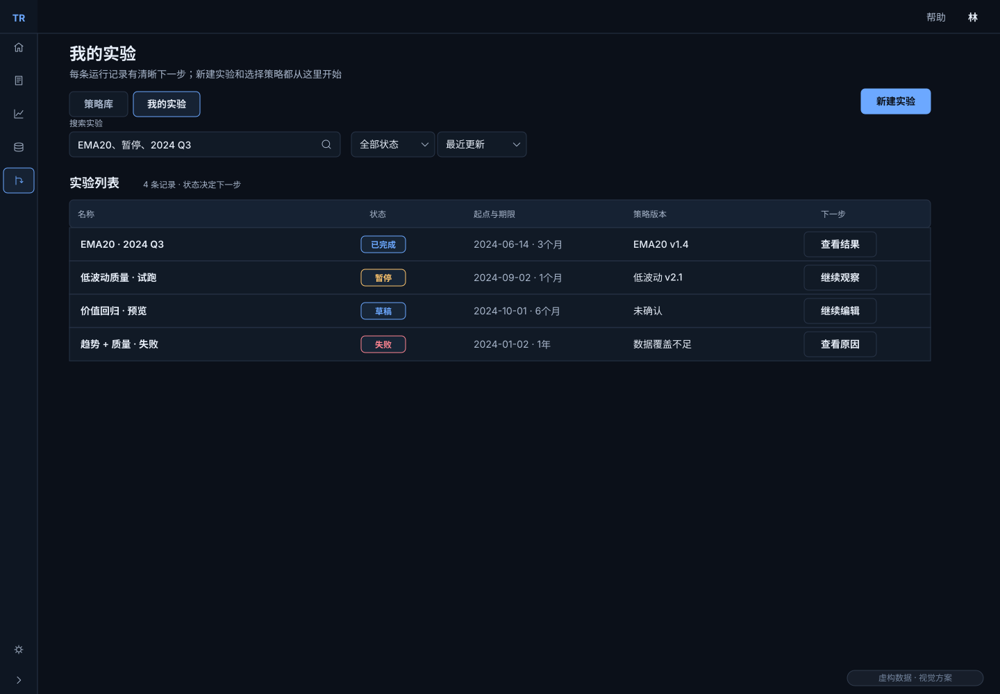

### 用状态说明下一步，而不自动推进

主要动作的位置保持一致，文字直接说明打开后要完成的任务。重新打开已运行实验时先暂停，由用户主动推进后才揭示新一天，避免进入页面的瞬间获得额外信息。

实验列表与策略库各自保留查询条件。进入实验再返回，恢复原查询、页码、滚动和焦点。编辑中的草稿离开前，提供保存、放弃本次修改或继续编辑的选择；普通切换不应制造一个未确认的新实验。

本章的两行实验列表采用[公共扩展 SW05](../../../shared/strategy-workbench-v1.2/manual.html#SW05)；控件的外观与适用状态在公共部分定义，本章说明它们怎样服务当前任务。

查看实验状态与列表恢复规则

| 规则 | 设计要求 | 返回与边界 |
| --- | --- | --- |
| EXP01 草稿 | 保留步骤、输入和已选版本 | 离开给出“保存草稿 / 放弃本次修改 / 继续编辑”，普通切换不隐式保存失败数据 |
| EXP02 创建后 | 确认后有独立运行身份，初态未开始 | 一次确认只产生一个运行 |
| EXP03 暂停/失败 | 保存的暂停/失败运行重开后仍暂停 | 不因重新打开就继续暴露未来 |
| EXP04 完成 | 保留观察、结果、比较和复制入口 | 完成状态仍可查看原上下文 |
| EXP05 返回 | 从详情返回恢复查询、页码、滚动和触发焦点 | 返回不会改变列表条件或选中对象 |

## 七、四步创建实验 {#chapter-ST05}

### 先把研究假设说明白

创建实验依次回答四个问题：在哪段历史中研究，采用什么方法，预期形成怎样的配置，是否按这些条件开始。先建立共同的时间与数据范围，再选择完整策略并预览，最后一次确认，能够让不一致的条件在运行前被发现。

| 步骤 | 用户要确认什么 | 本步完成后得到什么 |
| --- | --- | --- |
| 1 设置起点 | 起始时间、市场、证券池与期限 | 明确的研究范围及名义、实际终点 |
| 2 选择策略 | 一个或多个完整策略及其版本 | 需要预检的组合，各自使用独立本金 |
| 3 预览组合 | 候选、入围原因、目标权重和现金余量 | 对策略计划的理解，尚无实际成交 |
| 4 确认创建 | 版本、资金、费用、数据与执行假设 | 一份条件锁定、尚未开始的实验 |

用户先选择策略，再核对资金、费用与执行条件。上一步输入保留，缺少方法时可以在第二步就地组装；保存后追加准确的新版本并重新预检，取消则原样返回。

### 创建过程的交互分镜

下面四幅画面依次展示四个步骤，每一帧只有一个当前步骤。预览先呈现计划，确认动作才创建运行身份。

:::state-demo
images/04-create.svg|步骤1：确定历史起点|填写时间与期限，先辨认业务时区、名义终点和实际覆盖，再进入选择策略。
images/04b-select-strategies.svg|步骤2：选择明确版本|多选完整策略；缺少方法时就地组装，保存后回到原选择，各组合本金独立。
images/05-preview.svg|步骤3：预览组合|核对入围依据、目标仓位与起点实际现金；预览不产生交易。
images/05-confirm.svg|步骤4：确认创建|核对版本、资金、费用与执行约定；确认成功后进入未开始的工作台。
:::

### 预览怎样避免被误读成成交

候选名单与目标权重来自起点以前可知的数据，表达策略希望如何配置。此时实际持仓为0、现金为100%，页面把“目标”和“实际”分列。多一组字段能够让用户看清计划与事实的距离；没有候选也可能是有效结果，应说明原因并保留现金组合。

时间和执行条件同样需要明确。研究期限显示名义终点与实际完整交易日，数据不足时让用户等待或明确选择部分区间；信号触发与实际成交分开，费用未知不能显示为免费。确认失败留在本步并保留输入，重试也只产生同一个实验。完整算法和字段约定如下。

本章的四步创建与校验采用[公共扩展 SW03](../../../shared/strategy-workbench-v1.2/manual.html#SW03)；控件的外观与适用状态在公共部分定义，本章说明它们怎样服务当前任务。

查看四步字段、数据边界及失败规则

| 步骤/元素 | 字段与规则 | 用户可观察结果 |
| --- | --- | --- |
| WIZ01 设置起点 | 绝对时间、业务时区、市场/证券池、历史区间；期限沿用1周、1个月、3个月、半年、1年 | 一周为7自然日，其余为1/3/6/12日历月，月末无同日取目标月末；终点取目标之前最后完整交易日，显示名义/实际终点和交易日数；目标超出数据末端时等待补齐，或明确选择部分区间，不静默缩短 |
| WIZ02 选择策略 | 完整策略身份与版本、三包版本、数据适配、可运行说明 | 多选不是共享本金；不可用原因就近可查；查看与选择分开 |
| WIZ03 就地组装 | 保存成功返回步骤2追加准确新版本；重新预检 | 取消不变；保存失败留表单；已有选择与查询仍在 |
| WIZ04 预览组合 | 候选清单、入围依据、目标权重、现金余量、数据截止与预热覆盖 | 目标/实际分列；空候选、数据缺失与策略失败用不同说明 |
| WIZ05 独立资金 | 每个组合本金、币种、费用、滑点及整股/分股约束 | 示例10万元仅为样本，不成为默认值；费用未知不能显示免费 |
| WIZ06 执行约定 | 信号截止、最早下一可交易开盘执行、停牌/涨跌停/成交不足、退出与再平衡冲突规则 | 触发不等于成交；不从日线假定精确盘中撮合 |
| WIZ07 锁定确认 | 实验名、T0、区间、各版本与参数、数据快照/修订、费用和执行口径 | 一次确认产生一个运行；成功进待开始，失败回本步并保留输入 |
| WIZ08 历史可知 | T0只能用已完整结束的日/周及当时已发布财务信息 | 盘中T0不能用当天收盘；未结束周线不能当完整周；缺必需数据明确阻断 |

## 八、观察工作台与当日证据 {#chapter-ST06}

### 先理解一个组合在一天里的状态

进入工作台后，用户主要回答“这个组合今天发生了什么”。实验名、策略版本和当前组合先确定对象，摘要呈现净资产、累计收益、最大回撤与仓位，日期再限定这些信息属于哪一天。只有这些上下文一致，图表和原因才能互相解释。

净值曲线用于理解组合变化，切换到标的K线后，成交标记说明具体买卖位置。相邻的“组合详情”在概览、调仓记录和统计指标之间切换，始终属于当前组合与查看日。长原因自然换行，阈值、价格和单位保留完整，用户可以沿着规则核对当时的数据。

### 一次联动包含哪些信息

| 用户动作 | 画面怎样响应 | 保持的上下文 |
| --- | --- | --- |
| 选择另一个组合 | 图、摘要、持仓与原因切到该组合 | 查看日保持不变，落后组合标明真实完成日 |
| 在净值与K线间切换 | 改变图表视角，恢复该模式的视野 | 不推进日期，不改变实验条件 |
| 查看一次调仓或成交 | 显示计划、执行结果及对应原因 | 意图、计划与成交分别辨认 |
| 打开锁定配置与包说明 | 在说明层阅读原版本 | 主图、查看日与已展开边界保持不变 |

图表旁常驻解释可以减少反复打开详情的动作，同时占用横向空间。工作台将低频配置收进说明层，允许页面纵向滚动，优先保留正常字号和主图净高。播放、单步、速度和回看在图下使用稳定动作槽；组合数量增加时，通过当前项与“更多组合”选择，不继续挤压主图。

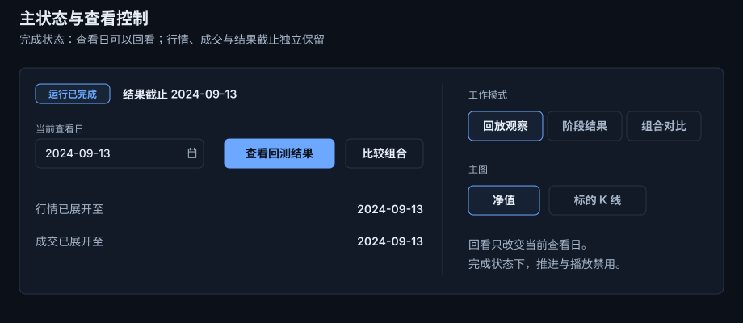

### 用完整原因支持判断

“满足条件”只能表达结论，不能帮助研究者复查。说明区应将规则阈值与当时观测值放在一起，例如市值和成交额是否达标，价格相对均线的位置如何。重要价格直接可读，金额可以按万、亿缩写，完整值通过聚焦、详情或复制取得。下面保留原因例文与各观察元素的精确约定。

本章的四指标卡摘要与检查区采用[公共扩展 SW06](../../../shared/strategy-workbench-v1.2/manual.html#SW06)；控件的外观与适用状态在公共部分定义，本章说明它们怎样服务当前任务。

查看观察元素、原因示例和空间规则

| 分组 | 规则 |
| --- | --- |
| OBS01 身份 | 实验/完整策略/版本同时可追溯 |
| OBS02 摘要 | 统一到当前查看日与当前组合；未知用“—” |
| OBS03 日期 | 显示“正在查看”“行情已展开至”，回看时另保留已看后续提示 |
| OBS04 图表 | 净值与K线共享舞台；切换恢复对应视野 |
| OBS05 成交 | 买卖文字/形状与颜色并用；意图、计划和成交分别展示 |
| OBS06 检查区 | 长原因自然换行；展开详情时主图不换容器、不改变已展开边界 |
| OBS07 回放 | 播放/暂停同槽；下一日永远表示交易日；不在输入法组合输入时触发快捷键 |
| OBS08 配置 | 只读锁定值，修改只能“基于此配置新建实验” |

**规则原因的完整例文。** 市值¥2,140亿（大于¥200亿）；日成交额¥4,280万（大于¥2,000万）；前周EMA20 ¥111.80，本周¥112.40；收盘¥113.10，较EMA20高0.62%，处于±2%范围。阈值、价格、单位与数据截止需一起可达，不能因排版缩短成“满足条件”。

| 可读性 | 约束 |
| --- | --- |
| 数值 | 价格保留2位小数，重要价格直接可读；金额按万/亿缩写，完整值可通过聚焦、详情、复制/导出取得 |
| 空间 | 说明正文14/20；长规则候选使用14/22，不改变共享按钮行高；外层可纵向滚动，不压缩主图 |
| 分工 | 480px 包详情层用于阅读；320px 观察检查区用于当日只读证据 |

## 九、逐日推进、播放与回看 {#chapter-ST07}

### 区分展开历史、当前查看与已经看过

推进会揭示新行情与执行证据，回看只改变当前阅读位置，已经看过的后续则成为研究记录的一部分。三者分别表达，用户才能复查早期判断，并知道这次复查受到哪些后来信息的影响。

例如，已经看到6月28日，再回到6月14日，图和当日持仓回到起点，但“已看后续至6月28日”继续保留。这接受了无法恢复首次盲看状态的限制，使后续研究有真实的信息背景。“返回最新”只回到已经展开的位置，不产生新的运行进度。

### 从起点到首次推进的分镜

起点先展示目标配置与实际现金。点击“下一交易日”后，行情、组合执行、估值与日期一起完成，新K线必须在主图中可见。有成交才增加成交标记和实际持仓，没有成交则只揭示当日行情；不能只改日期标签。

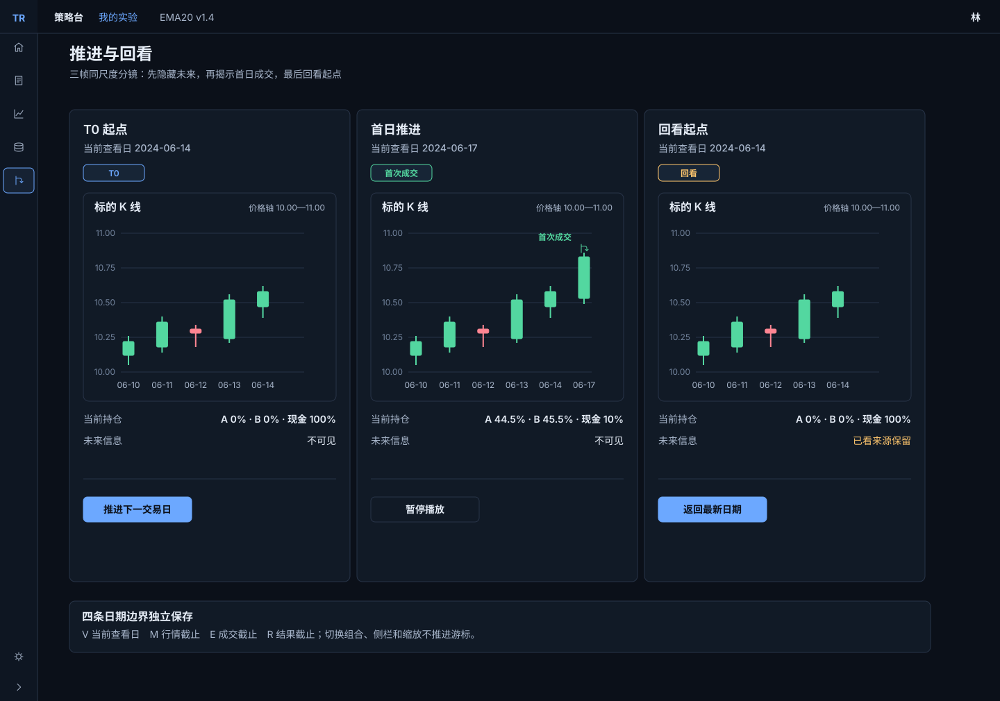

:::state-demo
images/07a-t0.svg|起点：2024-06-14|候选是计划，实际持仓0、现金100%；用户核对条件后主动推进。
images/07b-first-day.svg|点击下一交易日：2024-06-17|新K线进入主图，本示例满足执行条件，因此出现成交和实际持仓；无成交日只更新行情与当日状态。
images/07c-lookback.svg|从已展开的6月28日回看6月14日|查看日和当日数据回到起点，已看后续记录保留。中间交易日未逐帧展示，返回最新也不会再推进一天。
:::

### 连续播放怎样保持可控

播放按交易日依次揭示，速度控制日与日之间的观看节奏。用户可以暂停，手动回看时也暂停自动播放；取消后停止排队的画面，不能再补播。指定展开到某日之前，先说明将揭示的范围和已看记录的含义，失败时保留最后完整成功的一天。

主动下一日或播放推进后，新增K线或目标成交必须在主图可见；暂定保留横向缩放，仅在目标超出视野时必要平移。手动回看暂停播放；刷新、侧栏resize、缩放或切换周期按契约保留视野，不隐式推进或扩大可见数据边界。日期提示、摘要、周线与价格轴使用同一信息范围；独立时间变量和各动作的精确规则列在下方，供实现核对。

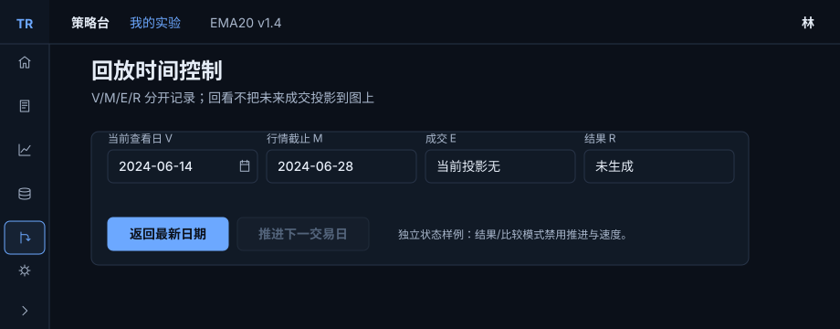

本章的回放控制与时间边界采用[公共扩展 SW07](../../../shared/strategy-workbench-v1.2/manual.html#SW07)；控件的外观与适用状态在公共部分定义，本章说明它们怎样服务当前任务。

查看每个动作的时间、视野和失败规则

| 动作/元素 | 日期与信息变化 | 视野/中断 |
| --- | --- | --- |
| TIME01 进入T0 | 查看=T0；实际0、现金100%；候选来自T0前可知数据 | 可显示预热历史；T0以后不在图、轴、提示、列表或后台响应中泄露 |
| TIME02 下一日 | 行情、组合执行和估值完成后原子提交；策略意图按约定成交 | 主动推进目标必须可见；暂定保留横向缩放，必要时最小平移；手动回看暂停自动播放，不能只改日期不露新bar |
| TIME03 播放/速度 | 逐日提交，不跨过未完成日；速度0.5×/1×/2×/4×为本次控件建议 | 可立即暂停；停止排队帧，不重复成交；失焦或输入时暂停 |
| TIME04 指定截止 | 先说明即将揭示的目标日与不可撤销的“已看”记录 | 取消不推进；执行中保留最后完整日；可暂停于已完成日 |
| TIME05 回看 | 仅改变查看日；所有当日摘要/持仓/事件随之投影 | 保留行情/执行截止和已看后续；不显示查看日之后的价格提示 |
| TIME06 返回最新 | 查看日回到当前可用最新已完成日，不新增行情 | 图表定位该日；记住各图模式范围 |
| TIME07 组合/周期/侧栏/缩放 | 不改变阶段与任何截止 | 图范围/轴/提示均受可见截止限制；周线仅由允许数据形成；显示未完成周时明确标“未完成”，不得用于默认周线信号 |
| TIME08 失败/重试 | 停最后完整提交日，失败组展示真实已完成日；重试不重复写入 | 旧图保留，错误槽显示恢复入口；不能靠改标签冒充成功 |

实现时分别保存：查看日V、行情已展开截止M、每组执行截止E_i、结果截止R、已看后续记录。它们不是一个日期变量。结果/比较不得超过所需组的有效数据交集；打开旧运行、复制或派生时保留已看来源。后续安全验收必须检查Tooltip、列表、摘要、缩放、周线、传输内容和导出。

## 十、阶段结果与事件追溯 {#chapter-ST08}

### 先评价一段过程，再追查原因

阶段结果帮助用户理解“这段运行表现怎样、结果由什么形成”。页面先交代统计区间与截止日期，再呈现净值、风险、盈亏与费用，随后通过贡献和调仓事件展开原因。所有数字共享明确范围，用户不会把不同阶段的值当成同一个结论。

净值、回撤和仓位共用图表区域。切换视角节省空间，但不能同时对照三幅图，因此区间和截止说明保持稳定。贡献说明收益来自哪些标的或部分，事件表说明策略做过哪些动作，两者把整体判断接到具体证据。

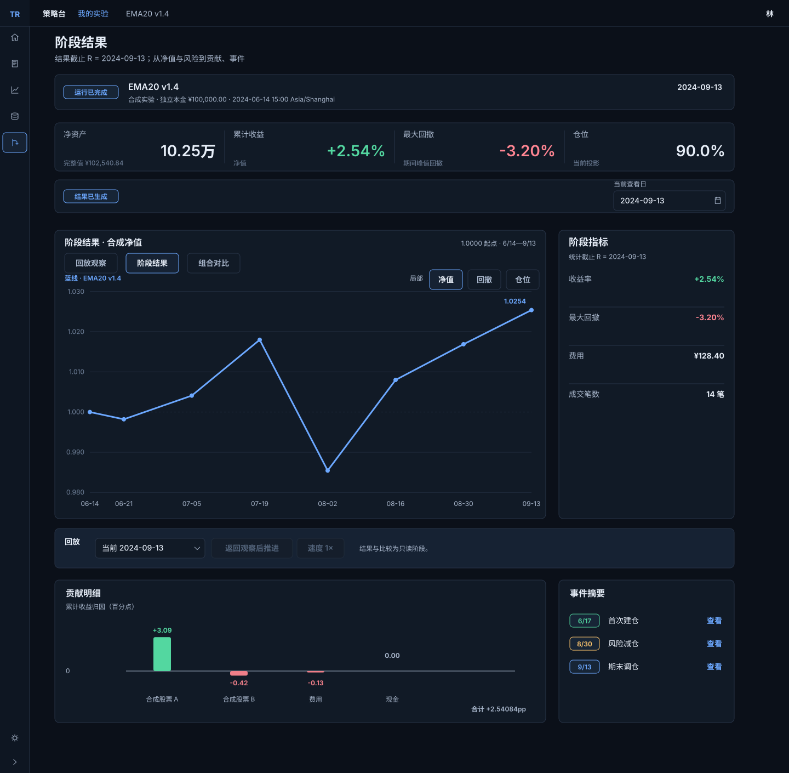

### 从一个事件返回发生当天

| 步骤 | 用户动作 | 可见结果 |
| --- | --- | --- |
| 阅读结果 | 选择区间并查看贡献、调仓 | 图与统计使用同一截止 |
| 追查事件 | 点击一条事件 | 进入事件日的观察画面，主图、持仓与原因对应当天 |
| 关闭详情 | 关闭事件说明层 | 仍停在事件日，继续检查当日证据 |
| 回到结果 | 点击“返回阶段结果” | 恢复原区间、筛选、滚动与入口焦点 |

关闭详情和返回结果分别承担不同任务，需要清楚的动作名称。两条返回路径分别保留各自的位置，让事件调查和结果阅读都可以连续进行。结果页保留回放工具的位置，但推进和速度不可用，提示返回观察后再推进；阅读结果本身不继续运行。

### 让没有数据的结果也能被理解

无平仓交易时，胜率不可计算；没有有效基准时，不给出超额收益。缺失估值不能算成零，贡献图从真实零线展开，真零不画假柱。部分区间持续说明实际覆盖，到期未执行计划保留原状态与原因，不能为了结果完整而补成成交。

本章的结果摘要与明细采用[公共扩展 SW06](../../../shared/strategy-workbench-v1.2/manual.html#SW06)；控件的外观与适用状态在公共部分定义，本章说明它们怎样服务当前任务。

查看结果口径与事件往返

| 分组 | 规则 |
| --- | --- |
| RES01 截止 | 统计、图、账本、事件统一到结果截止 R |
| RES02 口径 | 本金/净资产/现金/市值/已实现/未实现/费用口径各自说明，收益率分母可查；估值缺失不能当0 |
| RES03 无交易 | 无平仓交易时胜率“不可计算”，没有有效基准时不算超额收益 |
| RES04 贡献 | 正负从真实零线展开，缺估值断开，真零不画假柱；贡献负柱用 #EF7F89，普通亏损数字用 #FF8592 |
| RES05 事件往返 | 事件跳转记录来源区间/过滤/滚动/焦点/R；观察上下文另存；返回恢复来源快照 |
| RES06 导出 | 沿用同一截止、组合、过滤和精度，并带版本/费用/数据质量说明；静态图不冒充已实现导出 |
| RES07 回放槽 | 结果和比较保留回放槽，推进和速度禁用，显示“返回观察后推进”；切换视图不推进 |
| RES08 到期/覆盖 | 到期未执行计划保留原状态和原因，不回填成交；部分区间结果持续标明实际覆盖 |

## 十一、组合比较与下一次研究 {#chapter-ST09}

### 比较从共同条件开始

组合比较帮助用户判断方法差异，首先需要回答“这些结果是否在可比条件下形成”。顶部先给出所选组合的共同有效区间，各组合使用独立本金账本，收益计算口径一致，资金、费用与执行差异并列说明。

共同区间取有效数据的交集，会舍去部分组合独有的历史，但避免把半段结果与完整期间排名。缺行情、执行落后或失败的组合仍保留身份、原因与可用范围；不满足条件的组合不参与排名。

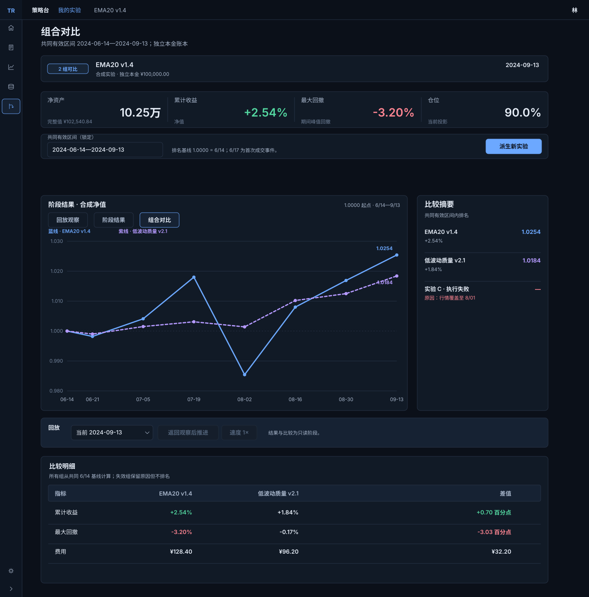

### 曲线突出少量对象，表格保留全部对象

图上最多同时高亮四条曲线，颜色、名称和线型共同辨认策略；其他组合继续保留在表中。限制同时高亮的数量，可以降低曲线互相遮挡，不限制实验创建的组合总数。图例、曲线与行选择联动，日期保持不变，盈亏颜色仍只表达正负。

### 把新假设带到新的实验

需要试验不同配置时，使用“基于此配置新建实验”，在新草稿中修改条件，原运行与结果保留。新草稿携带来源和已看记录，不能被描述成未见历史的盲测。“复制该版本为新策略”则只创建库中的方法，两种动作分别说明各自产物。

比较中的回放工具与结果页一致：先返回观察，再主动推进。这样，阅读差异、查看证据和改变实验进度分别由明确动作触发。

本章的比较图例与数值列采用[公共扩展 SW06](../../../shared/strategy-workbench-v1.2/manual.html#SW06)；控件的外观与适用状态在公共部分定义，本章说明它们怎样服务当前任务。

查看比较与派生规则

| 分组 | 规则 |
| --- | --- |
| CMP00 回放 | 比较与结果共用只读回放槽，返回观察后才可继续推进 |
| CMP01 区间 | 共同区间为所选组合的起止、行情、执行、估值有效日交集；标题显示实际交集，空交集解释原因 |
| CMP02 口径 | 同一比较视图共用截止和收益计算口径，费用/本金/执行差异并列披露 |
| CMP03 无效组合 | 无效组合不参与排名，未选/失败组合不从表中悄悄消失 |
| CMP04 身份 | 曲线身份用蓝/紫/青/橙加名称/线型；选中行、图例与曲线联动，不重置日期 |
| CMP05 派生 | “基于此配置新建实验”新建草稿并携带来源与已看记录，不伪装成未见历史的盲测；“复制该版本为新策略”只创建库对象，两者文案与结果不同 |

## 十二、等待、异常与恢复 {#chapter-ST10}

### 让用户知道哪些内容仍然有效

等待和异常会打断研究，但不应让用户失去已经确认的条件。提示要说明发生了什么、影响哪一部分，以及可以怎样继续：列表失败保留查询，包不兼容标在对应槽位，执行失败靠近日期与回放工具，其他有效内容继续可读。

首次进入时使用骨架保留区域尺寸；更新已有结果时，保留最后有效内容并标明正在更新。旧内容仍可阅读，也可能被误认成最新结果，因此其对象身份与有效日期必须同时保留。连续切换组合时，迟到请求不能覆盖最后一次仍有效的选择。

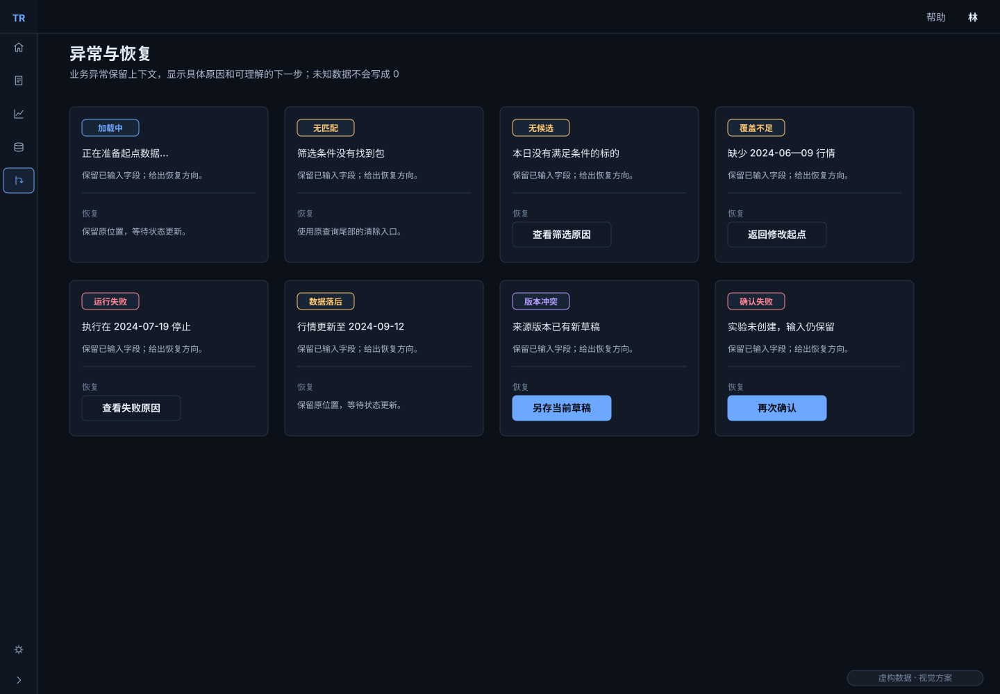

### 区分研究结果与不能完成的操作

- **没有匹配方法**是查询结果，可以调整或清空条件。
- **没有候选或信号**可能是有效策略结果，保留现金组合并解释原因。
- **缺少必需数据**意味着不能按原条件完成评估，需要更换包、区间或明确选择可评估集合。
- **执行或保存失败**意味着本次动作没有完整完成，保留最后有效进度与输入，再提供重试。

这些状态不共用一个笼统的“暂无数据”。未知值使用“—”并提供原因，实际零保留为零；正常画面无需常驻成功徽章。重试放在受影响的业务区域，不把首页专用的全局修复入口搬到策略台。

### 恢复后仍属于同一次任务

重试执行不能重复成交，重试创建不能产生第二个实验；版本冲突也不能自动改用最新版。失败时保留输入、图表和最后完整日，让用户能够决定重读、另存、更换条件或取消。下面按状态列出具体恢复动作及需要保留的内容。

本章的查询与局部恢复采用[公共扩展 SW08](../../../shared/strategy-workbench-v1.2/manual.html#SW08)；控件的外观与适用状态在公共部分定义，本章说明它们怎样服务当前任务。

查看异常与恢复清单

| 元素/状态 | 说明与动作 | 保留内容 |
| --- | --- | --- |
| ERR01 加载 | 正在读取/更新，提交按钮防重复；允许离开 | 输入、旧对象身份、几何与最后有效数据 |
| ERR02 空库/无匹配 | 空库“新建策略”；无匹配由搜索尾部清空恢复 | 查询工具；不在空态再堆一组相同清空按钮 |
| ERR03 无候选/无信号 | 显示原因与覆盖范围；允许合法现金组合 | 实际0与现金100%；不能称为引擎失败 |
| ERR04 缺必需数据 | 分别披露历史可知数据、证券池和交易模型覆盖；标出包、能力、起止缺口；更换包或区间 | 原配置与输入；未知不填0、不显示成功覆盖；部分证券不可评估时，需显式选择剩余集合并永久标注覆盖偏差，不自动排除 |
| ERR05 执行失败 | 停最后完整日；查看原因、重试、返回列表 | 不重复成交，不提前推进，保留图表 |
| ERR06 组合落后 | 显示该组已完成日，比较使用交集或不参与 | 身份、真实数据日期，不冒充当前结果 |
| ERR07 版本/归档冲突 | 说明被改变对象；重读、另存或显式沿用可用历史版本 | 未保存输入；不自动切到最新版 |
| ERR08 确认/保存失败 | 留在原确认界面，显示原因并可重试/取消 | 一次提交身份、完整草稿，不制造第二个实验 |

重试是各业务局部动作，不移植首页专属“唯一修复入口”。无权限或不可用的禁用项旁说明原因；焦点落到可读说明，不能仅用灰色传达。

## 十三、窄窗口与长内容适配 {#chapter-ST11}

### 空间改变时，阅读优先级不变

桌面将图表和解释并排，窄窗口则按摘要、日期、图表、回放和解释纵向排列。重排需要更多滚动，也减少图与原因同时可见的范围，但可以保留正常字号、完整说明和可触达动作。

价格轴始终预留位置，重要价格不省略；长名称、长版本和原因在说明区换行。表格在自身区域横向滚动，页面不左右漂移。覆盖层在桌面从右侧打开，窄屏使用可用全宽，标题和返回入口常驻，正文独立滚动。

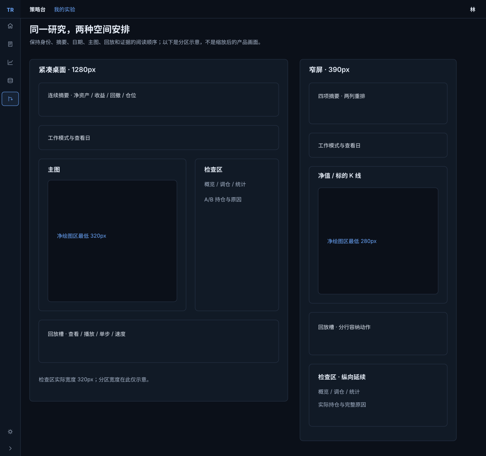

### 用完整画面检查重排结果

1280px画板用于观察紧凑桌面的空间分配，390px画板展示窄屏纵向延续。两者保留同一任务顺序；打开说明层只改变这一层，关闭后仍是原对象、原查看日与原图表位置。

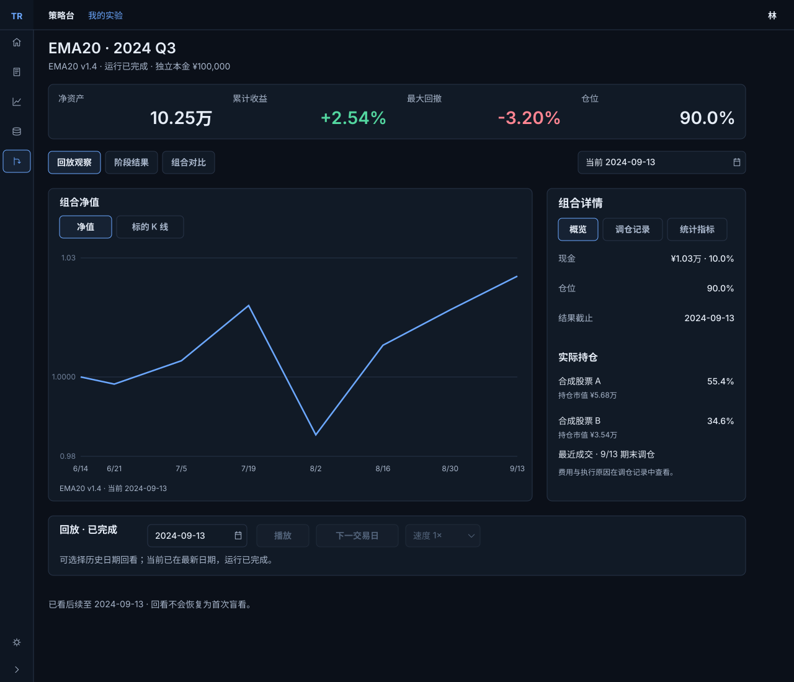

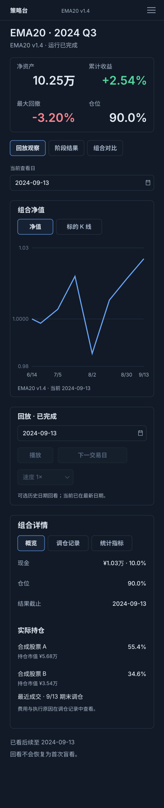

断点、图表最低净高与命中尺寸是落实上述优先级的参数。画板说明布局意图，真实设备上的触摸、软键盘和中文字形仍需在实现后独立验证，不能由缩放图稿代替。

本章的导航与窄屏入口采用[公共扩展 SW01](../../../shared/strategy-workbench-v1.2/manual.html#SW01)；控件的外观与适用状态在公共部分定义，本章说明它们怎样服务当前任务。

查看断点、触控和长内容规则

| 范围 | 布局/可达性规则 | 后续实现的检查点 |
| --- | --- | --- |
| ≥1024 | 主图与检查区并排，检查区320；摘要四列；主区内边距24 | 1440×900、1280×720/800，图净高≥320 |
| ≤1023 | 图表在前、解释在后；摘要两列；桌面导航折叠或顶端菜单 | 1024/1023两侧，不把缩放当重排 |
| ≤759 | 日期工具自然换行；菜单跟随锚点并限制屏内；图净高280 | 760/759与390×844，动作命中44px |
| ≤359 | 摘要一列；长标题完整换行 | 360/359，不挤压数值 |
| 长内容 | 正文14/20或规则14/22；表格金额与表头右边界一致；名称可换行 | 长中文、巨额、负数、未知、长版本名、错误三行 |

画板11是设计重排示意。真实设备触摸、软键盘、中文字形与产品断点行为属于后续实现验收，不能由缩放SVG证明。

## 十四、公共组件与交互反馈 {#chapter-ST12}

### 从全站标准组合出研究界面

策略台复用全站V2.5的颜色、文字、尺寸、焦点与状态反馈。用户从首页进入后，仍能辨认按钮、选择器、标签、表格和说明层；每个控件再按研究任务声明自己的作用范围。

| 研究需要 | 使用的公共组件 | 在策略台中的组合方式 |
| --- | --- | --- |
| 找到方法与实验 | 搜索、筛选、标签、数据表 | 工具只改变所属列表，返回恢复原条件 |
| 选择方法与组合 | 选择器、浮层、分段标签 | 当前值常驻，阅读说明与选择分开 |
| 理解当日表现 | 指标、图表、数据表、说明区 | 共用组合身份和查看日，数值与原因相邻 |
| 推进与回看 | 图标按钮、提示、速度选择器 | 动作槽稳定，播放与暂停共用位置 |
| 处理等待与失败 | 状态提示、空状态、重试动作 | 靠近受影响区域，说明有效范围与恢复结果 |

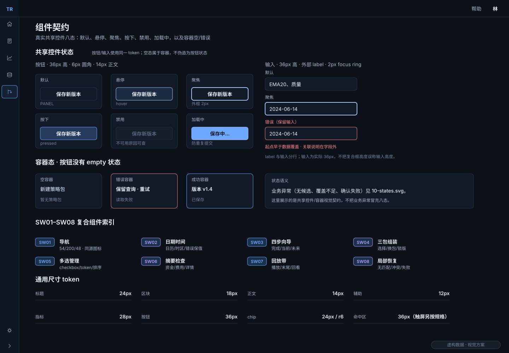

### 反馈解释动作是否发生

默认、悬停和聚焦帮助用户识别操作边界，按下和加载说明动作正在处理，禁用说明当前为何不可用。空状态属于业务容器，错误状态说明原因和恢复方式；不能要求每一个按钮都拥有“空内容”状态，也不能用按钮文案假装操作已经完成。

焦点清楚可见，关闭覆盖层返回触发器。输入框和中文输入法正在组词时，不触发全局播放快捷键。颜色配合文字与形状，灰色本身不足以解释禁用，红绿色本身也不足以区分买卖。

### 在公共部分登记策略组合组件

单个按钮和输入框解决的是操作外观，完整研究任务还需要日期边界、版本选择、回放与解释区共同工作。以下八类组合组件因此放入[公共扩展手册](../../../shared/strategy-workbench-v1.2/manual.html)，提供设计样例、适用状态和恢复约定，供策略台各页直接引用。它们不反向改变基础控件的默认尺寸，也不将首页的业务规则带入其他模块。

| 编号 | 组合组件 | 设计职责与取舍 |
| --- | --- | --- |
| SW01 | 紧凑与展开导航 | 保留策略布局尺寸，统一图标、选中与焦点语言 |
| SW02 | 业务日期与时间字段 | 36px交互本体配外置标签；查看日、只读截止和可编辑起点可辨 |
| SW03 | 四步向导 | 区分当前、已完成与未到达，返回编辑不丢输入 |
| SW04 | 三包选择与锁定版本 | 选包、看说明、改参数分开，保存明确版本 |
| SW05 | 两行多选与管理列表 | 72px容纳名称及摘要；选择、详情、排序各有操作边界 |
| SW06 | 四指标卡摘要、详情层与检查栏 | 88px摘要、480px包详情、320px观察栏分别服务不同阅读深度 |
| SW07 | 回放控制与模式切换 | 固定动作位置，分开查看、展开、执行和已看范围 |
| SW08 | 局部查询、说明与恢复 | 恢复作用于失败区域，保留输入与最后完整结果 |

每类组合的状态按任务定义，不机械凑成八态。基础12类控件的96个状态组合保持原统计；新增组合的状态清单独立列出。设计分镜展示预期行为，正式键盘与持久化表现仍须在产品实现时验证。

### 动效说明变化，不代替运行进度

轻量过渡用来说明浮层出现、悬停和数据替换，不能推动布局。新行情完成提交后，才呈现新bar或成交标记；播放速度控制交易日间隔，与界面淡入时间分别定义。减少动态效果时直接切换，仍保留逐步状态和可见焦点。

公共尺寸保持跨页面密度。长说明可采用更舒展的行高，窄屏扩大命中区，通过换行与重排容纳内容，而不改变共享按钮的文字排布。下方依次列出组件映射、适用状态、键盘行为与精确参数；公共既定值和本方案的页面分配分别标明来源。

查看控件映射、八态及动效精确规则

#### 控件映射

| 策略台元素 | 复用控件 | 特有语义 |
| --- | --- | --- |
| 播放/暂停、下一日、更多 | IconButton / Tooltip | 同槽状态转换；中文可读名称；暂停不回退已展开日 |
| 库/实验、图模式、右侧详情 | SegmentedTabs | 各有独立作用域；箭头移动、Enter确认；不推进日期 |
| 组合/版本/速度 | Select / Popover | 当前值常驻；选项全文与禁用原因；关闭回焦点 |
| 搜索/筛选/标签 | SW08 局部查询 / FilterPopover / Token | 只过滤所属列表；筛选草稿“应用”后生效，取消不变 |
| 摘要/列表/详情 | Metric / DataTable / SW06 详情层 | 身份与截止贯穿；指标卡标签/主值左齐，表格金额列右齐；480包层与320观察栏分工 |
| 错误/空数据 | StatusBadge / EmptyState / RetryAction | 只在需要时出现；真零、未知与无数据分别表达 |

#### 八态与动效

| 公共状态 | 视觉/行为 |
| --- | --- |
| default | 普通边框、可读文字、主动作使用蓝色 |
| hover | 表面 #1C2B42；120ms 反馈；不移动布局 |
| focus | 2px 焦点环；键盘可见，关闭层回到触发器 |
| pressed | 表面 #243B5C；不把已提交误画成完成 |
| disabled | 文字 #53647B、边框 #202B3A；附近说明原因 |
| loading | 保留原区域尺寸，防重复提交；旧内容可继续读 |
| empty | 由容器表达；按钮和图标动作没有“空内容”态 |
| error | 贴近受影响区域，给出恢复动作和保留内容 |

默认、悬停、聚焦、按下、禁用、加载、空、错误沿用公共合同，并按控件类型采用适用状态。图标动作无“空内容”态，业务空态由容器表达。按钮不得用占位文案假装已完成操作。浮层使用160ms透明度加4px位移，数据替换150ms；减少动态效果时直接切换，仍保留逐步状态和可见焦点。

#### 回放动效、键盘与输入

策略推进的候选动效为：新bar/成交标记在原子提交后淡入150ms，不横扫整图；主动推进让目标可见，暂定仅必要平移且保留横向缩放；手动回看暂停，被动刷新/侧栏resize保留视野。播放速度为0.5×/1×/2×/4×，只控制交易日间隔，不等同150ms界面动画。连续点击串行处理，不能补播已取消的过渡。

覆盖层 Esc 关闭一层，焦点返回触发器，未保存编辑先处理草稿。输入框和中文输入法组合输入期间禁止全局播放快捷键。

#### 颜色、排版与尺寸

| 参数组 | 数值 |
| --- | --- |
| 背景/层级 | 背景 #0B1019；面板 #111A26；抬高 #162233；边框 #283448 |
| 文字 | 主文字 #E6EDF7；次文字 #A8B6CB；弱文字 #71829B；动作 #6CA8FF；焦点 #A9C8FF |
| 语义色 | 正 #53D7A0；负 #FF8592；警告 #FFC66D；贡献负柱例外 #EF7F89 |
| 字体 | 标题24/32；区块18/24；图标题16/600；正文与金额14/20；辅助12/16；指标28/34 |
| 间距与圆角 | 间距4/8/12/16/24/32；圆角6/8 |
| 控件尺寸 | 操作区控件36px高；视觉图标16px；焦点环2px；按钮文字14px；窄屏命中44px；标签视觉24px、命中36px；表头40px、单行数据48px；策略名称与版本摘要组成的两行列表按 SW05 使用72px |
| 动效 | hover 120ms；Tooltip 延迟300ms；浮层160ms透明度+4px位移；数据替换150ms；候选 bar/marker 淡入150ms |

#### 参数来源与适用性质

默认参数与八态的唯一公共来源为[全站V2.5控件手册](../../2026-10-22-homepage-v2.5/source/component-manual.html)。以上颜色、排版和控件尺寸为公共既定参数，具体页面分配与策略推进候选动效属于本次方案；速度0.5×/1×/2×/4×为本次控件建议。

## 十五、实现顺序与设计验收 {#chapter-ST16}

### 先走通研究，再扩展视图

实现首先完成一条最小而真实的研究路径：确认起点，进入尚未成交的工作台，推进一个交易日，在真实主图中看见新行情和适用成交，再回看并返回最新。日期标签变化或静态分镜切换，都不能证明这条路径已经成立。

随后接入策略组装、完整创建、结果与比较，并检查各次往返。保存后返回列表、重新打开和刷新，读取的仍应是同一版本、条件、进度和已看记录。功能、时间安全、持久化与视觉分别验证，使某一项通过不能掩盖另一项缺口。

| 检查层面 | 需要观察到的结果 |
| --- | --- |
| 完整任务 | 选方法、创建、推进、查原因、看结果、返回来源可以连续完成 |
| 信息范围 | 图、轴、提示、摘要、列表和结果均不越过允许截止，已看记录不会被回看或派生抹除 |
| 保存与恢复 | 在隔离数据库中保存、返回、重开和刷新后，身份与内容一致，失败不会伪报成功 |
| 视觉与适配 | 按匹配状态对照1440与1280桌面、390窄屏及断点两侧，检查层级、密度、长内容和动作可达性 |
| 可访问操作 | 鼠标、键盘各自完成核心路径；触摸与软键盘另行记录，不以桌面模拟代替 |

### 评审时先判断三个视觉选择

88px首页同款四指标卡已按本轮确认修订。紧凑列表以及480px包说明层与320px观察区的分工仍按推荐、暂定保存。它们分别换来更多同屏方法、清楚的指标层级、完整配置与当日证据各自的阅读空间，也承担进入详情、占用高度和打开说明层的成本。

评审可以沿实际问题判断：列表能否帮助选方法，摘要和日期是否清楚，主图是否仍足够可读，原因能否解释一次成交，查看说明后能否回到原任务。这些判断通过后，再按元素覆盖矩阵落实实现。

### 跨页状态的具体交接

草稿、运行进度和视图位置分别保存。下表按每一次往返明确应保留什么；它服务于完整流程，而不是新增页面或控件。

查看跨页面状态与后续实现接受顺序

| 路径/元素 | 需保存的上下文 | 返回或重开 |
| --- | --- | --- |
| FLOW01 库→策略→包 | 库类型、查询、排序、页码、滚动、焦点、详情版本 | 逐层返回；只读不修改 |
| FLOW02 实验草稿→组装 | 草稿身份、步骤、各输入、已选版本、原查询 | 保存追加；取消不变；失败留组装 |
| FLOW03 确认→运行 | 配置与版本快照、资金、执行约定、数据版本、幂等提交身份 | 一次运行；成功后未开始；失败无半成品 |
| FLOW04 观察→配置→包 | 组合、图模式、日期、视野、展开的检查区 | 返回同对象同日、暂停 |
| FLOW05 结果→事件→返回 | 结果截止、过滤、区间、滚动、焦点；观察投影分开存 | 关闭详情留事件日；显式返回恢复结果 |
| FLOW06 比较→观察→返回 | 所选组、共同区间、图模式、表格位置 | 不把观察日期覆盖比较截止 |
| FLOW07 派生 | 来源策略/实验版本与已看记录、新草稿身份 | 原运行不改；新草稿可编辑 |
| FLOW08 保存→列表→刷新 | 草稿/版本/运行进度/成交估值/已看来源真实持久化 | 读取同身份同值；失败不伪报成功 |

实现先接受“确认T0→下一交易日→真实图表新bar/适用成交→回看→返回最新”的最小闭环，再扩展结果与比较。之后在隔离数据库验证保存→返回列表→重新打开→刷新→账本对账；功能正确性、时间安全、视觉对照分别验收。设计图不替代这些运行证据。

## 附录、设计依据与方案边界 {#chapter-ST14}

### 业务依据与视觉依据各司其职

历史规格和后续用户确认决定策略、实验、版本、时间和观察方式的业务边界；全站V2.5决定公共视觉和控件语言。两者结合形成本方案：完整观察与页面滚动沿用已确认方向，颜色、排版和控件反馈采用当前公共标准。

本方案的版本号V1.2属于策略台模块，不替换历史2.x文档。四指标卡摘要采用11/6已确认的ALIGN-ST-02修订2；其余新尺寸和页面分配属于暂定视觉建议；历史确认不会自动扩大到这些新方案。以下资料用于追溯当前设计的依据，阅读正文无需先了解历史迭代。

### 文档与产品的交付范围

本包包含完整方案、可编辑SVG和交互分镜。分镜按钮用于浏览设计，图中的按钮用于说明预期行为；它们不构成正式业务入口，也不证明生产回放、数据库保存或导出已经实现。产品阶段需按第十五章单独验收。

历史资料、来源字节快照、需求与元素映射，以及本包的接受记录集中列在下方，便于需要实施或追溯时查阅。

查看历史清单、变更归属与交付边界

| 来源 | 采用内容 | 本版处理 |
| --- | --- | --- |
| H01/H02 9月29日规格 | 观察者、四步创建、历史可知、独立组合、回放/结果/比较 | 保留；库内入口按后续H03纠正 |
| H03/H04 9月30日规格与融合契约 | 策略库、三类包、版本、管理、实验入口、返回状态 | 补入完整方案，不被后期观察截图遗漏 |
| H05 稳定工作台方案 | 固定动作槽、连续空间与状态边界 | 保留意图；严格单屏预算不覆盖后续完整观察 |
| H06/H09/H10 0.7 | 用户确认的完整观察与外层滚动，桌面/窄屏参考 | 保留阅读顺序；颜色/控件按V2.5适配 |
| H07/H08 历史文档2.1/2.2 | 图文、时序分镜、精确规则与范围边界 | 2.2仅两个代表章，本版扩为全模块设计 |
| 聊天记录 | 用户要求说人话、理由与取舍、动态过程及整页组合 | 正文叙事、展开规则、可浏览图稿；[聊天摘要](history/chat-findings.md) |
| 全站V2.5 | 色彩、文字、尺寸、八态、数值展示与焦点 | 公共唯一来源，不复制首页业务限制 |

来源原件的字节快照与哈希见[历史清单](history/index.json)，历史相对链接按原目录保存、不作为本版导航。[需求与元素映射](../DESIGN-COVERAGE.md)、[接受记录](../acceptance.md)、[包说明与启动](../README.md)提供实施与维护入口。采用历史VDF-002表达标准，来源见[标准快照](history/H11-VDF-002.md)。

本版新画板为可编辑SVG设计稿，全部样本数据虚构；观察、结果、比较与响应式曲线共用 `source/example-data.json`，净值终点、资产和最大回撤相互核对；画布尺寸不冒充真实浏览器视口。图稿/文档浏览验收与生产回测、数据库、导出、物理触摸的验收分别记录。新画稿是待用户评审方案，历史用户确认范围没有被扩写。

