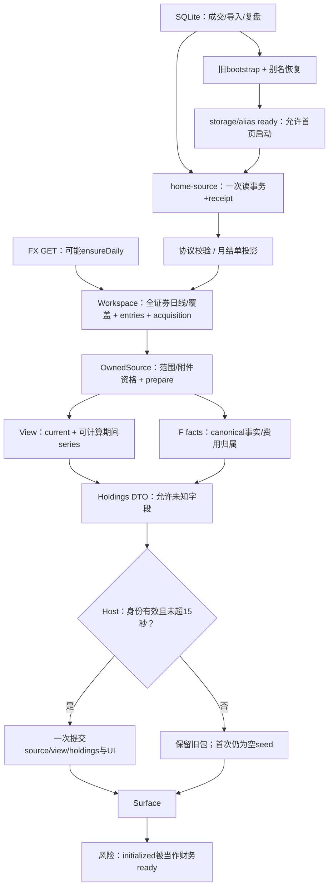

# 首页超时与空白：业务逻辑、数据链路和模块职责审查

## 设计结论

当前实现已经接入存储成交，并具备性质解析、原始证据检查、财务选源、同源投影及请求原子提交的主要边界。**业务规则的大方向成立，完整旅程尚未闭合。** 当前现象由三条独立机制叠加：

1. **时效**：浏览器调用链在发布前承担整批读取、证据处理、摘要、持有来源和财务事实计算；既有同版本 Node 分段样本约 18.29 秒，真实桌面已观察到 15 秒超时，host 正确拒绝迟到候选。
2. **完整性与可计算性**：当前 adapter 不供应全历史覆盖证明，且证据总体仍 unknown。因此即使及时提交，“全部期间”曲线与可信总额也不能自动得到；内部仍能生成带缺失状态的候选持仓行。
3. **展示终态**：首次超时会令 `initialized=true`，Surface 把它当成财务就绪，将未发布的空 seed 显示成“暂无持仓 / 0条”；期间无 view 时继续显示“期间数据读取中”。这与设计要求的首次读取失败语义冲突。

历史交易统计另外仍是明确的未接线状态。原始成交传输和性质合同的限定通过，不能覆盖这些问题。**当前不应宣称首页财务、性能或完整 UI 已验收通过。** 本次仅完成设计审查与有界只读补证，财务与 Bars 原暂停状态不变。

## 1. 版本、环境与证据边界

- 审查版本 HEAD：`58bf0d90e68ddc634de180b3f5c3d16a089f0eb3`，审查前存在 **181 项工作区变更**；不能只用 HEAD 代表被审代码。
- 2026-10-24 21:41 CST 固定 1,197 个源码、配置和相关文档文件的 SHA。与上一轮冻结版本比对：**847 个 source 文件、272 个 build 文件均一致**。见 [SOURCE-VERSION](evidence/SOURCE-VERSION.json)；结束后另作比对。
- 沿用 2026-10-24 21:15 CST 的[读取漏斗](../homepage-read-funnel-after-nature-2026-10-24/FUNNEL.md)和[协议版本证据](../homepage-read-funnel-after-nature-2026-10-24/evidence/HTTP-VERSION.json)。时间是历史同版本样本，本次没有重测浏览器、发布或重跑整条性能链。
- 该样本使用 4392 隔离预览：`.scratch/homepage-nature-contract/evidence/preview.sqlite`。默认业务库另由 `conf/runtime.json` 指向绝对路径。源码证明 home-source 与 bootstrap 共用同一数据库入口；隔离副本是否包含业务原库最新变更，本次未比较。
- 本次数据库读取使用 `mode=ro + query_only`，另以项目指定 **Node26.0.0 / SQLite3.53.0** 直接运行生产性质分类器，结果见 [IPO-NATURE-RESULT](evidence/IPO-NATURE-RESULT.json)。未调用可能触发 FX 更新的 GET，也未写业务或隔离库。
- shell 默认 `node` 同为26.0.0，但内置 SQLite 实测3.53.1；发现后以 `conf/native-environment.json` 指定可执行文件重验，报告采用3.53.0结果。该环境差异没有证据证明是本次首页根因。
- 既有 Node 探针不含 React、别名加载、目录组装和任务展示，不是浏览器总耗时；曾在尾部额外 HTTP 读取出现 ECONNRESET，不能把整次 Vitest 命令记成全通过。后续独立 HTTP 校验通过与之分别记录。
- UI 证据沿用既有 **1440×1000 桌面**截图及 AX，窄屏截图不作为桌面证明。此次为源码/设计审查，不进行控件或视觉验收；鼠标、键盘、触控、持久化旅程和当前运行页面均未新验。
- 原财务 **P1/F07 3/3 FAIL 暂停**、Bars **3/3 FAIL 暂停**，以[原 README 顶部最终状态](../homepage-v25-implementation/README.md)为准。本次未变更这些文件。

## 2. 先审业务：规则与实际表达

|规则|来源、约束地位与适用前提|当前判断|
|---|---|---|
|R01 实盘、模拟、unknown 必须有证据区分，配售不能伪造成普通买入|`CONTEXT.md:80`、V2.5首页仅实盘（原稿约436行）、已接受的[性质合同](../homepage-nature-contract/FINAL-ACCEPTANCE.md)；适用于分类和筛选|当前1778 live /84 simulation /6 unknown；原“严格实盘为零”的旧原因已不代表当前版本。6笔配售疑点见Q02.1。|
|R02 期间净盈亏=已实现+期末浮盈−期初浮盈；期间变更不改变最新持仓|批准原稿 `visual-design.candidate.md:191–225`；必须保留费用、币种、截点|view与holdings消费同一source/current；本次检查接线与不变量，未重新证明所有财务公式。|
|R03 unknown、缺证、真实零与完整空集合分别表达|原稿约467–503行；[来源合同](../homepage-v25-implementation/evidence/P4/ROOT-DATA-CONTRACT.md):18要求all起点有证据|核心有known/empty/unknown与null；首次失败Surface有违规映射，见Q03。|
|R04 同一范围、同一数据版本整组替换；失败保留旧范围和值|原稿约213–225、493–503行；既有session/host实现约束|请求身份、候选提取、前后截止检查和一次提交有实现支持。整体一致发布不等于所有金额完整可计算。|
|R05 交易时间、知识时间、行情完成时点和FX资格必须有明确语义|来源合同、财务决策、`CONTEXT.md`；ADR0006明确行情complete不代表历史可知时间已核验|acquisition使用读完成时刻为asOf，保留FX观察/发布时间；历史FX输入为空。跨来源共同逻辑时点未获数据库级快照证明，见Q08。|
|R06 首次失败明确不可用；更新失败保留旧值；15秒后手动恢复|批准原稿约467–503行|host有15秒期限；首次失败UI错误与空态/持续加载并存，见Q03。|
|R07 本地数据齐备时，完整首屏≤1秒；包括冷/热、重启首读及导入修订首读|用户已明确接受的性能边界；进程启动、外部行情/FX补齐另计；`CONTEXT.md:11`定义首页就绪|本样本完整性unknown，不能作为条件SLA正式判定。当前18.29秒/桌面超时是明确症状；需另备已齐备样本测端到端。|
|R08 首页展示当前持仓与历史统计，明细成交通过普通交易库查看并保留返回状态|原稿约349–456行|旧库标的/回合数与首页financial entries/持仓行不是同一粒度；首页无需复制整库成交表。历史区确实未接线，见Q04。|
|R09 持久数据入口、运行实例与来源新鲜度必须可追踪|`conf/runtime.json`、`conf/README.md`和项目AGENTS；隔离验收应明确DB override|同实例两API共用入口，既有成交全对象摘要相同；4392是副本，不证明业务原库实时同步，见Q06。|

ADR0001是旧架构回溯记录，不据此虚构“所有财务证据必须完整才能提交”的批准决定；ADR0006继续约束行情状态语义。**没有找到要求把未知财务金额一律变成空持仓的业务契约。** 相反，当前holdings模型允许逐行unknown，并仅在数量已知为零时跳过。

## 3. 完整数据链与模块职责

下图实线均有本次读取的源码支持；耗时来自已冻结的历史 Node 样本。



|模块|输入/输出、粒度、职责|接口隐含义务与边界判断|
|---|---|---|
|M01 存储快照|`homepage-source-snapshot.ts:16`，一次SQLite事务读取所有持久记录、Recall摘要与投影缺口；输出envelope|证明这批存储记录一致枚举；不证明所有历史事实、日线和FX都齐备。两存储API共用 `openSqliteDatabase()`。|
|M02 HTTP与协议|`sqlite-http-client.ts:162`、`homepage-source-contract.ts:164`，全对象分离、shape/count/SHA校验|传输完整性边界清晰；多次canonical/SHA需要时间预算，摘要不能替代业务完整性。|
|M03 性质与月结单证据|`nature-resolution.ts:19`、`statement-evidence.ts:607`；逐成交性质、证据候选及原始承载检查|保留原ID，不写回性质，不伪造成交；无法承载/定界证据进入unknown。模拟或unknown carrier不能认证实盘完整性。|
|M04 Workspace acquisition|`trade-review-workspace.tsx:2231`；协调source/FX/别名/全部证券行情/entries/receipt|调用方目前理解大量领域内部顺序；范围选择晚于全部行情读取。这里是编排责任聚集点，不能仅以大文件判定必须拆分。|
|M05 选源与所有权|`financial-source-model.ts:153`；按账户/证券/nature/run/附件投影，保留原证据；输出prepared、selectionKey、bounds|选择来源与深拷贝/确定版本的边界合理；all证据义务由上游供给，不能由最早成交补造。|
|M06 财务投影与事实|`financial-view-model.ts:102`，F prepare/boundaries/facts，`holdings-model.ts:89`|同source/revision/policy/cursor检查已实现；金额、行资格和全历史资格分别处理。facts包含大量审计事实，当前首屏仍整批请求。|
|M07 Host/session|`use-homepage-host.ts:118`、`session-model.ts:35`；generation、accepted scope、同步domain factory、前后deadline、原子发布|保护晚到与错范围有效；同步factory接口使host无法中断重CPU。initialized的消费者义务未充分表达。|
|M08 Surface|Workspace约6249行→`home-surface.tsx:307–338`，`period-surface.tsx:62`|应消费已提交DTO及终态，当前ready和view存在性把失败混入空/加载。历史区保留明确未接线文案。|

五个独立维度的结论：**存储枚举**有receipt；**发布原子性**有session/host保护；**版本一致性**有内容指纹和消费者校验，但跨daily/FX读取不是同一SQL事务；**业务可计算性**有unknown缺口；**时效**发布前链路仍超时。不得互相替代。

## 4. 按优先级的问题树

```text
Q00 首页超时、交易信息与持仓不显示
├─ Q01 [已确认 / P0] 发布前计算链跨过15秒，候选被拒收
│  ├─ Q01.1 [已确认机制 / P1] 全证券日线先读，范围资格后算
│  └─ Q01.2 [有支持证据 / P1] 多轮内容编码/所有权和完整facts是主要CPU候选
├─ Q02 [已确认 / P1] 财务完整性仍unknown；提速不能自动得到可信曲线/总额
│  ├─ Q02.1 [已确认机制 / P1] 6笔IPO仍unknown，关联29/64缺口样本
│  ├─ Q02.2 [已确认 / P1] lifetimeSourceCoverage始终[]，非空all必缺起点证明
│  └─ Q02.3 [待验证 / P1] 全局缺口如何限定到市场/账户，尚缺可用范围证据
├─ Q03 [已确认 / P1] 首次失败被映射成空持仓，期间终态仍加载
├─ Q04 [已确认 / P1] 历史统计未接线，无法靠读库修复
├─ Q05 [已确认可观察性缺口 / P2] 源API抹去异常细节，超时也可覆盖错误原因
├─ Q06 [已排除于同实例接口分库 / P2] 两API同入口、1868成交摘要相等；原库新鲜度未验证
├─ Q07 [已排除于旧“实盘全为零”解释 / P2] 当前1778 live；不能继续沿用旧结论
└─ Q08 [待验证 / P2] 存储/daily/FX独立读取时的跨来源一致性边界
```

### Q01：期限与计算链

**归属** Q00；R04/R06/R07，M02/M04/M05/M06/M07。影响：整个首次金融包没有提交，内部完成的持仓行不能到Surface。

**预期/实际**：15秒保护必须保留，≤1秒目标另按数据齐备样本测。Workspace同步组装domain后，host再次核对deadline，再决定是否 `update(next)`。这是正确拒绝过期结果；不能靠移除此检查把迟到包当成功。

同版本 Node 分段（ms，串行父阶段；source和FX并发取最大）：

|父阶段|ms|
|---|---:|
|source与FX并行|621.47|
|协议解析/SHA|395.48|
|prepare月结单与绑定|1212.02|
|证券摘要|3.82|
|236证券daily整批等待|2967.88|
|entries组装|262.76|
|complete acquisition|2412.84|
|own source / F prepare|5412.77|
|view|1808.52|
|facts|3108.88|
|holdings展示投影|16.58|

总wall约18,291.15ms。daily的range CPU720.95ms、coverage CPU623.90ms嵌套在daily阶段，不能再次累加；236个并发请求耗时也不能逐项相加。该探针的手工阶段总和与总wall有计时边界余量，不以其和代替总wall。

**纵向证据**：Workspace2238并行source/FX→2242 prepare→2255全部summary读daily→2266 complete→2287同步fromGlobal→2290 own→2292 view→2294 facts→2295 holdings；host140前检查、174 factory、179后检查、192提交。另有Workspace2860旧bootstrap/alias与3035 ready前置；上述18.29秒未覆盖整个首次导航关键路径。

**Q01.1**：`readHomepageBundle`未用readTarget减少证券集合；只有 `destination === trades` 跳过行情。A股首页仍可能受港美证券读取影响。这是机制确认，具体节省幅度未测。**Q01.2**：协议164、acquisition200/219/174、F648–663有多次编码/摘要/克隆及ledger准备；facts1141–1227重新取canonical审计事实并做费用观察。前期CPU采样支持SHA/序列化成本，但不能声称所有检查重复或可删除，也不能把facts全部改为只算20行而不核对未知持仓识别义务。

**竞争解释**：旧bootstrap、alias、FX外部获取或单个daily慢请求也可加时；当前样本source621ms、FX455ms，单纯DB查询不是18秒的充分解释。没有本轮浏览器CPU归因，主线程分布仍须补证。

**下一最小验证/预测/停止**：获后续诊断授权时，在同版本浏览器只捕获一次从导航到提交/拒收的trace，分开旧bootstrap、read开始、all daily、own、view、facts及提交帧；另备本地齐备fixture。如果重CPU窗口与own/facts重合，进入这些模块的接口预算设计；若主要等待在外部或启动，则先返回对应入口。定位独占关键路径即停止扩挖，不启动新修复候选。当前无AbortSignal贯穿readHomepageBundle，超时不证明底层IO/CPU已取消；未实际量化超时后浪费。

### Q02：覆盖资格与配售（详见子记录）

> 2026-10-25 续审追踪一条真实HKEX费用的完整生命旅程，确认持久化身份缺字段、当前parser词法差异、载体错误码混义与费用消费后果；详见 [记录旅程与规则边界](questions/Q02-RECORD-LIFECYCLE.md)。未修复，未重置暂停任务轮数；下文原证据保留。

> 22:29 CST 优先续审已完成全量231项普查、业务原库对照和HTTP完整对象复核；新增Q02.4–Q02.6，详见 [完整性责任划分与问题树](questions/Q02-INTEGRITY-REVIEW.md)。以下保留本总审查原取证边界，新结论不代表修复或验收通过。

**归属** Q00；R01/R03/R05，M03/M04/M05/M06。当前source总体unknown，231个表示缺口；样本只列64条。`universeComplete=false`使view.series为null、总额不可用，但代码仍计算current instruments，holdings允许unknown数量/价格/成本字段。

新补证确定：六笔IPO的来源规则均为 `manual/verified-ipo-allotment@1`，没有显式性质；当前resolver不接受此规则，六笔实际返回unknown。observer仅live才记录handled，因此它们关联的29条原始事件出现在64条缺口样本中。其余35条样本来自import；不能把231条一概归因于这六笔。

`buildHomepageFinancialAcquisition:171`固定 `lifetimeSourceCoverage:[]`；complete覆盖universe与revision，不补lifetime。故任何非空已选组的all bounds都会缺唯一lifetime行。当前387条bounds原因中291条为lifetime缺失/冲突。该保守输出符合已接受合同，**缺的是有证据的来源供应或明确的产品不可计算状态，不能填假complete解决**。

后续先区分“合法非成交/无载体证据”“性质未定”“真实历史缺失”“过严跨范围污染”；在契约未明前，不批准全局unknown降为complete或扩大白名单。[Q02深入与最小验证](questions/Q02-coverage.md)。

### Q03：首次失败与视图状态契约

**归属** Q00；R03/R06，M07/M08；P1，已确认源码反例并有既有桌面证据。

**预期** 首次读取失败应明确不可用，不能宣称0条；更新失败应继续呈现之前的包。**实际因果链**：初始domain为null source/view与EMPTY holdings（Workspace2286）→超时分支保持原domain并setInitialized(true)（host141–147、179–187、297–305）→Workspace2344回退EMPTY、6249以initialized作为ready→Surface331/334显示“当前范围暂无持仓/共0条”。`EMPTY_HOMEPAGE_HOLDINGS:37`本来明确定义“不作空集合断言”，消费者丢失了该约束。

期间控件在 `view===null` 分支无条件写“期间数据读取中”（period-surface62）；卡片本身可读 `ui.errors.global` 展示error，所以同一面板能出现失败与持续加载混合状态。

**竞争解释/反证**：成功包确实0行或搜索无结果时，同样空文案可能正确；此结论限定“首次读取失败且未有已提交金融包”。已有旧包更新失败路径不能据此断言会清空。历史20候选持仓行支持“seed零不是来源零”，不证明20行所有金额已可信。

**下一最小验证**：若获UI测试授权，固定未有source、无pending、global timeout、initialized=true，真实桌面重现；同时对照首次成功零行和已有包更新失败。预测只前者误报空。三个状态的消费者映射明确后停止；不以放宽deadline代替此状态修正。

### Q04：历史交易信息缺失

**归属** Q00；R08，M04/M08；P1，已确认。Workspace2286/2296保留history `status:not-wired`，2304 reloadHistory直接抛“历史财务读取尚未接线”；Surface337明确保留历史区占位。

**预期/实际**：批准V2.5包含历史统计；当前尚未实现完整接线。竞争解释“没有平仓交易”不能解释硬编码not-wired。首页financial entries、普通库标的/回合、持仓行的数量不得直接比较。

**下一步**：未来恢复原任务后，先验history producer事实/关闭日FX/不可计算状态，再验整条旅程；Bars继续原暂停，不借历史父任务绕开轮次。无需继续排查SQL来证明这段硬编码未接线。

### Q05：内部异常的可观察性

**归属** Q00；R06，M01/M02/M07；P2。源route `catch` 不记录原异常，统一503 `homepage-source-unavailable`；session-model44仅保留error.message，host219先判timeout可能覆盖晚到错误。**确认的是诊断信息损失，不是确认存在某个未发现内部异常。** 已有“无console错误”不能排除这些路径。

竞争解释是纯慢计算、没有异常；当前证据支持它足以解释超时。下一最小验证为已有服务日志与失败响应对照，缺信息才设计带request/source/stage的最小日志，不记录交易原文。用隔离故障区分source503、binding错误、domain throw和纯timeout；可归因即停止。此次未新增日志。

### Q06 / Q07：已排除的旧解释与保留边界

- **Q06**，R09，M01/M02：home-source route和bootstrap route均调用 `openSqliteDatabase()`；既有同版本HTTP校验均1868笔、排序后完整成交对象SHA一致。因此“这两个接口在同一实例读了两个不同库导致成交丢失”在该样本已排除。竞争解释“4392副本落后业务原库”仍待验证；若需要验证，仅比对两库已确认业务表的只读逻辑摘要与副本时间，不切换数据库、不重建副本。
- **Q07**，R01，M03：当前1778 live，旧1784条全部unknown导致首页集合为零的解释已失效；6条unknown保留。普通库226标的/726回合与首页232 selected entries不同粒度，不能用数差证明传输丢失。下一检查若出现新版本计数差，先固定性质/账户/市场/时间/聚合粒度再比较；当前停止追查已通过的传输分支。

### Q08：跨来源一致性边界

**归属** Q00；R04/R05，M01/M04/M05；P2，待验证风险。成交/Recall/import有单事务，daily分证券并发读取，FX另读并可能ensureDaily；内容revision证明“本包包含哪些输入”，不能单独证明这些输入来自数据库同一逻辑修订时点。时间戳资格也不等于同一SQL快照。

竞争解释是当前隔离数据静止，实际上没有跨修订混合；本次没有并发修订证据，不能把这一风险当作当前空白根因。后续先确认批准的一致性定义是否接受独立观测且明确版本的整包；只有要求同一revision却可构造混合时，才讨论存储版本/快照职责，不先重构全库。

## 5. 后续队列与重构判断（未授权实施）

|顺序|候选工作与收益|风险与进入/退出门槛|
|---|---|---|
|1|Q03 明确请求终态、是否有已提交source、数据可计算性三个独立状态；消除假空和无限加载|局部UI契约修正候选；仍需用户后续授权，首次失败/真实零/更新失败三态及桌面视觉分别验收。|
|2|Q02 分析六笔配售来源证据、其余未承载项与lifetime供应；建立可追溯coverage责任|涉及业务完整性，不能仅扩白名单。最小样本逐项解释、已知与未知分别保留；若进入财务代码，须先恢复原暂停任务。|
|3|Q01 补浏览器独占关键路径与齐备fixture，评估按范围读行情、复用不可变输入、首屏所需facts接口|保持摘要绑定、金额、时区、原始证据和64MiB合同；不删资格校验，不以缓存旧包满足新revision。一秒门槛仍按用户边界，财务相关实现继续暂停。|
|4|M04/M06职责收敛候选：由稳定producer隐藏组装顺序、覆盖和DTO细节，host仍唯一提交；评估执行环境和可取消性|是否提取模块以调用方减少理解成本为准。增加worker/service需解释版本、取消、资源与字节成本；现有纯seam能够解决时不扩大基础设施。|
|5|Q05 最小可归因日志；Q08明确跨来源一致性|先读取现有信息，确认缺口才实施；不泄露交易原文。|
|6|Q04 恢复后完成历史producer与页面旅程|原财务及Bars暂停不变，旧失败记录与轮次必须保留；独立性能、金额、完整数据链、视觉均不能互相替代。|

本轮结论是“审查完成、部分机制确认、部分问题待补证”。没有执行源码修复、数据修订、重构、恢复任务、构建发布或新UI验收。
