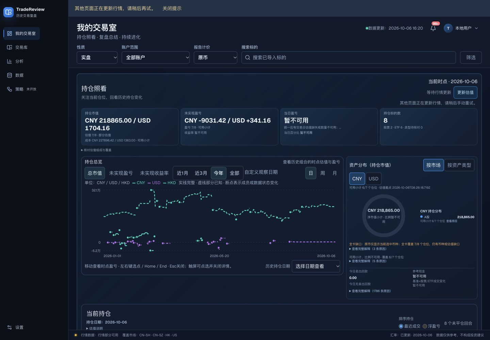

# 首页与复盘设计诊断

2026-10-07，当前源码审计 + 历史画面参照。**没有本轮最新浏览器截图或 computed style；下表不是当前页面的实际像素测量。** 用户提供的旧图、2026-10-06 首页截图和 2026-09-25 复盘批准原图用于定位与比较，已发生的首页修复不能由旧图判定成失败。

## 主要问题与可执行要求

每项都区分事实与影响推断。`SOURCE_ONLY` 是当前声明值；`HISTORICAL_IMAGE` 是历史画面；`STATIC_COLOR_CALCULATION` 是静态对比度。新截图、最终尺寸与实际任务影响须在样板真实浏览器验收补证。下表源码简称的完整路径、调用链与逐项行号见[基础审计](evidence/foundation-source-audit.md)和[真实图表审计](evidence/review-sample-source-audit.md)，不将源码值充当最新画面尺寸。D03摘要卡来源另见 [app/components/dashboard/room-portfolio-summary.module.css](../../app/components/dashboard/room-portfolio-summary.module.css)：第4行 label12/1.2，第5行 amount14/1.25，第42–47行桌面覆盖仍保留14px数值。

| ID / 位置与截图证据 | 来源与实测边界 | 现象、影响与原因判断 | 修改规则与验收 |
| --- | --- | --- | --- |
| D01 中文/数字字体；旧首页标题、筛选与金额混排 | `layout.tsx:6–14` Geist Latin；`globals.css:45`；Vinext `font-google-base.js:313–314`；Text 几何 `text-geometry.ts:15`；ReplayChart `:1015`。SOURCE_ONLY；实际字体 NOT VERIFIED | 字体变量含 generic，排在显式中文候选前；DOM、Canvas、SDK 另有三套字体。可能造成不同笔画、行宽、基线和编辑后折行，不能凭截图证明当前中文实际字族 | generic 最后；明确 UI、数字、图表轴、图上文字角色。用完整中英混排、价格、长批注比较实际 rendered font、400/500/600 与字体失败；编辑前后及重开单独验 |
| D02 顶部范围/操作比例；旧首页范围条 | Scope Module h36/font14；全局搜索 h36；首页晚段刷新/待复盘 h44/font14；advanced fields h44/radius9，Scope radius6。SOURCE_ONLY；旧控件 9px 规则已被覆盖 | 同任务行多套尺寸、内边距与字重来源；select 继承 label650，而 radio500/segment550。不同高度本身未必错误，当前缺的是角色规则与同排基线证据 | standard36/primary40/touch44 为候选，值14/500，label 独立；先比较真实原组件再统一。测 bbox/padding/gap、长中文选项、内容宽度断点与粗指针，不能偷偷把已批准触摸控件缩小 |
| D03 数值与层级；旧首页四张摘要卡，币种与金额相互挤占 | PortfolioSummary Module amount14/1.25、label12；当前正文已14，页头24/32；壳层与菜单10–12。SOURCE_ONLY + HISTORICAL_IMAGE | 金额与正文同级，边框/大块容器承担过多强调；旧图的币种、金额换行使扫描变慢。当前最新折行未验证 | 金额20/28起试，正文14/22，说明12/18；保持币种与精度，完整覆盖说明。不依靠多层大框拉层级；同数据1440/1024/390/320对照，核对快速识别范围、小计与缺口 |
| D04 颜色意义；通知徽标、错误、盈亏 | dashboard `:537–541` 动态涨跌色；global tools CSS `:98/:135/:146` 使用 dashboard-negative；recall positive/negative 同时用于状态。SOURCE_ONLY | 默认红涨绿跌时错误/未读可能变绿；设置行情配色同时改变状态。属于可确认的语义耦合，不只是审美 | market-gain/loss 与 state-danger/warning/info/success 分开；盈亏原设置保留。逐种现有配色切换，金融值随设置，错误/未读含义保持；文字与图标补色 |
| D05 主动作对比度；普通确认/导入/复盘完成按钮 | globals `:2034–2035` 白字/2f80ed；`:4874` 白字/2169cc；recall CSS `:260` 白字/2563eb。STATIC_COLOR_CALCULATION | 同主动作三种蓝；白字2f80ed为3.87:1，普通小字组合低于4.5。正文e7edf6/page却为15.91，不应笼统说所有颜色太暗 | 链接与填充 token 分离；填充候选2169cc（5.31）。测最终有效背景及hover/pressed/opacity；普通文字4.5，必要非文本3，装饰线按用途判断 |
| D06 图标和点击目标；旧页头与绘图工具 | Lucide 调用点14/15/16/17/18/19/20，默认2随 viewBox 缩放；通知 `!/~ /↗` 文字符号；clearSearch padding2、X14，无min目标。SOURCE_ONLY | 不是多图标库；同动作不同尺寸与字体符号混用，线重/基线不受统一角色控制。清除/关闭命中区可能偏小，实际 bbox 未测 | 保留Lucide，field/nav18、tool20、stroke1.75起试；图形与36/44容器分开。替换或正式定义符号徽标；测1×/2×像素、基线、清除/关闭及宽屏触摸可点范围 |
| D07 焦点/选择/不可用；筛选、图表工具、输入 | globals早段2px蓝offset2，晚段button浅蓝offset3；Scope浅蓝offset1；chip青色内描；搜索outline0+18% shadow；disabled opacity.35–.72。SOURCE_ONLY | 焦点规则按类型分裂；selected 与 focus 可能难辨，容器裁切风险未复现。disabled/loading/readonly 语义混杂；Scope tabs缺完整复合键盘行为 | 单一focus2px浅蓝offset2候选，选择用底色+border，真实focus可并存；disabled原因、loading状态、readonly分开。真实Tab/方向键/Home/End、弹层边缘、重复操作与恢复；不假造组件未支持状态 |
| D08 图表、长诊断与窄窗；用户旧图散点与长原因、批准S1图 | 旧首页全期间图混币数量级、右侧长原因挤出空间；当前首页spec已有单币/诊断抽屉要求；ReplayChart调用方需先过滤数据。HISTORICAL_IMAGE + SOURCE_ONLY | 旧图大面积空白与右侧长日志属于当时状态，当前整改需重新取证。若新样板只改变排版却不管 cutoff，漂亮摘要/Tooltip 仍可泄漏未来 | 首页优先单币可解释趋势、小计覆盖、按需原因；复盘真实图表/图上全文为主，不预设栏比例。固定范围与S1全文比较；下一根真实可见、S2返S0轴安全、tooltip/list/summary共同过滤，窄窗价格不隐藏 |

## 推荐取舍

先统一文字角色、控件比例、语义颜色和焦点，保留现有暗色主题、React/CSS Module/Lucide 与盈亏配置。采用一个推荐样板；首页检验资产信息，复盘检验图表与完整判断。图表周边保持较紧凑，长中文批注增加行高；触摸命中区放大而不把所有图标放大。多行完整内容可能增加页面高度，这比删判断或缩小文字更符合任务。

参考 TradingView 的是工具按任务分组、图表主面和可配置标签，并非未经测量的栏比例或像素值。规则来源与外部事实见 [官方参考审计](evidence/tradingview-reference-audit.md)；候选参数与固化范围见 [规范草案](../../docs/design-system/TradeReview-设计规范-v0.1.md)。

## 仍需补齐的证据

1. 启动包的路径及内容，与本草案冲突核对。
2. localhost 浏览器权限恢复后，当前业务首页的最新完整截图/字体与尺寸测量，覆盖中文长菜单与窄窗。
3. `/design-preview` 基线和推荐在同数据、同阶段、同范围的修改前后截图，以及 selected+真实focus、S0/S1/S2代表状态。
4. 非实现者直接比较截图；真实图表阶段/下一根/返回早期；鼠标、键盘及各类触摸分别记录。

当前这些项目 **NOT VERIFIED**；源码审计、类型与构建不替代。样板使用合成数据和内存状态，不涉及原始交易修改与生产持久化；不能据此把原首页整改或生产复盘整体标为完成。
