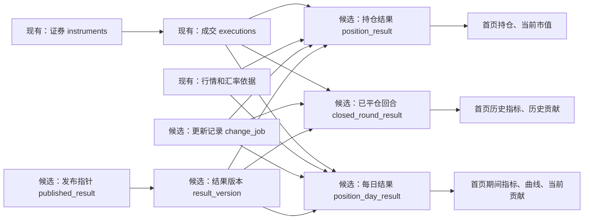

# 首页数据库结构与读取设计（候选审查稿）

日期：2026-11-05。**用途：逐项审查首页需要的数据、表之间的关系、候选字段和索引；不是现有表清单、数据库迁移指令或已验证的性能结论。** 本文只讨论设计，不修改数据库。财务与 Bars 相关开发仍按既有记录暂停。

## 1. 先看结论

**建议保留原始成交等明细，另外建立几张可重建的结果表，再在结果表上建立索引。** 系统在成交、行情等发生变化时准备数据；打开首页时优先读取已准备好的结果。明细用于追溯，结果用于加快读取，索引用于更快找到特定范围和顺序的数据。

| 方式 | 优点 | 局限与判断 |
| --- | --- | --- |
| 一张大表存所有内容 | 看起来容易查 | 同一笔成交可能重复存很多次；账户、日期和不同指标粒度不同，更新和对账容易出错。不建议。 |
| 只存明细，打开时现场计算 | 事实清晰，保存简单 | 现有实验中即使只返回少量结果，仍因先处理完整来源而较慢。单靠分页不够。 |
| **明细 + 共享结果 + 索引（建议）** | 既能追溯，又能提前完成重复计算；多个页面可共用部分结果 | 增加更新、重建和版本管理成本；必须用真实数据对账和测速。 |

**索引通常不是另一张业务表。** 可以把表想成账本，索引想成按指定顺序排列的目录。本文的持仓读取表本身保存的是提前整理的结果；其上的数据库索引是帮助筛选和排序的目录。两者作用不同。

## 2. 首页控件需要什么

下图是首页 V2.5 的布局参考，图中旧的“12”徽章不属于当前入口规则；持仓区实际方案及分镜见[视觉规范](../design-system/baselines/2026-10-22-homepage-v2.5/visual-spec.html)。[四页面逐控件字段对照](view-field-mapping.candidate.md)保留逐项依据、现状和未核实事项。

| 首页区域 | 用户看到或操作 | 至少需要什么 | 从哪里读取 |
| --- | --- | --- | --- |
| 市场、账户和全局搜索 H01–H04 | 选择范围、查找证券、进入详情 | 市场、交易性质、账户身份、证券名称和代码 | 证券资料与账户映射；持仓结果 |
| 附加筛选 H05–H06 | 资产类别、未平仓、待复盘 | 类别、持仓状态、复盘状态及筛选条件 | 证券资料、持仓结果及显式的成交复盘状态；状态与回合及标的的映射仍需细化 |
| 时间与期间卡片 H07–H09 | 时间范围、已实现、浮盈变化、净盈亏和当前市值 | 每日已实现和费用、起止时点浮盈、最新持仓市值、缺失原因 | 每日结果和当前持仓结果 |
| 期间曲线 H10–H11 | 每日点、缺口和未来范围 | 每日日期、可用金额、价格覆盖、缺失状态 | 每日结果 |
| 当前持仓 H12–H18 | 数量、成本、价格、持仓天数、市值、浮盈；搜索、排序、每页 8 行及导出 | 每账户证券持仓、价格和时点、金额及可用性；全范围汇总、稳定排序 | 持仓结果及其索引；汇总覆盖全部符合条件的行 |
| 历史表现 H19–H22 | 历史盈亏、回合数、胜率、费用和按月/年曲线 | 平仓日期、回合净额、费用、盈利与有效回合数 | 已平仓回合结果及其日期索引 |
| 贡献与下钻 H23–H28 | 市场、证券、类别的盈亏贡献，排序和详情 | 账户、证券、市场、类别、已实现与浮盈变化及状态 | 每日结果和回合结果，按范围组合 |
| 进入交易库、返回与状态 H29–H32 | 带条件跳转、返回原位置、加载/错误/更新状态 | 目标范围、当前读取版本、错误或缺失原因、前端导航状态 | 页面请求和发布状态；滚动、焦点等属于前端交互状态 |

**已确认的规则：**实盘中，同一证券在所选账户内的交易按时间合并到同一标的；不同计算时点的币种换算统一使用最新汇率。合并结果的成本、相反方向如何计算，以及汇率更新后的重算方式属于后续设计和验证，不能仅凭这两条规则推定。模拟练习保留独立边界。

## 3. 表的层级和关系

**原始事实是依据；计算结果是可重建的副本；页面索引为查找服务。** 原始成交、证券、行情等可复用现有表；下图中的结果与发布表是候选设计，并非宣称已存在。

图中箭头表示依赖，不是都需要数据库外键。**一条成交可能参与多个计算结果，一份结果可以使用多条成交；不能靠一个成交 ID 表达完整来源。** 精确追溯可通过对应计算任务、依据版本和必要的关联明细实现；关联粒度与存储成本待实验。

## 4. 原始事实：现在有什么、还缺什么

**下表是静态源码核对的结果，不能证明实际数据库记录齐全或页面已接通。** 精确列与证据见[现有字段字典 S01–S08](view-field-mapping.candidate.md)。

| 表 | 一行表示 | 已核对的主要字段 | 设计注意 |
| --- | --- | --- | --- |
| `instruments` | 一个证券资料对象 | `id, symbol, name, market, currency`，另有资料 JSON | 同代码可能属于不同市场；类别及独立交易所字段尚未证明齐备。 |
| `executions` | 一笔成交 | `id, instrument_id, account, side, executed_at, quantity, price, fee, currency, trade_nature, simulation_run_id` | 金额和数量原始列为文本；费用、账户、币种可能缺失；未知性质不能自动当实盘。 |
| `execution_fact_states` | 一笔成交的事实状态 | `execution_id, state, revision_id, reason, recorded_at` | 处理有效、撤销或修订时必须遵循既有规则，不能把全部行直接当有效成交。 |
| `daily_candles` / `market_candles` | 某证券某时点或周期的行情 | 证券、日期/时点、价格、来源、币种等 | 页面只使用适用的行情；缺价不是零。这里不改变暂停中的 Bars 开发。 |
| `import_batches` 与来源相关表 | 批次、材料版本及来源关联 | 批次 ID、来源、指纹、导入时间等 | 可追溯来源；批次数量不等同成交、回合或练习数量。 |

目前未证实有统一账户主表、稳定回合身份或完整的首页持久计算结果。**下文候选账户 ID、结果 ID 等需要设计映射和迁移，不能假定已有。**

## 5. 候选结果表：每张表要存什么

**这些表按“一个时间点的持仓、一天的变化、一次已完成回合”拆开，避免把不同时间粒度放进一张大表。** 表名是便于审阅的候选名称；最终 SQL、约束及迁移方案尚未批准。

### 5.1 当前持仓结果 `position_result`

**一行：某结果版本下，一个账户、一只证券、一个交易性质的当前持仓。** 练习/运行身份或多空方向是否需要额外区分，取决于最终规则，不能提前合并。

| 字段 | 含义及例子 | 约束/来源 |
| --- | --- | --- |
| `version_id` | 计算结果版本，例如 V12 | 必填；关联结果版本。 |
| `position_key` | 该持仓记录的稳定标识 | 必填；版本内唯一。 |
| `account_ref, instrument_ref, market, trade_nature, run_ref` | 账户、证券、市场、实盘/模拟及必要的练习身份 | 前四者及身份规则按真实来源确定；未知不能猜。 |
| `as_of` | 持仓结果对应的时点 | 必填；不与期间筛选结束日期混淆。 |
| `quantity, cost_price` | 剩余数量及成本价 | 精确数值；无法计算的成本为空并记录原因。 |
| `holding_start, holding_days` | 持仓起点与持有天数 | 起算规则待决定；未知不写 0。 |
| `quote_price, quote_at, quote_source, quote_currency` | 使用的价格、价格时间、来源和币种 | 缺失可为空；不能把历史与最新价格混用。 |
| `market_value, unrealized_pnl, reporting_currency` | 市值、浮盈及展示币种 | 汇率和计算依据要可追溯；缺价/汇率时值为空。 |
| `asset_class, direction_class, review_status_ref` | 用于资产类别、多空/IPO 及待复盘筛选；具体来源、分类规则及复盘状态所属对象仍待定，不能猜测或强行并入持仓事实。 |
| `quantity_status, cost_status, quote_status, value_status, pnl_status, missing_reason` | 每类数据是否可用及原因 | 不把未知或失败当 0；必要时拆分原因明细。 |

候选唯一约束是 `(version_id, position_key)`；账户、证券、性质、运行身份和方向如何构成内部结果的唯一键仍需设计。首页实盘按所选账户将同一证券的交易按时间合并到同一标的，再排序、汇总和分页；账户来源仍须保留。能否直接组合账户级结果、相反方向的成本及数量如何计算，需要通过具体案例验证，不能先假定简单相加。

### 5.2 每日共享结果 `position_day_result`

**一行：某版本、账户、证券、性质与业务日的一份结果，保留可组合的基础量。** 它同时服务期间卡片、曲线和当前贡献，而不是每个控件各算一次。

| 字段 | 用处与规则 |
| --- | --- |
| `version_id, account_ref, instrument_ref, market, trade_nature, run_ref, business_day` | 确定版本、归属及日期；业务日时区按已确认规则。 |
| `realized_pnl, fees, closing_unrealized, closing_market_value` | 当日已实现和费用、日末浮盈及市值；保留币种和是否可用。已实现是否含费用须按现行财务规则明确，避免重复扣费。 |
| `currency, quote_ref, fx_ref, rule_version, source_manifest_ref` | 币种和计算依据；行情、汇率、公式及来源必须可追溯，具体来源版本结构待定。 |
| `direction_class, classification_evidence_ref` | 支持按多空/IPO 类别查看当前贡献；分类规则、是否按结果拆分和来源依据待定。 |
| `realized_status, valuation_status, missing_reason` | 区分可计算、缺行情/汇率、未来及失败；不能仅凭一项有效声称全日完整。 |

期间净盈亏按已确认口径组合：**期间已实现 + 期末浮盈 − 期初浮盈**。期初可能需要读取范围开始前的有效边界值；不存在可靠边界时显示不可用，不补零。多账户或跨币种须先按明确换算时点和规则归一化；存款式日末市值不能跨天相加。唯一键包含版本、账户、证券、性质、必要的运行身份和业务日；空身份的唯一性必须以显式约束处理，不能依赖 SQLite 对空值的默认唯一行为。

### 5.3 已平仓回合结果 `closed_round_result`

**一行：一次人的主动平仓及其对应开仓形成的一个实盘回合，可能包含多份成交配对。** 回合身份和识别规则仍待确认；不能把一份配对直接当一个回合。

| 字段 | 用处与规则 |
| --- | --- |
| `version_id, round_key, account_ref, instrument_ref, market, trade_nature` | 结果及回合、账户、证券和市场身份；回合稳定身份待定。 |
| `close_day, close_action_ref` | 平仓业务日和主动动作依据；用于历史筛选，不用导入日代替。 |
| `net_pnl, fees, currency` | 回合净盈亏、费用、币种；费用未知时按规则标记不可计算。 |
| `direction_class, classification_evidence_ref` | 供历史贡献按类别统计；分类和证据仍须按业务规则确定。 |
| `result_status, eligible_for_stats, missing_reason, rule_version` | 是否允许进入对应统计、原因和计算规则；不是复盘完成状态。 |
| `allocation_refs` | 可追溯关联：回合包含哪些成交分配；物理上建议关联表或其他可核验结构，而非假设此字段是一个普通列。 |

历史胜率按符合口径的盈利回合数 ÷ 符合口径的总回合数，分母为零显示“—”；不能平均各月胜率。若单独预存月/年桶，应保存盈利数与有效数而非只保存百分比，是否需要建表由实验决定。

### 5.4 计算、发布与恢复

| 候选表 | 一行代表 | 核心字段 | 作用 |
| --- | --- | --- | --- |
| `change_job` | 一项需要处理的变化或合并后的任务 | `job_id, change_type, affected_account, affected_instrument, earliest_day, input_version, status, error, created_at` | 找到受影响范围，失败后可恢复；多个变化合并不能遗漏范围。 |
| `result_version` | 一批使用一致依据生成的结果 | `version_id, input_manifest_ref, rule_version, status, computed_at` | 记录实际使用的成交、资料、行情、汇率及规则依据；版本结构需进一步设计。 |
| `published_result` | 一个已定义范围当前可读的结果 | `scope_key, version_id, published_at` | 仅指向经过完整性检查的版本；范围定义和多范围的一致读取仍待设计。 |

持仓、每日结果、回合结果关联兼容的版本，不要求每次变化都复制所有历史数据；增量结构、复用与版本保留策略仍需实验。成交事实与更新任务应在同一数据库事务中提交；计算完成后重新核对依据，再原子发布可读版本。导入后的页面目标不能因“后台更新中”而算通过。

## 6. 索引：准备怎样查，而不是越多越好

**先针对实际查询建立少量候选索引，再用 SQLite 查询计划和真实数据验证。** 以下是列顺序草案，不是已创建的索引。表和字段名称、默认排序以及多选账户查询都尚未最终确定。

| 候选索引 | 典型查找 | 预期作用与限制 |
| --- | --- | --- |
| `position_result(version_id, trade_nature, market, account_ref, instrument_ref, position_key)` | 按版本、性质、单市场、单账户找持仓 | 减少扫描；多个账户或全部市场需实测，筛选项缺失时不能保证同样高效。 |
| `position_day_result(version_id, trade_nature, market, account_ref, business_day, instrument_ref)` | 单账户/市场的时间范围与曲线 | 限定日期范围后读取必要行；多选组合、证券筛选需看实际查询计划。 |
| `closed_round_result(version_id, trade_nature, market, account_ref, close_day, round_key)` | 选定范围的历史回合 | 按平仓日筛选与稳定排序；历史按证券下钻是否需另一索引需测量。 |
| `(version_id, position_key)` 唯一索引 | 按 ID 找持仓或稳定翻页 | 防同版本重复键；不是业务身份唯一性完整证明。 |

**金额排序不能直接依赖文本的字母顺序。** 原始数值列有文本，字符串“100”可能排在“20”前面。候选方案是在确认业务精度、币种、最大值及溢出边界后，额外保存精确且可比较的定点整数排序值；只有能无损转换时才使用，不能为了速度截断或使用浮点近似。跨账户合并或换算后的排序值通常要先计算完整结果；单账户结果上的索引不能保证这些查询免排序。各排序字段、升降序、空值位置及搜索策略以实测决定，避免为所有组合盲目建索引。

例如，若确认单账户、单市场的市值降序是高频查询，可实验在精确排序值存在时建立 `(version_id, trade_nature, market, account_ref, value_missing, value_sort_i DESC, position_key)`；`value_missing` 用于规定缺失位置。该索引只覆盖对应筛选、币种和顺序，不能自动解决跨账户聚合、其他排序或搜索；实际建索引前必须检验唯一键、精度、查询计划和写入代价。

名称/代码搜索是否使用普通索引、专门搜索索引或小规模扫描，取决于匹配规则（前缀、包含、中文等）和真实规模；不能假设普通索引能加速任意包含搜索。

## 7. 一次打开首页怎么读

**先固定一组兼容版本，再分区域取摘要、曲线和第一页；不传完整成交与来源材料。**

1. 获取范围、数据状态和可读版本；账户/证券选项从资料读取。
2. 依据账户、市场和期间读取每日结果，得到期间指标与曲线；读取当前持仓得到市值。
3. 按筛选组合持仓、计算完整范围汇总，先全量排序，再返回第 1 页的 8 行；详情和导出另行请求。
4. 按平仓日期读取已平仓回合，组合历史卡片、月/年曲线与贡献；当前贡献复用每日结果。
5. 响应携带范围、版本、更新时间和各区域可用状态；缺失、失败、更新中和真正没有数据分开。

例如：一个账户买入 100 股、卖出 40 股，补录此前买入 10 股后，成交仍保留三条事实，受影响的持仓结果从 60 更新为 70。历史回合和每日结果是否也需重算，由成交时间及业务规则决定；新结果通过检查后才发布。这个例子只说明数量，不预设盈亏。

## 8. 能否达到 1 秒：证据和验收

**目前只能说这个方向值得实验，不能声称改表或加索引就已达标。** [既有隔离实验](../../.scratch/page-reading-mvp-wayfinder/homepage-precomputed-read-analysis-2026-10-29.md)中，完整来源约 34 MB；仅缩小返回仍需约 7,176 毫秒中位数；预先准备精简事实的进程内读取约 0.677 毫秒，但未包含完整财务、HTTP、曲线和浏览器渲染，不能当作首页速度。

| 验证 | 怎样判断 |
| --- | --- |
| 字段完整 | 每项首页控件追溯到表、字段、计算规则与缺失状态；未决口径单列，不把未知当已设计。 |
| 数字正确 | 隔离副本上，用已确认规则与全量重算逐项对账；覆盖多账户、跨市场、缺价/汇率、历史补录、筛选和分页。 |
| 索引有效 | 对实际 SQL 记录 `EXPLAIN QUERY PLAN`、扫描行数或可获取的指标，比较建索引前后耗时、大小和更新代价。 |
| 读取有效 | 逐区域记录查询、计算、接口字节与耗时；确认摘要是完整筛选范围、列表只返回当前页。 |
| 页面达标 | 本地数据齐备、服务已启动时，桌面首页完整正确首屏 ≤1 秒；分别测冷/热访问、服务重启后首读、导入或修订后首次打开。外部行情/汇率补齐与进程启动单独计时。 |
| 更新可靠 | 记录从保存到新结果可用的时间；异常、重启及输入变化不能丢任务或把旧结果冒充最新。 |

## 9. 审查时最需要决定的事

1. 实盘同一证券跨账户按时间合并到同一标的，模拟练习保持独立；如何据此计算相反方向的成本、数量及排序，需要通过案例设计和验证。
2. 历史回合怎样稳定识别、费用怎样分摊？这决定胜率和历史贡献。
3. 期初边界、行情、汇率、精确数值与缺失如何确定？这决定是否能计算金额和排序。
4. 待复盘状态挂在哪个业务对象上？哪些控件受该筛选影响？
5. 发布范围及更新策略如何兼顾一致性和导入后的首读时限？
6. 哪些统计需要预存额外桶，哪些从结果表临时组合即可？以真实查询和更新成本决定。

完整数据设计及写入/更新机制见[数据模型审查稿](view-driven-data-model.candidate.md)和[数据生命周期](page-read-data-lifecycle.candidate.md)。本稿先供首页逐表对齐；未实现、未修改数据库、未验收一秒目标。

## 10. 补充：汇率证据、累计边界与逐控件核对

**金额必须能同时说明原币、报告币和采用了哪些换算依据。** 第 5.2 节中的单个 `currency` 和 `fx_ref` 只是简写，不足以表达完整设计；本节是对它们的细化，并替代单一汇率引用的理解。

| 候选字段／对象 | 需要记录什么 |
| --- | --- |
| `native_currency, reporting_currency` | 原币和报告币分别是什么，不用一个币种字段混淆。 |
| `native_realized_pnl, native_closing_unrealized` | 原币已实现、原币日末浮盈；各自带可用状态。 |
| `report_realized_pnl, report_closing_unrealized` | 换算到报告币后的对应基础量；汇率缺失时可为空，不影响可用的原币值。 |
| `valuation_evidence` 候选依据集合 | 每项包括 `evidence_id, version_id, subject_ref, metric_key, kind, from_currency, to_currency, rate, effective_at, observed_at, source_ref, status, missing_reason`；一个结果可关联多项依据。行情与汇率也可按需要拆为不同表。 |

例如港币金额转人民币，要保留“港币→人民币”的方向、所用汇率的时间和来源。**已确认：不同计算时点统一使用最新汇率，不按历史成交或估值日期选取历史汇率。** 例如历史美元盈亏 100 美元，最新美元兑人民币汇率为 7.2 时，展示换算值为 720 元；最新汇率改变后，历史金额的换算展示也会随之改变。具体如何选取、更新和版本化最新汇率，以及缺失时如何重算发布，仍需设计和验证；原币金额应保留。

**期间与累计是两种不同的数字，缺口不能悄悄跳过。** 首页曲线需要分别提供期间盈亏 `period_net` 和从可信基准起算的累计盈亏 `net_to_date`。每日结果应记录或关联 `lifecycle_start, cumulative_baseline_ref, coverage_state, gap_reason`。可信证据表明起点前没有持仓时，相应边界才可使用零；缺历史、缺价格或不知起点时标记未知。新开仓、期间平仓证券也必须核对起止边界；累计依赖的前置数据有缺口时，后续结果不能声称完整。累计起点及具体存储形式仍待决定。

### 首页 32 项控件：数据和状态清单

以下为候选承载关系，“待定”表示还不能据此认定完整；更详细的业务证据见[逐控件字段对照](view-field-mapping.candidate.md)。

| 控件 | 需要核对的数据、计算和状态 |
| --- | --- |
| H01 市场 | 请求市场、性质；结果保留同样归属，未知性质不猜。 |
| H02 账户 | 账户集合及 `account_ref`；统一账户目录和身份映射待设计。 |
| H03 全局搜索 | 证券 ID、名称、代码、市场；应能覆盖无持仓证券，搜索范围与类别来源待定。 |
| H04 搜索详情 | 持仓身份、数量、成本、价格、市值、浮盈及各项状态；无持仓需明确。 |
| H05 附加筛选 | 类别、持仓数量及状态、显式成交复盘状态；状态与回合、标的的映射仍需细化。 |
| H06 应用/清除 | 前端草稿、已应用范围及读取版本；失败时不能把旧范围冒充新范围。 |
| H07 期间 | 请求起止业务日；不改变当前持仓时点。 |
| H08 期间四卡 | 每日已实现、起止浮盈与各项状态；当前市值另取持仓结果；金额带币种。 |
| H09 市值说明 | 数量、价格、价格时间和来源，以及适用汇率依据、覆盖和缺失原因。 |
| H10 日曲线 | 日期、每日基础量、期间值、累计值、累计基准及状态；起点规则待确认。 |
| H11 缺口 | 每日覆盖、缺失原因、是否未来与断线范围；未知不补零。 |
| H12 持仓行 | 证券名称代码、数量、成本、天数、价格、市值、浮盈及各项状态。 |
| H13 持仓汇总 | 完整筛选范围的市值、浮盈、数量及覆盖；搜索是否影响汇总待定。 |
| H14 持仓搜索 | 证券名称、代码与查询条件；匹配规则待定。 |
| H15 持仓排序 | 正确币种的可比较值、可用状态和稳定键；多账户先合并再排序。 |
| H16 持仓导出 | 固定版本、筛选和排序，导出全部匹配行、列及精度，不能只导出当前页。 |
| H17 持仓分页 | 全量筛选和稳定排序后的 8 行、总数及页码；索引只能加速部分查询。 |
| H18 持仓详情 | 持仓身份、明细及可用状态；前端保留返回筛选、页码、滚动和焦点。 |
| H19 历史范围 | 按回合平仓日与选定年份筛选；不用导入日或成交日替代。 |
| H20 历史卡片 | 回合净盈亏、费用、统计资格；分别累计盈利数和有效数；币种及缺失分开。 |
| H21 历史曲线 | 回合按平仓月/年分桶的净额、数量和累计基准；不能平均月胜率。 |
| H22 历史状态 | 有效回合数及缺失、零值、未来、失败状态。 |
| H23 贡献模式 | 当前选期间结果、历史选平仓回合；保留对应界面状态。 |
| H24 市场/证券下钻 | 市场、证券身份、贡献基础量及相同筛选和版本。 |
| H25 分类/未平仓 | 类别、分类依据与当前剩余持仓；多空和 IPO 分类规则待定。 |
| H26 贡献排序分页 | 全范围聚合后的可比较金额、稳定键、汇总和当前 8 行；缺失处理待定。 |
| H27 贡献组成 | 当前用期间已实现及起止浮盈变化，历史用有效回合净额；缺失与部分已知分开。 |
| H28 贡献返回 | 前端保存模式、类别、层级、页码、滚动和焦点；对象失效时有退回规则。 |
| H29 交易库入口 | 市场、账户、性质、时间范围和目标证券；普通入口不默认待复盘队列。 |
| H30 日期入口 | 选定业务日、市场、账户；交易库按成交日查，不等于按平仓日查。 |
| H31 刷新/返回 | 前端保存筛选、期间、分页、排序、滚动、焦点及结构版本，不作为成交事实。 |
| H32 更新/修复 | 更新任务状态、错误、结果版本、修复范围、已完成数、总数及剩余原因；进度来源和接线待设计。 |
