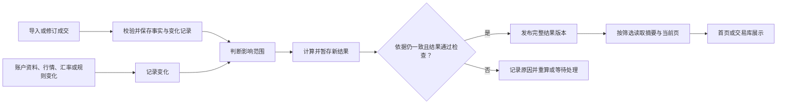

# 首页与交易库数据生命周期及模型设计（审查稿）

> 状态：候选设计，供业务和技术审查。本文细化[页面数据预处理方案](page-read-preparation.candidate.md)，不代表产品已经实现或性能已经达标。财务、行情柱线（Bars）、重复导入和并发性能开发任务仍按原记录暂停；此处仅描述设计约束。

## 1. 先看结论

**建议把交易事实保存好，在数据发生变化时提前计算并保存页面所需结果；用户打开页面时，只读取当前适用的结果。** 首页和交易库共享业务计算结果，分别读取自己的摘要、列表和详情，避免每个组件重复搬运和计算完整历史。

| 环节 | 要做的事 | 用户能感知的结果 |
| --- | --- | --- |
| 写入 | 保存确认后的成交等原始事实，并记录哪些数据发生变化 | 导入是否成功有明确回执 |
| 更新 | 找到受变化影响的范围，安排计算 | 新数据不会因为被遗漏而一直不更新 |
| 计算 | 按统一业务规则准备持仓、交易回合及所需摘要 | 不同页面使用相互一致的业务结果 |
| 发布 | 完整检查后，将新结果切换为可读取版本 | 页面不会混用一半新、一半旧的数据 |
| 读取 | 根据筛选条件取摘要和当前页，详情单独读取 | 不必为看一页列表下载全部历史 |

**验收目标仍是本地数据齐备、服务已启动时，首页和交易库各自完整首屏在 1 秒内展示。** 浏览器冷、热访问、服务重启后首读，以及导入或修订后的首次打开，都要分别验证；进程启动和外部行情、汇率补齐单独计时。异步更新不自动满足这个目标：更新未完成时的等待和页面真实状态必须计入对应场景，并另外记录从变化发生到结果可用的时间。

**目前只能说明方向值得继续验证，不能宣布整页达标。** 早期实验中，启动接口和首页来源接口各自返回约 34 MB；预先准备的精简数据读取很快，但未包含完整财务、曲线和浏览器渲染。另一次组合实验的分步读数可供参考，但总报告写出失败，不能当作完整端到端验收。[实验与限制](../../.scratch/page-reading-mvp-wayfinder/homepage-precomputed-read-analysis-2026-10-29.md)、[组合实验记录](../../.scratch/combined-read-experiment/reviews/measurement-06/REAL-RUN-COORDINATOR-20261029.md)。

## 2. 先认识几个名称

**原始事实、计算结果和缓存是不同的东西。** 事实回答“发生了什么”，结果回答“按规则算出了什么”，缓存只是为了更快取到结果。

| 名称 | 通俗解释 | 例子 |
| --- | --- | --- |
| 成交事实 | 已确认保存的原始交易记录 | 某账户在某日买入 100 股 |
| 计算依据 | 计算时使用的事实、规则和其他必要资料 | 成交、账户、市场、汇率及规则版本 |
| 计算结果 | 由事实和依据推导出来、可重新生成的数据 | 持仓数量、交易回合 |
| 页面读取模型 | 根据页面需要整理的结果，持久保存供读取 | 首页指标、持仓列表；交易库摘要、回合列表 |
| 版本 | 一组数据或结果的变化标记，用于判断依据是否一致 | 某次更新后产生的新结果版本 |
| 发布 | 将一组完整、通过检查的结果设为页面可读取的版本 | 新计算完成后切换到新版本 |
| 缓存 | 可丢弃的加速副本；失效后从已保存的结果重新读取 | 常用筛选条件的查询结果 |
| 待更新 | 原始数据已变化，对应新结果尚未完成 | 刚导入成交后后台仍在计算 |
| 数据不可用 | 计算所需信息缺失、冲突或处理失败 | 市场未知、汇率缺失、计算报错 |

## 3. 一条数据怎样走完整个旅程

**先确认和保存事实，再准备结果，最后让页面读取已经发布的版本。** 下图中的每一步均为建议职责，不表示当前代码已具备这些机制。

**保存成功和页面更新完成是两个不同状态。** 例如，一笔成交已入库，但新的持仓还在计算，应如实提示“已保存，数据更新中”；不能把旧结果当成最新结果，也不能将错误或未知显示为零。最终状态展示方式仍需产品审查。

## 4. 各模块分别负责什么

**每项业务规则只由明确的领域职责负责，页面负责表达而非重复计算。** 模块是责任边界，不要求一个模块必然对应一个类或文件。

| 模块 | 输入与职责 | 交给下一环节 | 失败时 |
| --- | --- | --- | --- |
| 成交提交 | 接收已确认的导入或修订；校验来源、字段和重复；保存事实 | 提交回执、事实变化记录 | 不提交部分事实，返回明确原因 |
| 资料管理 | 保存账户、证券资料及其他允许变更的计算依据 | 资料变化记录 | 不把未成功保存的资料当新依据 |
| 更新协调 | 接收变化，确定影响范围并保存待办 | 可恢复的更新任务 | 留下失败原因，支持恢复 |
| 业务计算 | 按既有业务规则计算受影响结果 | 带依据版本的待发布结果 | 不发布不完整或错误结果 |
| 结果发布 | 检查结果与依据，将完整版本切换为可读取版本 | 已发布版本及状态 | 保留原可读版本并标记其状态 |
| 页面读取 | 根据页面条件查询已发布结果 | 摘要、当前页、详情及数据状态 | 返回可区分的错误或不可用状态 |
| 状态与诊断 | 记录进度、耗时、缺失项和错误 | 展示状态及排查线索 | 避免将异常伪装为空数据；不记录敏感交易明细或文件内容 |

**领域计算的边界以已有业务规则为准。** 缺失市场、交易性质、行情或汇率时，不能凭空猜测；月结单等来源材料是否可作为辅助证据，应按已有来源规则处理，不能因本方案而变成所有成交展示的新增必需条件。具体财务公式和行情柱线计算不在本稿重新设计。

## 5. 数据模型：保存哪些对象

**原始事实和衍生结果分开保存；每份结果都能追溯其依据。** 下表是逻辑对象，不是已经存在的数据库表，也不预先决定物理表名和字段类型。

| 对象 | 主要内容 | 用途及关系 |
| --- | --- | --- |
| 成交事实 | 成交标识、账户、证券、市场、交易时间、方向、数量、价格、来源及已知状态 | 业务事实的来源；不得用计算结果覆盖 |
| 计算依据版本 | 涉及的成交、账户与证券资料、行情、汇率及规则的版本或有效范围 | 说明某份结果依据什么计算；只有实际依赖才纳入 |
| 变化记录 | 变化标识、类型、涉及账户与证券、时间范围、旧／新版本、原因 | 告诉更新协调模块哪里可能受影响 |
| 更新任务 | 任务标识、关联变化、影响范围、最早受影响时间、状态、失败原因 | 持久记录待处理工作，重启后可恢复 |
| 业务计算结果 | 持仓、回合及其他共享结果；各值的可用状态、有效时间和依据版本 | 首页和交易库共享；缺失值与零值分开 |
| 结果版本 | 版本标识、依据版本、规则与结构版本、计算和检查状态 | 将一批可互相搭配的结果关联起来 |
| 发布指针 | 数据范围、当前可读版本、更新时间及状态 | 页面先找到可用版本，再读取该版本的内容 |
| 页面摘要与列表项 | 已发布版本下的页面指标、列表所需字段及排序信息 | 摘要针对完整筛选范围；列表只返回当前页 |
| 页面查询条件 | 范围、账户、市场、日期、搜索、排序、页码或游标 | 决定读取什么，须与摘要和列表保持一致 |
| 加速缓存 | 规范化查询条件、相关版本和结果副本 | 可失效、可重建；不能充当唯一事实来源 |

展开：对象之间的约束与技术细节

- 一个已接受的事实变化可影响多个账户、证券或时间段；一项更新任务可合并多个变化，但不能遗漏任何影响范围。
- 一份计算结果属于一个结果版本，并记录实际使用的依据版本；页面的摘要、列表和详情需要使用业务上兼容的已发布版本。
- 按金额汇总时，必须保留币种、时间与有效性，不能将不可相加的数值直接相加；未知数据不能转成零。具体财务计算继续遵守已有已确认规则。
- 查询条件应明确持仓时点与历史区间的含义。当前持仓不应因只查看一段历史成交就被错误地当成该区间内的净成交。
- 缓存标识包含规范化后的查询条件及相关结果版本；只按实际需要缓存，不预先生成账户、市场和日期所有组合。
- 是否采用一个全局发布版本或按业务范围发布，以及具体字段、索引和保留期限，须在实现设计和实验中确定；不可因拆分而使页面展示互不兼容的结果。

## 6. 写入：先确保事实和变化不会脱节

**一次有效提交应同时保存成交事实和“需要更新”的记录。** 在这些对象位于同一个数据库时，建议由同一数据库事务提交，保证两者一起成功或一起失败；若不同来源不在同一事务内，需要另行设计可靠交接，不能假定天然原子。

1. 接收文件或修订请求，检查身份、字段、来源及重复情况。
2. 按用户提出的源头拦截要求，候选方案是：同一文件内容哈希命中已导入文件时，提示重复并阻止再次导入，不新增成交或安排无意义的更新。文件哈希只判断整个文件是否相同；同一文件内不同成交、不同文件之间的成交重复或冲突仍须分别检查，不能将文件指纹作为每笔成交的身份。具体实现和验收仍受重复导入任务的暂停状态约束。
3. 对允许保存的变化，在同一事务中写入事实、必要的来源与审计信息、版本变化及更新记录。
4. 事务成功后返回保存回执；页面更新状态单独报告。校验或提交失败时，不报告保存成功，也不产生部分业务事实。

**原始记录始终是可追溯的依据，不能为了加快页面直接修改历史事实。** 已有数据库模块的业务提交边界见[数据库模块设计](database-module-design.candidate.md)；本稿不授权迁移或改动现有共享业务数据库。

## 7. 更新：只重算受影响的内容，但不能漏算

**更新范围由变化的业务影响决定，不是简单地只改一行。** 特别是历史成交会影响之后的持仓和回合，因此需要从最早受影响的位置向后检查。

| 变化 | 可能需要更新 | 应特别注意 |
| --- | --- | --- |
| 新增、修订或撤销成交 | 对应账户、证券的持仓、回合和相关摘要 | 历史变化可能影响之后的结果；必要时从可靠起点重算 |
| 账户、证券名称或归属变化 | 受影响的展示资料及筛选结果 | 区分仅展示变化与会改变业务归属的变化 |
| 行情或汇率变化 | 依赖这些资料的估值、换算和相关摘要 | 保留适用时点、币种和缺失状态，不影响无关结果 |
| 业务规则或结果结构变化 | 受影响规则计算的结果 | 需要重新生成时，不能继续标记旧结果为最新 |
| 复盘内容变化 | 对应复盘内容及其必要摘要 | 不应因此重算无关财务内容 |

**更新任务应可恢复，并允许合并工作。** 合并时保留最早受影响时间和全部受影响对象；找不到可靠的历史起点时，扩大重算范围或标记不可用，不得静默沿用错误结果。更新失败应记录原因，服务重启后仍能发现未完成任务。

**安排在后台不等于允许页面长期展示旧数据。** 是否同步完成关键结果、后台增量计算，或采用其他组合，需要通过首次打开和导入后首读的完整验收决定；在待更新期间必须明确提示数据状态，不能把旧数字标为最新。

## 8. 计算与发布：先算完整，再整体切换

**计算过程使用一组明确的依据，结果完整后才能成为当前版本。** 建议采用以下顺序：

1. 确定受影响范围，并取得一致的事实与依据版本；计算过程不把网络获取行情或汇率塞进数据库写入事务。
2. 按现行业务规则计算，写入暂存结果，并保留使用的依据、缺失信息和计算状态。
3. 检查结果是否完整、范围是否正确、依赖是否满足；缺失可选信息与缺失必需信息要分别处理。
4. 发布前再次核对依据版本。如果计算期间依据已经改变，不能把旧依据算出的结果冒充最新；应重新安排相应计算。
5. 在可保证一致的范围内原子切换发布指针，使页面读取到一组兼容的结果。切换失败时，保留之前可读结果并如实显示其状态。

**异步处理即使发生在单机，也需要版本检查。** 用户导入、资料更新和后台计算可能先后交错；这里的版本约束是为了结果正确，并不等于开展已暂停的并发性能任务。数据库事务具体覆盖范围和跨范围发布方式仍需实现前确认。

## 9. 读取：摘要覆盖全部结果，列表只取一页

**页面发出筛选条件后，后端从已发布结果中读取与页面相符的数据，而不是返回完整历史让浏览器再计算。** 首页读取所需指标和持仓第一页；交易库读取筛选范围的摘要和回合第一页；用户进入详情时再读取详情。曲线等其他首屏内容也应有对应的读取模型，不能因为列表变小就忽略它们。

| 页面需要 | 后端返回原则 | 避免的问题 |
| --- | --- | --- |
| 摘要 | 在完整筛选范围内计算或读取摘要，并明确结果状态 | 把第一页小计误当成全部总计 |
| 列表 | 只返回当前页必要字段、排序依据和是否有下一页 | 把所有历史记录、详情和无关来源材料一次传出 |
| 详情 | 按用户选中的对象单独读取其详情和必要追溯信息 | 首页为可能用不到的详情付出传输成本 |
| 状态 | 区分最新、更新中、部分不可用、失败和确实没有数据 | 把超时、缺失或错误显示成空列表 |

**同一页面的摘要与列表必须对齐筛选范围及结果版本。** 同一次读取应固定兼容的版本；分页排序要有稳定的唯一兜底顺序。若翻页时原版本已不可用，提示刷新并重新读取，不悄悄混入新旧页。筛选结果确实为空，与“数据未知或获取失败”是不同状态。

展开：接口应交代哪些信息

建议接口合同明确请求的账户、市场、交易性质、时间范围、排序和分页条件；响应包含对应版本、摘要、列表项、分页信息、更新时间以及可用性状态。不同字段按其实际适用范围返回：不可用时说明原因，而不是返回伪造的零。具体路径、字段名称、页大小和分页方式须与现有接口方案及页面设计一起审定。

## 10. 用一只股票举例

**补录历史成交后，后面的持仓应随之重新计算，而首页读取的是更新完成的结果。** 假设某账户这只股票的初始持仓明确为零，且只有下表成交：

| 时间 | 操作 | 原先的持仓 |
| --- | --- | --- |
| 1 月 10 日 | 买入 100 股 | 100 股 |
| 1 月 20 日 | 卖出 40 股 | 60 股 |

随后补录 1 月 15 日买入 10 股：系统保存这笔事实及变化记录，从受影响时间重新计算后续持仓，得到 1 月 20 日之后持有 70 股。计算完成并发布后，首页读取 70 股；在更新期间，页面应提示更新状态，不能把旧的 60 股声称为最新。此例只说明数量传递，不推断成本、盈亏或汇率。

## 11. 遇到问题时怎样表现

**错误和缺失要有独立状态；保存过的数据、上次结果和最新结果不能混为一谈。**

| 情况 | 应有行为 |
| --- | --- |
| 文件完全重复 | 提示重复并阻止再次导入，不产生新增成交 |
| 保存失败 | 明确失败，事实与更新记录均不产生部分提交 |
| 保存成功、计算尚未完成 | 明确已保存及更新中；不得把旧结果标为最新 |
| 计算失败或依据变化 | 记录原因并保留可恢复任务；不发布错误结果 |
| 缺少市场、行情或汇率 | 按字段实际依赖标记未知或不可用；可用部分仍按规则展示 |
| 没有历史数据 | 确认查询成功且范围内确实为空后，展示空状态 |
| 缓存丢失 | 从持久结果恢复；若结果不可用则明确提示并安排处理 |
| 服务重启 | 已保存事实和未完成更新可恢复；首读表现单独验收 |
| 结果损坏或版本不匹配 | 不发布或拒绝错误结果，记录原因并安排重建 |

## 12. 如何验证方案可用

**先证明数字正确、状态真实，再证明完整页面快。** 测量必须使用隔离数据库副本，不修改共享业务数据库；保留失败记录与实际测量条件。

| 验证内容 | 核心案例与通过要求 |
| --- | --- |
| 结果正确 | 用相同事实比较更新结果和完整重算；覆盖新增、修订、撤销、补录历史、缺失依据和筛选；数量、金额、时间与状态均符合既有规则 |
| 写入可靠 | 同文件重复、字段错误和提交中断不得产生重复或部分成交；保存回执与实际状态一致 |
| 更新可靠 | 多个变化合并不丢范围；重启或失败后能恢复；旧依据不能覆盖新结果 |
| 查询一致 | 不同筛选下，摘要对应完整范围、分页无遗漏或重复、详情与列表版本兼容；真空数据与失败可区分 |
| 页面性能 | 桌面端首页和交易库分别计时，从打开到完整、正确首屏；分别覆盖冷／热、重启后首读、导入或修订后首读，均不超过 1 秒 |
| 过程诊断 | 分别记录来源准备、计算、发布、接口响应量与耗时、浏览器加载及渲染；记录变化到数据可用的时间，识别瓶颈 |

**性能验收不能只看接口或实验读取时间。** 完整首屏包含页面设计要求的指标、列表、曲线和其他必要区域；缺失的财务或行情能力不得用占位数据冒充通过。实验数据量、机器环境、筛选范围、数据状态与每次结果都应留档。

## 13. 需要继续审查和决定的事项

**以下细节尚未通过完整产品实验确定，不应当作已实现或已经批准的接口合同。**

1. 哪些首屏数据必须在导入提交后同步准备，哪些可以后台更新，同时如何满足导入后首次打开的 1 秒目标。
2. 结果版本按什么业务范围发布，如何保证摘要、列表、曲线和详情互相兼容。
3. 各领域的具体计算依赖、缺失资料处理、历史变动的重算起点及规则版本如何定义。
4. 页面接口字段、分页方式、结果保留期限，以及首次建立结果和升级后的恢复策略。
5. 不同数据状态在页面怎样告知用户，以及外部行情／汇率补齐期间的体验。

本稿用于审查设计。实现安排、财务与 Bars 的暂停状态，以及正式数据库的变更授权，仍以用户后续决定为准。
