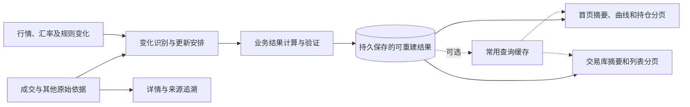

# 首页与交易库数据预处理方案（审查稿）

**状态：候选设计，供业务与技术人员审阅；尚未批准正式实施，也未证明完整页面达到 1 秒。**

本文在[既有读取架构审查稿](page-reading-architecture.candidate.md)和[独立审查意见](page-reading-architecture-review-2026-10-29.md)的基础上，吸收预处理实验与公开实践，重点回答：页面需要的数据怎样提前准备、怎样共享、数据变化时怎样更新，以及怎样验证最终结果。现状与目标分别记录；本稿不改变已有业务规则。

**推荐方向：先在隔离副本中验证“可重建的业务结果 + 持久保存 + 按变化更新 + 页面摘要与分页”，通过完整正确性和性能验证后，再决定最终实现方式。** 不要求拆分服务或引入新基础设施。是否同步更新、异步更新或两者结合，仍由实验结果决定。

---

## 1. 先看结论：用户需要什么

用户打开首页或交易库时，希望看到真实、完整且与所选范围一致的信息。根据已确认的验收边界：在本地所需数据齐备、服务已启动时，**首页和交易库分别在 1 秒内展示完整首屏**；浏览器冷、热访问，服务重启后首次读取，以及导入或修订后的首次打开都要分别验证。进程启动和外部行情、汇率补齐另外计时。

首页的指标、曲线、持仓合计与持仓列表必须遵循既有页面规范；交易库的摘要、列表和操作也要完整。速度、业务正确性与页面功能是独立的验收条件，任何一项未验证都不能声称整体通过。

### 1.1 为什么现在需要改进

目前首页启动时先读取一整套来源数据，随后又读取首页来源、汇率和证券行情，再计算财务结果与持仓。指标卡、曲线和持仓可以共享结果，但当前它们依赖的是体积很大的来源包：先读取和整理完整范围，再在浏览器里筛选及分页。

在一次隔离环境的独立 HTTP 测试中，启动接口和首页来源接口分别返回 34,315,599 字节。另一次真实历史副本实验表明，若依旧整理和校验完整来源，单独缩小返回结果仍较慢；提前准备精简事实后，实验读取明显更快。实验不包含完整首页所需的财务、曲线和浏览器，不能外推成整页达标。[详细证据](../../.scratch/page-reading-mvp-wayfinder/homepage-precomputed-read-analysis-2026-10-29.md)

### 1.2 方案要解决的事

|用户关心的问题|设计要达到的结果|
|---|---|
|为什么打开页面很慢？|减少每次打开时重复整理、校验和传输完整原始材料的工作。|
|多个区域是否各算各的？|把可共享的业务结果集中准备，首页和交易库按各自需要读取；同一指标的业务规则由唯一职责维护。|
|只看到一页，汇总会不会少算？|汇总依据完整筛选范围；列表仅传当前页。搜索、排序、计数均作用于适用的完整范围。|
|导入之后是不是最新？|识别变更影响并更新相应结果；页面知道当前结果的状态和依据，不能把旧结果冒充最新。|
|数据缺少时怎么办？|保留可确认的事实，将受影响结果标为未知并说明原因；错误不伪装成空记录或零。|
|需要核对原始成交怎么办？|原始记录、来源和追溯能力继续保留，详情按需读取，不必塞入每个首屏响应。|

### 1.3 本稿不做什么

本文是候选方案，不授权产品改造、数据库迁移或部署。财务 P1/F07、Bars、重复导入及并发性能优化仍按现有记录暂停；设计讨论、模拟数据和静态阅读不改变暂停状态或重置轮次。涉及这些任务的真实开发、回归或接线，需遵守原有恢复要求。隔离实验不得写共享业务数据库。

---

## 2. 先认识文中名称

|名称|通俗解释|使用时要注意|
|---|---|---|
|原始事实|已经保存的成交、账户、标的，以及业务规则需要的其他依据|它们是计算和追溯的依据，不能用预处理结果替代。|
|业务结果|按照既定规则计算出的回合、持仓、指标等|一个结果可能依赖多笔成交、历史前序、行情和汇率。|
|预处理结果|提前计算并保存、可以依据原始事实重建的业务结果|不是用户确认的原始成交；建立或重建也有成本。|
|页面摘要|满足当前筛选范围的总数和指标|必须基于完整范围，不能只汇总当前页。|
|页面结果|给首页、交易库、详情或导出的特定响应|首页和交易库可以共享业务结果，不必共享同一整包响应。|
|持久保存|结果保存在数据库中，进程重启后仍可读取|与只存在内存中的缓存不同。|
|缓存|为加快重复访问而保存的结果副本|会失效或过期；不能作为唯一事实依据。|
|更新任务|记录哪些预处理结果需要重新生成的工作|任务完成之前，系统要能识别结果可能不是最新。|
|结果版本|标识结果基于哪些来源和规则生成|成交、行情、汇率、复盘与规则可能各自变化。|
|完整首屏|设计要求首屏展示的真实数据和主要可操作控件均已就绪|骨架屏、空数据和“更新中”都不能代替最新完整首屏通过验收。|

---

## 3. 总体方案：把重复工作移到变化发生时

**核心思路：原始数据保存后，事先准备能被多个页面使用的业务结果；页面打开时按用途读取，不再默认运送完整原始材料。**

图表示职责，不表示要建立多个进程或数据库。一个本地服务与 SQLite 可以承载这些职责；具体表结构、计算粒度和执行时机需要通过实验确定。预处理不可跳过来源与业务规则的必要校验，只把校验放到更合适的环节。

### 3.1 一次普通访问

1. 页面提交市场、账户、交易性质、期间及必要的筛选和排序。
2. 页面读取模块查找符合范围、规则和来源版本的已准备结果。
3. 返回该范围的摘要、页面要求的曲线数据和列表当前页；附带结果状态及生成依据。
4. 用户查看单项详情、来源或导出时，再读取相应详情或完整筛选结果。

首页首屏与交易库首屏各自需要的内容应依据视觉及行为规范逐项映射，不能假设“一个摘要接口加一个列表接口”已经覆盖所有区块。组合请求还是拆分请求，由性能实验决定。

### 3.2 一次数据变化

1. 用户确认导入或修订后，系统按现有写入规则保存原始事实，并可靠记录需要更新的范围。
2. 更新模块识别受影响的结果；必要时向后重算受影响的历史链，而非只更新变化当天。
3. 计算并核对新的结果，完整就绪后发布；页面从同一可解释版本读取摘要和列表。
4. 更新失败、来源不足或结果尚未准备完成时，明确显示状态并保留原因；不能显示错误的“最新结果”。

**例子：**一笔去年买入成交被补录后，今年的持仓数量、成本和之后的回合可能改变。系统需要依据既有业务规则确定影响范围，不能仅把去年当天的汇总加一笔。精确影响范围必须用实验和财务规则对账确定。

---

## 4. 分层与模块职责

**各模块提供小而明确的使用方式，把复杂的规则留在负责的模块内部。** 表中名称是职责，不要求一一对应成新类、新服务或新数据库。

|模块|负责什么|向调用方提供什么|不负责什么|
|---|---|---|---|
|事实与依据读取|一致读取成交、账户、标的、必要辅助事实及其状态|按约定范围可追溯的事实及版本|不把“读到记录”解释成“所有指标都可计算”。|
|业务结果计算|依据既有领域规则生成回合、持仓及指标，保留依据与可用性|可核对的业务结果和未知原因|不决定页面排版，不写改原始事实。|
|结果准备与保存|组织可重建结果的初建、受影响范围重建及存储|可读取的结果版本和准备状态|不另创财务公式，不把历史旧结果标为最新。|
|更新协调|记录变化、识别受影响范围、安排计算、核对来源版本并发布|更新状态、失败原因、可恢复的待处理工作|不保证所有变更都只影响单条记录或单天。|
|页面读取|解析范围，读取对应摘要、曲线和分页结果|按页面用途组织的结果、完整范围总数、状态与版本|不重复定义财务口径；不默认附带完整追溯材料。|
|详情、追溯与导出|按需读取完整详情、来源、诊断及完整筛选结果|有依据的详情或导出结果|不限制导出只能包含当前页。|
|运行诊断|记录阶段耗时、数据量、状态和异常|可复现的分段证据|不输出原始交易文件或敏感明细。|

### 4.1 与既有财务规则的关系

本方案复用现有已确认的事实、回合、持仓、资格和金额规则；需要修改、补充或判定这些规则时，须在相关任务获恢复后单独处理。缺少历史成本、行情或汇率时，交易事实与金额的可用性应分别判断。未知交易性质不能为了性能而默认为实盘。金额、组合收益率、跨币种结果和日期归属不能假定可简单相加或按同一个日期筛选。

既有[独立审查](page-reading-architecture-review-2026-10-29.md)指出：交易库实盘成交列表、已平仓统计及模拟练习的日期归属可能不同。首页期间表现与当前持仓时点也可能不同；实现前须按原有规范逐项核对。

---

## 5. 建议保存哪些对象

**先保存可复用的业务事实和必要汇总，再根据真实页面需求选择是否缓存最终响应。** 不预先生成每个账户、日期、搜索词和排序的所有组合：组合会不断增加，更新和存储成本可能失控。

|对象|内容示例|主要消费者|需要说明的限制|
|---|---|---|---|
|来源版本与依据|成交变化、规则版本、行情及汇率状态等标识|更新协调、结果读取与诊断|不同来源独立变化；版本并不自动证明原始材料齐备。|
|交易与回合结果|按业务规则形成、可追溯的事实或回合信息|首页、交易库、详情|受历史补录及相关规则影响；日期与身份必须遵循业务定义。|
|持仓与必要时间序列|受账户、标的、时间及规则约束的持仓和相关结果|首页持仓、曲线、详情|计算粒度尚待实验；不能保证所有指标都能直接相加。|
|摘要或中间汇总|必要范围下的总数或可组合统计|首页与交易库摘要|完整范围统计；只对数学和业务规则允许组合的指标进行组合。|
|准备与发布状态|源版本、结果版本、生成时间、处理状态和失败原因|更新协调、页面与运维|需要持久记录，重启后能识别未完成的工作。|
|可选热点缓存|某个筛选范围、排序和版本下的页面结果|重复访问|带范围及版本；失效或缺失时不影响原始数据与结果可重建性。|

预处理与缓存的存储位置仍需评估。同库保存有利于用事务保护相关数据；若分文件保存，SQLite 的 WAL 不保证多个数据库作为整体原子提交，需设计单独的版本校验、发布和恢复。[SQLite WAL 官方文档](https://www.sqlite.org/wal.html)

---

## 6. 数据更新、版本与故障处理

**更新机制不仅要快，还要能说明“哪份数据已经完成、哪些内容仍在更新”。** 以下是候选契约，具体表、字段和机制需经实验验证。

### 6.1 哪些变化需要检查

|变化|可能影响|设计处理|
|---|---|---|
|新增、修订、撤销或回补成交|相关回合、持仓、期间统计及列表|按实际规则确定受影响的账户、标的和后续时间范围。|
|账户、标的信息变更|名称、搜索、展示及相关范围|更新受影响的目录和展示结果；不能只检查成交版本。|
|行情或覆盖状态变化|市值、浮动金额、曲线和可能的排序|按行情对应范围与时点更新；缺失和过期状态分别表达。|
|汇率变化|跨币种汇总与相关金额|只对依赖该汇率及日期的结果更新，具体范围须验证。|
|计算规则或口径变化|使用该规则生成的结果|以规则版本标识旧结果，决定重建范围和切换策略。|
|复盘状态变化|交易库相关状态和筛选|更新相关复盘展示或查询；不改变成交事实。|

上表是影响识别清单，不代表已经完成各项接线。外部行情/汇率补齐的等待单独计时，但已经齐备的本地数据仍需满足完整首屏要求。

### 6.2 更新与发布

建议原始数据变化与待处理记录在同一数据库事务内可靠登记；计算可以在事务外完成，完成后核对依赖版本，确认仍适用再将结果及发布标记作为整体提交。若期间依据已变化，则丢弃或重新安排过期结果。计算中断后应保留可发现的待处理记录，并提供恢复或重建路径。

系统至少能区分：**可用且已对应当前依据、正在更新、依据不足、更新失败、尚未准备**。是否允许用户查看明确标注的上一版结果，需要结合现有页面规范决定；无论如何，上一版不能被称为最新，也不能计入最新完整首屏的 1 秒通过结果。

单次页面展示中的摘要、曲线和列表需要能解释其各自依赖的来源版本和时点。一个总版本不应掩盖行情、汇率、成交和复盘各自的更新；哪些区块必须严格同批发布、哪些可各自明确时点，留待逐项业务合同与实验确定。

### 6.3 分页与范围变化

筛选、搜索、排序和总数作用于完整适用范围，然后才取出当前页。排序必须有稳定的唯一末级依据。翻页时若结果版本或影响排序的数据发生变化，应明确提示刷新或采用可验证的稳定快照；不能悄悄混用导致重复或漏行。

用户快速切换市场或账户时，较早请求晚返回也不能覆盖当前选择。列表里的局部搜索和页头全局标的搜索分别遵循各自的设计范围。

---

## 7. 面向页面的读取约定

**页面应该按用途提问，服务端负责解释范围和组织结果。** 下面定义的是能力，不是现有或已批准的 URL，也不是完整字段合同。

|读取能力|请求至少需要表达|结果至少需要表达|
|---|---|---|
|首页首屏|市场、账户、性质、期间及展示规则|筛选选项、完整范围指标、要求的曲线、持仓合计和第一页、各项状态与依据时点。|
|首页持仓后续页|生效范围、局部搜索、排序、页大小和分页位置|当前页、完整范围总数、分页状态，以及相同范围和版本的标识。|
|交易库首屏及后续页|市场、账户、性质、列表类型、日期、搜索、排序及分页|与当前视图相符的摘要、当前页、总数、状态与版本；日期规则按视图分别解释。|
|详情与追溯|稳定身份及必要范围|可展示事实、计算依据、材料引用和缺失原因；大型材料按需读取。|
|导出|完整生效筛选、排序和数据版本|完整筛选结果或明确的导出任务及失败状态。|

**示例：**某范围有 20 条持仓、15 个不同标的，每页 8 条。第一页返回 8 条，摘要分别显示 20 条持仓和 15 个标的；第三页返回剩余 4 条。两种数量不能混为一谈。缺少某标的行情时，能确认的名称和数量继续展示，受影响的金额依现有规则显示未知。

专业实施前仍需按页面逐项补齐字段、精度、币种、日期、身份、状态、错误、排序、导出和兼容合同；这里的清单不能直接当作已验收的接口规范。

---

## 8. 与其他方案相比，为什么优先实验它

|方案|好处|主要问题|当前判断|
|---|---|---|---|
|继续优化整包读取|改动可能较小|页面仍依赖大包和重复整理；能否 1 秒不明|保留为基线与局部优化。|
|只改摘要接口与分页|减少传输|如果后台每次仍处理完整来源，等待可能仍很长|必要但不足；精简响应实验仍约 7.18 秒。|
|持久准备可复用结果，变化时更新|有机会同时减少重复计算和传输，重启后可复用|要处理初建成本、数据变化、正确性和恢复|**优先验证的候选**，尚非最终决定。|
|提前计算所有筛选组合|命中时读取直接|组合多、空间和更新成本难控制|暂不优先；按真实范围与实验数据再决定。|

已有实验中，完整来源路线中位数约 8.47 秒；精简响应路线约 7.18 秒；已准备的**非财务**事实读取约 0.68 毫秒。均为进程内实验，未包含完整首页、HTTP 或浏览器；首次准备单次约 7.31 秒。因此，它支持继续实验，不能保证正式结果。[原始实验报告](../../.scratch/real-data-fact-experiment/RESULTS-RUN-02.md)

---

## 9. 安全验证与决策顺序

**先证明正确和可恢复，再用真实页面证明速度；实验结果达标后才决定是否正式开发。**

|阶段|验证内容|通过的证据|当前状态|
|---|---|---|---|
|A. 页面与规则清单|把首页和交易库的各区域、范围、数据来源、缺失状态逐项映射到规范|可核对清单；未实现和暂停项明确标记|待完成。|
|B. 隔离结果实验|在独立副本准备允许范围内的代表性结果，对照原有规则；覆盖筛选、跨页、空值和合成历史补录，不运行已暂停的真实导入或财务任务|结果逐项对账、数据版本与原始记录核对|局部非财务实验通过；完整范围未验证。|
|C. 更新与重启|验证允许范围内的合成更新影响、初建、失败恢复、重启读取及与全量重算的一致性；真实业务路径仍受暂停限制|每场景的来源、结果、耗时和状态；使用合成变化时明确标注|已有有限合成变化实验，真实业务更新和完整恢复未验证。|
|D. 页面真实链路|桌面浏览器验证首页、交易库完整首屏及主要操作|环境、分阶段时间、响应字节、实际数据核对和截图|尚未通过；完整页面 1 秒未验证。若依赖暂停任务，须恢复授权后才可执行对应路径。|
|E. 路线决策与切换|比较准确性、速度、准备等待、空间、维护与回退成本|正式审阅结论和明确的实施授权|待前述证据完成。|

完整方案最终至少需要验证：范围内确实无数据；有成交但缺少计算依据；缺行情或汇率；多账户同一证券；20 条持仓跨 3 页；补录历史成交；修订后更新失败；页面读取期间来源版本变化；进程重启后首次读取；切换筛选时旧响应晚到。这里列的是**最终验收需求，不是本轮全部可执行的授权**。

- 当前可规划的实验仅限不触及暂停任务的合成、非财务数据，例如分页、范围变化和合成历史事实更新；逐项核实边界后执行。
- 真实导入、暂停的财务及 Bars 开发／回归，以及依赖它们的完整浏览器链路，保持 **未验证**；涉及暂停范围须先取得用户单独恢复授权。不能用同名的模拟测试替代真实路径验收，行情与汇率相关场景也须先核对具体暂停边界。

### 9.1 计时口径

记录从页面发起到真实、最新、完整首屏可用的整段时间，并附接口、结果读取、准备与浏览器处理的分段数据。冷访问、热访问、服务重启后首次读取、导入/修订后首次打开分别测量；另记录原始写入、变更后结果准备和等待时间。不能把独立样本的阶段时间相加成一次真实首屏，也不能推迟确认、提前结束计时或用旧数据改变约定边界。

实验要报告输入规模、数据及代码版本、环境、样本数量、响应字节、时间分布与失败；样本过少不能推断稳定保证。涉及写入的浏览器操作必须使用显式指定的隔离数据库，保留原始证据，不触及共享业务库。

---

## 10. 待审阅和待决策事项

**下列事项会影响最终方案或验收，应在证据齐备后逐项决定；本文示例不代表已批准。**

1. 每个首页、交易库区块的权威规则、字段和范围分别是什么？哪些业务结果可以安全共享？
2. 哪些结果应在写入确认前完成，哪些可以异步准备？导入完成和结果就绪的状态如何向用户准确表达？
3. 历史回补、汇率、行情、复盘和规则变化的最小正确重算范围是什么？初次准备、导入后的等待和存储成本是否可接受？
4. 摘要、曲线和列表的发布一致性应怎样界定？分页遇版本变化时采用刷新还是可验证的快照？
5. 如果完整业务结果没有通过 1 秒，应继续优化哪一环；哪些体验或范围变化需要重新由用户决定？
6. 满足条件后，新旧读取路径如何对账、切换、回退，并保持详情、追溯和导出可用？

这些问题应与[一秒优化实验决策地图](../../.scratch/page-reading-mvp-wayfinder/issues/00-map.md)和[读取架构决策地图](../../.scratch/page-reading-architecture-wayfinder/issues/00-map.md)共同跟踪，本文不关闭既有问题。

---

## 11. 公开实践及适用边界

- [Apache Superset：仪表盘性能](https://superset.apache.org/admin-docs/configuration/dashboard-performance/)提出对多个图表复用的昂贵聚合提前生成结果，配合缓存和按需加载。借鉴其思路，不表示需要引入 Superset 或分布式组件。
- [Metabase：查询结果缓存](https://www.metabase.com/docs/latest/configuring-metabase/caching)说明缓存失效后的首次访问可能等待重新查询，并提供自动刷新机制。适用于理解缓存失效和预热，不能单独证明首次读取速度。
- [微软：物化视图模式](https://learn.microsoft.com/en-us/azure/architecture/patterns/materialized-view)描述按读取需求准备可重建的派生视图，并指出更新与一致性需要权衡。这是架构模式，不意味着 SQLite 自带对应的自动物化视图。
- [微软：Cache-Aside 模式](https://learn.microsoft.com/en-us/azure/architecture/patterns/cache-aside)说明按需缓存会遇到缓存缺失以及源数据和缓存不一致的问题；因此不能只靠内存缓存覆盖重启和数据变更后的首次访问。
- [SQLite：事务隔离](https://www.sqlite.org/isolation.html)与 [WAL](https://www.sqlite.org/wal.html)说明同库事务和读取快照的机制及跨数据库限制；应用仍需设计业务版本、发布、失败恢复和跨请求一致性。

更多一手资料及其适用边界见[公开实践研究记录](../../.scratch/page-reading-mvp-wayfinder/dashboard-industry-research-2026-10-29.md)。本稿是阅读和决策材料；公开实践不替代本项目的业务规则、真实数据对账或桌面端验收。
