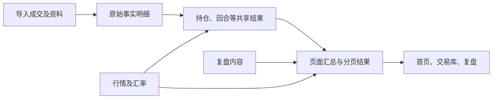
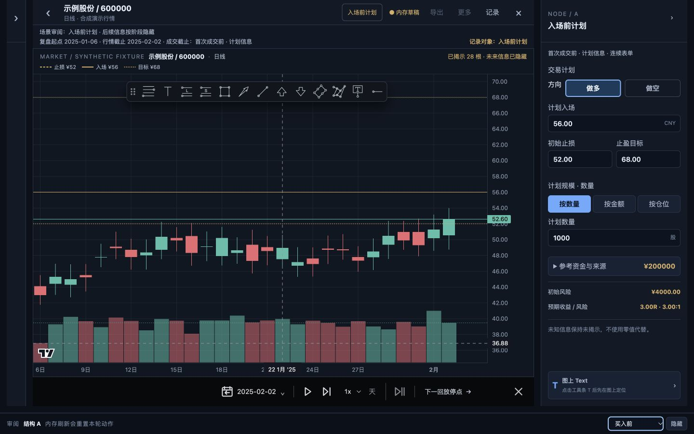

# 从页面到数据：模型与读写设计（审查稿）

> 本文是候选设计，不代表已经实施、通过性能验收或获批数据库迁移。目标是让业务审核人员沿着“页面看到什么 → 需要哪些信息 → 信息存在哪里 → 变化时如何保持正确”逐层审查。财务、行情柱线、重复导入及并发性能开发仍依既有记录暂停。

## 1. 一页看懂方案

**页面展示需要的数据应先从真实记录出发，再生成可复用的结果，最后按页面需要读取。** 一笔成交属于原始明细；由多笔成交计算出的持仓和交易回合属于中间结果；首页卡片、图表和列表则按相同筛选范围读取汇总及当前页。复盘笔记属于用户保存的内容，应独立保存，不能因为重算被覆盖。

**这是设计选择，不是已证明的性能结果。** 在本地所需数据齐备且服务已启动时，首页和交易库完整首屏均以 1 秒为目标；浏览器冷、热、重启后首读及导入或修订后的首次打开须分别实测。完整产品一秒目标为 **NOT VERIFIED（未验证）**：真实规模 measurement-06 整次 **FAIL（失败）**，measurement-07 只验证合成记录收尾，真实规模仍未验证；局部实验不能证明整页达标。详见[已有预处理方案](page-read-preparation.candidate.md)及[生命周期设计](page-read-data-lifecycle.candidate.md)。

## 2. 视觉依据与阅读方法

**先确认设计版本，再从画面推导数据。** 2026-11-04 重新核对了主线与复盘设计分支。图稿示例数据仅用于说明，不能当作真实数据或实现验收；复盘新方案仍待审阅。

| 页面 | 查看设计 | 依据说明 |
| --- | --- | --- |
| 首页及共享控件 | [首页 V2.5 视觉规范](../design-system/baselines/2026-10-22-homepage-v2.5/visual-spec.html) | 当前首页和全站共享规范 |
| 交易库 | [V2.0 视觉规范](</Users/zhoulin/Documents/TradeReview/docs/design-system/baselines/2026-10-26-trading-library-v2.0/visual-spec.html>)、[交易库业务规范](</Users/zhoulin/Documents/TradeReview/docs/design-system/trading-library-design-spec.md>) | 主线当前版本；V1.0 为历史版本 |
| 复盘 | [复盘工作区 V1.0 提案及状态](</Users/zhoulin/.codex/worktrees/80b0/TradeReview/docs/design-system/baselines/2026-10-22-review-workspace-v1.0/README.md>)、[完整工作区原型](</Users/zhoulin/.codex/worktrees/80b0/TradeReview/docs/design-system/baselines/2026-10-22-review-workspace-v1.0/prototypes/workspace-v0.1/index.html>) | 设计分支的较新提案与原型，待用户审阅；旧版 E01–E22 是历史需求线索，不能冒充新稿完整清单 |
| 导入 | [TradingView 导入功能规格](../specs/2026-09-07-tradingview-simulated-trade-import.md)、[来源与交互取证](../../.scratch/view-model-design-2026-10-31/replay-import-evidence.md) | 已有各来源功能规范；未找到统一批准的导入页视觉稿 |

图片的具体来源、版本状态和校验值见[参考图片来源](view-design-references/README.md)。完整设计规范目前位于不同本地工作区，迁移文档时应一并处理链接。

**字段不能只按“画面上是否显示”判断。** 搜索、排序、点击进入、显示空状态、回放时点及保存失败等都需要数据或状态；而纯布局样式一般不需要长期保存。

**首页逐表审查：**需要检查表的字段、层级、关系、索引和读取路径时，请参阅[首页数据库结构与读取设计](homepage-database-design.candidate.md)。该稿是候选设计，不代表已有物理表或性能已达标。

## 3. 数据分层和命名

**明细是依据，共享结果是计算产物，页面结果是为阅读整理的内容。** 缓存是可丢弃的副本，不是唯一真相。

| 层次 | 用户能理解的作用 | 保存原则 |
| --- | --- | --- |
| 原始明细 | 保存发生过的成交、来源和用户填写的复盘 | 可追溯，不因重新计算覆盖 |
| 外部资料 | 保存证券、行情和汇率及其适用时间、来源 | 缺失与过期必须能识别 |
| 共享计算结果 | 从明细得到持仓、回合和可共享的财务结果 | 可重算，关联输入与规则版本 |
| 页面读取结果 | 首页、交易库按范围快速取摘要、列表与趋势 | 兼顾筛选、分页和同一版本 |
| 工作及状态 | 记录变化、待处理工作、版本与发布状态 | 中断后可恢复，不能丢变更 |

本稿的表名和字段是便于讨论的逻辑名称，并非现有数据库现状或已经决定的 SQL。[现状结构附录](database-review/schema-reference.md)是较早快照，当前代码已有后续迁移；不能将其中表数量视为当前实际结构，需结合本轮代码取证核对。

## 4. 从控件推导数据需求

**先从一个控件逐层推导，而不是先决定建表。** 例如，首页“当前持仓”显示名称、代码、持仓天数、数量、成本、最新价、市值和浮盈；用户还能搜索、排序、翻页及打开详情。因此系统至少需要证券身份、账户、成交与剩余数量、成本依据、价格时点、币种和可用状态，并能按全量筛选后排序再取一页。不能只存展示字符串，否则无法正确排序或追溯。

*这是 V2.5 正文引用的整页图；整页图只用于参考布局；图中侧栏“12”仍属未同步的旧徽章，交易库入口以[当前入口分镜](../design-system/baselines/2026-10-22-homepage-v2.5/source/images/journeys-library-entry.svg)和正文为准：无徽章、默认不进入待复盘队列。下图是正文已确认的持仓 C 方案，用于核对标题旁汇总及工具区。*

| 页面／区域 | 用户看到或操作什么 | 需求怎样推导 | 候选数据层 |
| --- | --- | --- | --- |
| 首页：市场、账户、搜索、附加筛选 | 选择市场/账户，搜索证券，切换未平仓及待复盘 | 需要身份、市场、账户、证券名称代码、仓位与复盘状态；筛选条件与旧结果须一致切换 | 资料、持仓和复盘状态 |
| 首页：期间指标与日曲线 | 净盈亏、已实现、浮盈变化、当前市值及日变化 | 期间与当前是不同时间截面；曲线每个时间点需要自己的估值、费用、汇率和缺失状态 | 成交、估值与按日共享结果 |
| 首页：当前持仓 | 名称、数量、成本、价格、持仓市值和浮盈；搜索、排序、分页 | 持仓按当前时点计算，排序对全量结果进行，当前页才返回对应行；同标的跨账户如何合并仍待确认 | 持仓结果、证券资料、行情；摘要和分页索引 |
| 首页：历史和贡献 | 平仓盈亏、回合数、胜率、费用、年度图表和市场/证券贡献 | 按平仓日期区分回合；胜率需盈利数和总数，不能平均各期胜率；贡献的已实现与浮盈变化需要可追溯 | 回合结果、时间分桶与贡献结果 |
| 交易库：范围与列表 | 实盘/模拟、市场、账户、日期、查询、交易或练习行 | 成交日期、平仓日期和练习日期用途不同；一份模拟文件对应一次练习，等价重复文件仍归原练习 | 成交事实、练习身份、回合和复盘状态 |
| 交易库：统计、分布、下钻 | 盈亏、胜率、回合数或练习数、分布及明细 | 实盘按主动平仓回合，模拟汇总按练习；金额与收益率各自判断可计算资格，下钻保留原筛选与分母 | 实盘回合、练习结果、统计分桶及可用状态 |
| 复盘：图表与过程 | 成交标记、回放节点、价格曲线、复盘内容和返回 | 需要回合/成交身份、行情时间、当前回放截止和用户记录；未来数据不得提前暴露 | 成交、行情、复盘事实及回放状态 |
| 导入：选择、预览、确认、结果 | 来源、识别字段、错误及导入结果 | 需要文件/批次身份、解析诊断、预览状态、成功或失败回执；重复文件和重复成交是不同问题 | 来源材料、导入批次、成交及审计 |

**逐控件对照供专业审核。** [页面控件与字段对照表](view-field-mapping.candidate.md)保留原 90 项调查索引，并修正已发现的 V2.0 业务口径；原编号按旧版整理，不能证明覆盖新版全部控件。单项映射不代表一项控件必建一张表。[首页与交易库原始取证](../../.scratch/view-model-design-2026-10-31/home-trades-evidence.md)另列图文差异和未决口径。

*以上两图是 V2.0 的 E 布局参考，主要用于看页面几何和层级；业务口径以正文和业务规范为准。下列 V2.0 正文分镜补充展示练习身份和内部配对的关系。*

*一份模拟文件是一项练习，其中可以有多笔成交及多份内部配对；这几个数字不能互相代替。*

*复盘图来自设计分支 2026-10-29 的 candidate-v37 原型截图，仍未完成整体验收，也未获最终批准；后续设计须结合[版本证据和未通过项](</Users/zhoulin/.codex/worktrees/80b0/TradeReview/.scratch/review-workspace-design-map/evidence/immersive-layout/revision-01/acceptance.md>)复核。*

**旧版复盘与导入的详细追溯**见[复盘 E01–E22 与导入控件取证](../../.scratch/view-model-design-2026-10-31/replay-import-evidence.md)；其中复盘画面与流程仅为历史依据，新版应结合上方工作区提案与原型审阅。复盘的行情可见截止与成交可见截止需分别保存；阶段语境变化本身不推进可见范围，须由明确节点或显式揭示动作控制。

**取舍示例：为什么不为每个页面单独保存一份完整历史？** 多份完整副本会重复计算，也可能因更新时间不同而显示不同数字；共享可追溯的回合和持仓结果，再针对页面准备摘要与分页字段，更利于一致性。代价是要设计更新范围、版本发布和恢复机制，这些必须通过实验验证。

## 5. 候选模型：明细、共享结果与页面汇总

**每张候选表先定义一行代表什么，再决定字段，才能避免把不同账户、不同时间或不同计算版本的数据混在一起。**

| 候选对象 | 一行代表什么；关键字段 | 主要使用方与保留原则 |
| --- | --- | --- |
| 账户 | 一个账户身份：账户 ID、来源映射、显示名称、状态 | 筛选与隔离；当前未发现通用账户主表，不以名称代替身份 |
| 证券 | 一个具有明确市场及交易所身份的证券：ID、代码、名称、币种 | 搜索及成交；市场未知不能猜测 |
| 导入批次 | 一次用户提交或服务端导入尝试：批次 ID、来源、状态、时间 | 导入结果和审计；批次不等于文件或成交 |
| 来源材料及版本 | 一个文件、图片或材料的一个版本：材料 ID、版本、指纹、解析版本 | 整文件识别和追溯；历史缺指纹不伪造 |
| 来源观察 | 来源材料中的一行或一项观察：材料版本、行位置、原始字段、解析结果与诊断 | 可关联零笔或多笔规范事实；辅助材料可不产生新成交 |
| 审核计划与提交回执 | 一次服务端审核计划、用户选择及对应的一次实际提交回执；各自独立 ID、版本与状态 | 预览数与实际提交数分开；保留请求 ID，结果未知时先查原回执 |
| 成交事实 | 一笔有稳定身份的成交：账户、证券、性质、时间及精度、方向、数量、价格、费用、币种、来源 | 不以文件指纹代替成交身份；保留真实重数和未知 |
| 成交修订与撤回 | 一次对某成交的修订或撤回：目标成交、变化、原因、时间、来源 | 保留历史和审计；派生结果可重新计算 |
| 行情 | 一种来源下一个证券、周期及时间点的价格记录：价格、时点、精度、版本、有效状态 | 估值和图表；已完成与未完成区分 |
| 汇率 | 一种来源下一个币种对、时点的汇率：方向、时点、值、版本、有效状态 | 换算必须保留原币、来源及适用时点 |
| 练习 | 一次模拟文件所代表的练习：练习 ID、来源版本、练习日期及来源、历史交易区间、导入时间、稳定编号、账户、一个或多个证券及运行身份 | 等价重复文件归原练习；同标的同日可以有多个不同练习；练习不等于账户 |
| 实盘回合与成交配对 | 一次主动平仓产生一个实盘回合；独立配对分配记录对应开仓、平仓、数量及顺序 | 一次平仓可有多份配对；识别同一主动操作和稳定身份的方法待定 |
| 模拟练习内部配对及结果 | 一份练习内的开平仓配对分配及练习整体结果；另保存剩余持仓和估值资格 | 配对用于详情，练习用于模拟汇总；配对数不等于练习数 |
| 持仓结果 | 一个账户、证券、性质、模拟运行及结算币种在指定时点和版本的持仓 | 数量、成本、估值状态可追溯；跨账户合并只在读时按规则处理 |
| 时间序列结果 | 一组明确维度下一个时间桶的基础指标、完整性与计算版本 | 保存可组合基础量；缺失不补零，分母和日期口径不可混用 |
| 页面摘要 | 一个受控范围及版本下的完整集合汇总、覆盖与状态 | 摘要基于筛选后全部结果，不是当前页 |
| 页面列表索引 | 一个结果版本内一个可筛选排序的对象行 | 全量筛选排序再分页；提供稳定末级排序键 |
| 复盘文档及版本 | 一次用户保存的复盘内容修订：复盘对象、内容、修订与保存状态 | 独立于自动计算；重算不可覆盖用户内容 |
| 复盘决策、计划与快照 | 分别为一次决策、一份计划版本、一份快照；各有稳定身份和版本关联 | 记录两个回放截止、当时能看到的信息及后续可见状态；不泄露未来 |
| 变化记录 | 一次事实或依赖变更：类型、版本、受影响对象及最早时间 | 与同库事实一起可靠提交，重启后仍可发现 |
| 更新任务 | 一次范围明确的可重试计算：目标依据、状态、失败原因与重试 | 可合并但不能漏掉任何变化，重复执行不能产生错误副作用 |
| 发布版本 | 一组已验证的共享结果和页面结果：依赖版本、适用范围、状态、发布时间 | 读请求固定同一版本；指针只能指向完整相容结果 |

**来源粒度为何要拆开？** 一份月结单可以作为库存或辅助证据，却不一定新增成交；一份文件也可能有多行、多个成交。图片识别草稿可暂存在浏览器，只有确认后的服务端事实和证据进入持久记录。各来源应分别报告原始行、配对、成交、回合和练习数，以及预览候选、实际新增、修订、重复、排除和未解决数，不能统称“导入数”。具体的重复判定和冲突处理按已有单独任务，不在本设计擅自改规则。

**导入证据与成交是多对多关系。** 一条来源观察可以证明多笔成交，一笔成交也可由多份材料佐证；关联需记录两端身份、材料版本、定位、链接原因及身份状态，保留相同内容的真实重数。审核计划绑定材料版本、账户身份范围、成交簿版本或输入摘要、用户选择及原因；提交时核对依据是否仍有效。回执关联同一请求 ID，分别记录实际新增、修订、撤回、补充证据、重复、排除与未解决数量。过期计划应重新审核，不能套用旧选择。

**原始行与来源观察的粒度不同。** 原始行（RawRow）是解析材料时定位的一段原始输入或浏览器草稿；来源观察（SourceObservation）是从一个材料版本中识别、用于确认或审计的一项来源信息。候选模型记录观察关联的材料版本及原始位置；一行可以产生多项观察，一项观察也可引用多个来源位置，不要求原始行一定单独建持久表。截图原图、裁剪和未确认 OCR 草稿仍按来源规范留在浏览器内，不因为候选追溯要求而默认持久化。

**练习与账户的关系不能靠文件名猜测。** 一个账户可关联多个练习或模拟运行，一个练习可包含多份内部配对；来源账户标签需映射到规范账户身份，映射不明时保留待确认。同一标的同一天可有独立练习；等价重复导入不新增练习。练习与旧模拟运行的对应、主动平仓识别及重算后的复盘绑定仍待确定，不能跨未知身份汇总。

**配对份数、实盘回合和模拟练习是不同单位。** [交易库业务规范](</Users/zhoulin/Documents/TradeReview/docs/design-system/trading-library-design-spec.md>)中的实盘示例：先买 100 股、再买 50 股，一次主动卖出 80 股，分配给最近开仓 50 股和较早开仓 30 股；这是 **1 个实盘回合、2 份配对、剩余 70 股**。一次模拟文件中的多次配对则仍是 1 次练习，模拟汇总不以配对计数。应保留成交、分配数量及顺序和规则依据；识别一次主动操作、模拟练习身份及不同来源配对规则仍需核实。
**聚合必须先说明“按什么分组”和“什么数可以相加”。** 建议以账户、证券、市场、交易性质和时间为基础维度；对跨币种、跨时间以及缺失资料的结果，保留有效性并遵循已批准业务规则。复杂筛选按有索引的明细或可组合的中间结果查询；预先保存所有筛选组合会造成规模膨胀。具体哪些指标可合并、按日还是按回合保存、哪些需要实时组合，需以页面字段矩阵和性能实验决定。

### 5.1 一个字段怎样从明细来到画面

**以历史胜率为例，既要保存分子和分母，也要保留回合依据。** 用户选定市场、账户和年份后，先找到该范围按平仓日归属的有效已平仓回合，分别计算盈利回合数和全部回合数，再计算胜率；没有回合时显示“—”，不是 0%。历史月度图按同一口径分桶。这样不同时间范围可以组合基础计数，而不会错误地平均各月份百分比。

| 页面值 | 一步步所需依据 | 候选保存粒度 | 注意 |
| --- | --- | --- | --- |
| 当前市值 | 成交→账户/证券持仓→适用价格→数量与价格；跨币种再用适用汇率 | 每账户、证券、时点及结果版本 | 缺价或汇率须附原因和覆盖，不把缺值当零；跨账户和空头口径待决 |
| 期间净盈亏 | 期间已实现盈亏 + 期末浮盈 − 期初浮盈 | 账户/证券、业务日期、币种和规则版本；页面按范围组合 | 含费用与部分平仓；历史价格和汇率采用何时口径仍待决定 |
| 历史胜率 | 成交及费用→有效已平仓回合→盈利数 / 全部回合数 | 回合明细及可组合的时间分桶计数 | 分母包含哪些回合须按已批准规则；零回合不可算 |
| 复盘画线 | 用户输入计划→计划版本→价格线和轴标签 | 复盘对象、计划版本、字段及可知时间 | 图上与侧栏引用同一数值；事前不展示未来成交 |
| 导入结果 | 文件→来源行→解析预览→确认提交回执 | 文件版本、来源行、批次及服务端提交结果 | 预览与提交结果分别留痕；已识别的完整重复文件应阻止新增并提示，同文件与同成交判重不同 |

**关系要能向上追到来源，也能向下找到页面。** 一份来源材料可产生多笔成交；一笔成交可参与一个或多个配对结果，具体配对由业务规则决定；一个练习可包含多份内部配对；复盘关联明确的实盘回合或模拟配对及决策；页面结果关联对应的共享结果和依据版本。实盘回合、模拟内部配对与练习不是同一个对象，不能仅凭同一名称合并。

展开：候选表的核心字段、关系与粒度

| 候选表（逻辑名） | 一行的键及关键字段 | 关联及约束 |
| --- | --- | --- |
| 账户 | 账户ID、名称、性质、币种、状态 | 练习不等于账户；未知性质单独标记 |
| 证券 | 证券ID、市场、交易所、代码、名称、类别、计价币种 | 市场/交易所不明不能伪造；同代码可能对应不同证券 |
| 导入批次 | batchId、来源类型、处理状态、时间 | 关联材料版本及服务端计划；一次批次不是一笔成交 |
| 来源材料 | materialId、来源类型、当前版本引用 | 一份材料可有多个不可变版本，不以名称代表身份 |
| 来源材料版本 | materialVersionId、materialId、前版、来源范围、文件指纹、解析版本 | 版本属于一个材料；保留来源及不可用指纹状态 |
| 来源观察 | observationId、materialVersionId、来源内 locator、原始字段、身份状态及诊断 | locator 唯一范围由来源类型定义；独立关联零笔或多笔成交 |
| 来源与成交关联 | observationId、executionId、链接原因、状态与记录时间 | 多对多；保留来源证据和真实重数 |
| 审核计划 | planId、batchId、材料版本、身份范围、输入版本或摘要、状态 | 计划绑定审核依据；过期时不得继续使用 |
| 审核选择 | choiceId、planId、选择对象、操作及原因 | 选择属于特定计划，不直接等同实际提交效果 |
| 提交回执及效果 | receiptId、requestId、planId、事实版本、状态；独立 effect 行引用目标和实际动作 | 按服务端实际结果计数，支持查询同请求的已有回执 |
| 成交与修订 | 成交和修订分别以独立ID标识；成交有账户、证券、性质、时间精度、方向、数量、价格、费用、币种及来源；修订引用目标成交 | 精确数值及真实重数；修订可追溯，费用未知不等于零 |
| 练习 | 练习ID、账户ID、证券关联集合、来源版本、练习日期及来源、历史交易区间、导入时间、同日稳定编号、状态 | 同证券同日可有多次不同练习；重复文件不新增；与 simulationRun 映射待决 |
| 实盘回合及成交分配 | 回合ID、主动平仓身份、账户、证券、币种、开平时间、规则版本与结果版本；分配记录包含成交ID、数量、角色和顺序 | 一次主动平仓对应一个回合，可关联多份配对；主动操作识别及稳定身份仍待确认 |
| 模拟内部配对及练习结果 | 练习ID、开平成交及分配数量和顺序、剩余持仓、练习结束估值、费用、初始资金、结果可计算状态 | 文件内配对不另增练习；缺结束价格时整体盈亏不可算；金额与收益率资格分别判断 |
| 持仓结果 | 账户ID、证券ID、时点、数量、成本及可用性、依据与结果版本 | 同证券跨账户合并是读取口径，底层不得提前丢账户 |
| 行情／汇率 | 证券或币种对、时间/周期、数值、来源、状态、版本 | 时间精度、缺失与来源可查；复盘仅取截止前已完成的行情 |
| 复盘文档／决策／快照 | 文档ID、回合及决策ID、修订、计划/评价/文本/图形引用、留存版本、已看未来状态 | 用户内容保留；快照冻结；重算后的回合关联待确认 |
| 统计和时间序列 | 结果范围、维度、日期/周期、币种、已实现/费用、分子/分母、覆盖、结果版本 | 仅存可以正确合并的基础量；缺失与真零区分 |
| 页面列表索引 | 结果版本、对象ID、筛选维度、排序值、展示字段及可用状态 | 对完整范围筛选排序后取页；对象ID作稳定末级顺序 |
| 变化记录／更新任务／发布指针 | 变化ID、来源及新旧版本、影响对象/时间；任务ID、状态、失败与重试；发布范围及版本 | 变化持久化、可恢复且可追溯；指针只能指向已验证的相容结果 |

字段名、唯一键的具体构造和物理拆表仍需设计及迁移审查；本表不是 SQL 或当前实际表清单。浏览器的筛选草稿、滚动和焦点属于交互状态，不应混入成交事实。

### 5.2 金额、时间和缺失：每个数字需带什么

**金额不是一个孤立数字，必须保存计算依据和它是否可用。** 下面是候选字段合同；未定计算规则只保留原始输入，不先固化成唯一答案。

| 类型 | 基础输入与日期 | 可组合的量 | 不可直接相加或仍待决定 |
| --- | --- | --- | --- |
| 首页期间表现 | 各账户证券的期间已实现、期初与期末浮盈、费用；按业务日期 | 同币种且规则、范围、覆盖一致时的金额基础量 | `净盈亏=期间已实现+期末浮盈−期初浮盈`；历史价格、FX 时点及跨币种换算口径待决 |
| 当前持仓市值 | 各账户证券的剩余数量、最新适用报价及币种 | 相容时点和币种下的可用金额 | 当前截面不是期间累计；空头按净额或绝对额展示待决 |
| 历史胜率与交易库分布 | 实盘回合的平仓日、净盈亏及有效性；模拟练习的日期、净额、收益率和各自可计算状态 | 实盘按回合；模拟汇总按练习，并记录总数、各指标可计算数及缺失数 | 百分比不能直接相加或平均；练习胜率为盈利练习数 / 净额可计算练习数，收益率需另判初始资金 |
| 交易库范围 | 实盘列表成交日、实盘统计平仓日、模拟练习日期 | 各自维度内的计数和金额 | 练习日期、历史交易区间、导入时间分别保存；练习日期需导入前确认，不能用导入时间替代 |
| 复盘风险和费用 | 当时冻结的计划、成交、费用分摊、币种和汇率依据 | 依据明确且规则一致的基础量 | 风险单位与费用计算按[复盘规则](../specs/2026-09-25-chart-first-review-ui.md)，未知不补零 |

候选输出至少记录：对象及分组键、日期类别和时区、原币与报告币、数值、完整/部分/不可用状态、覆盖数与缺失原因、依据数据/公式版本、行情及汇率来源和适用时点。金额和数量用精确十进制表达并按明确规则舍入；显示缩写不得修改原始精度。可加性须逐指标证明，不同币种、不同日期口径、比例或覆盖不全的数不能直接相加。

**曲线与分布还需要字段级合同。** 日曲线需分别提供当日值、所选期间净额、范围起点累计值，以及提示框所用市值、浮盈、已实现、费用和来源覆盖；每点标明日期、指标标识、公式版本、业务截止以及真零、无回合、非交易日、缺行情/汇率或未来等状态。交易库分布需记录指标、区间上下界、边界归属、桶版本、有效分子与分母、不可计算数量和下钻范围。收益率分母、边界和缺失资格仍须按正式规范细化；未定前不得把一个净额字段套用所有曲线或把不可算金额伪装为零。

### 5.3 复盘为什么要两个截止点

**“行情看到哪里”和“成交看到哪里”是两个独立状态。** 只保存一个时间会让未来成交或尚未完成的 K 线提前出现。

| 用户动作 | 行情截止 | 成交截止 | 其他必须保留 |
| --- | --- | --- | --- |
| 查看事前计划 | 只到当时允许看到的已完成行情 | 只到当时允许看到的成交 | 阶段、计划修订、数据精度与来源 |
| 逐根播放行情 | 前进到新的已完成 K 线 | 按批准规则独立推进，不由切周期推断 | 时区、周期、复权方式、行情版本 |
| 前往下一决策 | 按规格推进对应可见行情 | 推进到对应决策及成交边界 | 决策稳定排序、同日低精度来源的不确定性 |
| 切周期、滚动、开关侧栏 | 不因交互自动推进 | 不因交互自动推进 | 视野位置、文字归属、当前阶段 |
| 看过未来后再补记或回看 | 按回看范围限制画面 | 按回看范围限制成交 | 保留已看未来的事实和来源，不能伪装为盲态 |

每份快照候选需绑定阶段、两种截止、已完成行情依据、成交与决策稳定顺序、记录修订、可知时间/时间精度及已看未来状态。日期只有“某天”的来源不能凭空补精确时刻；遇到同日多项记录时依来源可证明的顺序或标注待确认。原始成交时间、系统获知时间及快照保存时间不是同一个字段。

### 5.4 汇总方案的选择

**推荐保留细粒度共享结果，并仅为常用范围准备可组合的汇总。** 方案 A 每次打开都从所有成交重算，规则直接但重复工作多；方案 B 为每个账户、市场、日期和筛选组合分别保存完整结果，读取快但组合爆炸且容易互相过期；候选方案 C 保存可追溯的回合、持仓及按需日/周期汇总，再以索引处理筛选和分页。方案 C 的更新与一致性更复杂，且尚未完成完整性能验证；应以真实界面及正确性实验决定是否采用。

**当前数据库不是空白起点。** [当前代码模型与版本证据](../../.scratch/view-model-design-2026-10-31/current-model-evidence.md)显示现有交易版本覆盖并不等同于行情、汇率、证券名称和复盘的全部变化。候选结果须记录实际依赖，不能用单一交易版本冒充所有数据都已更新。

## 6. 写入、更新与读取流程

**一次业务保存应同时留下变化，后台计算完毕后才切换可读取版本。** 这既服务页面速度，也避免读取到一半新、一半旧的结果。

1. **提交**：校验输入与来源；同一数据库内以事务保存已确认事实、必要审计、版本变化和待处理记录。保存失败不产生部分事实。
2. **确定影响**：依据账户、证券、时间及变化种类确定范围。补录历史成交可能影响此后所有回合和持仓，不能只改一行。
3. **计算**：从一致的依据版本计算共享结果，暂存输出并标记缺失及异常；行情、汇率按实际依赖处理，不能用未知冒充零。
4. **发布**：同一数据库写事务内，比较当前完整依赖向量与计算时绑定的向量，验证结果完整并原子切换相容版本；任何一项不相符时拒绝旧任务并重排队。比较和切换不能分成两个事务。跨数据库或外部源不能假定原子，需先可靠入库及版本化，或声明无法保证并设计对账。
5. **读取**：固定同一适用版本及筛选范围，取完整范围摘要和当前页；详情及复盘按需读取。翻页版本不兼容时明确要求刷新。
6. **恢复**：失败和服务重启后，已提交变化仍可发现、重试；旧结果可保留，但不可标记为最新。

**以补录历史成交为例，更新依赖和读写顺序如下。** 成交事实与待处理记录一起提交；任务标记受影响账户、证券和最早日期；计算使用明确的成交、规则及实际依赖的行情/汇率版本；生成新回合、持仓和相关摘要后，再比较依据是否发生变化。若期间又有修订，旧任务不得覆盖新结果；否则才发布。一次读取固定同一组相容的结果版本，页面与状态一起更新。

**发布所需的版本清单。** 至少包括数据库身份及恢复代次、成交/来源/撤回、证券展示资料、行情、汇率、复盘、计算规则/代码及结果结构；还要绑定范围、报告币种、业务时点与可知边界。每一种变化都需要明确负责更新版本和发出待处理记录的入口；现有成交簿版本并未覆盖上述全部依赖。结果只能声称覆盖真正绑定的数据，不可凭单一成交版本推断全部最新。

| 当前变化入口（代码证据） | 候选依赖与受影响范围 | 目前的设计缺口 |
| --- | --- | --- |
| [成交提交](../../app/lib/storage/trade-changes-engine.internal.ts) | 成交、来源、撤回版本；受影响账户/证券及最早时间之后的结果 | 需实现并验证变更记录与提交同事务 |
| [证券名称保存](../../app/lib/storage/sqlite-store.ts) | 展示资料版本；该证券的列表、搜索、详情 | 现有成交版本不覆盖全部名称变更，需新增可追踪版本 |
| [行情写入](../../app/lib/storage/sqlite-store.ts) | 行情来源版本、时间/周期；相关估值和图表 | 需确定可重读快照、已完成时间和影响范围 |
| [汇率设置](../../app/lib/fx/storage.ts) | 币种对、来源、有效时点和版本；依赖它的金额 | 需确定可重读快照与历史适用口径 |
| [复盘保存相关代码](../../app/lib/storage/sqlite-store.ts) | 复盘内容修订及受影响的状态/关联 | 需逐写入口核实，不能假设仅交易版本即可覆盖 |
| 规则、结构或业务日期变化 | 规则/代码/结构版本、业务日期及 as-of；对应结果 | 明确升级、时钟推进和恢复时重建或失效策略 |

此表是候选责任划分，不声称这些入口现已产生对应版本或任务。外部资料应先以来源、版本、适用时点及可知时间形成可重读的输入快照；无法形成一致依据时，必须标明不可用或旧数据。

| 发生情况 | 保存回执与页面应如何表现 | 恢复或防错 |
| --- | --- | --- |
| 成交保存成功，计算还在进行 | 回执显示事实已保存；页面明确“更新中”，旧完整结果标注旧版本与时间 | 同一事务持久记录待处理变化，服务重启后继续处理 |
| 请求超时，保存结果未知 | 显示结果待确认，不把它当失败或成功 | 用同一请求 ID 查询回执后再决定是否重试，避免重复写入 |
| 重算中再次修改数据 | 旧任务不具备发布资格 | 发布事务校验完整版本；拒绝旧结果并合并影响范围重算 |
| 任务重复执行或中断 | 保留已发布完整结果，不能发布半成品 | 任务可幂等重试；暂存数据与发布指针分开；记录失败原因 |
| 阅读和翻页时版本切换 | 当前请求的摘要、列表和状态固定同一发布版本 | 游标绑定版本、筛选及排序；不兼容时提示刷新，不混用新旧页 |
| 行情、汇率或名称单独变化 | 只声称其实际依赖的结果已更新；其他结果标记相应状态 | 各写入口触发版本变化；无法证明覆盖时标记不可用或重建 |

**如何确保任务不吞掉后来发生的变化。** 给每条变更分配持续递增的序号；任务领取时固定本次处理的序号上界、依据版本和影响范围。处理期间有新变化时，新序号仍保留待处理，旧任务不能清空整个范围。发布成功和标记“只消费到本任务上界”必须在同一数据库事务中完成；如果发布前输入已变，拒绝发布并重新合并范围。领取记录需有失效和重试机制；发布后进程中断时，重启依据已发布版本及消费水位继续，不重复累加或遗漏后续变化。这是候选合同，具体队列实现仍待设计和故障实验。

**不同变化触发不同范围。** 成交修订可能影响此后的回合和持仓；证券名称只影响相关显示或搜索索引；行情、汇率只更新依赖它们的估值与换算；复盘内容变化更新相应复盘及待复盘状态。规则和结果结构变更可能需要重建。任务合并时保留全部影响范围及最早时间；缺少可靠起点时扩大重算或标注不可用。

**异步并不自动满足一秒目标。** 导入后首次打开必须在结果真实完整的前提下计时；同时记录从保存到新结果可用的时间。若后台更新未完成，只能提示更新中，不能将占位或过期结果当作验收成功。

## 7. 关键反例与验收

| 场景 | 预期结果 |
| --- | --- |
| 买入 100 股、卖出 40 股后，补录期间买入 10 股 | 从受影响位置重算，最终持仓 70 股；不能声称旧的 60 股是最新 |
| 同一只证券在两个账户分别成交 | 明细和账户范围不能错误合并；合并展示需明确聚合口径 |
| 筛选结果有 200 行但当前只展示 20 行 | 摘要覆盖 200 行范围，列表只返回 20 行，翻页不遗漏不重复 |
| 汇率或市场未知 | 标记不可用或未知；不伪造为零，也不擅自推断市场 |
| 后台计算期间又修订了成交 | 旧依据的计算不能发布为最新；变化保留并重算 |
| 复盘已填写后重新计算回合 | 复盘内容不能丢失或自动附到错误回合；关联策略需确认 |
| 重启或写入中断 | 事实、变更任务、已发布版本各自状态清楚，可恢复；不可报告虚假成功 |

**验证需同时检查正确性、结果状态、性能和可恢复性。** 用隔离数据库副本比较增量计算与完整重算，覆盖上述案例；桌面浏览器逐场景测完整首屏、接口大小和各阶段耗时，保留失败证据。实际财务口径、回放截止与缺失状态按已批准规则或待决项处理。

**一秒如何测，必须在实验前冻结。** 端到端从用户导航或应用筛选开始，计到目标范围的真实数据完整绘制、状态正确且首屏核心操作可用；同时独立记录事实保存到新版本可读取的耗时，不把旧数据或“更新中”算作新数据首屏成功。报告须写明代表性数据集规模、运行时与硬件、桌面浏览器及视口、冷暖缓存和服务状态、样本数、p50/p95 与失败次数，覆盖首页和交易库的冷/热、重启首读、导入和修订后首读，同时核对摘要、筛选、分页和数值正确。具体样本数、统计通过规则以及保存到新版本可读的独立预算仍待实验方案确定。

## 8. 需要审查的选择

**方案仍有需要共同决定的边界。** 包括历史回合重建后复盘如何稳定关联；曲线、金额和区间统计的准确口径；哪些数据同步准备、哪些异步更新；版本按全局还是业务范围发布；首次建立结果和规则升级后的重建成本。确认这些前，任何表结构与接口都只是候选。

## 9. 独立审查

**旧版依据的历史审查仅供追溯，不代表本次新版覆盖已通过。** 第一轮独立审查认为方向可继续，但原稿完整性未通过。 问题涉及逐控件映射、版本发布、财务粒度、复盘截止、导入来源粒度和对象身份；本稿已据此补充。审查为静态设计核对，不是产品运行缺陷证明。[第一轮详细意见](../../.scratch/view-model-design-2026-10-31/independent-review.md)；[第二轮复核](../../.scratch/view-model-design-2026-10-31/independent-review-round2.md)认可部分补充，同时指出逐字段映射、来源证据与业务规则仍有缺口。[第三轮复核](../../.scratch/view-model-design-2026-10-31/independent-review-round3.md)确认当时旧版调查的 90 项控件均有对照且现状与候选的区分总体清楚，并指出分布分母、配对序号与导入关联需补充；对应字段已补，业务口径仍待确认。

**读写流独立审查的第二轮确认，主要控制要求已在设计层写明。** 模拟运行与练习、实盘回合和复盘重挂的稳定身份仍是冻结唯一键和迁移前的前置决策；全部写入口、崩溃恢复、真实浏览器行为和一秒目标需要实施验证。详见[第一轮](../../.scratch/view-model-design-2026-10-31/flow-review.md)与[第二轮](../../.scratch/view-model-design-2026-10-31/flow-review-round2.md)。具体性能样本和通过规则仍待冻结，完整产品一秒目标保持未验证。

**第五轮是旧版依据下的定点复核。** 配对序号和余量、原始行与来源观察的边界已在主稿和字段表中协调；见[第四轮](../../.scratch/view-model-design-2026-10-31/independent-review-round4.md)和[第五轮记录](../../.scratch/view-model-design-2026-10-31/independent-review-round5.md)。这是文档复核，不代表身份口径、数据库改造或性能已验收。

## 10. 名词说明

| 名词 | 通俗解释 |
| --- | --- |
| 成交事实 | 实际发生的一笔买卖，以及它的时间、数量、价格等记录。 |
| 实盘回合／内部配对 | 实盘一次主动平仓及对应开仓形成一个回合；一次回合可含多份配对。模拟内部配对只属于练习详情，不能当练习数。 |
| 练习／模拟运行 | 用户的一次模拟练习，以及旧系统用于组织模拟数据的运行标识；两者的对应关系尚待确认。 |
| 汇总／聚合 | 把一定范围的多条结果合成一组数字，例如统计某年全部已平仓回合数。 |
| 缓存／读取结果 | 为更快展示而提前准备的副本或汇总；原始记录仍是追溯依据。 |
| 版本／发布 | 给一组结果标记其依据；检查完整后将其设为页面可读取的版本。 |
| 依赖向量 | 这组结果所依赖的成交、行情、汇率、规则等各自版本的清单。 |
| 异步更新 | 原始记录先保存，后台随后完成相关计算；两者成功状态分别说明。 |
| 截止与可知时间 | 分别表示回放可看到什么时点的数据，以及系统当时能够知道什么。 |
| 覆盖／缺失 | 已取得且可计算的数据占应有数据的情况；缺失并不代表数值为零。 |
