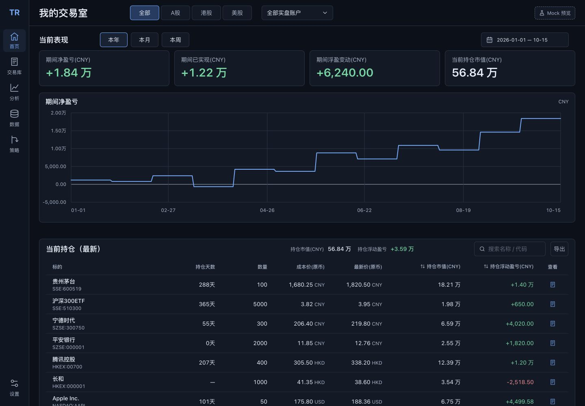

# 首页 Mock 版本开发

2026-11-14（Asia/Shanghai）。用户确认“当前的内容ok，先推送一版远端分支，记录为首页的mock版本开发”，据此保存当前可预览的前端阶段版本。

- 版本分支：[`codex/homepage-mock-20261114`](https://github.com/philip85517/TradeReviewer/tree/codex/homepage-mock-20261114)。本次仅保存远端开发分支。
- 开发基线：`6ddbeca09b9eaf1b6d88488e6e154839217cb74b`；分支同时包含前序展示合同、Mock数据源和首页旅程的三个提交。
- 20个产品文件指纹：`18ca3bd95ea15f45d4d9f21fea7e2ba5dc8aacc67307769e093b0c9343a33e39`，见[源码清单](evidence/visual-alignment/source-manifest.json)。清单中的原开发分支、基线和未提交状态记录的是视觉验收时的事实；本版本使用相同产品内容封版。

## 本版本包含

首页四卡、表现曲线、市场/账户/期间切换、持仓搜索/排序/分页、详情和模拟交易集合往返；提供固定2026-10-15的Mock场景及慢读、失败控制。前端展示合同独立于旧后端。

恢复正式导航图形和页面滚动，调整日期浮层、账户箭头、市场选中态、持仓工具栏及查看图标；单价明确原币。市场切换请求立即开始，结果立即提交，只有持续250ms的读取才显示“更新中”，固定反馈区域避免推动主要模块。慢读、取消与失败保留旧范围和数据，拒绝迟到响应覆盖。

## 验证与边界

| 项目 | 结果与证据 |
| --- | --- |
| 封版前首页测试 | 3文件、34/34通过，退出0；[日志](evidence/homepage-tests.log) |
| 封版前类型检查 / ESLint | 均退出0；[类型日志](evidence/typecheck.log)、[ESLint日志](evidence/eslint.log) |
| 同一产品指纹的生产构建及原生检查 | 构建及5/5通过；[日志](project-test-visual-alignment-final.log) |
| 本轮D01–D06视觉差异与250ms防闪 | 主代理真实浏览器复验；非实施者直接对照设计和最终截图，独立PASS，VA-R01表头换行已关闭；[验收](VISUAL-ALIGNMENT-ACCEPTANCE.md)、[独立报告](VISUAL-ALIGNMENT-REVIEW.md) |
| 全量测试历史 | 3100通过、4项超时、6跳过；串行复测2通过，部署staging和Tiger US daily两项仍超时；[首次日志](unit-visual-alignment.log)、[复测日志](unit-timeout-recheck.log)。本版本不称全仓测试通过 |

[封版命令回执](evidence/snapshot-verification.json)记录实际命令、退出码和产品指纹。归档日志仅清理行末空白和末尾空行，原始本地日志保留。

这是用户确认可保存的前端Mock阶段版本，整个Mock阶段的完整验收仍未完成。CSV浏览器文件下载、完整IME/图点/读数/键盘/动效/触控证据仍待补；真实财务、后端模型、业务持久化和1秒性能目标尚未验收。没有业务数据迁移或写入；本记录不将Mock表现当成真实后端性能结论。

旧35张图继续绑定a443138c…，表头修正后的最终6张图另绑18ca3bd9…；首次FAIL及历史指纹保留在[证据目录](evidence/visual-alignment)。截图是Mock样例，数据库副本不进入本版本记录。

## 预览与启动

在仓库根目录执行 `npm ci`（首次安装）及 `npm run dev`，打开 [首页 Mock](http://127.0.0.1:3333/preview/homepage)。运行环境按[固定原生环境](../../../conf/NATIVE-RUNTIME.md)准备；标准入口使用3333端口，并按[项目配置](../../../conf/README.md)从已配置业务库制作WAL一致性隔离备份，重启重置测试更改。Mock页面本身不访问业务存储。

