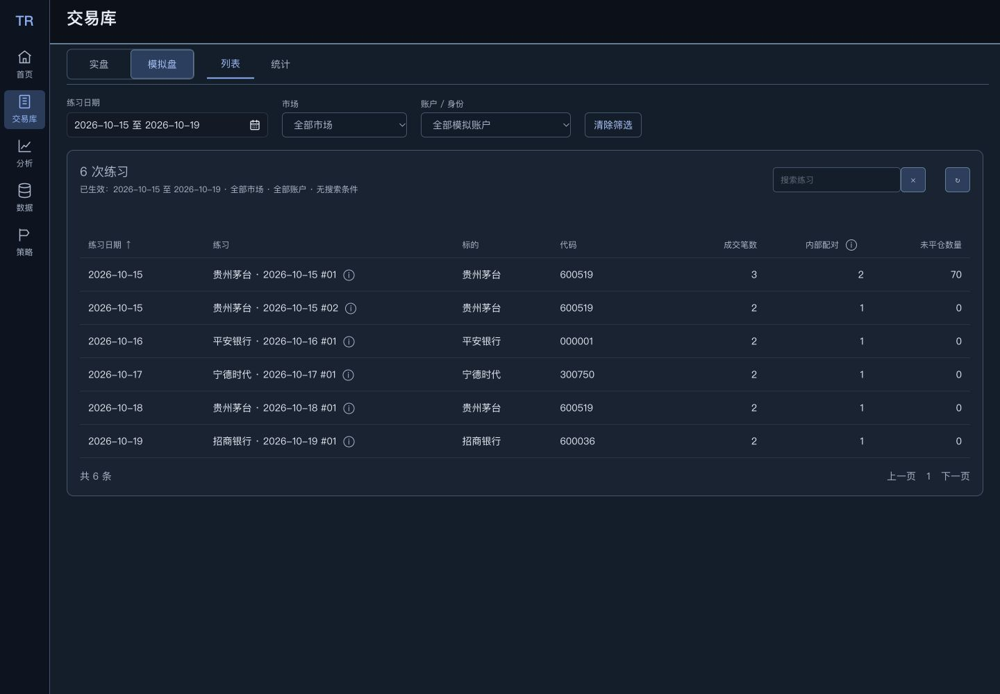
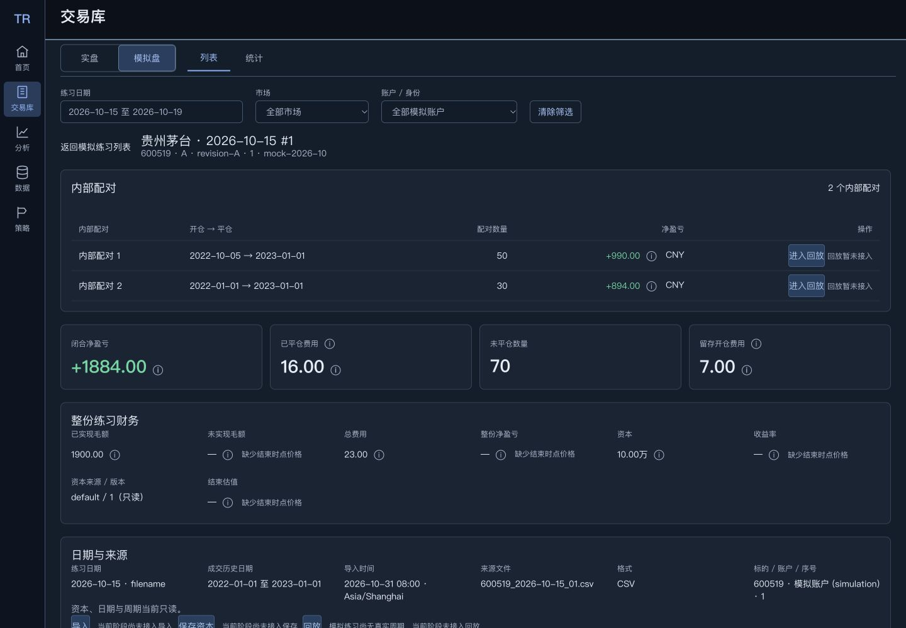

# 前端实现进展与接受边界

2026-11-14 归档。实现模型为用户选择的 `gpt-6.1-terra`；协调者 root 未实施这些产品组件，负责独立代码、真实浏览器与视觉接受。以下为已有验收的记录，本次文档工作没有重新运行 UI 或产品测试。

## 实现与代码范围

产品版本 `1770178694f5815b699c23deef894888dac1abea`，相对基线 `3d444316589e2feefd9b2b3d03d362737e8a6d27` 只新增三个目录中的 33 个文件：

- [开发预览入口](../../../app/library-preview/page.tsx)：`/library-preview`，生产模式返回 404。
- [页面和控件](../../../app/components/library-preview/)：列表、详情、日期、信息浮层和各状态。
- [契约、Mock 与状态](../../../app/lib/library-preview/)：四类读取端口、固定样本、取消／身份／导航及返回恢复。

旧首页、runtime 和 native 配置不在这批产品差异中。代码按展示结构与纯规则选择性取用，重写装配和状态边界；没有整文件或整分支 cherry-pick，也没有带入旧数据库／bootstrap／统计读取链。逐项取舍见 [代码选取账](SOURCE-EXTRACTION.md)。

|已实现行为|范围与关键保护|
|---|---|
|模拟列表|日期、市场、账户、搜索、稳定排序和每页 6 行；13 对象样本为 6／6／1；汇总属于完整入选范围|
|单练习详情|完整练习／修订／版本身份，三个时间、来源、财务拆分、资本与结束估值的已知／未知事实；直达与返回保留上下文|
|内部配对分页|单对象每页 6 条、稳定身份；加载／错误／同目标重试；旧响应不得覆盖新目标|
|异常与未知值|加载、空集合、失败、版本失效、不存在、长文本、大金额、unknown 与已知 0 分开|
|未接入动作|统计、实盘、保存、导入、回放等展示阶段原因；可见入口不代表功能已完成|

四个实际读取端口在 [contracts.ts](../../../app/lib/library-preview/contracts.ts)，具体请求与字段见 [台账](REQUEST-LEDGER.md) 和 [数据契约](DATA-CONTRACT.md)。Mock 的 options→page 串行调用只是实验策略，尚未决定真实网络传输方式。

## 历史验收结果

|检查|原执行结果|证据与限制|
|---|---|---|
|定向自动化、类型与构建|PASS|[最终自动化结果](evidence/frontend/automated-final-results.json)：13 文件／102 测试，另有消费者计数 1 测试；typecheck、build、diff。不是全仓测试；原日志同目录保存|
|生产入口隔离|PASS|[历史响应头](evidence/frontend/production-guard-17701786-headers.txt.gz)为 404|
|桌面旅程、状态安全与视觉|限定 PASS|原协调者直接操作、比较参考与真实渲染；[原接受记录](evidence/frontend/FINAL-ACCEPTANCE.md.txt)、[控件结果登记](evidence/frontend/CONTROL-RESULTS.md.txt)按历史版本保存|
|控件／状态登记|172 PASS，4 NOT VERIFIED|总计 176 项：135 控件、10 选项、27 状态、4 补充项；未验证项为原生 OS IME、模拟触控、物理触控、软件键盘。不同输入和历史版本不能合并成最终 100%|
|历史 13 次练习打开／返回、20 个配对入口|历史限定 PASS|最终 [manifest](evidence/frontend/final-manifest.json)保留内容 hash 兼容关系及受影响复验；没有声称这些动作都在最终 HEAD 重跑|
|最终版本的相关复验|限定 PASS|列表／详情／返回、详情只读、日期编辑、配对五态、1440 与默认 1280 页面；[配对几何](evidence/frontend/pair-retry-17701786-geometry-summary.json)|
|网络与数据保护|观测范围内 PASS|[代理摘要](evidence/frontend/network-summary-final.json)记录历史资产／HMR 请求 1,884 条、业务／存储／写请求均 0；不覆盖最终直连、外部源或真实后端。未以此证明性能|
|完整流程合规|FAIL 保留|早期 RED、参考预读和派发落盘顺序有缺口，后来 GREEN 不改变历史顺序；[原执行判断](evidence/frontend/RULINGS.md.txt)|

版本与文件 SHA256、13 个设计参考及历史检查桥接记录保存在 [最终 manifest](evidence/frontend/final-manifest.json)。部分原始动作文件／截图只留在原 scratch，未随本次精选归档收入；归档的原接受记录与控件表中的路径是历史定位符，不能解释为本目录含全部历史附件。

## 视觉依据与已接受差异

当前 [交易库规范](../../design-system/trading-library-design-spec.md)、[业务更新](../../design-system/iterations/2026-11-06-current-visual-progress/BUSINESS-UPDATES.md)，及 [批准模拟列表](../../design-system/baselines/2026-10-26-trading-library-v2.0/source/images/approved-e-sim-list-1440.jpg)、[批准详情](../../design-system/baselines/2026-10-26-trading-library-v2.0/source/images/hcr06-final-rounds-a.svg)是对照来源。

原接受涵盖 1440／1280、列表 761／759／390、详情 900／899／600／599／390 的适用边界。核对了 72px 侧栏、64px 顶栏、58px 二级栏、36px 字段、48px 表格行、280px 浮层、104px 指标卡及详情 4／2／1 列。完整身份、三种时间、费用／估值解释与阶段原因可自然增加页面高度。默认 A 的整份净额 unknown，闭合净额 1884 不能冒充整份净额；只有显式结束价场景可得 4677。

保留两张最终版本的真实渲染：

这些是 Mock 画面，不能证明真实财务 provider、来源认证或后端性能。截图查看记录属于原验收，本次没有进行新一轮视觉检查。

## 剩余项

- M3：压缩 JSX／辅助函数可读性；M4：额外部分身份组合和 fuzz 深度，均为原审查保留的 Minor，未修复。见 [全分支审查](evidence/frontend/final-branch-review.md.txt)与[修复复审](evidence/frontend/final-fix-review.md.txt)。
- 真实后端、实际持久化、结束估值／FX、全市场／部分配对、统计页、实盘、回放／真实图表尚未接受。
- 原生输入与设备证据未补齐；F1 的桌面限定接受不能扩展到这些设备。

预览路径为开发模式的 `/library-preview`。原运行地址 `http://127.0.0.1:3437/library-preview` 只记录历史检查位置；本次未检查服务存活，不把它作为新交付预览。需要再次验收时，按当前 [启动与隔离规则](../../agents/development-workflow.md)使用显式隔离数据库，重新记录运行版本与证据。
